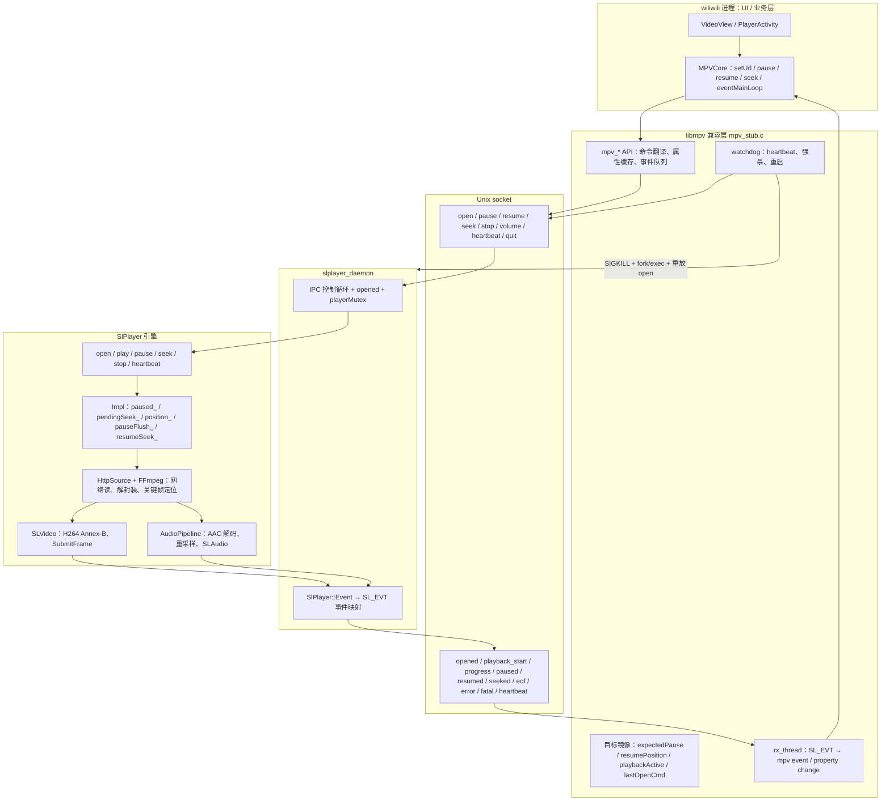

# 开发进度日志

> 每个阶段结束追加一条，带真机证据。更早的完整叙述见 [归档文档](archive/规划-完整历史-2026-11-16.md)。

## 阶段 0：环境与设备（2026-11-16）

- SDK 交叉编译环境（WSL2 Ubuntu 26.04 + `~/steamlink-sdk`，GCC 9.2.0）就绪
- 真机：root SSH、固件 build 930、263MB 可见内存
- Moonlight 官方 6.2.0 可用；V+ 全部跑不起来，已结案

## 阶段 1：SLVideo / GL / SLAudio

- 1.3 SLVideo 出画面：640x360 Annex-B，180 帧成功
- 1.4a GL 叠层：SDL2 + 原生 EGL（alpha=8），半透明层正常叠在视频上
- 1.4b SLAudio 出声：440Hz 正弦波，RSS 9.8MB / CPU 5.2%

## 阶段 2：播放管线

- 2.1 最小 FFmpeg 7.1.1 静态库（约 1.7MB），MP4/FLV 解封装通过
- 2.2 本地 MP4 → SLVideo/SLAudio：10 秒画面声音正常，RSS 7.9MB / CPU 1.5%
- 2.3a B 站 API：`playurl` 不需要 WBI/登录；设备下载约 950KB/s
- 2.3b libcurl 边下边播：真实 360p 30 秒正常；RSS 28MB / CPU 11.8%
- 2.3c 设备端 API：`popular → view → playurl` 全在设备完成；cid 必须 64 位
- 2.3d 缓冲窗口：8MB 分块（pinned moov + 反压），RSS 28.4 → 18.2MB；音频首帧后 3000ms 启动，`sync_long` 白屏/蜂鸣基本同时
- 2.3e 播放控制：手柄 A 暂停、左右 ±10s、B 退出；SLVideo overlay 进度条可见；seek 后 300ms 音频补偿

## 阶段 2.3f：线程化 + 自动音画同步

- 480p 诊断：`BeginFrame` 重试 0，不是解码背压；单线程主循环 30fps 预算不够
- 音频解码/重采样/SLAudio 移到独立线程；主线程只入有界包队列
- 固定延迟不可靠：视频上屏耗时每次 1.5～2.7s 浮动
- 自动同步：`GetQueuedVideoMS` 停止创新高 → 已呈现内容 `P` → 音频预缓冲跳过 `P` 后启动
- 480p 本地合流：904 帧完整播完，CPU 13.6%，RSS 10.1MB；用户确认基本同步
- 360p 网络流：742 帧，CPU 16.2%，RSS 19.4MB

## 阶段 2.4：480p DASH 双流

- `fnval=16`，视频取第一个 avc1，音频取最大 bandwidth；失败回退 MP4
- 两路独立 `MediaSource`，音频线程自解封装
- 修复预缓冲丢帧造成的内容缺口（改为等待）
- 真机 `--popular 30`：640x480@25 + AAC 48kHz，737 帧；A/V 偏差 ±223ms 无漂移；RSS 27.6MB / CPU 16.2%
- 用户确认同步正常

## 阶段 3.1：borealis + wiliwili API

- 新工程 `app/`：borealis + nanovg + yoga + fmt + cpr + pystring + wiliwili API 子集
- 自编静态 libcurl 7.79.1（cpr 要求 ≥7.68）
- 真机：热门列表 20 条正常渲染（截图 + 用户确认）
- 关键：WBI 取 key 是同步请求，API 必须在主循环后的独立线程调用

## 阶段 3.1c：热门列表 + 详情页

- 热门行可聚焦、A 进详情、B 返回；详情显示标题/UP/播放数/简介
- 修复：`pushActivity` 会用 `createContentView()` 覆盖内容（否则崩溃）；Label 默认可聚焦（需显式关闭）；B 键不自动返回
- 截图确认详情页正常；用户确认上下/A/B 正常
- 提交：`592d2bc`

## 阶段 3.2：整仓移植 wiliwili UI

- 方向纠正：停止手写样式，改为整仓编译 wiliwili（去掉 mpv 本体）
- 除 MemoryModule（仅 Windows DLL 用）外，子模块全部初始化
- MPV 头文件取自 mpv v0.37.0（`client.h` / `render.h` / `render_gl.h`），桩库在 `tools/mpv-stub/mpv_stub.c`
- 构建：`sh tools/build-wiliwili.sh` → `~/build-wiliwili/wiliwili`，22MB，strip 后 8.2MB
- 链接修复：SDK 的 libssl/libcrypto 无 SONAME，绝对路径会写进 DT_NEEDED；`tools/cmake/FindOpenSSL.cmake` 改为 `-lssl -lcrypto`
- 崩溃修复：桩库 `mpv_get_property_string` 返回 NULL，wiliwili 用 fmt 打印时抛 `string pointer is null` → 改为返回 `strdup("mpv-stub")`
- 真机：原生 HomeActivity 正常渲染（推荐/热门/追番/影视标签、侧栏、真实封面与 UP 主信息），截图确认
- 真机：视频播放页可进入（标题/UP 主/点赞投币/评论栏/底部控件正常，视频区域为黑屏+加载动画）
- 修复进播放页 SIGSEGV：borealis 的 glad 不加载 GLES2 的 FBO 函数；构建改 `MPV_NO_FB`，桩库用 `SDL_GL_GetProcAddress` 补 `glad_glBindFramebuffer`
- 现状：wiliwili RSS 约 34MB、CPU 约 64%（首页持续渲染）；PE_Single_CPU 仍在后台占约 21%
- 透明层 spike（2026-11-16）：borealis `SDL_GL_ALPHA_SIZE=8` + `SL_TRANSPARENT` 透明 clear；`slvideo_test` 播 450 帧彩条，采集卡截图确认视频从 UI 后面透出，卡片/文字/侧栏正常叠加
- 补充验证：60 秒测试图循环 + `SL_SPIKE_NO_IMAGES=1` 跳过卡片预览图，整个卡片区域透明、视频大面积透出；**用户真机确认通过**
- 视频层分辨率 1920x1080，UI 1280x720 由 EGL 自动缩放；SLVideo 进程 RSS 6.4MB / CPU 1.4%

## 阶段 3.4b：VPU 鲁棒性架构第 1 步（2026-11-17）

- 架构拍板：进程隔离 + Dirty Flag + mpv 层 watchdog，详见 [06-VPU鲁棒性架构.md](06-VPU鲁棒性架构.md)
- 第 1 步完成（VPU 生命周期干净化 + Dirty Flag），只改 `player/src/SlPlayer.cpp`：
  - Dirty Flag `/tmp/slplayer_vpu.lock`：起调前写、`shutdown()` 末尾（FreeContext 之后）删；残留则启动前先做 Context 建/释清洗
  - 起调失败复位重试：`CreateContext`/`CreateStream` 失败做有限次 FreeContext → 延时 → CreateContext（SDK 无全局 Deinit，这是最接近复位的动作）
  - 重建 stream 去脏：seek/pause 的 FreeStream → CreateStream 之间加 50ms 间隔，封装为 `rebuildStream()` 并带复位重试
  - 异常安全：`emit()` 回调 try/catch + `ShutdownGuard` RAII + 线程入口 try/catch 三重保护
- 真机验证（设备在线，本地 `dash_480p_30s.mp4`）：
  - 画面：采集卡截图 `.screenshots/vpu_step1_visual.png` 确认视频正常上屏（非黑屏）——曾因只凭日志下结论被用户纠正，已补截图证据
  - 基线：播放中标记存在、退出后清除（93 帧）
  - 异常自愈闭环：SIGKILL 后标记残留 → 重启触发"启动前清洗"→ 正常播放并清标记
  - pause/seek：暂停/恢复/seek 到关键帧 5.00s，117 帧 0 丢帧，退出清标记
  - 交叉编译通过，无新增 warning
- 复核发现 6 处"预想 vs 真实代码"差异（如 CreateContext 失败无 context 可 free、emit 回调抛异常可绕过 shutdown），已回填 06 文档第三节
- 真机观察：`MV_PE_Remove` 返回 `0x800001ab`（退出时），本次未造成卡死，留作 VPU 污染排查线索

## 阶段 3.4c：VPU 鲁棒性架构第 2 步（2026-11-17）

- 第 2 步完成（暴露检测能力），改 `SlPlayer.h/.cpp` + `test_main.cpp`：
  - 新增 `FatalType`（VpuInitFailed/VpuRebuildFailed/FrameSubmitStalled/UnsupportedStream）+ `FatalCallback` + `setFatalCallback()`，5 处 VPU 致命点主动上报，上层决策不 `_exit()`；普通错误仍走 `EventType::Error`
  - 新增无锁 `Heartbeat`（`lastFrameTimeMs` 单调时间戳 + stage/playing/inTransition/videoFrames），只读 atomic、不取锁、不碰 `stats()`；时间戳在 `SubmitFrame` 成功后更新
  - `slplayer_test` 加 `[hb]`（含 frameAge + watchdog 阈值提示）与 `[fatal]` 打印验证路径
- 真机验证：
  - `frameAge` 播放中 14～41ms；暂停期涨到 2046ms 但 `inTransition=1`（正确挂起）；恢复后回落 38～88ms
  - 采集卡截图 `.screenshots/vpu_step2_visual.png` 确认画面正常（非黑屏）
  - 交叉编译通过无 warning；强杀后 Dirty Flag 残留（预期）、正常退出清除
- 真机发现并修复：`inTransition` 原用 pauseFlush/pauseFlushed 组合，暂停静默期会失效（frameAge 涨但 transition=0）→ 把 `paused_` 纳入判定
- 真机发现：resume 后首帧到达前有 `frameAge=3060ms transition=0` 窗口 → watchdog 设计需"恢复后首帧宽限期"（建议 2s）
- 复核差异追加 06 第三节（2 条）

## 补充验证：强杀后最后一帧残留（2026-11-17）

- 用户发现并提问：强杀播放进程后画面卡在最后一帧（监控画面"1999-03-01 / 快加药"）。采集卡截图 `.screenshots/after_kill_check.png` 确认属实——SLVideo 无隐藏 stream 接口，进程退出后最后一帧留在视频层。
- 真机测试残帧覆盖：无脏标记状态下启动新播放，新画面（动画"23:59:37 / 琥珀"）立即完整覆盖残帧，无叠加无卡死（`.screenshots/residual_covered.png`）。
- 结论：残帧会被新 stream 首帧正常覆盖，不构成卡死；封面占位的必要性是"非播放页不透明 UI 挡住残帧、避免透出"（已更新 05 文档第五节）。
- 提交纪律写入 [07 开发纪律](07-开发纪律.md)（先回归测试后提交、按主题拆解、`.workbuddy/` 不入库）；当时的拆解范例见本文历史资料归档。

## 阶段 3.5a：进程隔离骨架 + libmpv 兼容层基础（2026-11-17）

### 方案调整（用户拍板）

纪律一复核真实代码后发现"直连轻量"前提不成立：wiliwili 链接库里根本没有 SLVideo/SLAudio/FFmpeg，桩库仅 4KB 纯 C 空函数；直连须把 FFmpeg 4 个静态库 + SLVideo + SLAudio 塞进 wiliwili，且单进程内 wiliwili GL 层与 SLVideo 硬件层共存**从未验证**。而阶段 3.3 的双进程透明叠层 spike 已真机通过。故**进程隔离从"最后做"提前到 3.5a**，兼容层从第一版就是 IPC 客户端，SlPlayer 跑独立子进程。

### 实现

- 新增 `player/include/IpcProtocol.h`：IPC 线上格式常量（Unix socket、4 字节长度 + TAB 分隔文本 payload、命令/事件集）
- 新增 `player/daemon/slplayer_daemon.cpp`：播放子进程，SlPlayer + IPC server；`open/pause/resume/seek/stop/quit/volume/heartbeat` 命令，事件回调转 IPC 上报；`SIGTERM` 置 quit 走干净 shutdown（PDEATHSIG 兜底）
- 重写 `tools/mpv-stub/mpv_stub.c`（164 行空桩 → 兼容层）：
  - `mpv_create/initialize/terminate_destroy`：fork/exec daemon（子进程设 `PR_SET_PDEATHSIG`）+ connect（50×100ms 重试）+ 回收
  - `mpv_command_async`：解析 `loadfile`（含 extra 串的 referrer/start/end/audio-file）、`set pause/volume`、`seek`、`stop/playlist-clear`、`quit`
  - `mpv_wait_event`：事件队列，严格模拟 mpv 时序（START_FILE → FILE_LOADED → PLAYBACK_RESTART）；事件在下次 wait_event 时失效（对齐 mpv 语义，避免 wiliwili 不释放导致泄漏）
  - 属性缓存 + `mpv_observe_property` 观察表：`PROPERTY_CHANGE` 带观察时注册的 reply_userdata（duration=INT64、playback-time/percent-pos=DOUBLE、pause/eof-reached/seeking=FLAG 等）
  - `mpv_render_context_*` 保持 no-op（视频走 SLVideo 硬件层）
- 新增调试/验证工具：`ipc_probe`（IPC 链路探针）、`compat_test`（链 libmpv.a 模拟 wiliwili 调用序列）
- 构建改动：`tools/build-wiliwili.sh` 编译兼容层（`-D_DEFAULT_SOURCE -pthread`）并复制协议头；`player/CMakeLists.txt` 新增 daemon 与两个测试 target

### 真机验证（2026-11-17）

- **IPC 控制面/事件面**（`ipc_probe`）：daemon 收到 open → SLVideo stream 就绪 → 事件 `opened(30.12s, 640x480)` / `playback_start` / 连续 `progress` 全部正常
- **兼容层全链路**（`compat_test`）：`forked daemon pid=...` → `connected to daemon` → `loadfile` → daemon 侧 open → `视频已上屏`；事件时序 `START_FILE → FILE_LOADED → PROPERTY_CHANGE(duration=30) → PLAYBACK_RESTART → PROPERTY_CHANGE(playback-time/percent-pos) → TICK`，与 mpv 语义一致；属性值正确
- **画面（采集卡截图确认）**：`.screenshots/3.5a_compat_visual.png` 显示视频画面（"琥珀"动画、时间戳 23:59:37、"异镜科技"字幕），**非黑屏**
- **seek/回收**：seek 到 5s 后 `playback-time=5.00`；`mpv_terminate_destroy` → daemon 优雅退出 → **Dirty Flag 正常清除**、进程全清
- wiliwili 整仓构建通过，链接无冲突（两套 curl 分属不同进程）

### 真机发现并修复的 bug

`daemon` 的 `recvPayload` 把 200ms `SO_RCVTIMEO` 超时误判为"连接断开"（只把 EINTR 当 continue，EAGAIN 直接 return false）→ daemon 在 open 后 200ms 无命令就退出。改成三态返回（1=完整帧 / 0=超时 / -1=真断开）后事件面全部正常。已回填 06 文档第三节复核表。

### 已知未完成

- **wiliwili UI 进播放页的实际验证**：`MPVCore::init()` 在构造函数里、`MPVCore::instance()` 只在播放页（VideoView）首次访问，故需人工操作 UI 进播放页才能触发完整链路。当前兼容层已用 `compat_test` 独立验证（模拟完全相同的调用序列），UI 侧待人工操作确认。

## 阶段 3.5a 补充：Steam Link 主菜单启动入口（2026-11-17）

用户要求"在主菜单加个启动入口，和 moonlight 一样"。

### 机制（从真实设备逆向确认，非猜测）

- `shell`（Qt/QML 主菜单）扫描 **`/home/apps/<dir>/toc.txt`**：shell 二进制里有 `/home/apps`、`/toc.txt` 和 `Missing name/icon/run entry in toc.txt` 字符串
- `toc.txt` 三行格式：`name=Moonlight` / `icon=moonlight.png` / `run=moonlight.sh`
- 点击流程：shell 写 `/tmp/launch_cmdline.txt` 并退出 → `/home/steam/shell.sh` 的 `while true` 循环 `eval` 执行该命令
- 主菜单进程链：`rc.local` 启动 `powermanager.sh` → `powermanager` → `shell.sh` → `shell`

### 实现

- 新增 `tools/steamlink-app/`：`install.sh`（一键安装/更新）、`bilibili.sh`（启动脚本）、`toc.txt`、`bilibili.png`（wiliwili 官方 256×256 图标）
- 安装到 **`/home/apps/bilibili/`**（机身 flash，`/` 分区可用 660MB，占用约 39MB）：`toc.txt` + `bilibili.png` + `bilibili.sh` + `bin/{wiliwili,slplayer_daemon}` + `resources/`
- **HOME 持久化**到 `/usr/local/bilibili`（默认 `/tmp` 重启清空会丢 B 站登录态）
- 启动脚本设 `SL_DAEMON_PATH`、`SL_TRANSPARENT=1`，照 moonlight 做法 `renice -10` 音视频服务与自身
- 纯增量安装：不改 `shell.sh` / `rc.local` / moonlight，卸载只需 `rm -rf /home/apps/bilibili /usr/local/bilibili`

### 真机验证（全闭环）

1. 主菜单截图：**Bilibili 图标（粉红 WiliWili logo）与 Moonlight 并排显示** ✓
2. 模拟点击（写 launch_cmdline + `killall shell`）→ wiliwili 启动，截图确认 **B 站首页完整渲染**（推荐 tab、视频卡片、封面缩略图、播放量、UP 主、底部按键提示）✓
3. 退出 wiliwili → **自动回到主菜单**，`launch_cmdline.txt` 被消费 ✓

### 真机踩坑（含一次判断纠正）

**① 透明层开关不能全局打开（用户发现并纠正）**

我在启动脚本里固定 `export SL_TRANSPARENT=1`，导致首页背景变纯黑——这是阶段 3.3 验证"透明层能否透出视频"时留下的 spike 开关（`borealis-steamlink-alpha.patch` 里 `if (getenv("SL_TRANSPARENT")) color.a = 0;`），设置后整个 UI 图层全透明，首页没有视频层可透就露出黑底。另有 `SL_SPIKE_NO_IMAGES`（跳过图片绘制）也是同期调试开关。

修复：启动脚本不设该变量，首页/详情页恢复不透明；透明只在播放页需要，按 [05 文档第五节](05-播放器替换设计.md) 由运行时切换实现（属 3.5d）。

**② `exec` 判断纠正（用户指出 moonlight 用 exec 也能回主菜单）**

我一度认为"启动脚本不能用 `exec`，否则会顶掉 `shell.sh` 的 while 循环、退出后回不到主菜单"，并据此改成普通调用。**这个判断是错的**：

- `eval $cmd` 执行的是 `shell.sh` fork 出的**子进程**，`exec` 替换的是该子进程，`shell.sh` 的 while 循环不受影响
- 真机确认：`exec` 启动后 `shell.sh`（PID 4063）与 `wiliwili`（PID 360）同时存在，wiliwili 退出后循环继续、主菜单自动回来
- moonlight 的 `exec` 是正确且省开销的做法（少一个常驻 sh 进程）

已改回 `exec`。补充发现：`shell.sh` 由 `powermanager` 在开机时拉起（powermanager 二进制内含 `/home/steam/shell.sh &`），但 powermanager **不在运行期**检测重启——手工 `kill -9` 掉 shell.sh 本身需手动恢复。

## 阶段 3.5a 真机联调：播放页跑通（2026-11-17 下午）

### 现象与根因

真机点进播放页后视频不开始播放、进度停在 0。日志里出现 `[mpv-compat] 透明关闭` 紧跟在 SPS 之后，说明兼容层在 loadfile 之后又被喂了一条"停播"命令。

加命令审计日志（`[mpv-compat] cmd: ...`）后抓到 wiliwili 的真实命令序列：

```
loadfile <主源> replace <extra>
loadfile <备用源1> append
loadfile <备用源2> append
→ FILE_LOADED 事件后：
playlist-clear
set pause no
```

两个语义错误：

1. **`playlist-clear` 被当成 `stop`**。mpv 的语义是"清空播放列表但保留当前播放项"（wiliwili 用它丢弃备用链接，`mpv_core.cpp:933`），我们却下发 `SL_CMD_STOP` → 视频刚加载完就被停掉，随后的 `resume` 发给一个已停的播放器。**这是"进播放页不播放"的直接原因**。
2. **`append` 被当成正常播放请求**。wiliwili 的 `setBackupUrl()`（`mpv_core.cpp:1184`）给每个视频追加 2 个备用 CDN；老实现每个 append 都触发一次完整 `open`，导致一个视频连出 3 次 open、进度反复打回 0。

### 修复

- `playlist-clear`：只清备用源队列，不下发 stop（日志 `playlist-clear：丢弃 N 个备用源，当前播放继续`）
- `append`：只入备用源队列（≤8 条），不触发播放；主源报错时依次切换，全失败才向 UI 报 `END_FILE(ERROR)`
- 兼容层加命令审计日志 `[mpv-compat] cmd: ...`（定位这类问题的关键手段）
- 发送串行化：新增 `txMutex`，命令（UI 线程）与备用源切换（接收线程）共享同一 socket 时不会帧交错

### 播放页透明改为运行时开关

`borealis-steamlink-alpha.patch` 在 `SDLVideoContext::clear()` 里**逐帧** `getenv("SL_TRANSPARENT")`，因此同进程内 `setenv/unsetenv` 立即生效，**不需要改 borealis 代码**：

- `loadfile`(主源) → `setenv("SL_TRANSPARENT","1",1)`：播放页 UI clear 全透明，透出 SLVideo 视频平面
- `stop` / `EOF` / 播放错误 / `terminate_destroy` → `unsetenv`：恢复不透明 UI
- 启动脚本不再设该变量（否则全程透明，首页露出空视频平面变黑底）

### 验收（用户真机确认"可以放了"）

- 日志证据：`播放页透明开启` → `loadfile` → `备用源入队(1)(2)` → `playlist-clear：丢弃 2 个备用源，当前播放继续` → `set pause no` → `音频就绪` → `进入播放循环` → `视频已上屏`
- 隔离回归（`compat_test` 复刻 wiliwili 的 FILE_LOADED 处理）：`playback-time` 连续推进 0.17 → 0.94 → 3.06 → 5.14 → 10.94 s，不再被重置
- 用户确认：视频出画面、**弹幕正常显示**

### 弹幕为什么能直接用

wiliwili 自带弹幕引擎（`wiliwili/source/view/danmaku_core.cpp`，37KB，`DanmakuItem::draw(NVGcontext*)` 走 nanovg 自绘 + `live_danmaku_item.cpp`），**完全不依赖 mpv**。整仓移植时只替换了 MPV 层，弹幕/UI/网络/API 全是原样代码，所以无需额外适配即可工作。

### 本轮暴露的新缺陷（已登记到 00 文档 D1～D4）

1. D1 暂停后音画不同步
2. D2 多次播放退出后某些视频音频变白噪音（疑与 D1 同源）
3. D3 播放页控制条与标题栏出现白色半透明渐变背景（透明 clear 下的 UI 叠加异常）
4. D4 播放中偶发崩溃退出：现场日志在 `VideoView set fullscreen state` 处截断、daemon 侧 `IPC 接收断开`、`dmesg` 连续 `memory_engine_lookup_shm_node Error alignaddr`

## D4/D5 定位：不是崩溃，是 OOM 杀了播放子进程（2026-11-17 15:39）

用户报告两个新现象：⑤ 点暂停后按钮状态不变、有时无法恢复播放；⑥ 详情页会自动播放（原生预期），小窗能透出视频但没缩放。

### ⑤ 的根因（已确证）

日志顺序非常干净：

```
[mpv-compat] cmd: set video-margin-ratio-* 0     ← 进全屏
[mpv-compat] cmd: set pause yes                  ← 用户点暂停
[mpv-compat] IPC 接收断开                        ← daemon 在同一时刻死掉
[mpv-compat] cmd: set pause no                   ← 之后所有命令都写进废 socket
```

内核证据：

```
dmesg: Killed process 2383 (slplayer_daemon) total-vm:365156kB, anon-rss:24004kB, file-rss:1968kB
ps:    2383 root  [slplayer_daemon]      ← 僵尸（父进程没 wait）
/tmp/slplayer_vpu.lock  33 字节          ← 非正常退出，Dirty Flag 机制正常生效
```

内存现状：总量 269MB / 已用 196MB / 空闲 73MB / 缓存 121MB；`wiliwili` RSS ≈ 50MB，daemon 被杀时 RSS ≈ 24MB。

**结论**：daemon 被 OOM killer 杀掉 → 没有 `SL_EVT_PAUSED` 上报 → `pause` 属性不发 `PROPERTY_CHANGE`（wiliwili 观察 id=12）→ 按钮状态不变；后续 `set pause no` 写入已关闭 socket → 无法恢复。**D5 是 D4 的下游表现**，不是暂停逻辑本身的问题（3.4b 阶段 `slplayer_test` 的 pause/seek 测试是 0 丢帧通过的）。

### ⑥ 的性质

- 自动播放：wiliwili 原生 `AUTO_PLAY`，移植前就有，预期行为
- 小窗不缩放：SLVideo 只能全屏输出；wiliwili 下发的 `set video-margin-ratio-*`（日志可见 0.367/0.359 等）我们目前忽略，小窗区域因 render no-op 而透明，露出的是全尺寸视频的局部
- 处理方案沿用 05 文档既定结论：强制 `PLAYER_AUTO_FULLSCREEN`，非全屏走封面占位 + 暂停（属 3.5d）

### 由此确认的优先级

`3.5c`（子进程死亡检测 + 重启）从"锦上添花"变成**必须做**：daemon 被 OOM 杀死是这台设备的常态风险，没有 watchdog 就只能整页退出。

## D7：弹幕只有固定类型，没有横向滚动（2026-11-17 用户报告）

### 弹幕位移机制（读 `danmaku_core.cpp` 确认）

```cpp
if (!MPVCore::instance().isPlaying()) {
    position    = i.speed * (playbackTime - i.time);          // 暂停分支：靠 playback_time
    i.startTime = currentTime - (playbackTime - i.time) / videoSpeed * 1e6;
} else {
    position    = i.speed * (currentTime - i.startTime) * videoSpeed / 1e6;  // 播放分支：靠墙钟
}
```

- `isPlaying()` 直接返回 `video_playing`，而 `video_playing` 的唯一来源是 **`core-idle` 属性**（`mpv_core.cpp:981-989`，`playing = (*data == 0)`）
- `playbackTime` 来自 `playback-time` 属性的 PROPERTY_CHANGE（userdata 4）
- 固定弹幕（type 4 顶 / 5 底）本来就是不动的，只看时间窗口 `i.time ~ i.time+4s`

### 嫌疑点（待真机确认）

1. **`core-idle` 只在 `PLAYBACK_START` 发一次 0**，之后再不更新。若这一条事件没在 UI 侧生效（或 UI 开始绘制弹幕的时间早于它），`video_playing` 会一直是初始值 `false` → 所有滚动弹幕都走"暂停分支"，位置只随 `playback_time` 的 250ms 台阶变化，视觉上接近停滞。
2. daemon 的 progress `position` 存在回退（真机日志 `0.320 → 0.080 → 0.020`）。在暂停分支里 `position` 直接由它算，回退会让弹幕忽前忽后。
3. `i.speed = (width + i.length) / SECOND`（`SECOND = 0.12 * DANMAKU_STYLE_SPEED`，默认 12s 穿过一屏），依赖绘制区宽度——如果 `video_aspect` 缺失导致 `maskWidth/maskHeight` 异常，速度也会异常（目前未验证）。

### 验证方案

- 真机播放中隔 3 秒截两张图：对比进度时间（确认 `playback_time` 在走）+ 弹幕 x 位置（确认是否真静止）
- 兼容层补发 `core-idle`：`PLAYBACK_START` → 0，暂停/EOF/错误 → 1；观察弹幕是否恢复滚动

## 真机性能采样 + 播完态截图（2026-11-17 15:45）

用户播放中要求采样性能与截图。设备：wiliwili(632) + slplayer_daemon(780)。

### CPU / 内存（`top -b -n 1` + `/proc/PID/status`）

| 项目 | 数值 |
|---|---|
| 整机 CPU | **86.6% usr + 13.3% sys，idle 0%**（单核已饱和） |
| Load average | 3.15 / 2.59 / 2.47 |
| `wiliwili` | **58.8% CPU**，RSS 43MB，VSZ 430MB，12 线程 |
| `PE_Single_CPU`（音视频服务） | 23.5% CPU |
| `slplayer_daemon` | 11.7% CPU，RSS 19MB，VSZ 346MB，8 线程 |
| 内存 | 用 202MB / 总 269MB，free 66MB，cached 109MB |

结论：瓶颈在 **UI 渲染**（58.8%），播放子进程只占 11.7%。这台机器 CPU 没有余量，弹幕/进度条更新滞后大概率是掉帧而不是逻辑错。

### 本轮日志要点

- `检测到 VPU 脏标记，先执行启动前清洗` → `启动前清洗完成`：**上次 OOM 杀掉 daemon 留下的标记被正确处理**，3.4b 的防御机制在真实故障上验证有效
- 该片源 `SPS: refs=7 reorder=4 buffering=7`（高参考帧，按设计不改写）
- `视频已上屏: 内容 2733 ms, 队列 2358 ms, 音频跳过 375 ms`
- 音频 48kHz，`预缓冲 8.81 s, 跳过 0.38 s`（预缓冲偏大，与 D1/D2 同区域）
- 全屏切换后出现 `透明关闭（UI 恢复不透明）`

### 截图三连（同一次播放）

| 文件 | 时刻 | 内容 |
|---|---|---|
| `perf_A.png` | 播放中（全屏） | 视频正常上屏（无限暖暖 3.0 预告），弹幕"急急急"在画面上方 |
| `perf_B.png` | 播完后 | 视频区变**纯灰 #EFEFEF**，UI 控件出现，进度 02:53/02:56，弹幕"我天那我21号过生日啊"仍在 |
| `perf_C.png` | 约 1 分钟后 | 与 B **完全一致**（进度不再变） |

用户确认："第二张图的时候，视频已经播放完了"。所以不是卡死，是 **EOF 后我们关掉了透明层** → UI 的 opaque clear 盖住视频层 → 灰底。mpv 的正常行为是保留最后一帧并显示结束态。已登记为 **D8**。

### D3 视觉确认

`perf_B.png` / `perf_C.png` 顶部标题栏和底部控制条都是**白色半透明渐变**（自上而下由白渐隐），与用户描述的"白色半透明渐进背景"一致。这个渐变在 wiliwili 里本应是深色遮罩，透明 clear 下叠出白色，属渲染层 alpha 处理问题。

## D4 真正根因：/tmp 是 tmpfs，88MB 测试残留把内存吃光（2026-11-17 15:49）

用户反馈"这个视频放了十几秒就崩了"。抓现场发现这次被杀的是 **wiliwili 自己**（上一轮是 daemon）：

```
wiliwili invoked oom-killer                 ← 由 wiliwili 自己触发
  __alloc_pages_nodemask → _DefaultAlloc [gal3d] → gckVIDMEM_ConstructVirtual
Killed process 632 (wiliwili) anon-rss:91796kB
free: used 266168 / total 269604 / free 3436
```

OOM 发生在 **GPU 驱动分配显存**的路径上，说明"申请一块纹理时已无空闲页"，内核反手杀了申请者。所以现象是"播到某一刻突然退出"，与播放到第几秒无关。

### 顺藤摸出的真凶

```
df -h /tmp        → tmpfs 131.6M  87.5M  66%
grep Shmem /proc  → Shmem: 89592 kB        （与 tmpfs 用量完全对应）
du -sk /tmp/*     → slplayer 43.7M / wiliwili 22.5M / resources 13.1M / res.tar.gz 9.9M
```

`/tmp` 是 **tmpfs（内存盘）**，里面全是我早期实验留下的产物：两个 17MB 的 mp4/抓包样本、一份 22.5MB 的旧 wiliwili 二进制副本、13MB 旧 resources、10MB 资源包。**应用真身在 `/home/apps/bilibili`（ext4，38MB），这些运行完全不需要**，却占掉设备总内存的三分之一。

这也解释了为什么"偶发"：可用内存本来就只剩几 MB，随便一次纹理分配就会踩线。

### 处置（已执行）

1. 清空 `/tmp` 残留：87.5MB → 272KB，**MemFree 3.4MB → 92.5MB**，`Shmem` 89588kB → 304KB
2. `bilibili.sh`：启动时把 `MemFree`/`Shmem`/`df /tmp` 记进日志第一行（`[boot]` 前缀），并把重定向改为 `>>`（否则基线被冲掉）
3. `install.sh`：新增第 6 步"检查设备内存与 /tmp 占用"，超 10MB 直接告警并给出清理命令
4. 新增 `tools/steamlink-app/memwatch.sh`：每 2s 采样 `MemFree/Cached/Shmem/Slab/wili RSS/daemon RSS` 到 `/tmp/memwatch.log`，用于区分"泄漏"与"一次性峰值"

### 复盘

- 前一轮把 D4 归因为"内存峰值被 OOM 挑中"，方向对但没找源头。**下次应先看 tmpfs 用量和 Shmem**，这两条一对照就能定位，不必等两次现场。
- 教训写进 03 文档第十节：测试产物不放 `/tmp`；看到 `IPC 接收断开` 先 `dmesg | grep Killed process`。

## 清理后真机复测：播放顺畅，弹幕仍不动（2026-11-17 15:54-15:58）

用户反馈"正在播放，现在顺畅多了，我就说虽然内存小也不至于这么吃内存"。

### 内存曲线（`tools/steamlink-app/memwatch.sh`，2s 采样）

启动基线（新 `bilibili.sh` 的 `[boot]` 行）：`MemFree=167220kB Shmem=292kB`、`/tmp 276KB`。

| 阶段 | wiliwili RSS | daemon RSS | MemFree |
|---|---|---|---|
| 启动瞬间 | 6.8MB | — | 149MB |
| UI 初始化 | 33.7 → 43.7MB | — | 104 → 85MB |
| 载入视频 | 59.3MB（峰值） | 2.8 → 28.2MB | **9.2MB（最低点）** |
| 稳定播放 | 48.3MB | 28.2MB | 73MB |

- **载入瞬间有一个约 66MB 的临时分配**（MemFree 65MB → 9.2MB，几秒后自动归还 73MB）。当时 `Cached` 有 109MB 可回收，所以没有触发 OOM；但如果同时再来一次峰值，仍是风险点（后续可用 memwatch 对比不同码率片源）
- 稳定后 `wili` 约 48MB、`daemon` 约 28MB、`MemFree` 约 71～73MB，播放流畅
- 观察项：`wili` RSS 在 15:55-15:58 从 48.3 → 49.8MB（约 0.3MB/min 缓增），量级不大，先记着

### D7 弹幕复现（内存充足条件下仍然不动）

连拍两帧间隔 0.7s（`.screenshots/dm_C1.png` / `dm_C2.png`）：

- "一分为二" 在两帧中横坐标完全一致；"啊，好痛。。"仅视觉测量误差级位移
- 按 `DANMAKU_STYLE_SPEED=100` 推算 `SECOND=12s` 穿屏 → 0.7s 应移动约 **58～66px**，实测为 0
- 同屏多条弹幕左缘集中在 x≈320～460（插入点附近堆叠），且存在某条弹幕在 0.7s 内整条消失的现象 —— 更像 **type 4/5 固定弹幕的 4s 窗口**（`CENTER_SECOND = 0.04*100 = 4s`）

**当时结论（已被 2026-11-18 后续追踪修正）**：D7 不是掉帧导致（内存已充足），是时间基准/状态问题。已核对：`push_prop_event` 会从 observe 表回填 userdata（core-idle=1、playback-time=4），wiliwili 的 `case 1/4` 分支按 userdata 分发，链路设计正确。当时计划加属性事件追踪；2026-11-18 实测确认 `core-idle` 正常，真正缺的是 `speed` 初值，最终根因与修复见本文末节“SPS 策略撤回与 D7 弹幕根因修复”。

## D9 登记：异常退出后重启会闪现上次的残帧（2026-11-17 16:01）

用户回忆：之前 OOM 不正常退出后，重开 wiliwili 会先看到上次卡住的那一帧，然后才刷到主页（现在测不出来了）。

分析结论：视频平面是硬件层状态、不随进程死亡复位。正常退出走 `FreeStream/FreeContext` 干净；SIGKILL 时 `shutdown()` 根本没执行，平面保持最后提交的一帧。平面位于 UI 图层之下，所以"新进程启动 → 首帧未画（约 1～2s）"这段时间露出来的就是残帧，主页画出后即被盖住。15:49 现场的 `/tmp/slplayer_vpu.lock` 残留（脏标记）正是同因旁证。

`SLVideo.h` 无"关闭平面/清屏"接口，设备上也无 `/dev/fb*`，没有干净解法；登记为 D9，待与 3.5c 一起权衡（黑帧覆盖 / 只靠不再异常退出）。详见 06 文档第十一节。

## 阶段 3.5c：watchdog + 断连恢复 + 孤儿清理（2026-11-17 17:10）

### 实现

- `tools/mpv-stub/mpv_stub.c`：
  - 新增独立 watchdog 线程，通过 IPC `heartbeat` 读 daemon 心跳；`frameAge > 1.5s && playing && !inTransition && !pause` 或超过无心跳阈值时 SIGKILL daemon。
  - 接收线程识别 IPC 断开：`waitpid` 打印退出码/信号 → 关闭旧 socket → 启动新一代 daemon → 把保存的 `open` 命令改为最后播放位置后重发 → 首帧后补发 pause。
  - 恢复期间把 `playbackActive` 置 0，等新 daemon 的 `PLAYBACK_START` 再重新武装 watchdog；避免脏 VPU 清洗/慢开流被误判为卡死。
  - 恢复时抑制 `START_FILE/FILE_LOADED`，避免 wiliwili 的 `AUTO_PLAY` 自动 resume 覆盖用户暂停态。
  - 新增 30s 内最多 3 次的重启限流；超过后停止自动重启并打印原因，防止 daemon 持续崩溃时 fork 风暴。
  - socket 写入改用 `send(..., MSG_NOSIGNAL)`，避免 daemon 已死后 watchdog 发心跳让 wiliwili 主进程收到 SIGPIPE。
- `player/daemon/slplayer_daemon.cpp`：SIGTERM handler 只置 `volatile sig_atomic_t`；启动时接收 `--expected-parent`，主循环复核 `getppid()`，避免把“创建 daemon 的父线程退出”误判成父进程死亡。accept 改 200ms 轮询 + 15s 总超时，父进程死亡后可快速走干净 shutdown。
- `tools/steamlink-app/test-3.5c.sh`：设备端故障注入脚本，覆盖 SIGKILL daemon、暂停中 SIGKILL daemon、SIGSTOP daemon、SIGKILL 父进程；日志/视频/二进制都放 `/home/apps/bilibili/3.5c-test`（flash），不写测试视频到 tmpfs。
- `player/daemon/compat_test.c`：新增由环境变量控制的“首帧后暂停”测试钩子，并把 stdout 改为无缓冲，便于脚本按日志推进。

### 验证

构建：`cmake --build ~/build-slplayer` 与 `sh tools/build-wiliwili.sh` 均成功；`mpv_stub.c` 用 `-Wall -Wextra` 单独编译无告警；测试脚本 `sh -n` 通过。

真机基线：设备 `reboot -f` 后 `/tmp` 约 12KB、无 Dirty Flag、无应用进程。完整 wiliwili + daemon 通过 `tools/steamlink-app/install.sh` 部署；`/tmp` 在部署后仍约 12KB。

`sh /home/apps/bilibili/3.5c-test/test-3.5c.sh all` 四类场景全部 PASS：

1. `kill-daemon`：播放中 `SIGKILL` daemon `885` → 打印 `daemon 退出(reason=IPC 断开): pid=885 signal=9(SIGKILL)` → 新 daemon `927` 接管 → `恢复播放: pos=0.117 pause=0`；`playback-time` 从 0.000 继续到 0.265。
2. `kill-daemon-paused`：首帧后暂停，再 `SIGKILL` daemon `1013` → 新 daemon `1067` → `恢复播放: pos=0.000 pause=1`，暂停态保留。
3. `freeze-daemon`：`SIGSTOP` daemon `1137` → watchdog 打印 `hbAge=1615ms frameAge=1633ms playing=1 transition=0 pause=0 action=无新帧` → 强杀并恢复为 daemon `1237`。本轮 1.5s 无新帧阈值先于 2s 无心跳阈值命中，是预期的双保险行为。
4. `kill-parent`：`SIGKILL` 兼容层父进程 → daemon 自行退出、Dirty Flag 删除，无孤儿残留。

测试使用加速参数 `poll=200ms nohb=2000ms stall=1500ms grace=1000ms`；代码默认值为 `500/3000/1500/2000ms`，可用环境变量覆盖。默认值仍需在真实长时间播放/OOM 场景中继续校准。

### 结论边界

进程级恢复链路已验证：daemon 死不再拖垮兼容层进程，能打印真实退出状态、自动重启、恢复位置与暂停态；父进程死后 daemon 能干净退出。真实 wiliwili UI 的暂停按钮视觉、异常退出后的残帧是否可见，仍需用户在完整播放场景中观察，不能仅凭本轮日志下结论。

## 真实 wiliwili 实例验收、D2 白噪音与 D1 对齐（2026-11-17 18:30）

### 真实实例链路

- 仓库新增 `tools/patches/wiliwili-open-bv-test.patch`，构建脚本自动应用；给 wiliwili 加 `--open-bv <BV号>` 测试入口，内部只调用 `Intent::openBV()`，视频详情、playurl、DASH 音视频、弹幕仍由 wiliwili 自己请求。
- 正式 `bilibili.sh` 透传启动参数；通过 `/tmp/launch_cmdline.txt` + 精确 shell PID 走正常主菜单 handoff，不绕过启动脚本。
- 真实播放 `BV1fYpn6SEk9`：日志确认 wiliwili 请求到独立视频源和 AAC 音轨，兼容层转交 daemon，播放器以 1920×1080 H.264 + 44.1kHz AAC 启动。

### D2：固定 48kHz

- 现象：真实实例中用户听到音频爆成噪音。日志：`[SlAudio] SLAudio_CreateStream 失败` 是使用独立 compat_test 时的环境差异；真实 UI 中是 `44100 Hz` 直接传给 SLAudio 后爆噪。
- 根因：`SLAudio.h` 明确 native frequency 为 48000Hz；Kodi `CAESinkSteamLink` 也固定 `SL_SAMPLE_RATE 48000`。原“按源透传”设计在本链路错误。
- 修复：`AudioPipeline` 固定 48000Hz sink，AAC 解码后由 swresample 转到 48kHz / stereo / S16；帧长 3840 字节/20ms。
- 验收：真实 wiliwili 播放同一 BV，用户确认声音正常。

### D1：暂停/恢复严格对齐

- 现象：用户手动暂停时画面还会多走一点，声音先停；恢复后声音超前。
- 修复过程：
  1. 暂停先由播放线程 flush SLVideo 队列，再停音频，避免音频先停、视频后停。
  2. 音频 seek 到“暂停请求时间点”，视频仍从关键帧解码，但用请求时间点而非关键帧 PTS 作为音频基准。
  3. 首帧提交后按实测上屏延迟和“关键帧→暂停点”的时间差安排音频启动时点；预缓冲在这段等待中填满，启动时 skip=0。
  4. 删除 seek 后 3 秒截断兜底，避免 large skip 导致再次失步。
- 真机日志：`SL_SYNC_DEBUG=1` 显示 `seek start: target=6503 first=5000 latency=2230 delay=3733`，与计算 `2230 + (6503-5000)` 一致；`SlAudio 启动: 预缓冲 10.91s, 跳过 0.00s`。
- 状态：日志和时序计算符合预期，**最终仍需用户在真实 UI 手动暂停/恢复确认听感**。

### 正常退出与 watchdog

- 正常退出日志已走完整 `audio_.stop → SLAudio_FreeContext → SLVideo_FreeStream → SLVideo_FreeContext → clear dirty flag → shutdown done`；`fuser` 无占用，主菜单恢复，Dirty Flag 为 NO。
- 真实 UI 播放中 `kill -9 slplayer_daemon`：wiliwili PID 保持存活，兼容层打印 `daemon 退出(reason=IPC 断开): signal=9(SIGKILL)`，新 daemon 启动并从 `pos=8.770` 恢复；恢复后音频仍走 48k 路径。

### D1 用户确认与新缺陷登记（2026-11-17 18:45）

- 用户真机手动暂停/恢复后确认：D1 暂停恢复音画同步，D1 关闭。
- 用户同时报告三个新问题，按独立缺陷登记到 00 任务板：
  1. D10：普通快进/快退后仍引入音画不同步；
  2. D11：播放多个视频后暂停按键失效；
  3. D12：暂停/播放操作延迟高，需拆分输入、UI、IPC、VPU flush 各段耗时。
- 这三项未在本次修复，保持待办；本次已提交的代码范围仍为 3.5c、D2、D1。

## 登录实测、D15 音轨 URL 修复与新缺陷 D13/D14（2026-11-17 19:20）

- 用户确认：原样移植的 wiliwili 自带登录、弹幕和播放记录同步，不需要另做登录模块。设备配置 `/usr/local/bilibili/.config/wiliwili/wiliwili_config.json` 已含 `cookie`，登录态持久化路径 `HOME=/usr/local/bilibili` 有效。
- 用户调整了设备默认值：`player_auto_fullscreen=true`、`player_hwdec=true`（兼容层桩层，无实际硬解开关作用）、`image_request_threads=2`；安装脚本不会覆盖这些设置。

### D15：音轨 URL 前导引号

- 用户报告某 720P 视频无声。日志证据：
  - `[SlPlayer] 打开音频源: "https://...`
  - `[SlPlayer] 音频地址失败: avformat_open_input: No such file or directory`
  - 三条备用音轨均失败，最终 `无可用音频，静音播放`。
- 根因：wiliwili 的 `genExtraUrlParam()` 生成 `audio-file="url"`；B 站音轨 URL 参数里含逗号，旧 `build_open_cmd()` 用 `strtok_r(..., ",")` 切分 extra，把引号内的 URL 也切开，导致音轨值残留前导 `"`。
- 修复：`tools/mpv-stub/mpv_stub.c` 改为只把引号外逗号当分隔符，去掉包裹引号但保留 URL 内容；extra/audio URL/恢复 open 命令缓冲扩大（64KB）；`rewrite_open_start()` 改为按输入长度分配临时缓冲。
- 验证：全量构建通过；部署后用户用正确视频确认声音正常。D15 关闭。

### D13：登录后动态页关注列表不刷新

- 用户报告登录后动态页关注 UP 列表不显示，关闭 wiliwili 重进仍不刷新；播放与播放记录同步正常。
- 归类：原生 wiliwili UI/API 数据刷新问题，与 SlPlayer、IPC、VPU 状态机无直接因果；需单独抓动态页 API 响应。

### D14：高清源切换与 OOM

- 用户设置 1080P60/1080P+ 后部分视频能放，但无法确认是否切到真实目标清晰度；容易 OOM。
- 内核日志证据：`shm_driver heap has not enough (19287808) bytes for (51840000) bytes`、`memory_engine_allocate failed`、`shm_lowmem_killer alert`；当时 `wiliwili` 占约 70MB SHM、`slplayer_daemon` 约 11MB、`PE_Single_CPU` 约 100MB。
- 归类：与 D4（`/tmp` tmpfs 吃内存）不同，D14 是图形/VPU 共享内存池容量问题；需先记录实际 qn/codec/refs 和 SHM 峰值，不能仅凭“设置了高清”判断源已切换。

## D11/D10 现场抓取与候选修复（2026-11-17 19:35）

### 现场证据

- 用户在真实播放中卡在“暂停后不能继续播放”。进程表：wiliwili `2169`、daemon `2192` 仍存活；daemon 只剩主 IPC、SDK RPC/ALSA 线程，播放/音频线程已退出，所以后续 `set pause yes/no` 能进入日志但无人执行。
- 日志顺序：`cmd: set pause yes` → `暂停: 清空视频队列 @ 519.58 s` → `cmd: set pause no` → `[SlHttp] 回跳超出窗口: target=76187722 base=76546048` → `partial file`；之后连续多轮 pause/resume 都没有新的 `暂停:` 日志。
- watchdog 没有杀 daemon：主 IPC 仍回复 heartbeat，且播放线程退出后 `playing=false`，“无新帧”判据不成立。这是 watchdog 状态判据的盲点，但本轮先修播放线程退出的根因。

### 候选修复

- D11：暂停恢复仍需要回退 seek，因为暂停时已 flush 掉 VPU 队列，单纯继续读会跳过未上屏内容；不能改成“原地续播”。
- D10/D11 共同根因：`HttpSource::Downloader::seek()` 原来只允许窗口内回跳，窗口外直接返回 -1，且 FFmpeg 的字节估算可能超出文件长度，导致 `av_seek_frame` 失败、`partial file` 和播放线程退出。
- 修复：
  - 窗口外回跳/大步快进时，停止旧下载线程，用 `Range: <offset>-` 重新请求，窗口基准重置到目标偏移；
  - curl 增加进度回调，让 `stop_` 能中断阻塞中的下载；
  - `Content-Range` 解析整片总长度，Range 响应的 `Content-Length` 不再被误当作总长；
  - CDN 未返回 206 时明确报错，避免按错误偏移解析；
  - FFmpeg 给出越界字节偏移时，SlPlayer 在 `av_seek_frame` 前提供媒体时间提示，AVIO 按 `实际文件长度 × 目标时间/总时长` 重新映射；
  - seek 目标钳制到实际文件长度内。
- 验证：`HEAD/Range` 对合法偏移返回 `206 Partial Content`，`Content-Range` 给出总长度；全量交叉编译通过；候选修复已通过 `install.sh` 部署。**D11/D10 行为仍需用户用刚才的视频真机复测，暂不标记完成。**

## 实施方向调整：播放器语义对齐（2026-11-17 19:45）

- 用户复测候选修复后反馈：快进快退仍不同步，暂停失效仍会出现，几分钟长视频 seek 还会跳到错误时间点；自动续播也没有完全适配。
- 结论：这些不是可以逐个调 skip/等待的独立问题。wiliwili 目标状态、mpv 兼容层缓存状态、daemon 实际播放状态各自计算时间，导致短片/单一动作看似正常，长视频、跨窗口 seek、连续播放后必然发散。
- 决策：停止局部修补，P0 改为“播放器语义对齐”。正式契约见 [05 播放器语义契约](05-播放器替换设计.md)：建立 wiliwili/mpv 标准行为序列、单一时间真相、目标状态与当前状态分离、续播优先级和 heartbeat 工作线程语义。
- 当前工作区中 Range/时间提示候选代码保持未提交、冻结为实验改动；不得按“已修复”提交。任务板和优先级已同步到 [00 文档](00-当前状态与任务.md)。

## PSV 低内存参考与 D13 上游修复复核（2026-11-17 19:55）

- 复核确认：当前 wiliwili 源码是上游主线 `origin/yoga` / `v1.6.0` / `88e5876`；上游没有独立 PSV Git 分支，PSV 通过同一源码的 `__PSV__`、`PLATFORM_PSV`、`scripts/psv/` 编译与依赖补丁支持。
- 上游 `dev` 比当前主线多 3 个提交；其中 `2f583df3edeca2c67d4e48da715cc473d75aa15a` 修复动态页关注 UP 列表：`mid` 字段从 `uint64_t` 改为 `std::string`，选择时 `std::stoull()`。这与 D13 日志 `type_error.302: type must be number, but is string` 完全一致，已登记为可单独回移修复；不整体切换 `dev`。
- PSV 默认 480P/720P 清晰度不照搬到 Steam Link：Steam Link 由 SLVideo 直接硬解，与 PSV 视频路径不同；D14 只观察到部分 1080P60/1080P+ 片源的 SHM 分配失败，应以实际 qn/codec/refs 与 SHM 峰值决定方案。
- 可借鉴并列入 D16 试验：更小图片 URL 尺寸、图片线程从 2 试到 1、播放器内存缓存试到 0MB；这些针对单核 CPU/内存压力，不等于照搬 PSV 平台参数。
- PSV 参考依据见本文“历史资料归档：SPS、PSV 与 D14 分析”；任务状态写入 [00 文档](00-当前状态与任务.md)。本轮只更新文档，不改播放器代码。

## P0 通讯架构与代码现状复核（2026-11-17 20:20）

- 按开发纪律先复核真实代码，再允许落地实现。核对范围覆盖 wiliwili `MPVCore`/`VideoView`/`PlayerActivity`、libmpv 兼容层 `mpv_stub.c`、IPC 协议与 daemon、SlPlayer/HttpSource/AudioPipeline。
- 当前链路确认：UI 操作经 `mpv_*` 进入兼容层，IPC 只传控制命令和状态事件；视频数据由 daemon 内的 SlPlayer 直接提交 SLVideo，GUI/弹幕在 wiliwili 进程用 GL 叠加。真正的时间与引擎状态由 `SlPlayer::Impl` 产生，兼容层另有属性缓存和目标镜像，daemon 没有统一播放状态机。
- 已确认 11 项实现差异：seek 模式丢失、续播等价 seek 重复重建、文件 generation 缺失、暂停目标/当前态混用、seek 请求无序号、heartbeat 线程存活语义缺口、EOF 事件顺序错误、恢复位置取自目标而非当前时间、core-idle/seeking 状态不完整、工作区实验改动污染基线，以及“23 个 mpv 调用点”的旧口径无法复现。
- 当时的通讯架构 Mermaid 图、分层职责表、播放器信息落点表、行为链路表、libmpv API 覆盖表和 R1～R11 差异表均归档在本文“历史资料归档：P0 实施前架构与代码复核”；当前设计只看 [05 播放器设计](05-播放器替换设计.md)。
- libmpv API 覆盖复核来源：wiliwili 原始源码 `88e5876` 的 `mpv_core.hpp`/`mpv_core.cpp`、`~/mpv-stub/lib/libmpv.a` 与 `~/build-wiliwili/wiliwili` 的符号表。三处一致为 22 个唯一 `mpv_*` API；属性观察编号 1～21，其中 8、9 注释，实际启用 19 个；wrapper 调用表达式约 108 处。旧文档“21 个空函数”和“23 个调用点”均已更正。
- 用户要求先核对架构再写代码，因此本轮未实现 P0 代码。
- 工作区整理：Range/时间提示实验改动已按明确路径保存到 `stash@{0}`（`冻结：D10/D11 候选改动（P0 前隔离）`）；本轮曾提前修改的 `IpcProtocol.h` 已撤回。当前只有文档改动，未提交。

## D14 的 GPU / SHM 内存讨论与 bitrate 可疑点（2026-11-17）

- 明确区分三类内存账：Linux 可回收 page cache、tmpfs/anonymous 内存、GPU/VPU shm 池。一次无播放进程快照中 `MemFree≈3MB` 但 `Cached≈154MB`、`Shmem≈1.4MB`，说明单看 `MemFree` 会误判；D14 的 51.84MB 请求属于 shm 池的大块连续分配问题，不是 D4 的 `/tmp` tmpfs 问题。
- 复核 UI 路径：wiliwili UI 与弹幕通过 borealis + NanoVG 走 GLES2，SLVideo 使用独立视频硬件层，GUI 以 alpha=8 透明层叠加；`mpv_render_context_render()` no-op 只表示视频不走 mpv 渲染。CPU 仍负责文本排版、路径生成和弹幕位置计算。
- 真机日志确认 EGL 创建 3 个 1280×720 framebuffer，stride 5120，约 10.5MiB。估算 1136×640 省约 2.1MiB，960×540 省约 4.6MiB；后者逻辑布局仍为 1280×720，但字体清晰度下降。该方向收益有限，不能根治 51.84MB 的 VPU 分配失败。
- 核对 Moonlight v6.2.0/master 上游源码：使用 `SLVideo_CreateStream(..., bLowLatency=1)`，只支持 I/P，设置帧率与 BT.709，不调用 `SetStreamTargetBitrate()`。Kodi Steam Link 解码器使用 `lowLatency=false`，同样只设置帧率。Moonlight 能播 1080P60 只能证明受控低延迟流可播，不能直接类比 B 站高 refs/B 帧点播流。
- 发现高优先级可疑点：`SlPlayer.cpp` 自阶段 3.4 起固定调用 `SLVideo_SetStreamTargetBitrate(videoStream, 1000)`，SDK 单位为 kbit/s，即 1Mbit/s；反汇编确认该 API 最终调用 `MV_PE_StreamSetVideoBitRate()`，不是 no-op。参考实现均不设置 bitrate。该调用位于 `CreateStream()` 后，是否导致 51.84MB 分配仍需时间线取证。
- 上述事实、假设和判别标准归档在本文“历史资料归档：SPS、PSV 与 D14 分析”；D14 任务条目同步到 [00 文档](00-当前状态与任务.md)。本轮没有修改实现代码。

## P0 播放器语义对齐实现与设备端回归（2026-11-18）

- 按 [05 文档第九节](05-播放器替换设计.md)的契约落地三层状态机，未修改 wiliwili 源码：兼容层负责 mpv 语义换算与事件时序，IPC/daemon 负责代次与请求号隔离，SlPlayer 负责目标态/当前态分离和完成事件。
- IPC 统一为 `<name>\t<gen>\t<req>\t<args...>` 帧信封；所有控制命令带文件代次和请求号，事件按同一代次回传。daemon 丢弃过期代次命令/事件；心跳扩展 `currentPaused`、`targetPaused`、`seeking`、`workerAlive`。
- 兼容层修正 R1/R2/R7/R8/R9：`seek relative` 与 `absolute-percent` 先换算为绝对秒数；`start=` 与 FILE_LOADED 后等价 seek 去重；`playback-time` 只来自 daemon；EOF 先发属性变化再发 `END_FILE`；seek 命令发出时置 `seeking=true`。
- SlPlayer 修正 R4/R5/R6：pause/resume/seek 只更新目标态，工作线程完成 flush、关键帧定位和首帧重建后再发当前状态；seek 请求带序号，旧完成不上报；恢复期间允许提交首帧，但 `Resumed` 延后到首帧完成后发出；工作线程退出后心跳反映 `workerAlive=false`。
- 过程中发现并修正两个实现问题：`build_open_cmd()` 已带 `open` 命令名，首次封装 IPC 时重复添加前缀，导致 daemon 把字面量 `open` 当作 URL；正常退出时 500ms 回收窗口会 SIGKILL 尚在清理 VPU 的 daemon，留下脏标记，已改为 5s 回收窗口。
- 提交前复核再修正一处边界：`loadfile append` 只是备用源入队，不能再递增当前文件代次，否则主源事件会被误过滤；现在只有 `replace`、备用源实际切换和 watchdog 回放递增代次。修正后重跑 P0 序列与 3.5c 四类故障注入，仍全部通过。
- 构建：`cmake --build ~/build-slplayer -j4` 与 `sh tools/build-wiliwili.sh` 均成功；交叉编译 libmpv 兼容层无新警告。通过 `tools/steamlink-app/install.sh` 部署正式二进制，测试二进制放在 `/home/apps/bilibili/3.5c-test/`（flash），未写 `/tmp`。
- 设备端 `SL_P0_TEST=1 compat_test ./test.mp4 24`：START_FILE → FILE_LOADED → PLAYBACK_RESTART 顺序正常；absolute=3s、relative=+3s、percent=25% 均换算并落到关键帧；pause/resume 的 `pause` 属性各变化一次（1 → 0）；第二个文件以 `start=2` 打开，新代次生效；正常退出后无 `/tmp/slplayer_vpu.lock`。
- 设备端 `test-3.5c.sh all`：kill-daemon、kill-daemon-paused、freeze-daemon、kill-parent 四类场景全部 PASS；恢复日志显示新代次和请求号，暂停态在用例 2 中保持为 1。
- 本轮未做真实 wiliwili UI 截图/听感验收。12 秒本地测试片段的 seek 落点为关键帧 PTS，与请求目标相差约 1.3～1.5 秒；这符合当前引擎设计，但 D10/D11/D12 是否最终消除仍需用户在真实 UI 上确认。

## P0 真机反馈后的定点修复（2026-11-18 11:00）

- 用户反馈：播放正常，但暂停一次后当前和后续视频都暂停失效；短快进正常，长快进先出声、画面停旧帧约半分钟；暂停按钮只在首次切换后失效。
- 日志判定不是 daemon 不稳定：无 OOM、无 IPC 断开、无 watchdog 误杀；关键证据是 `cmd=stop gen=2 current=1` 和连续的 `SlHttp 回跳超出窗口: target=502634 base=524288`。
- 修复 1：兼容层 `stop` 先按 daemon 当前代次发送，再递增本地代次并清旧事件，避免 stop 被代次过滤。
- 修复 2：新文件先清旧事件队列，再显式发布 `pause=false`、`eof-reached=false`、`core-idle=true`、`seeking=false`、`playback-time=0`、`percent-pos=0`，让 wiliwili 的 UI 状态镜像不会沿用上一文件。
- 修复 3：把冻结候选中的 Range 重定位并入 `HttpSource`（窗口外/大步快进重新发 Range、解析 Content-Range 总长、校验 206），并在 `SlPlayer::doSeek()` 为视频和独立音轨设置 seek 时间提示。音频不再在视频定位失败时先按目标时间启动。
- 交叉编译、`tools/steamlink-app/install.sh` 部署均成功；`compat_test` P0 序列和 3.5c 四类故障注入再次全部通过。日志确认新文件属性复位事件已送达，且没有 `丢弃过期代次命令: cmd=stop`。
- 用户下一轮真机复测确认暂停/恢复与快进快退已恢复；剩下问题转入下一节继续处理。原 Range stash 保留未删除。

## P0 第二轮真机反馈修复（2026-11-18 11:20）

- 用户复测：暂停/继续已恢复正常；前两个视频快进快退正常，第三个视频快进后音画不同步；暂停按钮图标不随状态切换。
- 按钮图标根因：wiliwili `VideoView::refreshToggleIcon()` 读 `mpvCore->isPlaying()`，即 `core-idle` 属性，不读 `pause` 属性。兼容层原先只在首帧/EOF 改 `core-idle`，暂停时一直是 0，所以永远显示暂停图标。现已在 `SL_EVT_PAUSED`/`SL_EVT_RESUMED` 时同步 `core-idle=1/0`，让 UI 的 `MPV_IDLE → refreshToggleIcon()` 真正刷新。
- 第三个视频不同步根因：该视频以 `start=11` 续播打开，`afterSeek=true` 时旧代码不会记录 `measuredVideoLatencyMs`，导致后续所有 seek 都走“视频已上屏”兜底分支而不是首帧对齐。`videoFrames > 1` 且队列稳定后改为无条件记录一次 `measuredVideoLatencyMs`，后续 seek 恢复走 `seek 对齐`。
- 保留“视频已上屏”分支：它是冷启动测延迟与首帧路径尚未拿到延迟时的兜底，删除会让首次播放退到 8 秒兜底才出声；现在角色降级为测量/冷启动/兜底。
- `compat_test` 增加“带 `start=2` 打开第二个文件后再 seek”的步骤；本地测试视频无音轨，无法验证音频对齐日志，只能验证命令/事件链。设备端 P0 序列与 3.5c 四类故障注入再次全部通过；日志确认 pause/resume 时 `core-idle` 在 1/0 间切换。

## P0 问题视频现场抓取与 VPU 重建次数修复（2026-11-18 11:50）

- 用户给出问题视频 `BV1Nvx16TEzY`。此前按 URL 中的 `43208345449` 反推 aid/BV 是错的，未能打开视频；已改为在测试入口直接接受正确 BV。
- 干净重启后，用 `--open-bv BV1Nvx16TEzY` 和固定自动序列（起播 → seek 115 → pause/resume → seek 300/450/250/150）复现。原始现场保存在设备 `/home/apps/bilibili/p0-repro-bv1Nvx16TEzY.log` 与 `p0-repro-dmesg.txt`。
- 复现结果：`refs=7 / reorder=4 / buffering=7` 码流在长 seek 后触发 `shm_driver` 为 VDEC 申请 1,605,632 字节失败，最大连续块仅 1,298,432～1,597,440 字节；watchdog 连续 5 次强杀 daemon，最终触发 30 秒 3 次限流，UI 永久 loading。不是 OOM killer，也不是 IPC 协议错误。
- 根因侧写：续播起播时 `CreateStream` 后立刻 `doSeek` 又 `Free/Create` 一次；暂停 flush 已 `Free/Create` 一次，恢复 seek 又重建一次。高 refs 片源每次重建都会消耗 VPU/SHM 连续块，短时间多次重建造成碎片化和 VDEC 分配失败。
- 修复：新增 `doSeek(..., rebuildVideo)`。新建流后尚未提交帧、以及暂停已 flush 后的恢复只重新定位 demuxer，不再重复 `FreeStream/CreateStream`；用户主动 seek 仍重建视频流。
- 修复后同 BV、同自动序列完整跑完（115/300/450/250/150），daemon 全程存活，无 watchdog 强杀，无 VDEC 1.6MB SHM 失败；日志保存为 `/home/apps/bilibili/p0-final-bv1Nvx16TEzY.log` 与 `p0-final-dmesg.txt`。内核仍有一次 wiliwili 申请 51.84MB SHM 失败，是独立 D14 现象，本次不混修。
- 标准回归：`compat_test` P0 序列与 3.5c 四类故障注入再次全部通过。

### D25 立项：应用内关于页信息更新（2026-11-19）

- 用户指出项目里的关于页信息也没有改。核对真实文件：`resources/xml/fragment/settings_about.xml` 的标题是 `wiliwili`，二维码指向 `https://github.com/xfangfang/wiliwili`；`resources/i18n/zh-Hans/wiliwili.json` 的简介仍写 PC/PSV/PS4/Switch，作者发言也是上游原文。
- `labelAboutVersion` 由 `setting_activity.cpp` 从构建侧版本宏填充，当前构建目标是上游 `88e5876`，不能可靠反映 Steam Link 分支 Release。
- 已列 D25 到 00，定位为低优先级发布信息任务。范围：本项目名称/简介/仓库地址/二维码/版本显示；至少 zh-Hans 与 en-US；保留 wiliwili 上游作者、版权和 GPLv3 致谢。当前不实现，后续按构建 patch 落地，并在 D24 内源化时合并进仓库源码。

### D25 范围补充：开源许可页（2026-11-19）

- 用户指示把“opensource 页面要加东西”合并进 D25。核对真实代码：`wiliwili/source/activity/setting_activity.cpp` 的 `OPENSOURCE` 是硬编码字符串，列出 FFmpeg、mpv、borealis、OpenCC、pystring、QR-Code-generator、lunasvg、cpr、mongoose 等上游依赖；本分支新增的 Steam Link SDK / SLVideo / SLAudio 没有列出。
- D25 范围更新：保留上游全部许可文本，新增 Steam Link SDK / SLVideo / SLAudio 使用说明；Kodi Steam Link 解码器实现作为实现参考致谢，不写成代码来源。与关于页文案、链接、二维码和版本显示一起实现、一起验收。

### 3.5b 任务描述补充（2026-11-19）

- 用户补充：3.5b 应该视为长期任务，因为属性/事件面可能还有未发现的缺口；目前没有证据表明这些缺口影响播放。
- 已核对真实代码：`VideoProfile::update()` 读取十余个 mpv 属性，但兼容层 `prop_value_from_cache()` 只支持 duration/playback-time/percent-pos/pause/eof-reached/core-idle/seeking/volume/speed/paused-for-cache；`mpv_get_property_string()` 只支持 mpv-version/ffmpeg-version/path/hwdec-current。因此播放信息页大部分字段为空或 0。
- 截图中 `Resolution: 0 x 0 @0` 是真实视频元数据未接；后面的 `window: 1280x720 framebuffer: 1280x720` 是 UI 窗口尺寸，不是片源分辨率。
- 00 已将 3.5b 改为长期低优先级任务，并写入具体缺口。后续按明确缺口逐项补齐，不因“属性看起来不全”做无证据的大改；若补属性时发现 native 功能受影响，再提升优先级。

## D24 独立任务：patch 内源化与构建源码单一来源（2026-11-19）

- 用户指出 patch 管理方式不对劲。核对真实构建流程后确认：仓库已跟踪完整 `wiliwili/` 与 `library/` 源码，但 `tools/build-wiliwili.sh` 默认从 `~/refs/wiliwili` 构建，并由脚本向外部 upstream checkout 现场应用 16 个 patch。
- 问题是实际编译源码不在仓库里，而在每台机器的外部 checkout 状态；patch 缺失时部分分支静默跳过，幂等性依赖 grep 哨兵。对复现、review 和换机器构建都不友好。
- 用户同意将其列为独立工程维护任务 D24，放在任务板上，但不插队到 D23/D22 之前。当前播放问题先按 D23 排查、D22 兜底。
- D24 目标：12 个正式 patch 合入仓库内 `wiliwili/` 与 `library/`；4 个测试 hook（`--open-bv`、P0 seek reproducer ×2、`SL_MEDIA_TAG`）拆到可选 dev 构建，正式包不应用；构建脚本改为直接使用仓库源码并对缺失/失配明确失败。
- 验收要求：干净 clone 可独立构建，关键播放行为与当前已知可用二进制一致。本轮只更新任务板与开发日志，不改构建脚本，不迁移 patch。

## 00 任务看板状态审计（2026-11-19）

- 用户指出 00 长期只新增任务、没有同步状态。本轮按最新真机结论重写“当前阶段”：P0 主链路已完成并部署；近期完成下载续传、VPU 重建/fatal 收敛和启动参数诊断入口；用户确认多分辨率切换不再触发 OOM/崩溃，720P 稳定，多个 1080P 可播。
- D14 标记为完成：51.84MB 预览纹理已定位并降采样，目标码率三条路线均否定，现不调用 setter；VDEC 小块失败已由重建收敛处理。剩余片源级队列停滞转 D23/D22。
- D21 标记为完成：空队列重建、首帧前 watchdog 误杀、重复 fatal 关闭透明层和 CDN 断流判死均已修；新的高参考帧片源队列停滞不继续挂在 D21。
- 优先级重排为 D23 → D22 → P0 按需验收 → D24 → 旧报告/设计项。D23 是根因候选修复，D22 是运行时降级兜底，D24 不插队。
- 在看板关键边界中补充：`视频已上屏` 只表示音频调度点，不是画面证据；诊断能力常驻、启动参数按次开启。

### 旧任务关闭审计（2026-11-19）

- 用户判断 D3 可能只是 wiliwili 原生 OSD 渐变设计；进一步核对真实代码：顶部 OSD 是 `#000000CC → #00000000` 黑色渐变，底部也是原生 `vertical_linear` 遮罩。D3 暂保留为“只有出现白/粉色异常渐变时才处理”，不主动修。
- 用户提出 D6/D8/D9/D12 也可以关闭。已按当前架构和证据状态关闭：
  - D6：自动播放是 wiliwili 原生行为，小窗不缩放是 SLVideo 全屏平面能力边界，不做自定义封面占位。
  - D8：EOF 灰底只有旧报告；透明层、事件顺序和播放器架构已多次变化，无新截图/复现，关闭但可带证据重开。
  - D9：OOM 已缓解、watchdog 让 daemon 死而 UI 不死，异常退出残帧路径大幅减少且未复现，关闭但可带证据重开。
  - D12：暂停/播放延迟缺当前证据，目标/当前态分离、seek 对齐、重建收敛和 400ms 间隔已改变时间线，关闭；再次出现时带测量数据重开。
- 00 的优先级、当前阶段、勾选状态和 3.5d/按需启动条目已同步。关闭表示不再作为活动缺陷，不表示所有历史现象都已从代码层面证明消失。

### 3.5d / 3.6 关闭理由修正（2026-11-19）

- 用户纠正：3.5d/3.6 不应写成“设计储备关闭”。本分支最终是原样移植 wiliwili，除能力卡位主动隐藏的 UI 外，没有做自定义播放页闭环或额外交互改造。
- 3.5d 的真实关闭理由：选择直接使用 wiliwili 原生的退出恢复、清晰度/分 P 流程；不做封面占位/点击封面进全屏。D3 若出现白/粉色异常渐变的明确证据，单独重开评估，不再归 3.5d；D8 已关闭。
- 3.6 的真实关闭理由：登录态 1080p 码流、性能与长时间播放场景已在现有多轮真机回归中覆盖到可用程度，不再作为独立后续任务；若出现新现场问题，新开任务处理。
- 00 的优先级项、按需启动清单和 D3 的旧指向已按上述理由同步。本轮只改文档，不改代码。

### P0 验收结论（2026-11-19）

- 用户判断 wiliwili 主体功能已经基本闭环，P0 可以视为验收通过。00 的“当前阶段”改为“P0 语义对齐与真机验收已完成”，“P0 完整真机验收”标记为通过，并从下一步优先级移除。
- 验收边界明确：通过的是 wiliwili 主体 UI/播放语义、暂停恢复、seek、清晰度切换、弹幕、续播等主链路；不包括高参考帧 1080P/1080P60 片源的 VPU 能力边界，也不包括 D23（音频 seek 非阻塞化）、D22（健康检测与降级）、D24（patch 内源化）后续优化。
- 后续问题按“能力边界/架构策略优化”分类处理，不再统称为 P0 未过。本轮只改文档，不改代码。

## D21 1080P 偶发黑屏现场（2026-11-18 21:25）

- 用户报告默认配置/标准包后 1080P 播放比之前不稳定，当前视频黑屏卡住，判断不是 Linux OOM。文档早先把它记作 `BV1Nvx16TEzY`；复核后该 BV 的真实 cid 是 `43208345449`，与现场 `oid=43412491639` 不一致，因此该 BV 标注作废，本现场只按 cid 记录，BV 未知。设备现场只读抓取，未重启、未杀进程、未覆盖正在运行的二进制；日志和 `dmesg` 保存在设备 `/home/apps/bilibili/incidents/20261118-2125-1080p/`。
- 片源元信息：`oid=43412491639`、实际 `qn=30080`、`1920x1080@30`、`refs=7 reorder=4 buffering=7`、SPS 改写关闭。设备配置仍是 `video_quality=112`，但该视频实际回落到了 qn=30080，不能把这次现场直接归因为默认清晰度变更。
- 生命周期：新文件 `req=212` 在 `CreateStream` 成功后约 1.1s 又执行 `FreeStream → CreateStream`；这是 wiliwili 在 loadfile 前后送来的续播 `seek 1 absolute` 走了默认 `doSeek(..., rebuildVideo=true)`。VPU 重建后日志出现 `[SlHttp] 下载失败: Failure when receiving data from the peer`、`Packet corrupt`、`partial file`，没有新的 51.84MB UI SHM 或 VDEC 3.55MB 分配失败，也没有 OOM killer。
- 源码核对：`f78d6a8..HEAD -- player/src/SlPlayer.cpp` 无改动；当前 `HttpSource.cpp`、`SlPlayer.cpp`、daemon、mpv-compat 与旧 P0 提交 `ae583e3` 完全一致。后续提交只改 UI、配置默认值、包与纹理优化，因此不是最近提交删掉了播放器代码。
- 候选修复（已交叉编译，尚未部署/真机验证）：`SlPlayer::doSeek()` 在本次 open/上一次重建后尚未提交帧时跳过 VPU 重建；`HttpSource::Downloader` 在传输中断时保留当前 8MB 窗口，从 `endOffset_` 发 Range 续传，最多重试 2 次，并在服务端忽略 Range 时拒绝响应体，避免把从 0 开始的数据接到当前偏移。

### D21 后续现场与 watchdog 过渡态（2026-11-18 21:34）

- 用户继续测试时日志出现了更直接的因果链：`CreateStream` 成功后续播 seek 仍触发 `FreeStream → CreateStream`，首帧未及时到达，watchdog 以 `frameAge≈1854ms transition=0 action=无新帧` 连续强杀 daemon；恢复后重复同一步，随后才叠加 `Timeout was reached / Packet corrupt / partial file`。这不是 OOM，也不是 SHM 分配失败，和用户的判断一致。
- `heartbeat()` 的 `inTransition` 覆盖 pause/seek/resume，但 `doSeek()` 在重建完成时就清掉 `seeking_`，首帧到达前 `transition=0`，watchdog 按稳态 1.5s 阈值误杀。新增 `awaitingFirstFrame_`：重建开始置位，首个成功 `SubmitFrame` 清除；watchdog 在首帧前挂起 stall 判定。
- 候选二进制已交叉编译并以 `.new` + `mv -f` 原子替换设备上的 `slplayer_daemon`，没有杀掉当时正在运行的 PID 4088。当前进程仍是旧代码，必须等用户允许后重启应用/恢复干净基线再验证；日志现场另存为 `/home/apps/bilibili/incidents/20261118-2125-1080p/wiliwili.latest.log` 和 `dmesg.latest.txt`。

### D21 用户重启后首轮复测（2026-11-18 21:38）

- 用户自行重启并复测同一现场（早先文档记作 `BV1Nvx16TEzY`，但 cid 与 BV 不匹配，故只确认 `oid=43412491639`，BV 未知）。新 wiliwili PID 1367、daemon PID 1611，`/proc/1611/exe` 与 installed binary 的 MD5 均为 `eccc7635c259b1932fbf17adf73a4ca9`，确认跑的是候选代码。启动时配置 `video_quality=80`，现场流仍是 qn=30080 / 1920x1080@30。
- 新日志（`/home/apps/bilibili/incidents/20261118-2136-user-replay/`）显示：`CreateStream initial` 成功后续播 `seek 5 absolute` 只更新 demuxer，不再出现 `rebuild: FreeStream/CreateStream`；没有 watchdog 强杀、没有 `IPC 接收断开`、没有 `下载失败` / `Packet corrupt` / `partial file`。daemon 连续存活约 3 分钟，日志在无事件期间保持静默。
- `/tmp/slplayer_vpu.lock` 内容仍是 `SlPlayer VPU session in progress`，这是播放中的正常会话标记；同期内核没有新的 `shm_driver` 分配失败、`lowmem_killer` 或 OOM kill。
- 本轮只确认冷启动/续播路径。Range 续传分支没有被触发，暂停、快进快退和切换清晰度仍需继续覆盖；D21 暂不标记完成。

### D14/D21 根因落定：固定目标码率导致 1080P BeginFrame 无空间（2026-11-18 21:50）

- 用户重启后指出 1080P 仍黑屏、720P 正常。新日志出现 56,064 次 `Couldn't begin frame, out of space` 和 431 次 `FrameSubmitStalled`，没有 watchdog 强杀、下载失败或新的内核 SHM 分配失败。现场保存在 `/home/apps/bilibili/incidents/20261118-2144-1080p-oos/`。
- `SlPlayer.cpp` 自阶段 3.4 初版起固定调用 `SLVideo_SetStreamTargetBitrate(videoStream, 1000)`。SDK 头文件说明单位是 kbit/s，约 30 Mbit/s 为上限；同一条 1080P 流 URL 的 `bw=836647` 约为 6.7 Mbit/s，720P 对照为 `bw=400865` 约 3.2 Mbit/s。SDK 会按期望码率准备输入缓冲，固定 1 Mbit/s 与真实码率严重不符，正好解释 1080P `BeginFrame` 无空间、720P 可播。
- 历史核对：`git log -S"SetStreamTargetBitrate"` 在播放器源码中只有加入记录，没有删除提交；`954b30a` 的命中来自删除 demo 源码，不是移除播放器调用。会话记录里只有“对齐 Kodi/Moonlight、移除该固定值做 D14 实验”的建议，没有执行记录；设备上也没有旧 daemon 备份可核对。用户认为当时曾通过补丁修过设备文件，但当前可检索证据无法证实。无论历史如何，本轮现场足以把该调用判为回归根因。
- 当前工作区已删除该调用，只保留目标帧率设置；已交叉编译通过，但按用户要求暂未覆盖设备上正在运行的 `slplayer_daemon`，等待退出播放后再原子部署和 1080P 复测。

### 正式部署（2026-11-18 21:52）

- 用户确认修复问题后，通过 `DEVICE=... PASS=... sh tools/steamlink-app/install.sh` 正式部署；设备上 `slplayer_daemon` MD5 为 `97c47500b89fa70827f4070a48d0016b`，与本地产物一致。部署未杀进程，当时运行中的 PID 1611 仍是旧代码。
- 旧会话日志最终累计 95,708 次 `out of space`，最后写入时间 21:50:48。设备内存 `MemFree≈12.9MB / Cached≈179MB`，`/tmp` 仅 3.5MB，不是 tmpfs 耗尽。
- 下一步需要退出播放重新进入或重启应用，让新 daemon 加载；然后用同一 1080P 流验证 `BeginFrame` 不再报 out of space，并补测暂停、seek 和清晰度切换。

### 首帧后停住的临时诊断（2026-11-18 21:58）

- 用户重启后反馈：1080P 已能看到一帧画面，但最后画面停住，和之前的黑屏不同。新日志确认 bitrate 修复生效：无 `out of space`、无 watchdog 强杀、无下载失败；HTTP 续传分支触发一次并成功恢复。
- 剩余日志中整轮没有 `视频已上屏` / `SlAudio 启动`，最后一次恢复后连续 Range 重定位，停在 `offset=412746`。仅凭现有日志无法区分读包阻塞、VPU 队列停滞或状态机 pause。
- 新增仅由 `SL_PLAY_DIAG=1` 启用的轻量诊断：每秒输出 stage、位置、帧数、VPU 队列、下载窗口、read/base 偏移、pause/afterSeek/awaitingFirstFrame；首帧提交和读失败各输出一行。临时在 `wiliwili.sh` 中打开，定位完成后撤掉。
- 已交叉编译并正式部署，设备 daemon MD5 `d932a8acf28fe002953ec330e62ca069`；部署时应用已退出。等用户复现首帧后停住，再抓诊断日志定位卡点。

### 诊断结果：收帧但 VPU 不出帧（2026-11-18 22:04）

- 用户复现“续播放跳到 25s 停住，点两次继续播放”。诊断日志保存在 `/home/apps/bilibili/incidents/20261118-2203-frozen-after-first-frame/`。
- 前 8 秒 `stage=0 paused=1`，说明那段确实还在暂停态；第一下 `set pause no` 后进入恢复。第二下只是重复命令，不是根因。
- 恢复后日志出现 `first submit pts=25000.0 queued=0 vf=1`，随后 `vf` 持续增长到 197，但 `vq` 从 0 涨到 5125ms，提交速度被 4 秒反压降到约 2 帧/秒，`position_` 在 26.2～26.7s 之间来回。网络窗口始终约 8MB、下载无失败，watchdog 和 `FrameSubmitStalled` 都是 0。结论：不是读包卡住，而是 SLVideo 接收帧但不呈现，VPU 队列只涨不泄。
- 1000 kbit/s 会让 1080P `BeginFrame` 直接 `out of space`；完全不设置则能收帧但不呈现。修复改为从 B 站 DASH URL 的 `bw=`（字节/秒）换算真实码率：本片 `bw=836647` 约 6694 kbit/s，夹到 SDK 约 30 Mbit/s 上限内；`SL_VIDEO_BITRATE_KBPS` 可覆盖用于实验。目标码率会在 `[SlPlayer] 目标码率:` 行打印。
- 已交叉编译并正式部署，设备 daemon MD5 `0af4e4821c68f3bd9c4507aea92be162`，诊断开关仍开启。下一步用同一 1080P 流验证：`目标码率≈6694`、VPU 队列不再单调增长、位置和帧数持续前进。验证通过后撤掉 `SL_PLAY_DIAG` 并关闭诊断。

### 回退 bw 目标码率实验并强制重启（2026-11-18 22:10）

- 用户反馈按 `bw` 设置约 6693 kbit/s 后仍卡住，判断按目标码率调整是错误方向，应与 Kodi 一样保持 setter 不调用。现场日志保存在 `/home/apps/bilibili/incidents/20261118-2210-bw-bitrate-still-stuck/`：`目标码率: 6693`，`vq` 仍从约 4.1s 单调涨到 6.2s，位置和帧数停滞，无 OOS/watchdog/下载错误。该实验结论为否定。
- 源码已删除 `urlBitrateKbps()`、目标码率日志和环境覆盖，恢复为只调用 `SLVideo_SetStreamTargetFramerate()`，不调用 `SLVideo_SetStreamTargetBitrate()`。已交叉编译并通过 `install.sh` 部署，设备 MD5 回到 `d932a8acf28fe002953ec330e62ca069`。
- 按用户确认执行 `reboot -f`。重启后系统正常启动，`uptime≈29s`，`/tmp/slplayer_vpu.lock` 不存在，`/tmp/wiliwili.log` 尚未生成，设备 daemon 仍为 `d932a8ac...`，`MemFree≈59MB`、`/tmp` 12KB。当前是干净基线，`SL_PLAY_DIAG=1` 仍开启，等待用户启动应用并用同一 1080P 流验证。

### 干净基线复测与片源能力边界（2026-11-18 22:14）

- 用户从干净重启后打开同一视频，续播跳到 20 秒后黑屏。日志保存在 `/home/apps/bilibili/incidents/20261118-2213-clean-reboot-20s-black/`。
- 诊断显示没有 bitrate 调用后仍可正常收帧：`first submit pts=20000.0`，随后 `vf` 从 1 增到 241；但 `vq` 从 0 单调涨到 6269ms，播放位置在 21～22 秒附近停滞。没有 `out of space`、`FrameSubmitStalled`、watchdog、下载失败、Packet corrupt 或内核 SHM/OOM。说明不是读包或输入缓冲问题，而是 SLVideo 接受帧后不呈现。
- 用本机 `ffprobe` 直接读取该 DASH 视频流得到：`codec_name=h264`、`profile=High`、`level=50`、`1920x1080`、`yuv420p`、`r_frame_rate=30/1`、`has_b_frames=4`、`bit_rate≈745064`。结合日志中的 `refs=7 reorder=4 buffering=7`，这条 1080P 流的编码参数明显比一般 1080P30 更激进。
- 当前结论：**不是通用 1080P 无法播放，而是这一条 High@L5.0 / 多 B 帧 / 高重排的 1080P 流很可能超出 Steam Link VPU 的呈现能力**。不应继续围绕目标码率调参；下一步应做片源能力门禁（profile/level/refs/reorder/buffering），在创建 SLVideo stream 前判定并给出明确 unsupported 或回退路径，避免黑屏/转圈。

### VPU 队列反压与 fatal 去重（2026-11-18 22:17）

- 用户继续等待后，画面最终从 22 秒推进到 48.8 秒并出现约 1 秒画面，随后再次 `BeginFrame out of space`。本轮日志共 6,035 条 `out of space`、59 次 `FrameSubmitStalled` 和 59 次 `透明关闭`，无 watchdog、下载错误或内核 SHM/OOM；现场在 `/home/apps/bilibili/incidents/20261118-2217-late-1s-then-white/`。
- 这证明流能解码一部分，不是完全无法解码。真正导致白屏的是 fatal 被逐帧重复上报：`mpv_stub` 每次收到 `FrameSubmitStalled` 都关闭透明层、停 watchdog 并上报 END_FILE(ERROR)，即使 daemon 仍在播放线程里空转。
- 修复：`SlPlayer::emitFatal()` 对同类 fatal 在一次播放中只上报一次（按 FatalType 位掩码，开流时清零）；`mpv_stub` 对 `FrameSubmitStalled` 不再关闭透明层、不再停 watchdog、不再发 END_FILE，只记录告警。
- 同时修复送帧反压：`SLVideo_GetQueuedVideoMS() > 4000ms` 等待 500ms 后若仍超限，直接丢弃该帧而不是继续调用 `BeginFrame`，避免队列越堆越高最终触发 `out of space`。
- 两端均已交叉编译并通过 `install.sh` 部署；准备重启到干净 VPU 基线后复测。

### 76 秒续播现场与反压 watchdog 契约（2026-11-18 22:23）

- 用户从干净基线打开同一视频，退出前已快进，续播目标为 76 秒。日志保存在 `/home/apps/bilibili/incidents/20261118-2223-resume76-watchdog-loop/`。
- 每次都在 `seek request=76 key=75` 后成功提交首帧 `pts=75000`，约 5 秒内 `vf` 到 153、`vq` 到约 4000ms；随后 watchdog 以 `frameAge≈1.5～1.7s transition=0 无新帧` 强杀 daemon，连续循环 6 代。原因是上一轮新增的队列反压在 4 秒后停止喂帧，却没有把该状态告知 watchdog。
- 修复：新增 `backpressure_` 与 `backpressureSinceMs_`，进入队列反压时置位并计时；`heartbeat().inTransition` 在该状态下挂起 stall 判定，最长 30 秒，避免真正死锁时永久 loading。seek、暂停 flush 和成功提交帧时清除；诊断行增加 `bp=`。
- 已交叉编译、部署并强制重启到干净基线：daemon MD5 `101a3196a6611bf84f3bf0995a6a73bb`，无 VPU 脏标记，`MemFree≈191MB`，`/tmp` 8KB。等待用户再次从 76 秒续播验证：预期不再出现 watchdog 强杀循环。

### 清晰度切换对照与 720P 稳定验证（2026-11-18 22:32）

- 用户说明本轮曾手动切换两次清晰度，日志中的多次 `loadfile` / 回到 0 秒与操作一致，不是播放状态机自行丢失续播位置。
- 清晰度切换顺序可从 `[SlPlayer][media]` 行直接读出：`qn=30080 1920x1080@30` → `qn=30116 1920x1080@60` → `qn=30080 1920x1080@30` → `qn=30064 1280x720@30`。仅 1080P 阶段出现 1 次 watchdog 强杀；它发生在反压满 30 秒、位置 71.53 秒、`vq=4007ms` 且 `bp=1` 之后，恢复流程正常从 `pos=71.552` 重开。
- 最后一次切换到 720P 后，播放从 0 秒连续前进到约 39 秒；`vf` 从 1 增到 1223，`vq` 稳定在 1300～1333ms，`bp=0`，`drop=0`。无新增 watchdog、out of space、fatal、透明关闭、下载失败或内核 SHM/OOM。对照日志保存在 `/home/apps/bilibili/incidents/20261118-2223-resume76-watchdog-loop/wiliwili.720p-stable.log`。
- 结论：当前修复下 720P 播放链路稳定；这个具体视频的 1080P 档仍会在约 70 秒处进入 VPU 队列停滞。后续不应把清晰度切换造成的重新 open 误判为续播状态 bug；重点仍是 1080P 片源能力门禁或可恢复策略。

### 片源对照结论与 bw 单位更正（2026-11-18 22:36）

- 用户总结：热门视频流量越大、B 站压得越狠，这类视频的 1080P 档很难由 Steam Link VPU 稳定处理；非热门视频顺畅。当前顺畅片源 `oid=43560141052 qn=30112 1920x1080@30` 已连续播放到约 98 秒，`vq≈500～600ms`、`drop=0`、`bp=0`，无 watchdog/fatal；对照日志保存在 `/home/apps/bilibili/incidents/20261118-2235-smooth-1080p-control/`。
- 关键片源差异不是分辨率或 H.264 level：问题片源 `oid=43412491639 qn=30080` 的 SPS 是 `refs=7 reorder=4 buffering=7`，`ffprobe` 为 High@L5.0、4 个 B 帧、约 745 kbit/s；顺畅片源 SPS 是 `refs=4 reorder=3 buffering=4`，`ffprobe` 为 High@L5.1、3 个 B 帧、约 900 kbit/s。Level 5.1 反而更高，因此不能按 level 单独卡位；高参考帧/高重排与 B 帧组合更像是 VPU 队列停滞的相关因素。
- 更正早先判断：B 站 URL 的 `bw` 数值与 `ffprobe` 的 `bit_rate` 同量级（`bw=836647` 对 `bit_rate≈745064`，`bw=1635730` 对 `bit_rate≈899832`），应按 bit/s 或接近码率字段看待，不是 byte/s。之前把 `bw×8` 得出 6694 kbit/s 并据此设置目标码率的判断作废，这也解释了按该值实验仍失败。
- 目标码率路线已经否定：1000 kbit/s 固定值、按 `bw×8` 的大值、完全不设置都不稳定。下一步应基于 SPS 的 refs/reorder/buffering 做片源门禁或明确降级，而不是继续调 `SLVideo_SetStreamTargetBitrate()`。SPS 改写只降 refs 曾造成花屏，不能简单复用为默认修复。

## D22 立项：SPS 能力门禁与自动降级（2026-11-18 22:38）

- 用户拍板把它列为独立任务，而不是继续挂在 D14/D21 下。目标：对超过 VPU 能力的 1080P 片源在创建 SLVideo stream 前判定，并自动降级到可稳定播放的清晰度；阈值必须来自多视频实测，不先拍一个固定值。
- 当前 A/B 证据：问题片源 SPS `7/4/7`、ffprobe High@L5.0 / 4 B 帧，1080P 会队列停滞；顺畅片源 SPS `4/3/4`、ffprobe High@L5.1 / 3 B 帧，1080P+ 连续播放稳定。Level 更高仍能播，说明不能只看 level；refs/reorder/buffering 与 B 帧组合更值得验证。
- 采集字段（每片至少覆盖 1080P/1080P+/1080P60 与 720P）：BV/oid、qn、实际分辨率/fps、profile/level、refs/reorder/buffering、`has_b_frames`、码率、起播/续播位置、播放时长、VPU 队列峰值、drop/watchdog/fatal、是否出画与是否花屏。只记录元信息，不把完整签名 URL 写入长期日志。
- 验收前不实现硬阈值，不改 SPS，不恢复 bitrate setter。门禁触发后的交互路径（直接拒绝、UI 层重选清晰度、或播放层回退 URL）属于 D22 设计范围，另行拍板。

### D22 第三类样本：1080P60 高 SPS 间歇黑屏（2026-11-18 22:42）

- 用户报告同一视频 720P 流畅，1080P 能出画面但会间歇黑屏。现场保存在 `/home/apps/bilibili/incidents/20261118-2242-1080p60-intermittent/`。
- 片源为 `oid=43716576712`。同一 SPS：`refs=7 reorder=4 buffering=7`。720P 档 `qn=30064 / 1280x720@29.97` 诊断显示队列约 943ms、无 drop、正常连续播放；1080P60 档 `qn=30116 / 1920x1080@59.94` 的 ffprobe 参数是 High@L5.0、4 个 B 帧、约 1376 kbit/s，日志出现 7 次 watchdog、1042 次 `out of space`、10 次 `FrameSubmitStalled`。部分 fatal 已被新逻辑忽略，但 watchdog 仍会在 30 秒反压上限后强杀并恢复。
- 用户明确：720P 目前没有遇到不能播的案例，所以门禁只需判断 1080P 档的 SPS，不需要把 720P 纳入组合阈值。这个样本支持该方案：同一片源 720P 稳定，1080P60 的 SPS 为 `7/4/7` 时出现间歇黑屏。继续收集 1080P/1080P+/1080P60 的 SPS 与播放结果，确定 1080P 档阈值；VPU 队列逼近 4 秒可作为运行时辅助判据。

### D22 稳定样本：实际 1920×810 的 1080P60（2026-11-18 22:59）

- 用户从播放历史确认：以前能播的视频一直能播，没有随时间退化；当前这个 `oid=43208475876 qn=30116` 连续播放稳定，日志保存在 `/home/apps/bilibili/incidents/20261118-2258-stable-1080p60-1920x810/`。
- 日志显示实际流为 `1920x810@59.915`，SPS 仍是 `7/4/7`，但已播到约 76 秒，`vf=4573`、`drop=0`，`vq` 在 0～143ms 之间，watchdog / `out of space` / fatal 全为 0。`ffprobe` 为 High@L5.0、4 个 B 帧、约 3.75 Mbit/s。
- 对照前面失败的 `qn=30116 / 1920x1080@59.94`：两者 SPS 同为 `7/4/7`，但 1920×810 相比 1920×1080 少约 25% 像素和 H.264 宏块。结论：720P 继续豁免；1080P 档门禁需要把**实际帧尺寸/宏块量**与 SPS 联合判断，不能只看 qn 标签或 SPS 单项。当前能播片源持续稳定，不是退化。

### D22 方向调整与待设计项（2026-11-18 23:05）

- 用户提出改为基于运行时播放状态自动降级，不再按片源编码信息做条件判断。理由：SPS/分辨率/B 帧组合多，且已经确认“能播的片源一直能播”，问题片的共同表现是喂帧或上屏不健康。此方向已写入 00 的 D22；本轮只更新任务定义，不改代码。
- 待设计确认：健康信号是喂帧成功间隔与呈现位置推进；需覆盖彻底停住和断续出画。要决定监控频率（优先复用现有 500ms watchdog 心跳和 250ms progress，不新增高频 IPC）、连续不健康与滚动窗口阈值、启动/seek/pause/网络错误排除条件。
- 降级执行：一层是 SlPlayer/daemon 发出降级请求，一层是兼容层通知 wiliwili Activity 走现有 `updateVideoLink()` 重新请求 720P URL 并保留进度；不自己签名 URL，不 SIGKILL daemon，不写回用户默认清晰度。需防止同一文件重复降级、降级后继续触发以及 watchdog 与新 open 竞态。
- 日志约束：默认不逐秒输出健康日志，只在状态进入/退出和降级决策时输出带 generation/qn 的一行摘要；临时 `SL_PLAY_DIAG=1` 每秒日志不能进入正式启动脚本，定位结束后撤掉。需评估是否加 `/tmp/wiliwili.log` 启动轮转，避免长时间浸泡膨胀占用 tmpfs。

### D22 设计拍板（2026-11-18 23:10）

- 阈值不先写死：用几个已知失败片源实测后校准。实现上先做成环境变量或构建常量，至少包含启动宽限、连续无推进、滚动窗口内累计不健康时间；日志打印本次触发所用的阈值，便于校准。
- 降级目标直接取 720P。用户确认：1080P60 / 1080P+ 失败时降到 1080P 没有意义，问题片在 1080P 仍放不了。
- 用户希望有提示。已核对 wiliwili：播放器已有 `APP_E -> VideoView::HINT -> VideoView::showHint()` 的 OSD 中央提示通道，现有“已为您定位至…”就走这里；复用该通道显示“播放不稳定，已切换到 720P”，不新增 UI/弹窗，不阻塞播放。
- 网络错误采用“近期条件排除”：只在最近一段窗口内出现下载失败时排除健康降级，不因为本文件曾经出现过一次下载失败就永久豁免。用户强调不应假设网络失败与播放能力边界不会同时发生；若两者同时存在，优先避免把瞬时网络故障误判为 VPU 能力问题，但网络恢复后健康监控继续判定。
- 监控仍复用现有 watchdog 500ms 心跳和 250ms progress；不新增高频 IPC。默认日志只记录健康状态进入/退出、降级决策和完成；`SL_PLAY_DIAG=1` 仅作为校准工具，不进入正式启动脚本。

### 诊断能力常驻与启动参数（2026-11-18 23:20）

- 用户纠正：诊断代码不应“定位时临时加、结束后删掉”，而应作为长期调试能力积累；默认关闭，通过启动参数按次开启。
- `tools/steamlink-app/wiliwili.sh` 新增启动参数：`--diag`、`--sync-debug`、`--http-debug`、`--stop-debug`、`--diag-all`，分别映射到 `SL_PLAY_DIAG`、`SL_SYNC_DEBUG`、`SL_HTTP_DEBUG`、`SL_STOP_DEBUG`；这些参数由启动脚本消费，不传给 wiliwili 本体。也支持同名环境变量直接放在启动命令前。
- 04 调试文档新增参数表；07 开发纪律新增“诊断能力要积累，按启动参数开启”。正式启动脚本不再默认打开每秒诊断。

### “视频已上屏”日志口径纠正（2026-11-18 23:37）

- 用户明确：即使日志出现 `视频已上屏`，实际屏幕仍是黑屏。该日志名不准确，代码里的条件只是 `videoFrames > 1 && queuedNow > 0 && queueFlatFrames >= 5` 后安排音频启动，属于“VPU 队列稳定/可启动音频”的对齐标记，**不是画面真正呈现的证据**。
- 本轮现场 `oid=43707204817 qn=30112 / 1920x1080@30 / SPS 7-4-7` 出现 5 次 watchdog 强杀，每次 `frameAge≈31s`，恢复位置一直停在 `pos≈4.348 / key=0`，但音频曾短暂独立播放。日志末尾的透明状态是“播放页透明开启”，所以黑屏更可能是视频平面没有有效呈现，而不是 UI 重新变不透明。
- 后续判断画面必须依赖用户真机观察/截图；内部日志如果需要保留，应改名为“视频队列稳定”或“音频启动点”，不能写作“已上屏”。定位下一次需要 `--diag` 启动，抓 `stage / vq / net / read / base / bp`。

### seek 同步与黑屏症状的关系（2026-11-18 23:39）

- 用户追问黑屏是否可能与 seek 同步策略有关。结论：**seek 同步放大了症状，但不是唯一根因**。
- 当前失败片 `oid=43707204817 qn=30112` 每次恢复都停在 `seek request=4.348 key=0.000 ok=1`。`doSeek()` 会把视频起点设为关键帧 0，但把音频基准和目标位置设为 4.348s；随后音频启动依据的是队列稳定日志，而不是真实画面呈现确认。因此即使视频平面没有有效画面，音频仍可能按约 4 秒的延迟安排启动，表现为“音频在放、画面黑、进度条不动”。
- 另一方面，watchdog 每次在 `frameAge≈31s` 后才强杀，接近队列反压挂起上限，说明更可能是前面有帧提交后 VPU 队列不再消化、进入反压，最后 watchdog 接管。若 `doSeek()` 本身在首帧前卡死，`lastFrameTimeMs` 不会更新，watchdog 会因 `frameAge=-1` 而不报“无新帧”。
- 因此 D22 判据必须是“持续喂帧 + 持续位置推进”，不能用单条 `视频已上屏`。下一次 `--diag` 复现要看：若 `vf` 停且 `stage=3/30/31`，偏 VPU/队列；若 `vf` 增但 `pos` 不增，偏呈现停滞；若 `stage=1` 且 read/base 不动，偏 demux/Range 读包。

### seek 同步策略的优化空间（2026-11-18 23:45，待实现）

- 用户追问 seek 同步是否还有优化空间。复核 [SlPlayer.cpp](../player/src/SlPlayer.cpp:934)：日志 `seek: request=... key=... ok=...` 在 `audio_.seek(requestedTarget)` 之前打印，因此这条日志只证明视频 demux seek 完成，**不能证明 `doSeek()` 已走完**。
- `doSeek()` 当前在视频 seek 后同步调用 `audio_.seek()`；`AudioPipeline::seek()` 会等待音频线程完成 `av_seek_frame`、重建 decoder/resampler 和 SLAudio stream。这个等待发生在返回播放循环、提交视频首帧之前，所以如果音频 seek 或其硬件 stream 操作变慢，会直接阻塞视频首帧，形成“seek 日志有，但画面一直不出”的现场。
- 优化方向：把音频 seek 改成两阶段。命令入口只做不可阻塞的准备：立刻令 `startAt_=0`、阻断旧音频继续播放、记录 `audioBaseMs/seekDisplayTargetMs` 后返回；音频线程自行完成 flush/seek/预缓冲。视频首帧和队列稳定后仍按现有首帧 PTS 与上屏延迟调用 `scheduleStart(delay, skip)`，保持已验证的音画对齐契约。
- 必须避免回退 D1/D19：不能让旧音频队列在 seek 期间继续出声，也不能在视频首帧前用陈旧 `startAt_` 启动音频。若音频 seek 超时，应记录 warning 并让视频继续播放，音频降级为静音/后续恢复，而不是拖住画面。当前只记录设计方向，未改代码。

### D23 单列与优先级调整（2026-11-18 23:50）

- 用户判断这个优化应列单独任务并放在 D22 之前。已接受：D23 是根因候选修复，D22 是运行时健康降级兜底；先修视频首帧被音频 seek 阻塞，无法覆盖的片源再由 D22 降级。
- 00 已新增 D23，并把 D23 排在 D22 前。D22 描述中删除“同时评估 audio_.seek 非阻塞化”，避免两个任务职责混杂。
- D23 验收标准：同一卡点 `oid=43707204817 qn=30112 / 4.348s 续播` 下，`--diag` 能看到视频首帧及时提交；pause/resume、快进快退、切换清晰度的音画同步不回退；音频 seek 超时不得阻塞视频。

### D22 附属交付项补录：日志文案修正（2026-11-18 23:52）

- 用户指出：02 已经记录 `视频已上屏` 文案会误导，但 00 的任务项没有把它列成交付物。
- 已补入 00 的 D22：实现健康检测时同步把该日志改为“视频队列稳定”或“音频启动点”，避免以后把音频调度点误当画面呈现证据。该改动只影响日志文案，不改变播放/对齐行为。

### 协作纪律反馈（2026-11-18 23:55）

- 用户反馈：多讨论有帮助；他提出疑问、猜想或方向性意见时，助手不应太积极改代码，导致需要粗暴打断。
- 已在 [07 开发纪律](07-开发纪律.md) 增加纪律六：设计未收敛时先只读取证、真实代码核对、方案取舍和风险说明，不主动改源码/部署/重启；明确说“改/修/开始/部署/提交”后再落地。长期纪律笔记也已同步。

## D17 Steam Link 能力卡位（2026-11-18 14:55）

- 需求：视频选择最高只到 1080P60，禁止 4K/HDR/8K；音频只保留 AAC 高/中/低三档，不暴露 Dolby Atmos / Hi-Res。实现边界仍是构建补丁，不改 wiliwili 布局、样式或播放胶水。
- 真实代码复核：`config_helper.cpp` 的非 PSV 分支默认横/纵屏上限为 128，设置项默认值也是 128；`AUDIO_QUALITY` 有五个 raw value。`setting_activity.cpp` 音频选择器硬编码五个标签。`player_base_activity.cpp` 的 `QualityDataSource` 直接用 API 的 `accept_quality/accept_description` 建菜单，`getQualityIndex()` 还用于 OSD 文案，不能全局改索引语义。
- 现场差异：用户当前视频源设置为 FLV/MP4，日志中的 `qn=192` 实际是旧 MP4 支线的 720P 内部编号（现场流 `1280x720@30`），不是 4K。最终规则改为 `qn<=116 || qn==192` 可见；120/125/127 等高清档继续拦截。用户同时说明 1080P+ 在 1080P60 之下，两者通常不会出现于同一视频。
- 新增 `tools/patches/wiliwili-capability-caps.patch`，`tools/build-wiliwili.sh` 用 `WILI_VIDEO_QUALITY_LANDSCAPE_MAX 116` 作幂等哨兵并 `--recount` 应用。补丁覆盖配置默认值/旧配置运行时夹紧、设置页音频三标签、清晰度下拉过滤与选中索引映射、DASH 选流时对 192 的兼容。
- 验证进度：补丁通过干净 worktree 的 `git apply --check --recount`；构建日志确认 `apply wiliwili capability caps patch` 并编译成功；设备二进制不再包含 `Dolby Atmos` / `Hi-Res` 字符串。已通过 `install.sh` 部署。
- 设备插曲：第一次部署时运行中的 `wiliwili` 占用二进制导致 scp 失败，停止进程后重跑成功；用户随后看到的页面闪烁/退出与该强杀时间重合。重新拉起后进程稳定。因强杀留下 VPU 脏状态（日志 `MV_PE_StreamCreate() failed`），UI/播放复测前仍需 `reboot -f` 恢复干净基线；音频与视觉结论暂不据此下结论。
- 用户追加要求：编码选择只锁 H.264，隐藏 HEVC/AV1；播放设置里对 VPU 无效的图像调节也隐藏。真实代码复核：`setting_activity.cpp` 的 `selectorCodec` 由 `VIDEO_CODEC` 选项驱动，且在切换视频格式时会重新显示；`player_setting.cpp` 的均衡器区包含 5 个滑杆加 1 个重置项，对应 mpv 的 brightness/contrast/saturation/gamma/hue，兼容层这些属性均为 no-op。
- 补丁扩展：`VIDEO_CODEC` 选项收敛为 `{7}`，`BILI::VIDEO_CODEC` 固定 7，`selectorCodec` 在初始化及格式切换回调中始终保持 GONE；给播放器设置 XML 的均衡器标题和容器补 id，并在 `PlayerSetting` 构造中隐藏整段区域。仍不改 wiliwili 布局/样式或播放胶水。
- `tools/steamlink-app/install.sh` 改为先传 `wiliwili.new` / `slplayer_daemon.new` 再 `mv -f` 原子替换，部署时无需强杀正在运行的播放器，避免再次出现页面闪回主菜单和 VPU 脏状态。重新构建部署成功，设备二进制无 Dolby/Hi-Res/HEVC/AV1 选项字符串（仅保留 DASH 格式标签中的说明文字）。
- 用户重启后开始验收时又报告“退出播放退不出去、视频一直播到崩溃”。复核进程表发现我在 SSH 里直接 `nohup bilibili.sh`，而主菜单 `shell` 仍在运行，属于双 UI 抢焦点；不是 D17 补丁或播放器退出链路问题。改用 `/tmp/launch_cmdline.txt` + `killall shell` 的正规 handoff 后，退出日志出现完整 `cmd: stop` 与“透明关闭”，用户确认已能正常回到主页。该启动坑已写入 [03 踩坑](03-踩坑与经验.md)。

## D18 切换清晰度后退出崩溃：生命周期日志加固（2026-11-18 15:35）

- 用户找到稳定复现：播放 720P → 切到 480P → 退出播放，会卡住并闪回 Steam shell。干净 handoff 启动后仍能复现，因此不是双 UI 抢焦点。
- 跟随日志（`tail -F` 写到 `/home/apps/bilibili/`，避免 wiliwili 重启截断 `/tmp/wiliwili.log`）确认崩溃前序列：新 `loadfile gen=2` → 新片源上屏 → 三次 `set pause no` → 设置 video margin → wiliwili 无日志死亡 → daemon 仅打印“控制连接断开”。全过程中**没有 `cmd: stop`**，说明播放器 UI 在发出 stop 之前已经退出/崩溃；daemon 的清理不能作为根因证据。
- 已加三层单调时钟生命周期日志：`[mpv-compat][life]` 记录 `loadfile replace/stop/quit`，`[daemon][life]` 记录 `open enter/ok/failed`、`stop enter/done`、连接断开与 shutdown stop，`[SlPlayer][vpu]` 记录 `open/stop` 线程 join、`CreateStream/FreeStream` 和 `FreeContext` 边界。日志只在生命周期事件输出，不进逐帧路径。
- 编译与部署完成：播放器、mpv 兼容层、wiliwili 均构建成功；设备二进制字符串确认三类日志标签均存在。设备保持干净主菜单，尚未启动应用复现。
- 边界判断：`gdb` 只能看到用户态到 SDK/ioctl 的调用，无法证明 VPU 固件/驱动内部崩溃；下一步需用新日志对齐 UI、IPC、SlPlayer 的调用顺序，结合 `dmesg`/`DBG HEALTH` 判断是切清晰度时旧 VPU 流未干净销毁，还是 UI 在 stop 前的退出链路先崩溃。

### D18 结论与修复验证（2026-11-18 15:55）

- run1/run2 生命周期日志确认：切清晰度时 daemon 先 `player.stop()`，SlPlayer 完整走完 `FreeStream → FreeContext`，新 `CreateStream` 成功；退出崩溃时内核没有 OOM/SHM 失败，`memory_engine_lookup_shm_node` 出现在 daemon 后续清理阶段。因此不是切清晰度时 VPU 未销毁，而是 wiliwili UI 在发出 `stop` 前已死亡。
- run2 的 `-d` debug 日志抓到 `VideoView set fullscreen state: false` 紧跟 `VideoView already register MPV Event`，随后退出链路停在历史上报附近且没有 `del BasePlayerActivity` / `cmd: stop`。这与上游 [PR #692](https://github.com/xfangfang/wiliwili/pull/692)（issue #658）完全同类：`registerMpvEvent()` 重复订阅覆盖 `eventSubscribeID`，旧 lambda 在 VideoView 析构后成为悬空回调，导致 UAF。
- 没有自造半修复：按上游 commit `9e81d57` 回移完整两层修复——已注册时 `return`，并新增 `shared_ptr<bool> aliveToken` 在析构时置 false、回调开头检查。新增 `tools/patches/wiliwili-video-view-event-uaf.patch`，由 `tools/build-wiliwili.sh` 幂等应用。
- run3 真机验证：用户按“播放 → 切清晰度 → 退出”复测，仍按上游行为打印 `VideoView already register MPV Event`，但补丁拦截后退出流程继续完成：`VideoView` 析构、`cmd: stop`、`透明关闭`、daemon `stop done`、SlPlayer `FreeStream/FreeContext` 全部出现，wiliwili/daemon 进程存活。用户明确确认“可以正常退出了”；D18 关闭。
- 三层生命周期日志保留为诊断设施：`[mpv-compat][life]`、`[daemon][life]`、`[SlPlayer][vpu]` 只在边界事件输出，不进逐帧路径。设备现场日志保存在 `/home/apps/bilibili/d18-run1-*.log`、`d18-run2-*.saved.log`、`d18-run3-*.log`。

## D19 切换清晰度后音画不同步（2026-11-18 16:05）

- 用户真机发现：暂停/seek 已验证同步，但切换清晰度后音画不同步。run3 日志复核发现切清晰度是带 `start=13s` 的新 `loadfile`，`seek request=13.000 key=10.010 ok=1`，但音频启动只打印旧的 `视频已上屏: 内容 12412 ms, 队列 2069 ms, 音频跳过 0 ms`，没有 `seek 对齐` 行。
- 根因：`SlPlayer` 的兜底对齐用 `presentationMs - audioBaseMs` 计算音频跳过量，负值被 `max(0, ...)` 截成 0。画面还在关键帧附近（呈现时间落后目标）时，音频已经从目标时间开播，因此声音超前画面约 2～3 秒。
- 修复：兜底路径改为双向对齐。画面超前时仍用 `skipMs` 跳过音频；画面落后时计算 `delayMs`，调用 `audio_.scheduleStart(delayMs, skipMs)` 延迟音频启动。两个兜底分支都改，并把日志扩展为 `内容/呈现/目标/队列/音频延时/跳过`，便于后续判断对齐方向。
- 真机验证：新daemon部署后，用户切清晰度复测，日志出现 `内容 22589 ms, 呈现 20490 ms, 目标 22000 ms, 队列 2099 ms, 音频延时 1509 ms, 跳过 0 ms`；此前被截成 0 的负偏移已正确变成延迟。用户确认音画同步恢复；D19 关闭。现场日志保存在 `/home/apps/bilibili/d19-run1-live.log`。

### D17 最终 UI 验收与焦点修复（2026-11-18 16:45）

- 用户确认音频只剩 AAC 高/中/低、清晰度菜单无 4K/8K、编码选项隐藏、播放页图像调节隐藏。随后发现两个隐藏不彻底问题：
  1. 播放器设置里虽然看不到图像调节，但焦点仍能在底部之外多走 6 格，再回到顶部字幕项。根因是 borealis `Box::getDefaultFocus()` 递归子节点时不检查父容器 visibility；`SliderCell::getDefaultFocus()` 又直接返回内部私有 `pointer`。因此仅设外层 cell 或 slider 的 `setFocusable(false)` 无效。最终在 `wiliwili-capability-caps.patch` 中对五个 slider 的所有子控件（含 pointer）取消焦点，并对重置按钮取消焦点；用户确认六个隐藏焦点消失。
  2. 播放页倍速入口虽不生效但仍可见。新增 `tools/patches/wiliwili-hide-speed-button.patch`，调用上游 `hideVideoSpeedButton()` 隐藏 OSD 倍速按钮。第一版同时 `videoSpeed->setFocusable(false)`，导致 `setTvControlMode()` 调用 `setCustomNavigationRoute()` 时抛 `std::logic_error: Only focusable views can have a custom navigation route`，用户一播放即闪退。去掉该行后只靠 visibility 隐藏（普通 Label 的 `getDefaultFocus()` 会检查 visibility），重新构建部署，用户确认播放正常、倍速入口隐藏。
- 调试期间我在用户播放测试中强杀进程并部署，污染了 VPU 并出现残帧；已 `reboot -f` 恢复干净基线后再继续验证。该操作纪律问题已写入 [03 踩坑](03-踩坑与经验.md)。
- 最终真机确认：正常播放不闪退、倍速入口隐藏、播放器设置无残留焦点。D17 关闭。

## D13 动态页 mid 字符串回移（2026-11-18 16:55）

- 复核真实代码：当前 `DynamicUpResult::mid` 是 `uint64_t`，`DynamicUpListResult` 用 `NLOHMANN_DEFINE_TYPE_NON_INTRUSIVE` 解析；登录态下 B 站返回字符串 `mid`，日志为 `type_error.302: type must be number, but is string`，关注列表无法解析。上游 `2f583df` 正是把该字段改成 `std::string`，选择 UP 时再 `std::stoull()`。
- 新增 `tools/patches/wiliwili-dynamic-mid-string.patch`，仅回移这两个文件的两行改动，不整体切换 `dev` 分支。`tools/build-wiliwili.sh` 以 `std::string mid;` 作幂等哨兵。
- 补丁通过干净 worktree `git apply --check --recount`，wiliwili 构建成功，设备二进制已原子部署。因部署时设备仍有 daemon 运行，未主动强杀/重启；等待用户方便时从主菜单重新进入应用后验证动态页关注列表。
- 用户重启应用后真机确认：动态页左侧关注 UP 列表正常显示，选择具体 UP（截图中的“冬冰”）后右侧视频/综合列表正常刷新，进入其他 UP 也正常；截图已附在任务对话中。D13 关闭。

## D20 详情页加载期整页粉色（2026-11-18 18:05）

- 用户报告从第一版移植起，进入视频详情页、数据尚未返回时整页粉色，加载完成后恢复；关闭详情页自动播放仍然存在，说明与视频平面无关。截图取样为 `#FF759C`，与关注按钮的 `color/bilibili` 同色。
- 按调用顺序复核详情页 XML、`PlayerActivity`、`BasePlayerActivity::setCommonData()`、`UserInfoView` 和 `AutoTabFrame`。启动时透明度已关闭、环境无 `SL_TRANSPARENT`；临时日志显示关注按钮设置粉色时只有 100×34，代码里没有大尺寸 `setBackgroundColor()` 粉色赋值；`SL_SPIKE_NO_IMAGES=1` 也不消除粉色。
- 逐行复核 `VideoView::draw()` 后定位：`bottomBarColor` 取自 `color/bilibili`，用于底部 2px 播放进度条。加载期 `getRealDuration()` 返回 0，`mpvCore->playback_time / 0` 产生 NaN，NaN 宽度传给 `nvgRect()`；在 Vivante GLES2 上该非法路径被填充为整屏粉色。临时关掉这段绘制后用户确认粉色消失，验证根因。
- 正式修复不是删掉进度条，而是新增 `tools/patches/wiliwili-bottom-bar-nan.patch`：`duration<=0` 时 progress=0，`!std::isfinite(progress)` 再兜底为 0，最后钳制到 `[0,1]`。`tools/build-wiliwili.sh` 以 `SteamLinkBottomBarGuard` 幂等应用。
- 调试期间曾把 `export SL_SPIKE_NO_IMAGES=1` 写进 handoff 命令，因 `eval` 在 `shell.sh` 中执行，该变量残留到 shell.sh，导致用户重启后预览图仍隐藏；已通过 `reboot -f` 清除环境。正式版不带任何诊断开关。
- 用户重启后真机确认：详情页加载期不再粉色，预览图和其他图片正常显示，底部进度条正常。D20 关闭。

## 真机性能采样与切视频黑屏现场（2026-11-18 18:36～18:42）

- 用 `tools/steamlink-app/perf-sample.sh` 在设备端每约 2 秒采样一次，输出 `/home/apps/bilibili/perf-metrics.log`，不写 tmpfs。字段包括 `/proc/<pid>/stat` CPU ticks（按单核 100% 换算）、`/proc/<pid>/status` RSS、`/proc/meminfo` 和 SlPlayer 每文件元信息日志。采样帧率是片源声明值，不是实际上屏帧数；当前没有可直接读取的上屏帧计数器，不冒充实测 FPS。
- 1080P+ 稳定段（qn=30112，1920x1080@30，18:36:09～18:38:02）：`MemFree` 约 63MB；wiliwili RSS 稳定 40MB、CPU 23～33%；daemon RSS 31MB、CPU 11～28%；PE_Single_CPU RSS 19MB、CPU 28～65%。
- 720P 稳定段（qn=30064，1280x720@30，18:39:04～18:39:29）：`MemFree` 约 83MB；wiliwili RSS 40MB、CPU 16～40%；daemon RSS 22MB、CPU 0～39%；PE_Single_CPU RSS 19MB、CPU 7～18%。
- 片源声明帧率覆盖 720P 29.97/30fps、1080P 29.97/30fps、1080P60 59.94fps。
- 快速切换多个视频期间出现一次短暂黑屏。18:38:08～18:38:34，`MemFree` 从约 85MB 降到 20.7MB，`AnonPages` 升到 120MB，wiliwili RSS 从 40MB 冲到 91MB；之后回落并恢复播放。日志未见 OOM kill、VPU 致命错误或 SHM 分配失败；`K_RESTART` 出现在更早的 18:31 附近，不能作为这次黑屏的直接证据。该现场更倾向快速切视频/快照纹理导致的 UI 内存瞬时峰值，与 D14 图形内存压力相关，仍需专门取证，不在此处下结论。
- 采样脚本保留在仓库，现场日志保留在设备 `/home/apps/bilibili/perf-metrics.log` 与 `/tmp/wiliwili.log`。

## Steam Link 默认设置固化（2026-11-18 19:20）

- 审查设备当前 `wiliwili_config.json` 的 33 项 `setting` 与上游 `config_helper.cpp` 默认值。结论：不把测试期个人偏好写死，只固化与单核/低内存/SLVideo 全屏输出直接相关的默认值。
- 新增 `tools/patches/wiliwili-steamlink-defaults.patch`，由 `tools/build-wiliwili.sh` 幂等应用：
  - `player_auto_fullscreen=true`：SLVideo 是独立硬件视频层，播放页必须全屏。
  - `player_hwdec=true`：实际播放链路始终走 SLVideo 硬解，UI 默认值与事实一致。
  - `tls_verify=false`：设备重启后系统时间可能短暂回到 1970，避免 CDN 证书校验失败。
  - `player_inmemory_cache=0`：减少播放侧内存占用。
  - `texture_cache_num=100`：配合降低后的图片请求尺寸，控制纹理缓存上界。
  - `image_request_threads=1`：单核设备避免图片解码抢占播放线程。
  - `danmaku_smart_mask=false`：降低弹幕遮罩带来的 UI 负担。
  - `player_default_speed=1.0x`，并在 `ProgramConfig::init()` 运行时把 `MPVCore::VIDEO_SPEED` 固定为 100；倍速入口已隐藏，避免旧配置中的 1.5x 继续放大弹幕滚动速度。
- 没固化 `app_theme`、`player_volume`、`home_window_state`、`app_ui_scale` 等个人/窗口状态，避免把测试机偏好变成所有用户的默认行为。
- `player_auto_play` 上游默认已经是 `true`，无需改值；但在默认设置补丁中补了显式注释，标明 Steam Link 依赖详情页自动起播，避免后续误关。
- 全新安装后发现 `texture_cache_num` 仍显示 200：该值在 `config_helper.cpp` 和 `setting_activity.cpp` 里通过 `getSettingItem(SettingItem::TEXTURE_CACHE_NUM, 200)` 显式取 fallback，不读 `SETTING_MAP.defaultOption`。已把两处显式 fallback 也改为 100，并纳入同一默认设置补丁；补丁在干净 worktree 中重新通过 `git apply --check --recount`，wiliwili 重新编译成功。
- 补丁在干净 worktree 中通过 `git apply --check --recount`，wiliwili 构建成功，日志确认 `apply wiliwili Steam Link defaults patch`。本次只构建，未在用户播放测试期间部署。

## 满弹幕 + 1080P 的 SHM 峰值实验（2026-11-18 20:20～20:40）

- 用户发现：习惯性把弹幕显示区域设为 1/4 时 1080P 正常，默认满屏弹幕时 1080P 视频直接放不出来。日志显示打开 qn=30112、1920x1080@30 时，wiliwili 申请 51,840,000 bytes SHM 失败，最大连续块约 45.2MB；VDEC 的 4.18MB 分配也曾失败。该数值与 3600×3600×4 一致，指向 UI 侧大纹理/字形图集峰值，而非视频帧本身。
- 用户明确要求：默认可以是 1/4，但不能锁死，用户仍可选 1/2、3/4、全屏。据此新增 `wiliwili-danmaku-area-default.patch`，只把 `DANMAKU_STYLE_AREA` 默认索引从 3（全屏）改成 0（1/4），保留所有选项，不做运行时钳制。
- 弹幕字体默认从描边改为纯色：`wiliwili-danmaku-font-default.patch` 把默认索引从 `stroke` 改为 `pure`，同时改静态默认值。描边档每条弹幕会多画一次背景并调用 `nvgFontDilate`，纯色档跳过该 pass；用户仍可在设置中切回描边/斜体/阴影。
- 新增 `borealis-nanovg-atlas-cap.patch`，实验性把 `NVG_MAX_FONTIMAGE_SIZE` 从 4096 降到 1024，避免字形图集扩容时申请 51.84MB 连续 SHM。1024 可能导致中文字形图集不足，需真机观察是否缺字；若缺字则提高到 2048。
- 构建脚本修正子模块判断：`library/borealis/.git` 是文件而非目录，改用 `-e`，否则图集补丁会静默跳过。
- 三个补丁在干净 worktree 按顺序通过 `git apply --check --recount`；wiliwili 构建成功，日志确认 `apply borealis nanovg atlas cap patch`、`apply wiliwili danmaku area default patch`、`apply wiliwili danmaku font default patch`，源码确认 `NVG_MAX_FONTIMAGE_SIZE 1024`。

### 最终定位与修正（2026-11-18 21:00）

- 临时纹理追踪证实 51,840,000 bytes 来自 `[TexTrace] create w=4800 h=2700`，调用点是 `VideoSnapshotCore::loadTexture()`：B 站进度条预览雪碧图原始尺寸 4800×2700，直接以 RGBA 上传纹理正好 51.84MB。它不是字形图集，也不是视频帧；1024 图集实验因此撤销，上限改为更稳妥的 2048。
- 按用户确认，预览功能保留但纹理降采样到最大 1200×675（约 3.24MB，为原来的 1/16）；`wiliwili-snapshot-downscale.patch` 在 `stbi_load_from_memory()` 后、NanoVG 上传前做盒式降采样，绘制端仍用原始 tile 元数据映射，功能不变。
- 弹幕默认值按用户确认落地：默认区域 1/4（保留 1/2、3/4、全屏选项），默认字体 pure（保留描边/斜体/阴影选项）。
- 构建脚本清理：恢复 borealis 子模块图集补丁块，新增快照降采样补丁块；子模块 `.git` 是文件，判断用 `-e`。
- 最终版编译部署后，用 qn=30112、1620×1080@30 + 全屏弹幕 + 纯色字体复测：视频正常出画面，中文无缺字，内核无新的 51.84MB 分配；仅剩 VDEC 3.55MB 小块分配失败，属于独立问题，不在此处下结论。

## 历史资料归档：P0 实施前架构与代码复核（原 05 文档）

> 以下内容从 [05 播放器设计](05-播放器替换设计.md) 迁入，保留实施前快照与复核证据，不代表当前实现。当前契约只看 05 的设计章节，任务状态只看 00。

### 实施前总链路（P0 未实施）



数据面不走 IPC：视频由 daemon 内 SlPlayer 直接提交 SLVideo，wiliwili 的 GUI/弹幕在自身进程画 GL 叠加层；IPC 只承载控制命令、状态事件和 watchdog 心跳。

### 实施前分层职责

| 层 | 运行位置 | 当时持有 | 现状边界 |
|---|---|---|---|
| wiliwili UI / 业务 | wiliwili 进程 | `lastPlayedPosition`、UI 操作意图、MPVEvent 消费 | 认为自己在驱动标准 mpv |
| libmpv 兼容层 | wiliwili 进程 | mpv 属性缓存、事件队列、观察表、备用源、watchdog 状态、重放快照 | 目标镜像与真实状态未区分；`daemonGeneration` 只表示进程代次 |
| IPC | Unix socket `/tmp/slplayer-ipc.sock` | 4 字节小端长度 + TAB 文本帧 | open/命令/事件均无文件 generation、无 request id |
| slplayer_daemon | 独立进程 | 一个 Player 实例、`opened`、`playerMutex` | `playerMutex` 只覆盖 open/stop；pause/seek/heartbeat 从控制线程直接进入 |
| SlPlayer | daemon 进程内 | 真正的时间、暂停、seek 标志，HttpSource、AudioPipeline、SLVideo | `paused_` 同时表示目标与当前，`pendingSeek_` 无序号 |
| 硬件/系统 | daemon 与 wiliwili 共享显示设备 | SLVideo 视频平面、SLAudio 流、GL GUI 叠加层 | 视频硬件由 daemon 独占；GUI 透明度由 `SL_TRANSPARENT` 控制 |

### 实施前播放器信息落点

| 信息 | 当时事实源 | 传播链路 | 当时偏差 |
|---|---|---|---|
| 视频 URL/referrer/start/end/audio-file | `VideoView::genExtraUrlParam()` | `setUrl` → `loadfile` → `build_open_cmd()` → IPC `open` → `SourceSpec` | `network-timeout`、代理被忽略 |
| 备用源 URL | `setBackupUrl()` | `loadfile append` → compat `backup[]` → 主源失败时重新 open | append 不进 IPC，切源不递增 generation |
| 目标暂停态 | `pause()/resume()` | `set pause` → `expectedPause` → IPC → `paused_.exchange()` | 与当前暂停态共用 `paused_` |
| 当前暂停态 | SlPlayer `setPaused()` | 立即 `Paused/Resumed` → pause 属性 | 事件在 VPU flush 前发出 |
| 目标播放位置 | seek/seekRelative/seekPercent | mpv seek → compat `resumePosition = target` → IPC `seek seconds` → `pendingSeek_` | 三种模式都当绝对秒 |
| seek 结果 | `doSeek()` 后 `Seeked` | `PLAYBACK_RESTART`、`seeking=false` | 事件不带 playback-time；resumePosition 被目标覆盖 |
| 当前呈现时间 | SlPlayer `position_` | `maxSubmittedMs - GetQueuedVideoMS` → `Progress` 每 250ms | 单一时间源，但恢复位置被目标镜像污染 |
| 总时长 | SlPlayer `duration_` | `Opened`/`Progress` → duration 属性 | format/stream 优先，缺省用 endSeconds |
| seeking/core-idle | compat 缓存 | `SEEKED`/`PLAYBACK_START` | 用户 seek 未置 true；pause/EOF/stop 未置 core-idle |
| EOF | `EndFile` | 先 `END_FILE` 后 `eof-reached` | `END_OF_FILE` 被 `video_stopped` 条件拦截 |
| 心跳 | SlPlayer heartbeat | watchdog IPC → daemon 主循环读 atomic | 主循环活着但播放线程可能已停 |
| error/fatal | SlPlayer Error/Fatal | IPC → 备用源切换 → `END_FILE(ERROR)` | 无 generation，旧文件 error 可切新文件备用源 |
| 音量/倍速 | UI 属性 | set volume 下发；speed 只缓存 | speed 不参与真实变速 |

### 实施前行为链路

| 行为 | 当时通信链 | 当时问题 |
|---|---|---|
| 冷启动 | loadfile → open → Opened → 合成 START_FILE/FILE_LOADED → pause/resume | 无文件 generation |
| 续播打开 | start= 做一次 doSeek；FILE_LOADED 后再 seek(lastPlayedPosition) | 等价 seek 二次重建 VPU |
| 暂停 | set pause yes → paused_=true 并立即 Paused → 后续清队列停音频 | 目标/当前态混用，图标早于真实状态 |
| 恢复 | set pause no → resumeSeek → doSeek → 音频按首帧延时启动 | 快速连续 pause/resume 可能被旧完成路径覆盖 |
| 绝对 seek | `seek n absolute` → IPC `seek n` → doSeek | 模式丢弃、无序号 |
| 相对 seek | `seek n relative` → 仍发绝对 n | 跳到错误时间点 |
| 百分比 seek | `seek p absolute-percent` → 仍发绝对 p | 长视频跳到远超结尾 |
| EOF | EndFile → eof → 先 END_FILE 后 eof-reached | 自动续播链不完整 |
| 连续打开 | loadfile replace → open() 前 stop() | 无 generation，旧事件污染新文件 |
| watchdog 恢复 | SIGKILL daemon → 重放 lastOpenCmd（改写 start） | 恢复位置取目标而非当前位置 |

### mpv API 覆盖复核（基线 `88e5876`）

当时结论：22 个唯一 `mpv_*` API；属性观察编号 1～21，其中 8、9 注释，实际启用 19 个。早期记忆的“23 个调用点”无法复现。

| 类别 | API | 当时实现状态 |
|---|---|---|
| 生命周期 | `mpv_create` / `mpv_initialize` / `mpv_terminate_destroy` | 真实实现；initialize 启动 daemon、rx、watchdog |
| 版本/诊断 | `mpv_client_api_version` / `mpv_error_string` | 固定值/字符串映射 |
| 命令 | `mpv_command_async` / `mpv_command_string` | 命令翻译入口；当时 seek mode 丢失 |
| 选项 | `mpv_set_option` / `mpv_set_option_string` | no-op |
| 属性 | `mpv_observe_property` / `mpv_get_property` / `mpv_get_property_string` | 观察表 + 属性缓存；部分属性降级 |
| 事件 | `mpv_set_wakeup_callback` / `mpv_wait_event` | 线程安全队列 + 唤醒回调 |
| 内存 | `mpv_free` / `mpv_free_node_contents` | free / 空实现 |
| 渲染 | `mpv_render_context_*` 六个 API | dummy context；create 补装 GLES2 缺失 FBO 函数指针，其余 no-op |

复核命令：

```sh
cd ~/refs/wiliwili
git rev-parse --short HEAD
rg -o '^typedef .*\(\*(mpv[A-Za-z0-9]+Func)\)' \
    wiliwili/include/view/mpv_core.hpp | wc -l
rg -o '"mpv_[a-z_0-9]+"' wiliwili/source/view/mpv_core.cpp | sort -u

nm -g --defined-only ~/mpv-stub/lib/libmpv.a \
    | awk '$2 == "T" && $3 ~ /^mpv_/ {print $3}' | sort -u | wc -l
nm -C ~/build-wiliwili/wiliwili \
    | awk '($2 == "T" || $2 == "U") {print $3}' \
    | grep -E '^mpv_' | sort -u | wc -l
```

### P0 落地前 R1～R11 差异表

| 编号 | 当时预想 | 真实源码 | 对 P0 的影响 |
|---|---|---|---|
| R1 | seek 只送秒数 | wiliwili 发 absolute/relative/absolute-percent，compat 原样发 | 必须换算绝对秒 |
| R2 | start= 与 FILE_LOADED 后 seek 自然重合 | FILE_LOADED 后 VideoView 再 seek(lastPlayedPosition) | 等价 seek 去重 |
| R3 | 旧文件事件不污染新文件 | 无 generation；daemonGeneration 只是进程代次 | 命令/事件加 generation，清旧队列 |
| R4 | paused 属性变化发生在完成后 | setPaused 立即 emit；paused_ 同时目标/当前 | 拆分状态，事件由播放线程发 |
| R5 | 一次 seek 只有一个结果 | pendingSeek_ 无序号，旧完成无条件上报 | seek 请求号 |
| R6 | 主循环心跳足够 | heartbeat 由 IPC 主循环响应；running_ 未统一清零 | 快照暴露工作线程存活 |
| R7 | EOF 只发一次即可 | END_FILE 先于 eof-reached，END_OF_FILE 被拦截 | 先发 eof-reached 再 END_FILE |
| R8 | resumePosition 是实际时间 | seek 命令时立即写目标 | 目标/当前时间分离 |
| R9 | 停止后属性自然空闲 | EOF/error/stop 未置 core-idle；seek 未置 seeking | 完整状态事件 |
| R10 | 工作区可作 P0 基线 | Range/时间提示实验未提交 | 明确路径 stash 隔离 |
| R11 | wiliwili 有 23 个 mpv 调用点 | 实际 22 个唯一 API | 按 22 个 API 建覆盖表 |

## 历史资料归档：SPS、PSV 与 D14 分析（原 05 文档）

> 以下内容从 [05 播放器设计](05-播放器替换设计.md) 迁入。设计结论只保留在 05；这里是当时的真机现象、假设和判别标准。

### SPS 诊断与改写历史

- 早期曾把“播放约 50 帧后 `SLVideo_GetQueuedVideoMS` 卡死”归因于 B 站 360p/480p 的 `refs=7 / buffering=7`，并在运行时把 SPS 改写为 `4 / 3 / 4`。
- 干净重启后，同一个 `BV11fWo6aEFf`（`refs=7 / reorder=4 / buffering=7`）未改写时，本地播放 204 帧、网络 DASH 播放 317 帧均正常；30 秒带音频播放到 26.6s 无卡死。说明 `refs=7` 本身不是卡死根因，之前的规律是 VPU 被上一次异常播放污染造成的假相关。
- 把 `buffering` 从 7 压到 4 会截断 15 连 B 所需的重排缓冲，当时实测出现花屏和帧抽动，因此始终不降 buffering。
- 2026-11-18 用户多轮真机视觉复测确认：`refs 7→4` 会让很多视频花屏。虽然其中一张横向条纹截图后来确认是视频转场特效，但最终以多视频视觉复测为准，SPS 改写恢复默认关闭，`SL_SPS_REWRITE=1` 仅供对照实验。
- `fnval=1` 回退无效：失败时段拉到的 360p 仍是同一套 `refs=7` 模板，不能作为兼容性兜底。
- 登录后 1080p 的 SPS（H.264 Level 4.1 DPB 约束）仍待实测，见 00 的 3.6。

### VPU 污染历史

- 一旦某次播放把 MV_PE 锁死，后续即使播放已知正常的 `dash_480p_30s.mp4` 也会在 40 帧左右卡住，所有对比结论失真。
- 当时纪律：卡死后先 `reboot -f`，再放已知正常流确认基线；基线正常前不改代码、不对比码流参数、不下结论。Steam Link 普通 `reboot` 不生效，必须 `reboot -f`；重启会清空 `/tmp`。
- 首次污染的真实触发源当时未定位，候选包括异常退出、音频流创建/销毁、暂停/seek 重建、网络读停顿；后来收敛为“减少重建 + 重建间隔 + Dirty Flag + watchdog”，并把 51.84MB UI SHM 归为 D14。

### PSV 低内存参考（复核记录）

- 本地 wiliwili 源码为 `origin/yoga` 主分支 `v1.6.0` commit `88e5876`；上游没有独立 PSV Git 分支，PSV 是主线源码中的 `__PSV__`、`PLATFORM_PSV`、`BOREALIS_USE_GXM` 编译分支及 `scripts/psv/` 补丁。
- 上游 `dev` 比当前主线多 3 个提交：`2f583df`（动态页关注 UP 列表修复）、`5dccf14`（D3D11 渲染迁移）、`031ddf9`（剩余改动）。项目不整体切换 `dev`，只按需回移修复。
- PSV 主线默认：GXM 默认 720P、横屏最高 720P、竖屏最高 480P；OpenGL 默认 480P、横/竖屏最高 480P。该限制来自 PSV 自身渲染/运行时，不等于 Steam Link 的 SLVideo 直接硬解约束，不能照搬为统一清晰度上限。
- 可参考项：
  - 图片资源尺寸：横图约 256×144、头像 64×64，减少 PNG/JPEG 解码和纹理缓存占用，需对比画质与首页加载速度。
  - `image_request_threads=1`：单核上可能降低首页卡顿，需确认滚动加载不明显变慢。
  - `player_inmemory_cache=0MB`：桌面默认 10MB；需确认兼容层是否消费该配置，再判断实际收益。
- 不参考 PSV 的 220MB heap、GXM、VitaShark/定制 FFmpeg 解码器，均与 Steam Link SDK/SLVideo 不兼容。
- D13 上游修复：`DynamicTab::onError` 报 `json.exception.type_error.302, type must be number, but is string`，原因是 B 站 API 的 `mid` 返回字符串而 `v1.6.0` 的 `DynamicUpResult::mid` 是 `uint64_t`。上游 `2f583df3edeca2c67d4e48da715cc473d75aa15a` 把 `mid` 改为 `std::string`，选择 UP 时 `std::stoull()`；只回移该修复，不整体切 `dev`。

### D14 GPU/SHM 内存分析

- 设备 512MB DDR3，历史实测约 256MB 系统内存 + 256MB GPU/VPU 分摊，Linux 只看到约 263MB。普通进程 RSS、页缓存、tmpfs 在 Linux 侧记账；EGL framebuffer、纹理、SLVideo 硬件表面进入 GPU/VPU shm 池。两者不能只看 `free` 横向比较。
- 一次无播放现场：`MemFree≈3MB`、`Cached≈154MB`、`Shmem≈1.4MB`，说明低 `MemFree` 往往是文件缓存；真正危险的是 tmpfs、AnonPages/Unevictable、GPU/VPU shm 连续大块、驱动私有占用。
- D14 内核证据：`shm_driver heap has not enough (19287808) bytes for (51840000) bytes`、`memory_engine_allocate failed`、`shm_lowmem_killer alert`；请求约 49.4MiB，最大连续块约 18.4MiB，与 D4 的 tmpfs 耗尽不同。
- 渲染路径：wiliwili 用 borealis + NanoVG，GLES2 + SDL2 + EGL；弹幕 `DanmakuItem::draw()` 调 `nvgText`/`nvgFill`，画在 GUI GL 层；SLVideo 独立视频硬件层，GUI 通过 alpha=8 + 透明 clear 叠加；不使用 SLVideo ARGB overlay 画 UI/弹幕。
- UI 分辨率估算：日志确认 `mvInitDisplay` 输出 1920×1080，UI 1280×720 自动缩放；EGL 创建 3 个 1280×720 framebuffer，stride 5120，总量约 10.5MiB。

| UI framebuffer | 3 个 framebuffer 估算 | 相对 720P | 像素填充量 |
|---|---:|---:|---:|
| 1280×720 | 约 10.5MiB | 基线 | 基线 |
| 1136×640 | 约 8.3～8.4MiB | 省约 2.1MiB | 少约 21% |
| 960×540 | 约 5.9MiB | 省约 4.6MiB | 少约 44% |
| 854×480 | 约 4.7MiB | 省约 5.8MiB | 少约 56% |

- borealis `ORIGINAL_WINDOW_WIDTH=1280`，`setWindowSize(width,height)` 按 `width/1280` 算 `windowScale` 并保持逻辑 `contentWidth=1280`；960×540 逻辑高度仍是 720，布局理论上不变；1280×640 会减少垂直逻辑空间，不推荐。
- 低分辨率 UI 收益有限，不能解释或根治 51.84MB VPU/SHM 大块分配失败；优先级低于片源侧参数取证和纹理/图片缓存策略。
- Moonlight 6.2.0/master 的 `slvid.cpp` 使用 `SLVideo_CreateStream(..., bLowLatency=1)`，只支持 I/P，设置帧率和 BT.709，不调用 `SetStreamTargetBitrate()`。Kodi Steam Link 解码器用 `lowLatency=false`，只设置帧率，同样不设置 bitrate。Moonlight 能播 1080P60 只证明受控低延迟流可播，不能类比 B 站 high profile、B 帧、高 refs 点播流。
- 固定 `SLVideo_SetStreamTargetBitrate(videoStream, 1000)` 的 SDK 单位是 kbit/s，即 1Mbit/s；反汇编确认它最终调用 `MV_PE_StreamSetVideoBitRate()`，不是 no-op。但调用在 `CreateStream()` 后，是否导致 51.84MB 分配仍需时间线取证。最低成本实验是同一片源、同一清晰度、同一干净基线下移除该调用，比较 SHM 峰值与 51.84MB 申请是否消失。
- D14 实验需记录：真实 qn/codec/profile/level/分辨率/fps/码率/refs/reorder/buffering；`SLVideo_GetStreamResolution()`；`CreateStream()` 前/后、设置 bitrate 前/后、首个 `SubmitFrame()` 前/后的时间戳；`dmesg -T` 中 shm 失败时间；`/proc/meminfo` 的 MemFree/Cached/Shmem/AnonPages/Unevictable；进程 PSS/SHM 与 EGL framebuffer 日志；是否真实切换到请求清晰度。

## 历史资料归档：VPU 鲁棒性复核与实现记录（原 06 文档）

> 以下内容从 [06 VPU 鲁棒性架构](06-VPU鲁棒性架构.md) 迁入。06 只保留当前架构与机制契约；这里是当时的复核过程、真机数据和开发记录。

### 早期 SDK / 参考实现复核

| 议题 | 当时预想 | 真实 SDK / 代码 | 结论 |
|---|---|---|---|
| 全局复位接口 | 官方示例有 `AMP_Deinit()/AMP_Initialize()`、`MV_OSAL_Exit()/Init()` | `SLVideo.h` 只暴露 Create/Free Context/Stream、BeginFrame/WriteFrameData/SubmitFrame、GetQueuedVideoMS；`rootfs/usr/include` 搜不到 AMP/MV_OSAL | 全局 Deinit→Reinit 不成立；最接近复位的是 `FreeContext → 延时 → CreateContext` |
| Kodi 防御 | 可能有全局 Deinit / 探针 / lockfile | `SteamLinkVideo*.cpp` 只用全局/stream 锁、`Flush()=Close()+Open()`、每步检查返回值；Pause 只是 SetSpeed(0)，flush 在 `FlushBuffers()` 同时处理 audio/video | 借鉴串行化、Flush 语义、失败上报和 audio/video 同步 flush，不照搬完整播放器 |
| Moonlight 防御 | 也许有 VPU 防御源码 | 本机只有 6.2.0 App，无源码；SDK 不暴露 AMP | 不作为依据 |
| watchdog 位置 | 主循环喂狗可省线程 | `SlPlayer::run()` 若卡在 SLVideo ioctl，主循环自身停摆 | watchdog 必须独立线程且在上层 |
| 卡死线程终止 | 置 `stop_` + `interrupt()` 可退出 | C++ std::thread 无 kill；卡死时 join 永久阻塞，旧 stream 仍占 VPU | 单进程逻辑重启不可行，引出进程隔离 |

### 第 1 步（VPU 生命周期干净化）复核

| 复核项 | 当时预想 | 真实 `SlPlayer.cpp` | 处理 |
|---|---|---|---|
| 关键行号 | CreateStream≈454、seek≈544、pause≈582 | 一致 | 无需修正文档口径 |
| shutdown 顺序 | 停音频 → FreeStream → FreeContext | 真实顺序：audio.stop → SLAudio_FreeContext → SLVideo_FreeStream → 释放 bsf/AVPacket → close source → SLVideo_FreeContext | 文档补真实顺序 |
| CreateContext 失败 | 用 FreeContext → 延时 → CreateContext | 失败时没有旧 context 可 Free | 区分“无旧 context 只延时重试”和“有 context 才 Free 后重建” |
| 异常路径 | run() 无异常保护 | emit() 调用户回调，异常会绕过 shutdown 导致 terminate | 加 RAII ShutdownGuard + 外层 try/catch |
| doSeek 失败 | 未讨论 | 只置 stop_=true，主循环 break 后统一 shutdown | 保持行为，代码加注释 |
| shutdown 幂等 | 未讨论 | fail() 已调 shutdown，再加 guard 会重复释放 | 加 shutdownDone 标记 |

### 第 2 步（无锁检测接口）复核

| 复核项 | 当时预想 | 真实代码 | 处理 |
|---|---|---|---|
| stats() 给 watchdog 用 | 禁止 | stats() 里 audio/source 查询带锁或非 atomic | heartbeat 独立实现，只读 atomic，不调 stats() |
| 最后提交帧时间 | heartbeat 需要暴露 | 原代码只有 videoFrames_，无单调时间戳 | 新增 lastFrameTimeMs_，SubmitFrame 成功后更新 |
| BeginFrame 失败上报 fatal | 文档列为 fatal | 原代码重试 100 次后静默丢帧 | 新增 FrameSubmitStalled，非 stop_ 时上报 |
| fatal 与 error 事件 | 未讨论 | fail() 把 VPU 错误与普通错误混在 Error | 新增 FatalType，只覆盖 VPU 相关 |
| fatal 回调线程安全 | 未讨论 | 回调在播放线程，与控制线程并发 | mutex 保护注册，try/catch 防上层异常穿透 |
| inTransition 判定 | pauseFlush_/pauseFlushed_/resumeSeek_/pendingSeek_ 组合即可 | 真机暂停静默期 frameAge 从 19ms 涨到 2040ms 但 transition=0，watchdog 会误判 | 把 paused_ 纳入 inTransition；seek/resume 标志作为补充 |

### 3.5a 链接架构复核

| 复核项 | 当时预想 | 真实代码/构建链 | 处理 |
|---|---|---|---|
| compat 直连 SlPlayer | 填实桩函数即可 | wiliwili 未链 SLVideo/SLAudio/FFmpeg；桩库仅 4KB 纯 C；直连要链 FFmpeg 四个静态库 + 硬件库，桩库 C→C++ | 放弃“先直连后换 IPC”，进程隔离提前到 3.5a |
| curl 依赖 | 未讨论 | wiliwili 链静态 7.79.1，SlPlayer 链 SDK 动态 -lcurl | 进程隔离后天然隔离 |
| 单进程 SLVideo + wiliwili GL 共存 | 隐含可行 | 从未验证；阶段 3.3 只证明双进程透明叠层可行 | 复用已验证的双进程架构 |
| 子进程启动归属 | 未讨论 | compat 内 fork/exec daemon，对 wiliwili 仍呈 mpv_* | wiliwili 源码零改动目标不变 |

### 3.5a 真机联调暴露的语义差异

| 复核项 | 当时预想 | 真机/代码事实 | 处理 |
|---|---|---|---|
| loadfile append | 备用源先忽略 | setBackupUrl() 每个视频追加 2 条 CDN；老实现每个 append 都触发 open，一个视频连出 3 次、进度打回 0 | append 只入队列，主源失败才切换 |
| playlist-clear | 与 stop 合并 | mpv 语义是“清空列表但保留当前播放项”；wiliwili 在 FILE_LOADED 后立刻发它。按 stop 处理导致视频刚加载就被停 | 只清备用队列，不下发 stop |
| 播放页透明开关 | 要改 borealis 并重编 UI | borealis 补丁逐帧 getenv("SL_TRANSPARENT")，compat setenv/unsetenv 当帧生效 | 首页不透明、播放页透明，不改 UI 代码 |
| 命令审计 | 未讨论 | 出问题只能看 daemon 日志，无法知道 wiliwili 下发了什么 | compat 对非噪声命令打印 `[mpv-compat] cmd: ...` |
| 子进程消失归因 | 先怀疑 VPU 卡死 | 真机是 OOM killer SIGKILL；dmesg 有 Killed process，Dirty Flag 残留 | IPC 断开时 waitpid 打印退出状态 |
| daemon recv 超时 | 把 read 超时当断开 | g_clientFd 设 200ms SO_RCVTIMEO，原 recvPayload 把 EAGAIN 当断开 | 改三态：1 完整帧 / 0 超时 / -1 真断开 |
| daemon 消失信息量 | “IPC 接收断开”足够 | 看不到退出状态，无法区分 OOM/watchdog/正常退出 | waitpid 打印 WIFEXITED/WIFSIGNALED，精确到 signal=9(SIGKILL) |
| watchdog 读 heartbeat | 主进程直接读 SlPlayer::heartbeat() | 两进程，C compat 无法调 C++ 对象 | watchdog 经 IPC heartbeat 请求/事件读快照 |
| 恢复期间继续判定 | 首帧宽限 2s 够 | 新 daemon 要先清洗脏 VPU + 重新开流，可能超过 2s | 恢复时先 playbackActive=0，首帧后再武装 |
| 恢复只重发 open | wiliwili 会处理好 | FILE_LOADED 触发 playlist-clear+resume，把暂停态覆盖成播放 | suppressFileLoadedOnce，首帧后再补 pause |
| 父进程死亡检测 | getppid()==1 即可 | PDEATHSIG 是父线程语义且 handler 中不能调 VPU/锁 | fork 前记录父 PID，--expected-parent，SIGTERM 只置标志，getppid 复核 + IPC EOF 双保险 |

### VPU 机制落地记录

- **Dirty Flag 起调前清洗与自愈闭环**：`/tmp/slplayer_vpu.lock` 在起调前写、FreeContext 后删；SIGKILL 后残留，新进程启动先 `CreateContext → FreeContext → 延时` 清洗。真机画面截图 `.screenshots/vpu_step1_visual.png` 正常；基线播放 93 帧，退出后标记清除；SIGKILL 后标记残留并触发清洗；pause/seek 到关键帧 5.00s、117 帧 0 丢帧。
- **避免误判黑屏**：`slplayer_test --seconds N` 到时退出后 SLVideo 释放视频层，屏幕变黑是正常的；先查进程是否存活。曾只凭日志下结论被用户纠正，因此补截图证据。
- **DBG HEALTH 线索**：基线退出时日志出现 `DBG HEALTH {line: 1072 (MV_PE_Remove)} 0x800001ab`，当时未造成卡死，留作污染线索。
- **无锁检测接口真机记录**：frameAge 播放中 14～41ms；暂停期涨到 2046ms 但 inTransition=1；恢复后 38～88ms；fatal 回调编译通过、正常播放不误触发；截图 `.screenshots/vpu_step2_visual.png` 正常。
- **恢复首帧窗口**：曾观察到 `frameAge=3060ms playing=1 transition=0`（resume 完成但新帧未提交），因此 watchdog 需要恢复后首帧宽限期。
- **孤儿清理真机记录**：`kill -9 <compat_test_pid>` 后 daemon 自行退出，Dirty Flag 删除，无孤儿残留；结果见 3.5c 故障注入。
- **watchdog 真机记录**：poll=500ms、stall=1500ms、nohb=3000ms、grace=2000ms 为当时默认值，可用 `SL_WATCHDOG_*` 覆盖。四类故障注入（SIGKILL daemon、暂停中 SIGKILL、SIGSTOP daemon、SIGKILL 父进程）全部 PASS。

### VPU 回归矩阵（历史方法）

- 基线：每轮测试前 `reboot -f`，再放已知正常流 `dash_480p_30s.mp4` 确认基线；基线不干净则结论无效。
- 操作矩阵：起调（CreateContext/CreateStream、Dirty Flag）、播放（本地 MP4/B 站 m4s/DASH）、暂停、seek（±10s/跨关键帧/边界）、换源（清晰度/分 P/备份 URL）、EOF、正常 stop、异常 SIGKILL、父进程死亡。
- 循环方式：单操作循环每项 N≥20 并回测基线；完整生命周期循环；异常恢复循环；父进程死亡循环；长时间浸泡 ≥30 分钟。
- 判定：任一循环后基线流卡死/花屏即失败，记录 stage、readPos、队列、刚做过的操作并回到复核；视觉/音画必须采集卡截图或用户确认。

### VPU 提交拆解范例

2026-11-17 落地 VPU 第 1、2 步后拆成 3 个提交：

| 提交 | 主题 | 文件 |
|---|---|---|
| `8bd9f4d` | docs: 新增 VPU 鲁棒性架构设计与拍板决策 | 06、01、04、README |
| `973e1ca` | feat(slplayer): VPU 生命周期防御与检测接口（阶段 3.4b/3.4c） | SlPlayer.h、SlPlayer.cpp、test_main.cpp |
| `9d742ef` | docs: 同步第 1、2 步落地进度与真机证据 | 00、02 |

第 1、2 步代码因 heartbeat 字段与更新点交织在同批文件而合为一个 feat 提交；文档按“设计 / 进度”拆开。

### VPU 当时未确认的技术点

- 重建 stream 清理延时：当时 50ms，pause/seek 无回归；200ms 未对照。后续已因连续重建碎片化加 400ms 最小间隔。
- 起调复位重试参数：`kVpuInitRetryCount=2`、`kVpuInitRetryDelayMs=200`、`kVpuCleanupDelayMs=200`，真机清洗正常但未做失败注入压测。
- watchdog 周期/阈值：当时 500ms～1s 轮询、1.5s 无帧判定，未经长时间校准。
- IPC 载体当时未定，后来选择 Unix socket。
- SLAudio 音量接口、登录态 1080p SPS、D 状态进程 SIGKILL 延迟生效均为当时开放问题。

### 异常退出残帧（D9 历史记录）

- 用户报告：OOM/强杀后重启应用，先看到上次卡住的最后一帧视频画面，约 1～2s 后才刷成 wiliwili 主页；内存修好后无法复现。
- 机制：正常退出走 `SLVideo_FreeStream → SLVideo_FreeContext`，平面停止；SIGKILL 时 shutdown 不执行，硬件平面保持最后提交的一帧。视频平面在 UI 图层之下，新进程加载资源期间 UI 尚未画不透明首帧，于是残帧透出。
- 旁证：15:49 wiliwili 被 OOM 杀后 `/tmp/slplayer_vpu.lock` 残留，说明没走正常 shutdown。
- Dirty Flag 清洗只做 `CreateContext → FreeContext`，不碰显示平面；`SLVideo.h` 也没有关闭平面/清屏接口，设备上没有 `/dev/fb*`，无法直接写帧缓冲。
- 当时三条路线：① 不处理，依赖“不再异常退出”；② 脏标记命中时喂一帧纯黑 IDR 覆盖平面，但违背“清洗不喂帧、避免新污染源”原则，需实测；③ 3.5c watchdog 让 daemon 死而 UI 不死，从根上减少 UI 重启路径。
- 复现方法：播放中 `kill -9 <wiliwili pid>` 后重新进应用；会打断当前播放。

## SPS 策略撤回与 D7 弹幕根因修复（2026-11-18 13:30）

- 用户多轮真机测试后确认：`refs 7→4` 会让很多视频出现花屏。虽然此前一张疑似花屏截图后来确认是视频转场特效，但视觉结论以用户后续多视频复测为准。**SPS 改写恢复为默认关闭**，仅保留 `SL_SPS_REWRITE=1` 实验开关；400ms 重建间隔与减少重复 stream 重建继续保留。
- D7 现场属性追踪：播放时 `core-idle=0`、暂停时 `core-idle=1`，按钮与 MPV_IDLE 链路正确。根因是 wiliwili `MPVCore::video_speed` 默认值 0，只有 property id=10 事件才会更新；兼容层原先从不推送 `speed`。`danmaku_core.cpp` 播放分支的位置计算乘 `videoSpeed`，所以滚动位移恒为 0；暂停分支不乘倍速，因此出现“暂停能见滚动弹幕、播放只剩固定弹幕”。
- 修复：`mpv_observe_property("speed")` 注册后立即回放当前值 1.0，`set speed` 命令也发送属性事件；新增仅在 `SL_DANMAKU_DEBUG=1` 时启用的属性日志，不改变默认行为。`compat_test` 增加 speed 初值断言，实测输出 `[test] speed 初值断言通过: 1.000`。
- 用户指定 `BV1pix16iECa` 复测：日志出现 `speed=1.000`、`SPS rewrite=off`，采集卡截图确认播放中有多行滚动弹幕且两帧内容不同；`core-idle` 随暂停/恢复 1/0 切换。最终标准回归：`compat_test` P0 序列与 3.5c 四类故障注入全部通过。

## 未完成任务分诊（2026-11-18）

- 用户提出：除 OOM、VDEC/SHM 池分配失败和动态页这类显式问题外，很多旧报告可能已被架构变化覆盖，不应继续按旧编号主动修。
- 当前主动任务收敛为 **D14**（仍有 wiliwili 申请 51.84MB SHM 失败的内核现场）和 **D13**（动态页关注列表明确不刷新，上游已有 `2f583df`）。
- D3（白色渐变）和 D8（EOF 灰底）只有早期截图；透明层、事件顺序、播放器架构已多次变动，改为待复现。D8 特别说明：当前 compat 的 EOF 分支仍调用 `transparency_disable()`，事件顺序修复不等于视觉自愈，没有新截图不改。
- D9（异常退出残帧）依赖 OOM/UI 被杀；OOM 已缓解，3.5c 让 daemon 死而 UI 不死，历史现场无法复现，改为只在再次出现时处理。
- D12（暂停/播放延迟）缺少当前证据；目标/当前态分离、seek 对齐、减少重复 stream 重建和 400ms 间隔已改变时间线。只有用户仍明显感到延迟才做分段测量。
- D6 是 wiliwili 原生自动播放 + SLVideo 全屏能力边界，不是当前缺陷；D16 当前配置已接近目标；3.5b/3.5d/3.6 作为设计储备，没有明确症状不启动。
- 本轮只更新 [00 任务看板](00-当前状态与任务.md) 与本文记录，不改代码。

## 取消详情页封面占位 / D16 图片尺寸补丁（2026-11-18）

- 用户决定取消“详情页播放窗口用预览图替代”的设计，避免改 wiliwili 布局/Activity 行为；已从 [05 播放器设计](05-播放器替换设计.md) 与 [00 任务看板](00-当前状态与任务.md) 删除该方案。D6 保留为 SLVideo 全屏能力边界，不主动修。
- D16 改为确定收益的轻量优化：用构建补丁只改 `ImageHelper` 的桌面图片 URL 后缀，不改布局/控件/样式。当前 `672x378` 横图、`312x420` 竖图、`96/160` 头像、`540` 评论图收敛为 `320x180`、`208x280`、`64/96`、`180`。
- 内存估算：RGBA 纹理按 4 字节/像素。`672x378` 为 1,016,064 B（0.97MiB），`320x180` 为 230,400 B（0.22MiB），每张省约 0.75MiB；`texture_cache_num=100` 满缓存上界约从 96.9MiB 降到 22MiB，省约 75MiB。竖图每张约省 0.28MiB；头像和评论图收益较小。JPEG 解码瞬时缓冲从约 1MiB/张降到约 0.22MiB/张，图片线程为 1，瞬时收益有限。
- 新增 `tools/patches/wiliwili-image-size.patch`，`tools/build-wiliwili.sh` 幂等应用；构建日志确认 `apply wiliwili image size patch`，源码与设备二进制均确认 `@320w_180h_1c`，旧 `@672w_378h_1c` 不再存在。已部署到设备。用户用采集卡截图确认缩略图清晰度可接受，并指出采集卡画质本身偏低、实际电视输出会更清晰；D16 关闭。

## 元信息日志与重建间隔（2026-11-18 12:35；SPS 部分为中间过程，已由下一节撤回）

- 当时用户指出一张截图里的横向条纹是视频转场特效，不是解码花屏；这是**中间判断**，后续多视频复测又确认 refs 改写确实会花屏，最终结论见下一节。
- 新增每文件一次的轻量元信息日志：`[SlPlayer][media] oid=<id> qn=<码> audio=<数> duration=<秒> <宽>x<高> fps=<帧率>`，并在 SPS 行记录 target/need/rewrite。`--open-bv` 测试入口设置 `SL_MEDIA_TAG`，compat 的 loadfile 行带 `tag=<BV>`；普通主菜单没有 BV/title，但可用 oid/qn 检索。
- 当时的临时策略是 `refs>4 → 4`，保留 reorder/buffering；**该 SPS 默认值已在下一节撤回为关闭**。连续 SLVideo stream 重建增加 400ms 最小间隔，避免高 refs 片源在快速连续 seek 时耗尽 VDEC SHM 连续块，这项保留。
- 真机复现序列改为首次 seek 60s，再 220/300/120/240s，避开片尾 auto-next 和视频转场内容。`BV1KrsC6hEsK` 在该中间版本（SPS 改写开启）完整跑完，无 watchdog 强杀、无 VDEC 1.9MB SHM 失败；内核只有独立的 51.84MB UI SHM 失败（D14）。日志保存为 `/home/apps/bilibili/p0-seq60-refson-bv1KrsC6hEsK.log` 与 `p0-seq60-refson-dmesg.txt`。用户后续视觉复测否决了该 SPS 默认值，最终以默认关闭版本为准。
- 标准回归：`compat_test` P0 序列与 3.5c 四类故障注入再次全部通过。

## D23 音频 seek 非阻塞化实现（2026-11-19）

- 复核真实代码：`AudioPipeline::seek()` 持有 `lock_` 等待 `seekDone_`，音频线程完成 `av_seek_frame`、flush、SLAudio stream 重建后才唤醒；该调用在 `SlPlayer::doSeek()` 的视频定位之后、首帧提交之前，确实会挡住视频首帧。SDK 头文件 `SLAudio.h` 没有 flush/pause 接口，只能由持有 stream 的音频线程调用 `SLAudio_FreeStream` 清理硬件队列。
- 实现：`AudioPipeline::seek()` 改为 `requestSeek()`，只递增请求序列、设置静音与 seek 标志、丢弃旧包队列后立即返回；demux seek、flush、SLAudio stream 重建和完成上报全部留在音频线程。请求序号用于丢弃过期完成，旧完成不能再解除静音或应用旧启动点。
- DASH 音轨的真实差异：`HttpSource::beginSeek/endSeek` 原来由播放线程在同步 `audio_.seek()` 外围调用；异步化后改由 `AudioPipeline::seekInternal()` 在真正执行 `av_seek_frame()` 的位置调用，`AudioPipeline::start()` 只在自我解封装模式接收 `HttpSource*`。两个提示函数各有独立锁，且音频源在该阶段只由音频线程读取。
- 对齐契约：`scheduleStart()` 若在音频 seek 未完成时到达，不再写入旧流，而是保存 delay/skip 与序列；`finishSeek()` 在新 stream 重建完成后按同一序列应用。这样视频首帧可能早于音频线程，但不会丢失 `scheduleStart(delay, skip)` 的首帧对齐。
- 旧音频阻断：请求入口立即令 `startAt_=0`、`skipMs_=0` 并置 `seekMuted_`；`writeFrame()` 在静音期间输出零 PCM，已排队压缩帧直接释放，硬件队列中已提交的少量帧由 `SLAudio_FreeStream` 清除。
- 诊断：`--diag`/`SL_PLAY_DIAG=1` 增加 seek 进入/返回耗时、返回时音频是否仍 pending、首帧提交相对 seek 入口的耗时。正式启动仍默认关闭。
- WSL ARMv7 交叉编译通过；`slplayer`、`slplayer_daemon`、`slplayer_test` 均生成。尚未部署真机，**D23 不标记完成**：需要在 `oid=43707204817 qn=30112 / 4.348s` 卡点用 `--diag` 看首帧是否及时提交，并由用户确认 pause/resume、快进快退、清晰度切换的音画同步没有回退。

## 真机测试片源索引（2026-11-19）

- 记录原则：只收录用户明确给出的 BV，或有 `--open-bv` / `SL_MEDIA_TAG` 日志 `tag=BV...` 佐证的 BV。播放日志里的 `oid` 是 cid，不是 aid，不能反推 BV；早期把 D21 的 `oid=43412491639` 写成 `BV1Nvx16TEzY` 是误关联，已在本文件 D21 章节更正。
- 下表的 cid 由公开 `bvid → cid` 接口正向核对；同一个 BV 可能有多个分 P，只列出当时有测试证据的分 P。是否“能播”按当时的画质和操作条件记录，不代表所有清晰度都能播。

### BV 与 cid 均已确认

| BV | cid | 当时结果 | 证据与备注 |
|---|---:|---|---|
| `BV1Nvx16TEzY` | `43208345449` | 曾出现快进后循环回跳、音画不同步；P0 修复后用户确认同片恢复正常 | 用户明确提供链接；D23 本地诊断日志为 `qn=30112 / 1620x1080@30`。该 cid 不是 D21/D22 的 `oid=43412491639`。 |
| `BV1KrsC6hEsK` | `43684400434` | 曾出现快进后循环回跳、音画不同步和一次持续 loading；中间版本完整跑过 P0 seek 序列 | 用户明确提供链接；完整序列测试发生在 SPS 改写实验开启期间，用户随后否决该 SPS 默认值，未见最终默认配置下的单片专项复测记录。 |
| `BV1pix16iECa` | `43208475876` | 可播；滚动弹幕与暂停/恢复均确认；1080P60 连续播放稳定 | 用户明确提供链接用于弹幕复测。该 cid 就是 D22 稳定样本：实际 `1920x810@59.915`、`qn=30116`、约 76 秒、`drop=0`、无 watchdog/fatal。 |
| `BV1fYpn6SEk9` | `42955378424`（P1） | 可起播 | 3.4 阶段真机记录：独立视频源 + AAC 音轨，`1920x1080` H.264 + `44.1kHz` AAC；未记录长时间浸泡结果。 |
| `BV1Uesp6yEsM` | `43627448897` | 可播 | 2.3c 阶段热门片源，端到端播放约 30 秒，画面/声音正常；属于早期独立播放器验证，不是当前 wiliwili 集成包验收。 |
| `BV11fWo6aEFf` | `43547887982` | 可播 | SPS 对照实验：`refs=7 / reorder=4 / buffering=7` 未改写时，本地播放 204 帧、网络 DASH 317 帧、30 秒带音频播放到 26.6 秒均正常。 |

### 有明确现场、但 BV 未知

| cid | 当时结果 | 证据与备注 |
|---:|---|---|
| `43412491639` | 1080P 卡顿/黑屏；720P 稳定 | D21/D22 主要失败样本：`qn=30080 / 1920x1080@30`、`refs=7/4/7`、High@L5.0、4 个 B 帧；日志切换顺序含 1080P60，最后 720P 连续播放到约 39 秒。文档早先误写为 `BV1Nvx16TEzY`，现已撤销。 |
| `43716576712` | 1080P60 间歇黑屏；720P 稳定 | D22 第三类样本：1080P60 为 `qn=30116 / 1920x1080@59.94`、`refs=7/4/7`，出现 watchdog、`out of space` 和 `FrameSubmitStalled`；720P 档连续播放正常。 |
| `43707204817` | 1080P 黑屏、音频曾独立播放；续播停在 4.348 秒 | D23 目标卡点：`qn=30112 / 1920x1080@30`、`SPS 7-4-7`，多次 watchdog 强杀。用户明确观察到即使日志写“视频已上屏”，实际仍黑屏。 |
| `43560141052` | 1080P 稳定 | D22 顺畅对照：`qn=30112 / 1920x1080@30`、`SPS 4/3/4`，连续播放到约 98 秒，`vq≈500～600ms`、`drop=0`、`bp=0`。 |

- 后续抓现场时优先用 `--open-bv <BV>` 或保留 `SL_MEDIA_TAG`，让 `loadfile` 同时留下 BV 和 cid；从主菜单自然进入的播放只能记录 cid。不要再尝试从 cid 反推 BV。

### 同步回归脚本能力边界纠正（2026-11-19）

- 用户实测：`test-3.5c.sh` / `compat_test` 在脏 VPU 环境下出现“有声音无画面”，干净环境重启后又出现“有画面无声音”。因此这两套用例不能证明音视频同步状态，PASS/FAIL 也不能当同步回归结论。
- 用户明确要求：以后不要再用这套脚本跑同步回归。已同步写入 `00` 的“当前不要做的事”、`04` 的调试产物说明和 `07` 的回归纪律。
- 后续同步验收只在真实 wiliwili 播放页进行：使用 `--diag --sync-debug` 抓日志，按 `loadfile` URL 中的 oid 识别当前片源，结合用户真机听感和截图判断；不从 cid 反推 BV，不把过期 `tag` 当当前片源。

### 720P 同步偏差结论（2026-11-19）

- 用户把视频降到 720P 后仍感觉音频略微领先。日志为 `qn=30064 / 1280x720@30`，无 watchdog，队列稳定在约 1055～1148ms。
- 位置触发后的启动点已经很接近目标：快进 `472.000s` 时估计画面 `472012ms` 启动并 skip 11ms；快退 `281.678s` 时估计画面 `281870ms` 启动并 skip 192ms。
- 剩余偏差更可能来自 `presentationMs = submittedMs - GetQueuedVideoMS()` 的估算噪声；SDK 没有真实帧呈现时间戳。用户判断偏差约 11ms 级，决定放弃固定手调偏移。代码保持当前“等画面到达目标再启动音频”的位置触发版本，不再为亚帧级偏差增加经验常数。

### 旧测试程序封存（2026-11-19）

- 用户要求把 `test-3.5c.sh` / `compat_test` 完全封存，理由是旧用例无法可靠反映音视频状态，需要重写一套新回归。
- 已将 `tools/steamlink-app/test-3.5c.sh` 和 `player/daemon/compat_test.c` 移到 `tools/deprecated-tests/`，并在两个文件头及 README 标注 DEPRECATED。`compat_test` CMake 目标改为显式 `-DBUILD_DEPRECATED_COMPAT_TEST=ON` 才构建，默认关闭。
- `00` 新增 D26 重写真机回归脚本；`04`、`07` 同步标注旧脚本禁止运行；`00` 常用命令中的旧脚本调用已移除。后续不再用旧脚本跑任何回归。

### 统一调试与日志系统设计立项（2026-11-19）

- 用户提出：在重写测试脚本前，先统一 debug 启动命令、日志、BV 标识和 dmesg 关联，避免每次排查在不同日志和信息源之间对齐。
- 只读取证确认：正常主菜单启动时 wiliwili、compat、daemon、SlPlayer/SlAudio 已共享 `/tmp/wiliwili.log`；但格式不统一，`brls::Logger` 与 C `fprintf` 前缀不同，`SL_MEDIA_TAG` 是启动时全局 BV，切片后过期，不能当当前视频标识。
- 已新增 [08-统一调试与日志系统设计](08-统一调试与日志系统设计.md)：定义单一活跃日志、统一行格式、UI 侧权威 session（BV/cid/qn/分辨率/fps/start）、session 全链路透传、BV 驱动场景复测和 dmesg run-id 关联。
- `00` 新增 D27 作为 D26 的前置工程；`docs/README.md` 已加入 08 索引。`04` 暂不改，等 D27 落地后整体翻新真机调试部分。本轮只写设计文档，未改调试代码。
- 用户补充两个设计缺口后做了只读取证：上游 `Intent` 已覆盖普通视频、番剧、直播、动态、搜索、收藏、设置等导航；`main.cpp` 里注释掉的 `Intent::openBV/openLive/openSearch` 是启动期调试入口，但没有运行时自动化框架。播放器自动化可调用 `MPVCore::pause/resume/seek/seekRelative/seekPercent/setVolume/setSpeed`，页面动作可通过 `VideoView` 的 `APP_E` 事件复用。
- 内容身份模型已扩展：直播主标识是 `room_id`（`LiveActivity(roomid)`、`liveRoomPlayInfo.uid`），动态/图文主标识是 dynamic id / `id_str`（`Intent::openActivity(id)` → `DynamicArticleDetail(id)` → `requestDynamicArticle(id)`），图文可嵌套 video/epid/live/gallery 引用；番剧用 season/episode id 加 bvid/cid/aid。08 文档已按内容类型重写，后续不再把所有内容都当 BV。

### 日志归档位置补充（2026-11-19）

- 用户提出：历史日志不必写设备 NAND，可在每次启动或清理前拉回开发机本地，读取快且不用清理设备存储。
- 设计调整为：设备只保留当前活跃 `/tmp/wiliwili.log`；debug 启动前先拉回旧日志，拉取失败则中止启动、不清空；运行结束后再拉取最终日志、dmesg 和 manifest 到开发机 `debug-runs/<run-id>/`。
- `.gitignore` 已补 `/debug-runs/`、`/output/`、`/.playwright-cli/`、`*.log.gz`、`*.log.zip`，连同既有 `*.log` 防止归档和抓取产物误提交/push。历史日志本地保存仍需按敏感文件处理，因为当前日志可能含签名 URL；D27 落地时会同步去掉签名参数。

### 08 开工标准复核与接口补齐（2026-11-19）

- 用户要求确认 08 是否达到开工标准。复核结论：原稿有落地顺序和最终验收，但缺可执行接口契约、逐项完成条件和已拍板决策，不能直接开工。
- 只读取证补充：`VideoView::genExtraUrlParam()` 负责生成 loadfile extra；`mpv_stub.c` 的 `build_open_cmd()` 解析 extra 并发送 `open`；IPC 当前格式为 `open/gen/req/url/referrer/start/end/audio...`。设备 `dmesg` 是 BusyBox 1.24.1，只支持 `-c/-n/-s/-r`，不支持 `-w`。
- 08 已补“接口契约”：run/session/request/generation 的 ID 规则、日志行样例、UI→compat→daemon 的 `meta` 帧透传方案、debug 参数、场景命令表和完成判据、日志清理/归档契约、敏感 URL 脱敏点。
- 已拍板：debug.sh 前台启动 wiliwili.sh，不经 shell 自动重启；session 用新增 IPC `meta` 命令透传；`quality_change` 用 debug-only helper 直切，不打开质量下拉框；dmesg 用多点快照；历史日志拉回开发机本地。
- 已补“每次落地的可检查条件”表，最终验收保留为总验收；另外列出不阻塞开工但需在真机回填的待校准项：debug 超时、归档保留上限、dmesg 快照频率、page_nav 判据。

### 代码与计划冲突处理规则（2026-11-19）

- 用户指出：不能默认 AI 方案一定准确，需要明确真实代码与文档计划冲突时改代码还是改计划、谁来拍板。
- 已把规则写入 `08` 和 `07`：计划是设计假设，真实代码/SDK/真机行为是证据。文档事实错误改文档；实现偏离契约默认改代码；真机结论推翻假设则暂停并更新设计；大范围接口/行为变化由用户拍板。
- 拍板边界：实现者可决定不改变契约的局部实现细节；用户拍板内容身份模型、session 字段、IPC 格式、debug 参数、正式包边界、默认行为、脱敏规则和验收标准。UI/画面/声音/同步结论必须用户真机确认。
- 08 新增冲突记录模板和停止条件；07 新增纪律七，并把冲突取证记录指向 02。

### 08 开工前最终复核（2026-11-19）

- 用户问是否需要最终复核。只读取证发现 4 处跨文档旧表述：`00` 仍写 `D23 → D22 → D24`、`00` 的 D27 仍把场景命令写成基于 `APP_E`、`README` 索引仍写 `session/BV`、08 的 meta 样例未显式带 `run`。
- 已修正：`00` 顺序改为 `D23 → D22 → D27 → D24/D25/D26`；D27 改为 `Intent`/`MPVCore`/debug-only helper；README 改为按内容类型 session；08 的 extra 与 meta 样例显式包含 `run`。
- 08 同时澄清结构化 session 只在 debug/诊断运行时启用，正式启动路径默认不打开。复核未改调试代码。
- 结论：08 已达到开工标准；后续若真实代码与契约冲突，按 07 纪律七和 08 冲突处理章节取证、拍板并记录。

### 设计意图逐项确认（2026-11-19）

- 用户同意 08 复核问题中的 10 条默认建议：dev-only 构建边界、session 生命周期、缺 BV 时标记 unknown、动态嵌套用 parent session、启动期场景、debug-only 质量切换、seek 双判据、dmesg 多点快照、严格脱敏、人工管理本地归档。
- 用户特别强调第 5 条：以后收到“测试某场景”的通知时，必须严格按统一 debug 启动流程触发；从主菜单启动、手工写 `launch_cmdline.txt` 或进入应用后手工点 UI，不算该场景测试。
- 已写入 08“设计意图确认记录”、04 的场景测试硬规则和 07 纪律八：启动流程是触发条件的一部分；场景报告必须附 run id，手工探索不能作为 D26/D27 验收依据。

### D27 子需求 1：session 元数据契约与测试（2026-11-19）

- 按 08 的第一项落地内容，只定义 `run/session/content/id` 的 C 兼容 schema，不改运行时行为。`player/include/IpcProtocol.h` 新增 `SL_CMD_META`、四个字段名、`sl_session_meta_t`、extra 解析和 meta 参数格式化函数。
- 解析规则：只识别 `run=`、`session=`、`content=`、`id=`，忽略 `referrer/start/audio-file` 等既有 extra 键；字段为空、含 `=`、含空格或超过 `SL_META_FIELD_MAX` 视为错误。签名 URL 不进入该结构。
- 新增 `player/test/session_meta_test.c` 和 CMake target `session_meta_test`，覆盖完整 extra 解析、meta 字段格式化、缺字段和空字段错误路径。
- 首轮验证发现两个问题：解析目标误写为 `char **`；交叉构建使用 `NDEBUG`，`assert` 被裁掉导致变量未使用。两者都是本地验证发现，未提交。改为 `char *` 和不依赖 `NDEBUG` 的显式 `CHECK` 后，主机测试 `session meta contract ok`，交叉构建 `BUILD_RC=0` 且无新警告。
- 本提交只包含 schema、单测和本条日志；之前的播放同步实验与文档设计改动继续留在工作树，不混入 D27 第一子需求。

### D27 子需求 2：daemon 接收 meta 并输出 session 前缀（2026-11-19）

- `slplayer_daemon.cpp` 按 08 契约新增 `SL_CMD_META` 接收：`meta/gen/req/run/session/content/id` 先于 `open` 到达，按 generation 存入有上限的 map；同 generation 的生命周期日志用该 session 作前缀。watchdog 回放同一 open 时复用已保存 meta。
- `lifecycleLog` 改为带 generation 的日志助手；daemon 自身 stderr 输出也统一前缀。进程级日志在没有活动 session 时显示 `run=- session=-`，有活动 session 时带真实值。`open` 日志不再打印完整视频 URL，只保留 generation/request/音轨数量。
- `IpcProtocol.h` 把 extra 分隔符解析抽成 `sl_session_meta_parse_kv_list()`，同时支持 loadfile extra 的逗号和 IPC meta 的 TAB；单测补了 TAB 参数和直播 room id 字段。
- `ipc_probe` 新增 `--meta-only <socket>`：只发 meta + quit，不打开视频、不碰 VPU。交叉构建 `BUILD_RC=0`，主机契约测试 `session meta contract ok`。真机独立 socket 验证日志为 `meta ok run=meta-probe session=meta-probe-1 content=video id=BVTEST`，退出与 shutdown 日志为 `run=- session=-`，符合预期。
- 本提交只包含 daemon 接收端、测试探针、契约测试补充和本条日志；UI/compat 发送端另起一次提交。

### D27 子需求 3：compat 发送 meta（2026-11-19）

- `tools/mpv-stub/mpv_stub.c` 在 `mpv_handle` 保存当前文件的 run/session/content/id；普通 `loadfile replace` 的 extra 经 quote-aware 解析后写入该结构， watchdog 回放和备用源切换复用它。
- 新增 `send_session_meta_and_open()`：在 daemonMutex + txMutex 下连续写 `meta` 与 `open` 两帧，避免其他命令插队；无 session 字段时退化为只发 `open`，正式路径行为不变。
- `IpcProtocol.h` 的 extra 解析改为按引号外逗号切分；单测覆盖 `referrer`/`audio-file` URL 内逗号场景。新增 `compat_session_test`：测试程序通过 `SL_DAEMON_PATH` 让 compat 自己拉起一个只打印 IPC 帧的假 daemon，不打开 SlPlayer、不碰 VPU。
- 首轮集成测试出现递归 fork：测试入口只识别 `--fake-daemon`，但 `mpv_initialize()` 实际以 `--expected-parent` 启动 daemon，子进程又进入完整测试。设备进程清零并重启恢复；修正为两个参数都只进入假 daemon 分支。该问题在本地测试发现，未提交。
- 修正后交叉构建 `BUILD_RC=0`，主机契约测试 `session meta contract ok`。真机假 daemon 测试输出 `meta 1 2 run=compat-probe session=compat-probe-1 content=video id=BVTEST` 紧邻 `open 1 2 ...`，REMAINING=0。本提交只含 compat 发送端、测试工具和本条日志；UI 侧生成 session 另起一次提交。

### D27 子需求 4：统一日志敏感 URL 脱敏（2026-11-19）

- compat 主程序日志改为只输出 URL 中 `?` 前的静态文件名和 extra 键名：`loadfile: ... url=v.m4s extra_keys=referrer,start,run,session,content,id,audio-file`；备用源入队同样只打文件名。
- wiliwili 主程序通过新增 dev patch `wiliwili-debug-log-redaction.patch` 改 `MPVCore::setUrl()` 的 debug 输出，构建脚本按 `slSafeUrlForLog` 标记幂等应用。D24 内源化时该 patch 再合入仓库源码。
- `compat_session_test` 的测试 URL 加入 `upsig=SECRET_SHOULD_NOT_LOG&trid=SECRET2`，extra 的 `audio-file` 也加入同一敏感串；真机假 daemon 测试后，`[mpv-compat]` 日志 9 行、敏感串 0 次，loadfile 行只含静态文件名和键名。假 daemon 的 `FRAME` 输出仍含完整 IPC 帧，用于证明发送内容未被脱敏影响，但它不是统一日志。
- `git apply --check` 确认新 patch 可应用到外部 wiliwili 源码树；`tools/build-wiliwili.sh` 编译 `BUILD_RC=0`，日志显示 `apply wiliwili debug log redaction patch`。player 交叉构建 `BUILD_RC=0`。
- 本提交只含脱敏代码、dev patch、构建脚本、测试 URL 调整和本条日志；UI 侧生成 session 仍另起一次提交。

### D27 子需求 5：UI 侧权威 session（2026-11-19）

- 新增 dev patch `wiliwili-debug-session.patch`：`VideoView::setDebugSession()` 只在 `SL_DEBUG_RUN_ID` 存在时生效，生成 `<run>-<counter>` session，写 `[UI][run][session] content start`，并把 `run/session/content/id` 追加到 loadfile extra。
- 普通视频从 `videoDetailResult.bvid` 取主标识；番剧用 `season_id`，附加 `cid/qn`；直播从 `liveData.roomid` 取主标识。不解析 URL，不从 cid 反推 BV。
- session 字段在 `VideoView` 中改为 `inline static`：真实代码复核发现 `genExtraUrlParam()` 是 static，不能用实例字段。第一次 wiliwili 编译因此失败；修正后 `git apply --reverse --check --recount` 确认 patch 与外部源码应用状态一致，完整 wiliwili 构建 `BUILD_RC=0`。
- `tools/build-wiliwili.sh` 按 `setDebugSession` 标记幂等应用 patch；正式启动无 `SL_DEBUG_RUN_ID` 时该逻辑不产生 session 字段和日志。
- 本提交只含 UI session dev patch、构建脚本和本条日志；统一 debug 启动命令与 run 归档另起一次提交。

### D27 子需求 6：统一 debug 启动与 run 归档（2026-11-19）

- 新增 `tools/steamlink-app/debug.sh`：生成 `YYYYMMDD-HHMMSS-<pid>` run id，先检查设备旧日志是否存在；存在则拉回 `prestart.log`，存在但拉取失败则中止且不清空；不存在则创建空 `prestart.log` 后继续。
- 脚本写 `/tmp/launch_cmdline.txt`，透传 `SL_DEBUG_RUN_ID/CONTENT/SCENE/ARGS` 和 debug flags，经 `killall shell` 触发 wiliwili.sh 启动；`wiliwili.sh` 的 boot 行加入 `run=<id>`，用于确认按统一入口启动。
- 退出 trap 先停止 wiliwili，再把统一日志、dmesg before/after、launch_cmdline 和 manifest 拉回开发机 `debug-runs/<run-id>/`。历史日志不写设备 NAND，也不入库。
- 首次测试因设备没有 `/tmp/wiliwili.log` 被脚本正确中止；修正为区分“文件不存在”和“拉取失败”。第二次测试 `page:main/none/--diag/5秒` 成功：run `20261119-134431-793`，归档包含 0 字节 prestart、4198 字节统一日志和两份 dmesg；boot 行为 `[boot] run=20261119-134431-793 ...`。
- 测试后设备 wiliwili 进程为空，`free` 显示 `MemFree=2916kB`，现场记录但不归因给本脚本；本提交只含 debug 启动脚本、boot 行和本条日志。

### D27 子需求 7：启动期 debug 场景控制器（2026-11-19）

- 新增 dev patch `wiliwili-debug-controller.patch`：`SL_DEBUG_RUN_ID/CONTENT/SCENE/ARGS` 存在时，controller 通过 `Intent::openBV/openSeason/openLive/openActivity/openSetting/openSearch/openCollection` 打开内容，通过 `MPVCore` 执行 play/seek/pause_resume/page_nav/none 场景；没有这些环境变量时正式路径不变。
- 真实代码复核发现 `brls::sync()` 只是把 lambda 入队，不是同步等待；原 P0 测试钩子里“入队后立刻读 bool”的写法不可靠。控制器改为全部用 `brls::delay()` 在主线程轮询状态，日志输出改用 `fprintf(stderr, ...)`，并修正 `%s` 参数必须传 `std::string::c_str()`。编译还暴露 main.cpp 缺少 `video_view.hpp` 和 lambda 未捕获 `timeout`，均已修正。
- 构建脚本幂等标记从旧版 `d27WaitPlaying` 改为 `d27ExpectPlaying`；`git apply --reverse --check --recount` 确认仓库 patch 与外部源码应用状态一致，wiliwili `BUILD_RC=0`。
- 按统一 debug 入口完成四项验收：`page_nav` 有 CMD start/ok；`play` 在 run `20261119-142045-992` 有 enter/start/ok 且 session 从 CMD 到 daemon meta 一致；`seek_forward target=60` 在 run `20261119-142140-794` 有 CMD ok，音频在呈现 60.026s 启动；`pause_resume after=2` 在 run `20261119-142244-792` 有 CMD ok 和实际 pause/resume 日志。
- 本提交只含 controller dev patch、构建脚本和本条日志；新回归脚本与 04 文档翻新仍另起一次提交。

### D24 完成：patch 内源化与构建源码单一来源（2026-11-19）

- 用户决定停止继续堆叠 patch：4 个旧测试 hook（`--open-bv`、P0 seek ×2、`SL_MEDIA_TAG`）退休，由 D27 的统一 debug controller / session 覆盖；D27 的 debug session/controller 也不再作为 patch，而是内源化到仓库源码，由 `SL_DEBUG_RUN_ID` 等环境变量门控。
- 三笔本地提交完成：`feb15c6` 内源化 11 个 wiliwili 正式修改并删除对应 patch；`3738b38` 将 borealis 改为 `KanzakiK/borealis` 的 `steamlink-port` fork commit `63e71fbd`，删除两张 borealis patch；`c48052b` 内源化 D27 debug hook 并删除 6 个 dev patch。
- fork 从上游固定 commit `5f08b286` 建分支，提交 `63e71fbd`，内容仅三个文件的 11 行新增/2 行删除：GL alpha 8、透明 clear、`NVG_MAX_FONTIMAGE_SIZE 2048`。父仓库 `.gitmodules` 指向公开 fork，gitlink 固定到该 commit。
- `tools/build-wiliwili.sh` 改为默认从父仓库源码构建，只检查 11 个 wiliwili 标记和 3 个 borealis fork 标记；`tools/patches/` 清空，构建过程不再应用任何 patch。clean clone 需 `git submodule update --init --recursive`，脚本会检查 borealis 子模块是否存在。
- 验证：当前工作树新 build 目录 `BUILD_RC=0`；从当前 HEAD 做干净 clone 并递归初始化子模块，用全新 build 目录构建 `CLEAN_BUILD_RC=0`。部署 0-patch 二进制后，按统一 debug 入口通过 `page_nav`（run `20261119-153630-828`）、`play`（`20261119-153823-794`）、`seek_forward target=60`（`20261119-153932-794`，音频在呈现 60.026s 启动）、`pause_resume after=2`（`20261119-154040-792`）四个场景。
- 暂停 D27 前的可编译基线分支为 `codex/d27-last-good`；两份 stash 分别保存“D27 session stderr 未验证 patch”和其余未提交改动，未删除。本轮 D24 提交不含那些 stash 内容。

### 暂停 stash 清理与旧测试封存补齐（2026-11-19）

- 复核 `stash@{0}`：其中 `00/02/04/08` 都是回滚前的旧文档，当前 HEAD 已包含更新后的 D24 零 patch 版本，没有需要从 stash 合并的文档内容；`07/README` 与 HEAD 一致。
- stash 里确实还有 D27 暂停代码：`player/src/AudioPipeline.cpp`、`AudioPipeline.h`、`SlPlayer.cpp` 的同步实验，以及一份未验证的 debug session stderr patch。为不丢失，已分别建立本地分支 `codex/d27-paused-work` 和 `codex/d27-session-stderr-experiment` 指向原 stash commit，然后再删除这两份 stash。更早的 `stash@{2}/stash@{3}` 是其它任务的历史存档，保留。
- 文档此前写“`compat_test` / `test-3.5c.sh` 已移到 `tools/deprecated-tests/`”，但 D24 回滚后仓库仍在原路径。现已按文档完成移动：三个封存文件在 `tools/deprecated-tests/`，CMake 默认不构建 `compat_test`；player `BUILD_RC=0`，默认目标不再包含 `compat_test`。

### D27 收尾（2026-11-19）

- 补齐 08 中“dmesg 命令边界快照”：`tools/steamlink-app/debug.sh` 在等待期间只按 CMD 状态切换各保存一次 `dmesg.<scene>.start.txt` 和 `dmesg.<scene>.ok.txt`，加上原有 `dmesg.before.txt` / `dmesg.after.txt`，不引入持续轮询。
- `tools/steamlink-app/check-debug-run.sh` 按 manifest 的 scene 检查这两张边界快照；新 run `20261119-162833-790`（`page:main`/`page_nav`）通过，旧 run 因缺少边界快照正确 FAIL，证明检查不是无条件 PASS。
- D27 必选验收为 `page_nav`、`play`、`seek_forward`、`pause_resume` 四场景，均已有 CMD start/ok、session 贯通和统一日志证据。`quality_change`、`live_connect`、`dynamic_open` 是设计建议但不是本次验收范围；后续需要时直接改仓库源码，不再新增 patch。
- 00 将 D27 标为完成；D26 仍保持未完成，因为 `check-debug-run.sh` 只验证日志契约，音画结论仍需用户真机听感/截图确认。04/08 补充检查脚本和 dmesg 边界附件说明。

### D23 代码移植回主线与真机场景回归（2026-11-19）

- 用户反馈当前主线真机音频非常不同步，要求把 D23 分支移植回主线。确认 D24 从更早基线继续，主线 `a022c04` 未包含 D23；只从 `codex/d27-paused-work` 恢复 `player/src/AudioPipeline.cpp`、`AudioPipeline.h`、`SlPlayer.cpp` 三份源码，没有整支 merge，也没有重新引入 patch。
- 移植内容包括非阻塞音频 seek、请求序号与过期完成丢弃、seek 期间静音旧 PCM、DASH HTTP seek 提示移入音频线程；播放器首帧只记录 PTS，队列稳定后按画面位置安排音频，并保留 8 秒 seek 兜底（该兜底随后在本日下一节移除）。WSL 交叉编译 `BUILD_RC=0`，新 daemon 中可查到 `[SlAudio] seek queued seq` 与 `first submit after seek` 诊断字符串。
- 首轮 `play` run `20261119-170420-881` 的播放器链路通过，但归档检查因缺少 `[UI] content start` 判为 FAIL。取证发现 `~/build-wiliwili/CMakeCache.txt` 仍指向旧外部源码树 `/home/liufe/refs/wiliwili`，`install.sh` 部署了旧 wiliwili。删除陈旧 build 缓存后按 `tools/build-wiliwili.sh` 从当前仓库全量重建并重新安装；设备 `wiliwili` MD5 `f08b1c516fd83cee0a4bc71073df5c5c`，`slplayer_daemon` MD5 `28e85d3a9a521fb200b784b699fbf752`。
- 统一 debug 入口复跑三条场景，`check-debug-run.sh` 均 PASS：
  - `play` run `20261119-171435-3143`：CMD/UI/daemon session 贯通；音频 seek 在 1281ms 内返回且首帧不被阻塞，画面呈现到 `250008ms` 时启动音频。
  - `seek_forward` run `20261119-171540-791`：从续播位置 `271s` 真正向前跳到 `400s`；两次音频 seek 序号递增，旧完成未覆盖新目标。该次视频喂帧慢于墙钟，最终走 `seek` 兜底分支，在呈现 `399728ms` 时按 `272ms` 延时安排音频。
  - `pause_resume` run `20261119-171711-792`：暂停后从 `410067ms` 恢复，队列稳定分支按呈现 `410761ms`、跳过 `693ms` 安排音频。
- 代码提交 `b39b39a`。D23 仍不标记完成：日志只能证明启动流程与队列状态，音频是否真正同步必须由用户在真机上确认；若上述 run 仍不同步，以用户听感为准继续定位，不从日志倒推结论。

### D23 同步失败判据调整（2026-11-19）

- 用户判断 `seek_forward` run `20261119-171540-791` 的 8 秒兜底是误判：当时画面只差 `272ms` 就到目标，后续日志证明它会自行走到目标点。根因是兜底按墙钟计时，而对齐按 `presentationMs` 内容呈现位置，两个时钟不能混用。
- 删除 `seekFallback` 与初始播放的 `submittedMs > 8000` 两条音频兜底。新的判据只在 `audioReady && !audioScheduled && videoStarted && !paused` 时生效，记录 `presentationMs` 高水位；每推进至少 `100ms` 就刷新进度时间，只有高水位连续 `5s` 不推进才判定同步失败。
- 失败时输出 `present/target/high/queue/frames/stage/no_progress`，通过 `EventType::Error` 结束播放，不安排音频启动。D22 尚未实现，因此当前是明确失败，不写自动降级。阈值可用 `SL_SYNC_NO_PROGRESS_MS` 覆盖，最小 `1000ms`；旧 `SL_SEEK_AUDIO_FALLBACK_MS` 退休。
- WSL 交叉编译 `BUILD_RC=0`，设备 daemon MD5 更新为 `8722719a1a365a18eca7c52222360093`，与本地一致。
- 统一 debug 回归：`seek_forward` run `20261119-172946-809` 从续播 `422s` 前跳到 `450s`，没有出现兜底日志，画面到 `450039ms` 时启动音频、跳过 `39ms`；`play` run `20261119-173234-808` 与 `pause_resume` run `20261119-173342-808` 均通过 `check-debug-run.sh`，后者在呈现 `15597ms`、目标 `15122ms` 时按正常分支启动音频。
- 两次无效 run 未计入验收：首次 `20261119-172834-971` 因设备残留 `run=main` 的旧 wiliwili、统一入口未触发新实例；首次 `20261119-173112-989` 因 CDN 证书错误连续切备用源失败。清理现场并重跑后才得到上述结果。
- 代码提交 `8b21aaa`。新的“呈现完全停滞”失败路径尚未在真机触发，也没有用人工手段制造；D23 仍保持未完成，等待用户确认音画同步。

### D23 亚毫秒对齐参数与真机校准偏移（2026-11-19）

- 用户真机反馈“基本同步，但音频仍略领先于视频”，并要求按此前三步推进：去掉整数毫秒量化、增加有符号音频偏移、补启动与稳态诊断。
- `scheduleStart/applyStartLocked/applyStartAtLocked` 与 `skipMs_` 改为 `double`，48kHz 下跳过量直接换算到采样字节，不再先截断到整数毫秒。
- 新增 `SL_SYNC_AUDIO_OFFSET_MS`：正值让音频整体晚启动，负值让音频提前，默认 `0`。偏移只在 `applyStartAtLocked()` 加一次，正常启动、seek pending、暂停恢复三条路径行为一致。`debug.sh` 新增 `--sync-offset-ms <ms>`，写入 `launch_cmdline.txt` 并在 manifest 记录 `sync_offset_ms`。
- `--sync-debug` 在音频启动点记录 `target/frame/present/skip/audio_submit/queue`，启动 5 秒后再记录一次 `audio_content` 与 `drift`。`drift` 基于 `presentationMs = maxSubmittedMs - queuedNow` 这个估算值，不是 SDK 返回的真实上屏时间戳，只能用于比较趋势。
- WSL 交叉编译 `BUILD_RC=0`，设备 daemon MD5 更新为 `c8b821a0017d8a369034fbaab249ccdc`，与本地一致。
- 统一 debug 回归：`play` 默认偏移 run `20261119-175947-984` 和 `20ms` 偏移 run `20261119-180102-813` 均 PASS，manifest 分别为 `0` 和 `20`，启动日志显示对应偏移；`seek_forward` run `20261119-180201-954` 从续播 `74s` 前跳到 `300s`，`position start` 在 `300272.69ms` 启动音频；`pause_resume` run `20261119-180302-1115` 从 `310403.31ms` 恢复，三条路径均看到 `偏移 20.0 ms`。
- 两次 `play` 的续播位置不同，5 秒 `drift` 数值不能直接横向比较；当前只证明偏移参数生效且场景无回归。代码提交 `97fb566`。D23 仍不标记完成，等用户确认 `20ms` 是否收掉剩余领先。

### 同步调参暂停：保留 50ms 音频块与 0 偏移（2026-11-19）

- 用户确认 `20ms + 10ms` 偏移能收掉轻微领先，但不同清晰度的 VPU/喂帧压力会改变同步表现，决定暂停继续手调，保留更省提交开销的配置：`kFrameMs=50`、`SL_SYNC_AUDIO_OFFSET_MS` 默认 `0`。
- 对照结果：`50ms + 0偏移` 相比 `20ms + 0偏移` 没有显著增加可感知延迟，但仍有轻微音频领先；因此 50ms 块没有恶化现场，也没有消除固定偏差。没有把 `10ms` 偏移设为默认值，避免用单一场景的校准值覆盖其它清晰度。
- `kFrameMs=50` 对应 `9600` 字节/帧，SLAudio 提交频率从 `50次/秒` 降到 `20次/秒`。SDK 头文件允许自选 `nFrameSizeBytes`，50ms 是官方示例同量级的有效配置。
- 设备 daemon MD5 更新为 `d707c8dc45b9ded19cc26050c8d8be4a`。统一 debug 回归全部 PASS：`play` run `20261119-183224-2817`、`seek_forward` run `20261119-183325-2982`、`pause_resume` run `20261119-183421-3138`，日志均显示 `9600 字节每帧（50 ms）`、偏移 `0.0 ms`，没有 `BeginFrame` 失败或音频提交异常。
- 手工听感 run `20261119-183520-3299` 按同一配置启动，约 15 分钟后自动归档，但不计入场景验收。D23 保持未完成：当前状态是“同步调参暂停”，不是同步问题已彻底关闭；后续若要继续，应先建立跨清晰度的同步矩阵。
- 代码提交 `d5025b1`。

### D22 设计收口：卡顿提示替代自动降级（2026-11-19）

- 用户提出简化 D22：检测到卡顿时只发一次 toast，不帮用户主动降清晰度。已确认采纳。原因是不同清晰度/片源压力会改变同步和卡顿表现，自动降级可能误判，并且重新取流会打断当前 session、进度和用户选择。
- D22 目标从“播放健康检测与自动降级”改为“播放卡顿检测与一次性提示”。软卡顿命中后通过现有 `VideoView::HINT` 显示“播放不流畅，可尝试切换到 720P”；不改 `SettingItem::VIDEO_QUALITY`、不调用 `updateVideoLink()`、不自动重开播放。
- 每个 generation/session 只提示一次；新文件、用户手动切清晰度或 watchdog 重启后重置。硬故障仍由现有 watchdog 负责 SIGKILL + daemon 重启，D22 不重复抢判。
- 判据采用 compat 侧复用 500ms heartbeat 轮询的监控逻辑：`playing=true`、未暂停/seek/transition、已过首帧与 resume grace、`frameAge` 未到 watchdog 阈值、最近 3s 无网络错误，且连续 8s 内 `presentationMs` 高水位推进小于 250ms、期间 `videoFrames` 仍增长。阈值先用环境变量校准，不新增高频轮询线程。
- heartbeat 计划扩展无锁字段 `presentationMs`、`videoQueueMs`、`networkErrorAgeMs`；新增单向 `health_stall` 事件映射到播放页 HINT。日志只记录 `health stall detected -> hint shown` 状态转换，不输出每秒诊断。
- 本次只改文档：00 更新任务定义与优先级，06 明确 watchdog/D22 分层和提示边界，08 补事件契约和日志时间线。没有修改代码、没有部署、没有真机测试；D22 仍未开始实现。

### D22 实现与强制提示链路验证（2026-11-19）

- heartbeat 新增 `presentationMs`、`videoQueueMs`、`networkErrorAgeMs`；`HttpSource` 在 HTTP 重试/失败时记录原子时间戳，网络错误只做 `3s` 近期排除，不永久豁免。daemon 按新顺序上报，compat 只在字段完整时启用健康判据。
- compat 复用现有 500ms watchdog 轮询：默认 `8s` 窗口内 `presentationMs` 高水位推进不足 `250ms`、仍在提交视频帧、已过首帧与 resume grace、`frameAge` 未到硬 watchdog 阈值且无近期网络错误时，首次命中发一次 `sl-health-stall` 属性事件。mpv_core 观察该属性并通过 `APP_E -> VideoView::HINT` 显示“播放不流畅，可尝试切换到 720P”。
- 不调用 `updateVideoLink()`、不改 `VIDEO_QUALITY`、不重开播放；按 generation/session 只提示一次，新文件、手动切清晰度或 watchdog 重启后重置。硬故障仍由 watchdog 处理。
- `debug.sh` 新增 `--health-force`、`--health-window-ms`、`--health-progress-ms`、`--health-net-grace-ms`，manifest 记录对应值。`check-debug-run.sh` 在 `health_force=1` 时检查 compat/UI 两条日志、提示恰好一次、且不出现 watchdog/ERROR。
- WSL player 与 wiliwili 均编译通过，设备 daemon/wiliwili MD5 分别为 `975b9e3e44b7e3e3ba85d94f797f3c69` / `33666e504e9b980b861e535ce776eb50`。普通 `play` run `20261119-190952-817` 无健康提示且归档 PASS；强制 `play` run `20261119-191057-990` 出现一次 compat 检测与 UI 提示，新检查脚本 PASS；`seek_forward` run `20261119-191416-822` 与 `pause_resume` run `20261119-191523-974` 均 PASS。
- 强制 run 中播放页自动续播到下一个视频，提示落在第二个 generation/session；这只验证事件链路，不代表真实卡顿阈值已校准。代码提交 `ea85049`。D22 仍保持未完成，后续需用真实卡顿片源校准阈值并确认提示可见。

### D27 修正：每个视频 session 必须携带 BV（2026-11-19）

- 用户指出重构统一日志的核心目的之一就是每个会话直接可见 BV；复核发现 season 的 `setDebugSession()` 只写了 season id 和 detail，没有把已经拿到的 `episodeResult.bvid` 写入日志，普通 video 也只是把 BV 放在 `id`，没有独立 `bv` 字段。旧 run `20261119-183520-3299` 因此只有 `cid=43396957466` 和两个不可靠 id，无法按 BV 重放。
- 修正 contract：session 公共字段增加 `bv`；video/season 必填，live/dynamic/page 可空。`VideoView::setDebugSession()` 增加 bv 参数，`genExtraUrlParam()` 写 `bv=`，compat meta 与 daemon `sl_session_meta_t` 增加该字段；daemon 所有生命周期日志前缀在 video/season 下带 `bv=...`，meta 日志也写 bv。
- `session_meta_test` 覆盖 video/season 的 bv 解析与格式输出，并保留 live 无 bv 合法用例。`check-debug-run.sh` 对 video/season 强制检查 UI 与 daemon meta 的 bv 一致，缺 bv 或不一致即 FAIL。
- WSL 交叉编译与 host 契约测试通过。统一 debug 回归：video run `20261119-200706-1875` 的 UI/meta 均为 `BV1Nvx16TEzY`；season run `20261119-200804-2031` 的 UI/meta 均为 `BV1dR4y1t7ZU`，两者 `check-debug-run.sh` 均 PASS。
- 代码提交 `387f79d`（PGC id 类型修正另见 `21d4177`）。旧日志缺 BV 无法追溯补全；以后视频/番剧会话必须按新 contract 记录，不再从 cid 反推 BV。

### D27 日志信息与统一格式补齐（2026-11-19）

- 用户复核指出 D27 仍缺动态/图文/页面 session，video/season/live 的 `content start` 字段不全，`loadfile` 只有 extra 键名，Player/Audio 没有 run/session/gen/req，缺 `EVT seeked` 与 `UI content end`，pause/resume 缺事件级 req，且日志前缀不统一。
- UI 侧新增 `wiliwili/include/utils/debug_log.hpp` 与 `source/utils/debug_log.cpp`：`[HH:MM:SS.mmm][UI|CMD][run][session][gen][req]` 统一输出；controller 预置 session 后由真实内容复用，video/season/live/dynamic/gallery/page 都能 `content start`，退出/替换/结束写 `content end reason=`。动态嵌套打开记录 `parent_session`。
- 内容详情补齐：video/season 写 `cid/aid/qn/width/height/fps/start`，season 主 id 改为 ep id 且 cid 不再为 0；live 写 `room_id/uid/title/qn`；gallery 写 `count/source`；dynamic 从模块数据提取 `nested_video_bvid/nested_ep_id/image_count/nested_live_room/forward_id`。
- IPC meta 增加 `cid/qn`。compat 的 `loadfile` 直接写权威内容值，`meta`/`open`/`seek`/`pause`、`EVT seeked` 等事件带实际 gen/req；daemon 收到 meta 后把身份写入 `sl::DebugLogContext`，同 session 的 open/seek/pause/audio/错误日志统一带 run/session/gen/req。SlPlayer、AudioPipeline、HttpSource 的日志也切换到统一输出，音频 URL 只打静态文件名。
- `check-debug-run.sh` 改为只消费新格式：检查 CMD start/ok、UI/compat/daemon/player/audio 行、video/season 的 BV/cid/qn 三处一致、seek 的 CMD/EVT、page 的 content end、D22 健康提示次数、签名参数与旧前缀；manifest 增加 `created_at`/`collected_at`/`archive_size_bytes`。
- 验证：WSL player 与 wiliwili 交叉编译通过；host `session_meta_test` 输出 `session meta contract ok`；旧 run `20261119-200706-1875` 被新脚本正确判 FAIL，合成的新格式样例 `debug-runs/check-format-test` 判 PASS。尚未部署新二进制，真机 run 仍需按统一 debug 入口触发并由用户确认画面/声音。

### D27 真机部署与真实 BV 回归（2026-11-19）

- 用 `tools/steamlink-app/install.sh` 部署当前产物；设备与本地 MD5 一致：wiliwili `28a33d671c3a49afb3b152853cae409d`，daemon `63c012a78fb92e02ec3a977518ee44e3`。没有使用旧测试脚本。
- 从 B 站排行榜公开接口取真实 BV 作为样本，再按统一入口 `debug.sh --content video:<BV> --scene ...` 测试。四个 run 的 `check-debug-run.sh` 均 PASS：`play` `20261119-210929-920`（`BV1YWsr6NEs7`）、`seek_forward target=60` `20261119-211032-1228`（`BV1LLsT6kESX`）、`pause_resume after=2` `20261119-211130-1658`（`BV1LLsr66EC6`）、`season:ep:323434 play` `20261119-211211-1864`（`BV1dR4y1t7ZU`）。
- 日志中 UI `content start`、compat `loadfile url=`、daemon `meta ok` 和 player `media` 四处的 BV/cid/qn 一致；seek 有 `CMD seek` 与 `EVT seeked`，pause/resume 有对应事件。番剧 `content start` 已变成 `id=323434 ... ep_id=323434 cid=184620662`，旧 `id=33415 / cid=0` 不再出现。
- 检查脚本在真机日志上暴露两处匹配问题：把 `loadfile replace` 生命周期行误当权威 `loadfile url=`，以及用固定 `[gen= ` 文本匹配数字 gen。已改为精确匹配 `loadfile url=`，并用 `check_both` 在 session 内查找 CMD/EVT 字段；四个归档重新检查均 PASS。

### D27 控制场景补测与快退语义修复（2026-11-19）

- 用户指出此前主要验证了日志字段，控制场景没有逐项覆盖。复核代码后确认 debug controller 实际支持 `play`、`seek_forward`、`seek_backward`、`pause_resume`、`page_nav`/`none`；`quality_change`、`live_connect`、`dynamic_open` 只在设计文档中列为建议场景，当前没有控制器实现，也不属于 D27 必选验收。
- 补测 `page_nav`：setting run `20261119-212129-676`、search run `20261119-212322-795`、collection run `20261119-212339-683` 均 PASS，日志中 CMD start/ok 与 page session start/end 一一对应，没有 watchdog 或 ERROR。
- 补测发现 `seek_backward target=120` 失败（run `20261119-212217-681`）：控制器把 `target` 当成相对位移下发 `seekRelative(-120)`，同时却按绝对位置 120 判完成，导致跳转被裁到 0 后超时。
- 修复 `main.cpp`：`target=<绝对秒>` 统一使用 `MPVCore::seek()`；`delta=<相对秒>` 使用 `MPVCore::seekRelative(±delta)`，以触发时的 `playback_time` 计算期望位置并把 `mode/target/delta/current/expected` 写入 CMD 日志。缺参数时写 `status=error missing_target_or_delta`。
- `check-debug-run.sh` 按 manifest 的 `args` 检查 seek 是否使用正确模式，并要求 `page_nav` 的 content id 与 manifest 目标一致。修复后 `seek_backward target=120` run `20261119-213251-1335`、`seek_forward delta=30` run `20261119-213346-1535`、`seek_backward delta=30` run `20261119-213453-683` 均 PASS。
- 已重新交叉编译 wiliwili 并通过 `install.sh` 部署。旧 run `20261119-211032-1228` 因当时没有 `mode=` 日志会被新检查脚本判 FAIL，这是预期的契约升级，不代表当时播放失败。

### 收工前文档复核（2026-11-19）

- 复核 `00` / `02` / `04` / `07` / `08`：D27 状态已同步为真实内容身份完整、统一日志格式、控制项实测范围、未实现的三个建议场景，以及检查脚本当前能力。
- 计划与实现冲突记录：08 原设计意图写“debug 控制器只进 dev 构建”，实际按用户后续拍板改为源码常驻、`SL_DEBUG_*` 环境变量门控，正式启动默认关闭；未拆独立 dev 构建，也未现场打 patch。
  - 计划条款：08“设计意图确认记录”第 1 条的构建边界。
  - 真实情况：D27 debug session/controller 已内源化到仓库源码，`main.cpp` 仅在 `SL_DEBUG_RUN_ID` / `SL_DEBUG_CONTENT` / `SL_DEBUG_SCENE` 都存在时注册入口。
  - 影响：不改变正式启动默认行为；测试入口由 debug.sh 触发，源码里保留。
  - 候选方案：拆独立 dev 构建 / 保持 env-gated 源码。
  - 最终决定与拍板人：保持 env-gated 源码；用户此前明确同意全部内源化并按脚本按需启动。

### D27 实现 quality_change 控制场景（2026-11-20）

- 用户指出没有 `quality_change` 就无法用统一 debug 入口复测不同清晰度。已补齐该场景：debug controller 读取 `--arg qn=<码>`，先在播放页等待 `isPlaying()`，从 Activity 栈找到当前 `BasePlayerActivity`，调用 debug-only helper 直接设置清晰度并重新取流，不触发会打开下拉框的 `QUALITY_CHANGE` 事件。
- helper 复用原生清晰度路径：校验 qn 在当前稿件 `accept_quality` 且符合现有过滤规则，写入 `BasePlayerActivity::defaultQuality` 与 `SettingItem::VIDEO_QUALITY`，再调用原生 `updateVideoLink()`；未登录且 qn>=32 时按原生规则拒绝。D27 CMD 记录 `qn/old_qn/old_session/status=sent`，新 session 的 `content start` 记录目标 qn，完成后记录 `old_session/new_session/status=ok`。
- `check-debug-run.sh` 增加 `quality_change` 分支：按 manifest 的 qn 检查请求与完成日志、旧/新 session 不同、旧 session 有 content start，并复用播放器场景的 UI/compat/daemon/player/audio 与新 session BV/cid/qn 一致性检查。CMD 通用匹配改为“同一行同时含 scene 与 status”，以兼容完成日志附加字段。
- WSL 交叉编译通过，设备经 `install.sh` 部署。真机 `BV1YWsr6NEs7` 双向切换均 PASS：`qn=64 → 32` run `20261120-103639-856`（1280x720 → 852x480），`qn=32 → 64` run `20261120-103734-1094`（852x480 → 1280x720）。设备默认清晰度测试后恢复为 64。

### 播放卡顿提示覆盖 hard watchdog（2026-11-20）

- 用户指出 D22 原先只覆盖软卡顿，watchdog 硬卡顿没有播放页提示；确认这是行为契约缺口，不是阈值问题。
- compat 抽出共用健康提示出口：`sl-health-stall=1` 表示 soft，`=2` 表示 hard；软卡顿在 D22 判据命中时发，硬卡顿在 watchdog 执行 `SIGKILL` 前发。两者共用一个 generation 去重标志，避免同一代重复弹。
- watchdog 恢复清事件队列时保留未交付的 `sl-health-stall` 属性事件，防止刚发出的硬提示被丢弃。UI 按 reason 选择文案：soft 为“播放不流畅，可尝试降低清晰度”，hard 为“播放卡顿，已尝试自动恢复，可尝试降低清晰度”；后半段统一。
- `check-debug-run.sh` 改为按 reason 校验：`health_force=1` 要求恰好一次 `reason=soft` 且不出现 watchdog；出现 `watchdog stall` 的 run 必须同时有 `reason=hard` 的 compat/UI 两行。
- `debug.sh` 启动前先结束旧 wiliwili 再重启 shell，避免已有播放进程继续占用 `/tmp/wiliwili.log` 或让统一入口启动失败。曾出现 run `20261120-110834-877` 因旧进程未清而启动失败，修复后恢复正常。
- 真机验证：软提示 run `20261120-111148-837`（`--health-force`）PASS；硬卡顿 run `20261120-111327-966`（`BV1LLsT6kESX`，qn=112）在 `frame_age=31425ms` 的 watchdog 强杀时出现 `health stall detected reason=hard` 与 `health hint shown reason=hard`，归档检查 PASS。
- 已同步更新 `00` / `04` / `06` / `08` 的行为边界、文案、检查口径和当前状态；D22 仍未关闭，剩余真实软卡顿阈值校准与 Toast 可见性确认。

### D22 硬卡顿自动降级到 720P（2026-11-20）

- 用户确认硬卡顿特征明确且多视频复现为黑屏，要求 hard 路径自动降到 720P；同时强调不能把后续所有视频都固定到 720P。已修改此前“D22 不自动降级”的拍板边界，只针对 hard/no_frame 开放一次性降级。
- `requestVideoUrl()` / `requestSeasonVideoUrl()` 增加可选 qn 参数；BasePlayerActivity 增加当前内容级 `sessionQualityOverride`。hard/no_frame 时，若当前 qn>64 且 `accept_quality` 包含 64，则通过原生 `updateVideoLink()` 切到 qn=64；不调用 `ProgramConfig::setSettingItem()`，不改静态 `defaultQuality`。
- 新内容或用户手动选清晰度会清掉覆盖；每个内容只自动降级一次。MPVCore 收到 hard reason 后先发 `AUTO_QUALITY_DOWNGRADE` 给播放器页面，成功则只显示“播放卡顿，已自动降低清晰度”，失败才回退通用 hard Toast，避免双提示。
- 日志新增 `scene=auto_quality_downgrade reason=hard_stall from_qn=... to_qn=64 old_session=... status=sent/ok`，新 session 的 content start 记录 qn=64。检查脚本按 sent/ok、to_qn=64 和新 session qn=64 校验。
- 真机 `BV1LLsT6kESX` qn=112 run `20261120-121040-868` PASS：hard 后新 session 立即切到 qn=64，设备 `VIDEO_QUALITY` 测试前后保持 112；随后用 debug quality_change 恢复为测试基线 116，软提示 run `20261120-121616-834` 仍 PASS。
- `debug.sh` 启动流程增加三轮重试：每轮重写 `/tmp/launch_cmdline.txt`、结束旧 wiliwili 与 shell，等待设备日志出现 run id；TIMESTAMP trap 改为归档后退出且有去重。修复了一次“设备已有主菜单 wiliwili 时统一入口没有启动新 run”的竞态（失败 run `20261120-121339-658`）。
- 同步更新 `00` / `04` / `06` / `08`：软卡顿仍只提示，hard/no_frame 才自动降级，且降级只覆盖当前内容。D22 仍未关闭，剩余真实软卡顿阈值校准与 Toast 可见性确认。

### D22 自动降级范围与验收收紧（2026-11-20）

- 用户实测指出首轮实现有两个问题：qn=64 新流曾因 HTTP 重试迟迟不起播，而 CMD `status=ok` 在 UI `content start` 时就写了；qn=64 再次 hard 时还显示“可尝试降低清晰度”，与当前档位矛盾。
- 明确不做逐级阶梯：只对 1080P 三档 qn=80/112/116 的 hard/no_frame 自动降到 qn=64；qn=64 及以下不再自动降。`accept_quality` 不含 64 或非三档时返回未处理，由 compat 显示通用硬提示。
- `status=ok` 改到 `LOADING_END` 且 `MPVCore::isPlaying()` 之后，并检查当前 qn 和 new_session；新流 60 秒内未起播或收到 `MPV_FILE_ERROR` 时写 `status=error failure=playback_timeout|playback_error`，只显示“播放卡顿，已尝试自动恢复”。硬提示通用文案去掉“降低清晰度”，避免误导。
- 错误日志只按 new_session 匹配，避免旧代次的迟到 `MPV_FILE_ERROR` 把新降级误判为失败。
- `check-debug-run.sh` 增加：来源 qn 必须属于 80/112/116、目标必须为 64、无 error/timeout、完成日志有 new_session、该 session 有真实 `playback start status=ok` 和 player `media qn=30064`。
- 真机回归：qn=112 run `20261120-123450-677`、qn=116 run `20261120-124133-1007` 均 PASS；日志顺序为先 `playback start` 和 `media qn=30064`，再写 `auto_quality_downgrade status=ok`。软提示 run `20261120-121616-834` 无回归。

### D22 取消 watchdog 旧流重放（2026-11-20）

- 用户要求只修正自动降级时 watchdog 恢复仍重放旧 qn 流的重复操作，不改同步策略、不加音频偏移、不扩大到逐级降级。
- 根因是 hard/no_frame 触发后，compat 强杀 daemon 并准备 replay 旧流，UI 同时发起 qn=64 新流；两条 open 路径竞态，旧流可能在新流到达后继续重放。
- `mpv_handle` 增加 `suppressWatchdogReplay` 一次性标记；UI 在 `autoDowngradeForHardStall()` 发起 `updateVideoLink()` 前通过 `set sl-health-auto-downgrade=yes` 置位。watchdog 强杀恢复并启动新 daemon 后等待最多 300ms 的 UI 决策窗口；若标记已置或新 `loadfile` 已推进 generation，则写 `watchdog replay cancelled reason=auto_quality_downgrade|newer_loadfile` 并跳过旧 qn replay。普通 `loadfile` 会清掉一次性标记，避免影响后续 watchdog。
- `check-debug-run.sh` 在自动降级 run 中强制检查 `watchdog replay cancelled reason=`，且 `auto_quality_downgrade status=sent` 之后不得出现 `replay open`；原有来源 qn、目标 qn=64、无 error/timeout、新流真实起播和 player media qn=30064 检查保持不变。
- 真机 qn=112 run `20261120-131457-1020` PASS：hard 后日志出现 `watchdog replay cancelled reason=newer_loadfile`，auto 后无 `replay open`，qn=64 新 session 有真实 `playback start status=ok` 与 `media qn=30064`。此前失败的两次尝试分别因 replay 抢先发出被检查脚本判 FAIL，短决策窗口修复后未再复现。
- 同一 run 的音频启动记录为 `target=26000.00 present=26113.69 skip=113.69`，低于此前两次仍重放旧流的 qn=112 run（`20261120-130734-674`：193.69ms；`20261120-131124-1019`：360.31ms）；这只证明重复 open 已取消、该次启动偏差数值变小，是否消除用户听感中的音频领先仍需真机确认。
- 新检查口径只适用于新契约：旧 run `20261120-123450-677`、`20261120-124133-1007` 因没有 `watchdog replay cancelled` 且存在 `replay open` 而 FAIL，属于预期；软提示 run `20261120-121616-834` 仍 PASS。

### D22 反压日志与等待上限缩短（2026-11-20）

- 用户根据现场判断：首帧可见但画面随后停滞时，等满 30 秒才 hard kill 太差，5～10 秒足够；同时要求把 `bp/vq/pos` 写进统一日志。
- `heartbeat()` 增加 `backpressure`，IPC heartbeat 追加可选第 16 字段；daemon 发送、compat 解析、旧字段计数兼容一并补齐。`watchdog stall` hard 行新增 `bp/vq/pos`，`health stall detected reason=soft` 新增 `bp`。
- `kBackpressureWatchdogSuspendMs` 从 30 秒降到 10 秒。hard 判据仍要求 `frameAge > 1.5s && playing && !inTransition && !pause && resumeAge > grace`，因此反压不恢复时最坏约 11.5 秒进入 hard，而不是约 31.5 秒。
- `check-debug-run.sh` 要求 `health_force=1` 的 soft 行含 `bp`，并要求每条 watchdog 行含 `bp/vq/pos`。04/06/08/00 同步更新日志契约与检查口径。
- 本地 player 与 wiliwili 交叉编译通过，设备与本地 MD5 一致：`wiliwili=32dd7390470419c0d6bac2b3448e7289`、`slplayer_daemon=51fa6a87296faa4705614a4b3b9a41a8`。
- 真机 qn=112 run `20261120-134423-895`（`BV1LLsT6kESX`，`--diag`）PASS：诊断行显示 `stage=31 pos=36.53 vf=154 vq=4007 bp=1`，随后 hard 行为 `frame_age=11814ms bp=1 vq=4007ms pos=36526.3ms`；旧 qn replay 已取消，qn=64 新流真实起播并持续推进到 77 秒以上。之前同片源 run 的 `frame_age≈31.5s` 不再出现。
- 旧软提示 run 因日志中还没有 `bp=` 会按新脚本判 FAIL，这是日志契约升级的预期结果，不代表软提示链路回归。

### D28 统一同步状态机设计（2026-11-20）

- 用户提出：所有起流/续播/seek/恢复/降级场景应使用同一套自动同步策略，不应按场景手调偏移；不同入口造成的准备延迟应在时间线计算中被排除。
- 新增 [09-音视频同步统一状态机设计.md](09-音视频同步统一状态机设计.md)：以 `SyncEpoch` 为唯一同步所有权，定义 `beginEpoch(reason, target_us, identity)` 唯一入口、`target_us` 权威起点、旧 epoch 失效、入口冻结、wall clock 与 media clock 分离、统一状态机和统一求解器。
- 设计覆盖冷播、历史续播、快进快退、暂停恢复、手动切清晰度、自动降级、watchdog replay、CDN failover、EOF 续播和直播重连；明确入口耗时只写入诊断字段，不参与音频启动公式。
- 规划 IPC 新增 `epoch/target_us/sync_reason` 与 `SYNC_BEGIN/PREPARED/START/DRIFT/END` 日志契约；检查脚本需验证每轮 restart 只有一个 epoch、目标时间一致、正式验收 `sync_offset_ms=0`，并禁止旧脚本作为同步验收。
- 设计分五阶段实施：先传精确目标与日志，再统一入口和目标来源，再统一状态机，再做真机矩阵，最后依据 drift 证据决定是否另开稳态纠偏。代码与计划冲突时先停下、更新设计并由用户拍板。
- 00 任务看板和文档索引已同步；本轮只写设计文档，未改源码、未编译、未部署。

### D28 设计复核与场景覆盖补齐（2026-11-20）

- 按用户要求把三个旧字段的最终归属写死：`firstFramePtsAfterSeekMs`、`seekDisplayTargetMs`、`measuredVideoLatencyMs` 一律只作诊断，不进入统一求解器；设计文档新增 D28-10/11，并从第 6.1 节输入和第 7.3 节接口契约中删除二选一表述。
- 增加暂停场景的音频静默门禁：pause 命令被接受时冻结精确目标，旧 SLAudio stream 必须释放/重建以清除已提交 PCM；`audioQuiet` 是 `PREPARED` 门禁，单纯 `setPaused(true)` 不再满足契约。`SYNC_PREPARED` 增加 `audio_quiet`，检查脚本要求必须为 1。
- 按九个场景逐项核对图中问题，新增第 12 节覆盖表：首播一次性测延迟、续播 `start=` 精度、seek 入口差异、暂停旧音频队列、清晰度整秒截断、自动降级目标丢失 526ms、watchdog replay 单独入口、CDN failover 使用原始 start、稳态无闭环。
- 结论：D28 已用同一状态机覆盖所有入口的起播同步和具体目标来源问题；稳态自动纠偏仍明确标为“未闭环”，第一阶段只记录 `SYNC_DRIFT`，必须拿到真机 drift 证据后另行拍板。本轮仍只改文档。

### D28 闭环控制与原子实施步骤补齐（2026-11-20）

- 用户要求补齐闭环控制并原子化实施步骤。09 新增第 6.4 节：`E_sync` 用连续样本中位数，只有 `vpu_state=STABLE` 且视频/音频队列稳定时有效；死区内不动，小误差做有上限的 PCM 重采样补偿，大误差或不收敛则重新 anchor，单位时间限频。
- `RUNNING` 增加 `CONVERGING/CONVERGED/CORRECTING/SUSPENDED_VPU` 子状态；PRESSURE 禁止纠偏，STALL/hard 交给 D22/watchdog。PCM 补偿与重新 anchor 互斥，所有动作记录前后误差和原因。
- 第 10.1 节改为 11 个原子步骤：闭环契约、日志字段、VPU 状态、纠偏关闭的基线矩阵、阈值表、控制器骨架、统一入口、PCM 补偿器、重新 anchor、D22 联动、启用与全矩阵。每步要求单独提交、单独验收；阈值必须从基线数据推导，未标定前纠偏默认关闭。
- 第 10.2 节要求至少覆盖稳定 720P、稳定 1080P、1080P/1080P60 高反压或失败片源三类档位，每类至少两轮、单轮不少于 60 秒，并从干净 VPU 基线开始。第 10.3 节新增 CORRECTING/reanchor/SUSPENDED_VPU 日志与 D22 联动验收。
- 09 第 12 节同步改为“设计已闭环、实现未完成”，避免与旧的“稳态未闭环”表述冲突。本轮只改文档。

### D28 实施前置条件补齐（2026-11-20）

- 最终审查发现设计虽闭环，但若干协议和跨层所有权尚未与真实代码对齐；09 新增第 1.3 节“实施前置条件”，并要求全部关闭后才进入 D28-02。
- 前置条件覆盖八项：epoch 跨层所有权与 daemon 被强杀后的终态写入方、`target_us` 精度链、`vpu_state` 来源和 heartbeat 传输、PCM 补偿后的媒体时间记账、pause 的 `audioQuiet` 实现、`drift_reanchor` 契约与 D22 仲裁、debug controller 缺失的控制场景、状态/字段/时间窗口的文档一致性。
- 每项前置条件均标明当前缺口、阻塞的原子步骤和退出标准；新增 D28-12：前置条件未关闭前不新增 IPC 字段、不改同步行为、不扩大检查脚本职责。
- 本轮只补设计文档，不改代码、不编译、不部署。

### D28 文档冲突逐项修订（2026-11-20）

- 按用户要求逐项修正 09 中已能确定的冲突：`WAIT_FIRST_FRAME` 离开条件改为首个视频帧提交，`WAIT_QUEUE_STABLE` 离开条件改为队列稳定且音频 seek 完成；无音频分支、直播跳过 `WAIT_TARGET_POSITION`、起播等待失败与 RUNNING 纠偏失败分开定义。
- 新增 `audio_media_us` / `queued_audio_media_us`，`audio_content_us` 和 `drift_us` 统一改用媒体时间；`SYNC_DRIFT` 补齐 `qn/frame_age/vq/bp/submitted_us`，状态事件补齐 `audio_mode`。
- `drift_reanchor` 加入 `reason` 枚举和入口映射；原子步骤统一为 `D28-S01～D28-S11`，避免与核心决策编号冲突；测试矩阵补上每项当前控制能力标注。
- D28-P1/P2/P3/P5 明确标注“当前未拍板”，对应正文不再写成已决定；00 看板同步改为“设计完成，前置条件待拍板”。本轮只改文档，未改代码。

### D28-P1 拍板：epoch 唯一权威所有者（2026-11-20）

- 用户确认：只保留一个 epoch 权威所有者。09 将 D28-P1 标为已拍板：**compat 是唯一权威所有者**，负责创建/递增 epoch、冻结目标、写 `SYNC_BEGIN` 和全部 `SYNC_END`；SlPlayer 是本地执行器，通过 `SL_EVT_SYNC` 上报阶段，不创建、不递增、不关闭 epoch。
- watchdog 强杀后，原 epoch 的 `error/superseded` 由 compat 写；自动降级与 watchdog replay 竞争时，compat 只保留一个赢家。
- D28-P1 的 IPC 承载格式并入 D28-P2；D28-P2/P3/P5 仍待逐项拍板。本轮只改文档，未改代码。

### D28-P2 拍板：统一整数微秒时间链（2026-11-20）

- 用户确认：不只保留 `meta.target_us`，`open.start`、loadfile extra `start/end`、debug `target/delta`、`SourceSpec.startSeconds` 等秒级字段也要提升到至少毫秒精度，并统一单位。
- 09 将 D28-P2 标为已拍板：内部媒体时间统一为 `int64` 微秒；新增字段使用 `*_us`；旧秒字段作为输入格式兼容，在 compat 边界解析并归一化为 `target_us`，不再形成第二权威或参与同步计算。
- IPC 契约：沿用 `SL_CMD_META` 下发 `epoch/target_us/sync_reason`，不新增 `beginEpoch` IPC；`SL_CMD_OPEN` 可携带 `start_us/end_us` 与旧秒字段，`SL_CMD_SEEK` 增加 `target_us`。D28 路径以 meta 为准，旧字段不得覆盖。
- 04 同步更新 debug 参数：`target_us/delta_us` 为权威，旧 `target/delta` 秒值只在边界转换；09 增加第 3.3 节时间字段单位契约，更新接口、日志、检查脚本和原子步骤。
- D28-P3/P5 仍待逐项拍板。本轮只改文档，未改代码。

### D28-P3 拍板：vpu_state 唯一计算方（2026-11-20）

- 用户确认：SlPlayer 是 `vpu_state` 的唯一计算方，根据内部 `bp/vq/frameAge/呈现位置推进` 计算 `STABLE/PRESSURE/STALL`，通过 heartbeat 上报；compat、D22、D28 都只读同一状态，不再各自推导。
- 心跳丢失或 worker 死亡仍由 compat 的独立存活判据兜底；旧 daemon 缺少 `vpu_state` 时只能按旧字段兼容，不执行 D28 闭环。
- 09 已同步更新 D28-P3、核心决策 D28-16、heartbeat 契约、`SYNC_DRIFT` 字段和原子步骤 D28-S03；00 任务看板同步改为“仅 D28-P5 待拍板”。本轮只改文档，未改代码。

### D28-P5 拍板：pause 的 audioQuiet 管理（2026-11-20）

- 用户确认 pause 方案：暂停时 `requestSeek(target_us)`，音频线程完成 seek、释放/重建 stream、清掉硬件 PCM 后以 `finishSeek` ack 置 `audio_quiet=1`；UI 可立即反馈暂停，但 `SYNC_PREPARED` 等 ack；resume 复用冻结目标且不二次 seek。
- 不允许只用 `setPaused(true)` 或自然排空。新增核心决策 D28-17：SlPlayer 不能直接控制 VPU，pause/seek/resume 必须由显式状态机和 ack 管理，不能依赖时序。
- 用户指出这是项目第一天就明确的约束；09 已同步 P5、5.1、7.3、D28-S07 和 00 看板。所有 D28 前置条件关闭，下一步为 D28-S02。本轮只改文档，未改代码。

### D28 实施步骤与兼容性复核补齐（2026-11-20）

- 按用户要求复核逐项拍板是否进入实施步骤：D28-S02 补入 compat epoch 注册表、`SYNC_END` 写入口、整数微秒字段、可选 `vpu_state` heartbeat 字段和 `sync_mode` 检查；D28-S03 改为只实现由 D28-S02 定义的 heartbeat 字段；D28-S06 补入 `SUSPENDED_VPU` 恢复和“SlPlayer 上报失败、compat 写终态”；D28-S08 补入 `queued_audio_media_us/compensation_ppm` 审计。
- 09 新增第 10.4 节兼容矩阵：`d28`、`mixed_compat`、`mixed_daemon`、`legacy` 四种组合；覆盖旧 `open.start`、旧 loadfile extra、旧 debug 秒参数、`vpu_state` 缺失、pause 新旧路径、新旧目标并存和新旧 compat/daemon 组合。每个兼容 run 必须记录二进制 MD5 与 `sync_mode`，检查脚本按模式选择契约。
- `SYNC_PREPARED` 增加 `quiet_ack/quiet_seq`，检查脚本要求 pause/resume 能追溯到 `finishSeek`；`SYNC_DRIFT` 增加 `queued_audio_media_us/compensation_ppm`；debug seek 实施后使用 `target_us/delta_us`，旧秒参数仍归一化，冲突时报 CMD error。
- 状态机修正：`PREPARING` 离开条件改为准备命令已下发，`WAIT_FIRST_FRAME` 保持首帧离开；`REANCHOR` 明确为创建新 epoch 的事件；`SUSPENDED_VPU` 恢复后回到 `CONVERGING`。10.3 改为整数微秒验收。
- 每个原子步骤的完成标准补入兼容门禁：D28-S02/S03 至少跑一次 mixed run，D28-S07 完成时必须跑完第 10.4 节兼容矩阵。本轮只改文档，未改代码。

### D28 文档结构重写（2026-11-20）

- 用户指出 09 存在结构性问题：前置条件、正式任务、待拍板问题、问题落点核对分散在多个章节，容易重复和过时。先新建草稿，按“目标/决策/架构/数据/状态机/求解器/日志/实施/测试/兼容/追溯”重新组织，再逐项对照旧文档后替换。
- 重写后的 09 只有一处定义决策（第 2 节）、一处分派任务（第 9 节）、一处真机验收（第 10 节）、一处兼容矩阵（第 11 节）；第 12 节仅做覆盖核对和变更控制，不再复述方案。
- 旧 D28-P1～P8 已拍板项写入 D28-1～D28-17 或第 9 节原子步骤，并在第 12.2 节建立编号映射；旧“待拍板问题与默认建议”、旧“问题落点核对”两张重复/过时表已删除。
- 对照检查确认旧文档的决策编号、实施步骤、日志字段、兼容场景、接口改动（`genExtraUrlParam`、`updateVideoLink`、`SourceSpec`）均已落入新文档；草稿文件已删除。本轮只改文档，未改代码。

### D28 时间单位从微秒改为毫秒（2026-11-20）

- 用户追问 `target_us` 的微秒精度是否有硬件/SDK 依据。复核结论：Steam Link SDK 只返回毫秒级视频队列和 48kHz PCM 排队采样数，没有真实上屏时间戳或扬声器时间戳；微秒只是此前为 FFmpeg `AV_TIME_BASE=1e6` 和无损内部表示选择的单位，不是设备能力。
- 用户确认按实际能力诚实收敛：D28 权威字段由 `*_us` 改为 `*_ms`，`target_ms` 是唯一权威起点，同步契约有效精度为 1ms。毫秒远小于 30/60fps 帧间隔，也小于当前 10ms 级残余偏差；整数运算开销可忽略。
- FFmpeg `AV_TIME_BASE=1e6` 仅保留在 `av_rescale_q()` 的内部换算边界，不进入 IPC、日志、状态机或 debug 参数；48kHz PCM 重采样仍可在采样级执行，但不宣称微秒级测量精度。
- 09 全量机械替换并补充 D28-18、1ms 精度和 FFmpeg 边界说明；00/04/README 当前口径中的 `target_us` 等旧字段全部更新为 `target_ms` / `*_ms`。02 历史记录不回溯改写。本轮只改文档，未改代码。

### D28 减法稿替换 09（2026-11-20）

- 用户要求以独立减稿为基础重写仓库 09。新稿按代码现状保留不能撤销的契约，删除首期不需要的通用播放器机制：compat 唯一维护一个 active epoch；SlPlayer 使用四状态和双 ready bit；session meta 与 sync meta 分离，sync meta 按 `(gen, req)` 一次性消费；meta+command 原子发送。
- pause/resume 收敛为明确边界：pause 新 epoch，`target_ms` 初始为 pending，由 SlPlayer 捕获 `position_` 并通过 `SL_EVT_PAUSED` 返回，compat 写 `SYNC_TARGET`；resume 沿用同 epoch，不再 seek 音频。区分 `decodeAllowed` 与 `audibleOutputAllowed`，PAUSE 不要求 preroll，PLAY 启动前才要求软件 preroll。
- Audio ACK 写入 S01：修正 `ensureStream()` 返回值、`finishSeek` 失败静音、`seekPending()` 覆盖 active、`requestSeek()` 返回 seq，并新增 `seekResult/prerollMs/sinkQueueSamples` 查询。`doVideoPrepare()`/`doAudioPrepare()` 拆分，共享 demux 仅由视频侧 seek。
- UI 亚秒目标、failover 故障时位置、`MPV_LOADED` 等价 seek 去重均进入 S05；PCM 补偿、自动 reanchor、完整媒体时钟、`vpu_state` 和 `SL_EVT_SYNC` 明确延期。
- 新稿替换仓库 09，临时草稿已删除；00 任务看板同步为减法版口径。本轮只改文档，未改代码。
- 减法稿落库后复核补齐两项已拍板契约：冷播无显式音频 seek 时不额外调用 `requestSeek(0)`，初始 stream/SDK 队列为空即可作为 reset 就绪；无 D27 session 的生产路径允许 `SYNC_*` 缺 session 身份，但必须保留 `run/gen/req/epoch`，不得伪造。同步修正 04 中旧的 `D28-S07` 编号为当前 `S05`。本轮只改文档，未改代码。

### D28 S01 Meta / Epoch 协议（2026-11-20）

- 修改 `player/include/IpcProtocol.h`：新增独立 `sl_sync_meta_t`（`epoch/target_ms/reason/desired`）与 `sl_sync_context_t`。session meta 与 sync meta 共用 `SL_CMD_META` 帧但独立解析；sync meta 按 `(gen, req)` 暂存，一次性消费，错配立即丢弃。正式播放没有 D27 session 时仍能发送和消费 sync meta，不伪造 run/session。
- 修改 `tools/mpv-stub/mpv_stub.c`：compat 只维护一个 `activeEpoch`，由 `SYNC_BEGIN/SYNC_END` 记录创建、替代、stop/EOF 正常终态和 watchdog 强杀 `error` 终态；新增通用 `send_meta_and_command()`，在 `daemonMutex + txMutex` 下连续发送 meta 与 command。open、watchdog replay、failover、pause、seek 已走该通道；resume 的 epoch 复用按设计留到 S04。测试专用 hook 只在 `SL_D28_TEST_HOOKS` 下编译，不进入正式构建。
- 修改 `player/daemon/slplayer_daemon.cpp`：meta handler 同时解析 session/sync 两类 kv；OPEN/PAUSE/RESUME/SEEK 在消费点按 `(gen, req)` 匹配并一次性取走 pending sync context，不匹配则记录 `identity_mismatch` 并丢弃，不用旧 context 污染后续命令。S01 不把 sync meta 传给 Player 行为，播放语义保持原样。
- 测试：host 构建 `session_meta_test` 与 `compat_session_test`。`session_meta_test` 覆盖 sync 独立解析、combined meta 互不覆盖、`target_ms=-1` pending、非法字段、正确 `(gen,req)` 消费一次、错配丢弃。`compat_session_test` 用假 daemon 验证 17 帧中 2 组 meta/open 相邻且身份一致，第一组带 D27 session，第二组仅 sync meta；并发 volume 命令没有插入 meta/open 之间。测试 hook 验证 `SYNC_END status=error reason=watchdog` 只写一次，epoch 终态幂等。
- 构建：host 测试目标编译通过；交叉构建 `slplayer_daemon` 与 `wiliwili` 通过。未部署真机、未做视听验收；S01 只覆盖协议与生命周期，S02 从 Audio ACK 开始。

### D28 S02 Audio ACK（2026-11-20）

- 修改 `player/src/AudioPipeline.h/.cpp`：`requestSeek()` 返回递增 `seekSequence`；`seekPending()` 覆盖 request+active；新增 `SeekStatus` 与 `seekResult(seq)`，只保留当前序列，旧序列返回 stale。`SeekAckState` 同时管理 mute：请求即 mute，只有当前序列成功才解除，失败保持静音，不输出旧 PCM。
- `seekInternal()` 现在检查 `ensureStream()` 返回值，失败直接判 ACK 失败；成功路径必须调用 `SLAudio_GetQueuedAudioSamples()` 查询新 stream 队列且为 0。`sinkQueueSamples()` 只返回实际 SDK 查询值，软件 `lastQueued_` 不再充当 ACK。新增 `prerollMs()` 和原子 `prerollBytes_`，供 S03/S04 判断 PLAY 的最低启动缓冲。
- 冷启动仍由 `start()` 创建并查询初始 stream；没有显式 seek 时不额外调用 `requestSeek(0)`，初始 `seekResult(0)` 为 none。
- 测试：新增 `player/test/audio_ack_test.cpp`，覆盖无 seek、pending、连续 seek 旧序列 stale、失败保留 mute、成功解除 mute、reset，以及 `seekAckReady(demuxOk, streamOk, sinkQueued)` 的四个判据组合。host 构建运行通过；交叉构建 `slplayer_daemon` 通过。
- S02 只提供 ACK 原语。PAUSE 无 preroll / PLAY 需 preroll 的场景判定在 S03/S04 状态机接入后验收；仍不做真机视听结论。

### D28 S03 最小状态与准备拆分（2026-11-20）

- `player/include/SlPlayer.h` 新增 `SyncContext` 与 `SyncStateTracker`：compat/daemon 解析出的 `epoch/target_ms/reason/desired/requestId` 随 OPEN/PAUSE/RESUME/SEEK 传入 Player；Player 本地只维护 `IDLE/PREPARING/RUNNING/PAUSED`、`VIDEO_READY/AUDIO_READY` 和当前 epoch。旧调用者不填 sync context 时 `epoch=0`，保持兼容路径。
- `player/src/SlPlayer.cpp` 把原 `doSeek()` 拆成 `doVideoPrepare()` 与 `doAudioPrepare()`：前者只做 demux/VPU 定位与重建，后者只启动音频 seek/预缓冲并记录 seq。PLAY 的 AUDIO_READY 要求当前 seek ACK 成功且软件 preroll 达到最低启动量；冷播初始 stream 由 `start()` 查询成功，不额外 seek；无音频片源直接视为音频 bit 就绪。PAUSE 分支先进入 PREPARING，完成后写 PAUSED 与 ready；resume 的具体 quiet 协议仍由 S04 细化。
- SlPlayer 开始写 `SYNC_READY/SYNC_START/SYNC_DRIFT`，正文带 epoch，并沿用 D27 run/session/gen/req 前缀；`SYNC_START` 只在真正调用 `scheduleStart()` 时写一次。过期 epoch 的控制命令被 `SyncStateTracker::matches()` 丢弃，帧完成路径用 `prepareEpoch` 避免旧 epoch 回写新 ready。
- `player/daemon/slplayer_daemon.cpp` 把一次性消费的 sync meta 转成 `sl::SyncContext` 传给 Player；无 sync meta 的旧路径传空 context。
- 测试：新增 `sync_state_test.cpp` 覆盖四状态、双 ready bit、`matches(0)` 兼容和旧 epoch 拒绝；host 上 `session_meta_test/audio_ack_test/sync_state_test/compat_session_test` 全部通过，compat 测试仍验证 meta/open 相邻和 `SYNC_END` 幂等。交叉构建 `slplayer_daemon` 通过。未部署真机、未做视听结论。

### D28 S04 Pause / Resume 契约（2026-11-20）

- `IpcProtocol.h` 的 `SL_EVT_PAUSED` 增加 `position_ms`；daemon 从 `Event::position` 回传毫秒位置。compat 新增 `SYNC_TARGET`，只接受创建该 epoch 的 `(gen, req)` 且只写一次；其它事件记录 `identity_mismatch_or_resolved`。
- `SlPlayer` 在 `setPaused(true)` 入口冻结 `pauseTargetMs_`，pause flush 使用该冻结值而非播放线程稍后读到的推进位置。pause 通过 `doAudioPrepare(..., forPlay=false)` 完成 reset/stream/SDK queue ACK，不要求 preroll；`paused_` 仍立即阻止喂帧，但 `SL_EVT_PAUSED` 推迟到双 ready 后发出。AudioPipeline 增加 `decodeAllowed()` / `audibleOutputAllowed()` 查询，明确“恢复解码”和“允许出声”不是同一个开关。
- resume 不再调用 `doAudioPrepare()` 或 `doSeek()`：只执行视频侧准备和 `audio_.setPaused(false)` 恢复解码；在 `scheduleStart()` 前 PCM 只进 preroll，`seekSequence` 不增加。compat 新增 `send_resume_command()`，复用 active epoch 和已解析的 `target_ms` 发送 meta + RESUME，不创建新 epoch。
- 测试：扩展 `compat_session_test` 的假 daemon，收到 pause 后模拟 `paused position_ms=6789`。验证 4 组 meta/command 相邻且身份一致：两组 open、pause（epoch=3/target=-1/desired=pause）、resume（epoch=3/target=6789/desired=play）；日志出现 `SYNC_TARGET epoch=3 target_ms=6789`。测试 hook 确认 resume 后 active epoch 仍为 3、目标已冻结，`SYNC_END error/watchdog` 幂等。host 四个测试全部通过；交叉构建 `slplayer_daemon` 与 `wiliwili` 通过。未部署真机、未做视听结论。

### D28 S05 目标精度与入口收敛（2026-11-20）

- `VideoView` 的 URL extra 支持 `target_ms` 和 `pause=1`：`target_ms` 用三位小数秒写回旧 `start` 字段给旧 daemon 兼容，新 daemon 优先使用 `target_ms`；暂停时发起的清晰度切换在 extra 中带 `pause=1`，compat 据它把新 epoch 的 desired 设为 pause。
- `BasePlayerActivity::updateVideoLink()` 在异步请求链接前冻结 `MPVCore::getPlaybackTime()` 为毫秒控制目标，整数 `video_progress` 继续用于 UI/历史；`onVideoPlayUrl()` 不再用 `getProgress()` 覆盖控制目标。`sl_extra_int64()` 从带引号 URL 的 extra 中可靠提取 `target_ms/pause`。
- CDN failover 不再使用原始 `open.start`：优先取 heartbeat 的最近呈现位置，其次取 `resumePosition`，并记录 `target_ms/source=heartbeat|resume_position`。`MPV_LOADED` 后的等价 seek 保留 compat 去重；测试确认带 `start=5.123,target_ms=5123` 的 open 再发 `seek 5.123 absolute` 只记录 duplicate，不产生 seek 帧。
- 测试：`session_meta_test` 覆盖 `target_ms/pause` extra 解析和引号内逗号；`compat_session_test` 验证第二组 meta 使用 `target_ms=5123`、等价 seek 去重、pause/resume epoch 与 `SYNC_TARGET` 仍正确。host 四个测试通过；交叉构建 `slplayer_daemon` 与 `wiliwili` 通过。未部署真机、未做视听结论。

### D28 S06 真机验收准备（2026-11-20）

- `check-debug-run.sh` 增加 D28 日志契约：有 `SYNC_*` 的 run 必须每条带 `epoch`、`SYNC_END` 必须带 `status`，`SYNC_START` 不得早于首个 `SYNC_READY`；`pause_resume` 场景要求 `SYNC_TARGET`，seek 场景要求 `target_ms`。没有 `SYNC_*` 的历史 run 仍按原规则通过。`bash -n` 通过，并用既有 run 验证“无 D28 日志”分支不误报。
- 当前环境未提供 `DEVICE`/`PASS`，按纪律不能从仓库或日志读取设备凭据，因此尚未执行 `install.sh` 部署、`debug.sh` 场景回归和 `check-debug-run.sh` 新 run 校验。S06 仍待真机：冷播/续播、连续 seek、pause/resume、暂停中 seek、清晰度切换、自动降级、watchdog replay、failover、无音频，且需用户确认音画同步；日志 PASS 不替代视听结论。
- 补齐统一 debug 控制器的 S05 承诺：`debug.sh --arg target_ms=<ms>` / `delta_ms=<ms>` 现在由 `main.cpp` 解析并优先于旧秒参数，日志写 `target_ms/delta_ms`，`check-debug-run.sh` 同步识别两种模式。wiliwili 交叉构建和检查脚本语法均通过。仍未提供设备凭据，S06 真机部分继续等待。

### D28 S06 首轮真机（2026-11-20）

- 用 `root@192.168.50.33` 和默认 SSH 密码完成部署。首次部署后发现 `cmake --build wiliwili` 不会重建 `libmpv.a`，wiliwili 仍链接旧 compat；改用 `sh tools/build-wiliwili.sh` 完整重建后，`SYNC_BEGIN/SYNC_TARGET/SYNC_READY/SYNC_START/SYNC_DRIFT/SYNC_END` 都出现在统一日志中。
- run `20261120-174555-2907`（play）check 脚本 PASS：epoch=1 的 open 与 epoch=2/3 的历史 seek 有完整替代关系，READY/START/DRIFT 齐全。
- run `20261120-174706-3160`（`target_ms=90000`）暴露真实 bug：`SyncStateTracker::matches()` 把新 epoch 的 seek/pause 当作不匹配丢弃，导致只有 sync meta、没有 `doVideoPrepare`。修复为 `isStaleCommand()`：只拒绝更小的旧 epoch，新的/相等的 epoch 和 epoch=0 兼容路径都进入状态机。host 四个测试、交叉构建、重新部署后 run `20261120-175011-1125` 的 check 全 PASS，日志出现 `video seek target=90.000 key=85.121 ok=1`、`seek done seq=2 result=success`、`SYNC_READY epoch=4`。
- `target_ms=90000` 之后播放器在约 5 秒静止于 `pos=88.78`、`vq=1225` 且帧数继续增长，触发现有对齐失败判据 `音视频对齐失败 ... no_progress=5000ms`，compat 写 `SYNC_END epoch=4 status=error reason=playback_error`。这是真机能力/呈现停滞路径，不作为 seek 协议失败；下一轮换较低目标验证稳定 seek。
- 设备重启后 `check-debug-run.sh` 把空 `prestart.log` 误判为失败；已改为“文件存在即 PASS，空文件表示干净基线”。重启后 play run `20261120-175517-1198` 与 seek run `20261120-175633-1572` 的日志结构正常。
- seek run 遇到 TLS 证书错误触发 CDN failover；发现 heartbeat 与 `resumePosition` 尚未建立时 failover 目标回退为 0。compat 已改为依次使用 heartbeat 呈现位置、active epoch 已解析的 `target_ms`、原 open start，并把来源写入 `failover ... source=heartbeat|active_target|resume_position|open_start`。完整重建 `libmpv.a` + wiliwili、host 四个测试和重新部署完成。
- pause run `20261120-180726-795` PASS：`SYNC_TARGET epoch=2 target_ms=286`、resume 同 epoch、`seek done seq=1` 后再无音频 seek、`decode_allowed=1 audible=0` 先于 `SYNC_START`。现场日志显示 resume 的 `SYNC_START target_ms=0` 与 `reason=open` 仍取了 open 时的旧上下文；SlPlayer 已改为在 pause/seek 时更新日志 reason，并把 resume 的 `audioBaseMs/seekDisplayTargetMs/lastSeekTargetMs` 设为冻结目标。重新构建和部署后，host 四个测试通过；下一次真机用无历史续播片源复验。
- 干净重启后 pause run `20261120-181739-895`（`BV1Uesp6yEsM`）PASS：`SYNC_TARGET epoch=2 target_ms=196`，resume 复用 epoch 2，`SYNC_START target_ms=196 reason=pause_resume`，只有 `seek done seq=1`，`SYNC_DRIFT` 后无对齐失败，stop 写 `SYNC_END status=ok`。
- quality run `20261120-181844-1159` 实际切到 qn=32 并起播，目标 26488ms；check 脚本把 manifest 中空格分隔的 `args=qn=32 timeout=40` 误解析为 `32 timeout=40`，已改为按空格/分号拆分。修复后 run 校验 PASS。
- seek_backward run `20261120-182048-932` 的协议链 PASS：`target_ms=20000`、视频 seek、`seek done seq=1/2`、`SYNC_READY`。随后仍出现同类 VPU 呈现停滞 `present≈17384 target=20000 queue=2616 no_progress=5000ms`，compat 写 `SYNC_END status=error reason=playback_error`；场景 `status=ok` 发生在停滞之前，日志检查不能代表持续视听成功。

### D28 S06 自动化验收汇总（2026-11-20）

- 已执行并通过 `check-debug-run.sh` 的 run：`20261120-174555-2907`（play）、`20261120-175517-1198`（重启后 play）、`20261120-181739-895`（无历史 pause_resume）、`20261120-181844-1159`（quality_change qn=32）、`20261120-182048-932`（seek_backward 协议链）、`20261120-182537-793`（page_nav）。这些 run 证明 D27 日志身份、BV/cid/qn、D28 `SYNC_*` epoch、`SYNC_TARGET`、`SYNC_START` 顺序和 dmesg 边界附件已接入统一归档。
- 真机证据确认：pause 在入口冻结目标并回传 `SYNC_TARGET`；resume 复用同一 epoch 且没有第二次音频 seek；quality_change 的新 session 保留亚秒目标 26488ms 并真实起播；seek 的 `target_ms` 能进入 Player 并产生 `video seek target=... ok=1` 与 `seek done result=success`。
- 未通过/未覆盖：多次 seek 后高位点会出现 VPU 呈现停滞，触发现有对齐失败并写 `SYNC_END status=error reason=playback_error`；`20261120-182425-852` 的 `BV1fYpn6SEk9` 在播放器尚未 open 完成时收到历史 seek，控制器未进入目标位置。自动降级成功路径、watchdog replay、成功 failover、无音频片源、seek/CreateStream 失败注入仍未由当前 debug 场景覆盖。音画是否同步必须由用户在真实画面和声音上确认，日志 PASS 不能替代。

### D28 S06 seek 同步误判修复（2026-11-20）

- 复盘 `present=17384 target=20000 high=20000` 后确认：`maxSubmittedMs` 在新时间线开始时被预置为 `target_ms`，首帧真实 pts 只有 15 秒；VPU 队列增长到约 2.6 秒后，`presentationMs = maxSubmittedMs - queue` 从 20 秒倒退，同步高水位先记到 20 秒，随后 5 秒无法再推进而误报停滞。
- 修改 `player/src/SlPlayer.cpp`：doSeek、pause flush、resume 三处新时间线重置都把 `maxSubmittedMs` 改为 0，由该 epoch 首帧真实 pts 推进；`audioBaseMs` 仍保持唯一目标。09 第 7.1 节补充该约束：禁止用 `target_ms` 预置 `maxSubmittedFramePts`。
- host 四个测试通过，交叉构建 `slplayer_daemon` 通过，重新部署。复验 run `20261120-183025-1132`（`target_ms=20000`）：`SYNC_READY present=15225` → `SYNC_START present=20225 skip=225` → `SYNC_DRIFT` → `SYNC_END status=ok`，check PASS。复验 run `20261120-183145-1408`（pause_resume）：`SYNC_TARGET target_ms=320`、resume 同 epoch、`SYNC_START target_ms=320`、无对齐失败，check PASS。

### D28 S06 暂停中操作与连续 seek（2026-11-20）

- 用户指出 debug 场景缺少暂停中操作；控制器补入三个 dev-only 场景：`pause_seek <target_ms>`、`pause_quality <qn>`、`continuous_seek <target_ms> <target2_ms>`，仍只由 `SL_DEBUG_*` 环境变量触发。check 脚本同步加入场景契约。
- 真机发现两个契约缺口并修复：compat 的 SEEK 原先固定 `desired=play`，暂停中 seek 会错误恢复；改为读取 `expectedPause`。daemon 的 OPEN 原先无条件 `player.play(0)`，即使 sync meta 为 `desired=pause`；改为只在 desired=play 时调用，暂停新流由 SlPlayer 的 startPaused 准备后发 `SL_EVT_PAUSED`。compat 对 `pause=1` 的 open 也抑制一次 FILE_LOADED，避免 UI 自动 resume 抢先。
- 暂停中切清度的控制器不能复用旧 session 残留的 paused 属性；dev-only 控制器改为等待统一日志中新 session 的 `SYNC_READY phase=paused`。`SYNC_TARGET ignored` 日志补 `epoch=`，满足日志契约。
- 验证 run：`20261120-184518-871`（pause_seek）check PASS，日志确认新 epoch `desired=pause`、暂停中到达目标、resume 同 epoch；`20261120-191237-1220`（pause_quality）check PASS，出现 `open leave paused desired=pause`、新 session `SYNC_READY phase=paused`、`quality_status=ok`、`Resumed` 与 `SYNC_START`；`20261120-191357-1501`（continuous_seek）check PASS，两次 seek 均到位并最终 `status=ok`。
- 用户报告连续 seek run 出现白噪音并怀疑采样率转换错误。该 run 日志为 `source=48000Hz sink=48000Hz`，三个 seek ACK 成功，无 `resampler init failed`。另跑 44.1k 音源 `BV1fYpn6SEk9` 的 play run `20261120-191746-1121`，日志显示 `resampler init in=44100Hz fmt=8 ch=2 out=48000Hz fmt=S16 ch=2`，同样没有转换失败；check PASS。AudioPipeline 增加重采样初始化失败时的输入率/格式/声道诊断日志。当前日志不足以把白噪音归因于采样率转换，现场需保留并由用户确认具体听感与片段。
- 44.1k 连续 seek 复验 run `20261120-192008-790`（`BV1fYpn6SEk9`, 10s→30s）check PASS：三次 seek 后都重新出现 `resampler init in=44100Hz fmt=8 ch=2 out=48000Hz fmt=S16 ch=2`，无 init failed、无 stale/失败 ACK；最终 `SYNC_START target_ms=30000 skip_ms=597.3`，`SYNC_END status=ok`。这证明当前 sink 固定 48k、swr 重建和 seek ACK 路径可运行；若白噪音仍复现，需要具体时间点/片段与音频采集证据，不能仅凭“采样率转换错误”结论改设计。

### D28 S06 白噪音定位（2026-11-20）

- 用户明确指出复现片源是 `BV11fWo6aEFf`，不是 44.1k 对照片源。为定位噪音位置，AudioPipeline 增加仅由 `SL_AUDIO_DUMP_PCM` 启用的 swr 输出 PCM dump，`debug.sh --audio-dump` 会把它归档为 `audio.pcm`；默认行为不变。
- 同一场景复现 run `20261120-192713-1415`：日志为 48k→48k，三次 `seek done result=success`，`SYNC_START target_ms=30000`，check PASS。用户试听从该 dump 转换的 `audio-full.wav` 与 `audio-after-start.wav`，确认两者均正常。因此白噪音不在 AAC 解码、swresample 输出或 preroll PCM 内容里，问题位于 `submit()` 之后的 SLAudio 提交、stream 生命周期或硬件状态。
- 下一步不再按“采样率转换错误”继续改解码链；先用干净设备基线验证是否与连续播放后的状态污染有关，再决定是否需要测试 `SLAudio_CreateStream` 的 low-latency 参数或 stream 重建时序。

### D28 S06 白噪音 A/B 收束（2026-11-20）

- 干净重启后 `20261120-194003-799`（`BV11fWo6aEFf`, 三次 seek）仍复现白噪音，排除连续播放后的累积状态。`SLAudio_CreateStream` 的 `bLowLatency` 从 1 改 0 后 `20261120-195051-794` 仍复现；50ms `FreeStream → CreateStream` 间隔、跳过 seek stream 重建也都未消除白噪音。上述 debug A/B 开关已从源码移除，正式默认值未变。
- 对照组：`20261120-194517-795`（44.1k `BV1fYpn6SEk9`, 三次 seek）、`20261120-195321-787`（48k `BV1pix16iECa`, 三次 seek）、`20261120-195451-799`（问题片源单次主动 seek）均被用户确认声音正常。因此“48kHz”不是单独条件，“重建一次 stream”也不是充分条件；目前条件缩小为这条音轨与三次 seek 的组合，但同一组合并非每次都能复现。
- `20261120-201143-1128` 尝试抓提交点 PCM，但 watch dog 连续强杀导致没有真正出声，`submit.pcm` 为 0，属于无效 run，不做听感对比。`20261120-201539-853` 在干净基线上 check PASS、用户确认声音正常，也未形成白噪音对照。后续保留 `SL_AUDIO_DUMP_PCM` 和 `SL_AUDIO_SUBMIT_DUMP_PCM` 两个默认关闭的 dump，下一次白噪音复现时直接比较 swr 输出与提交点 PCM；在拿到复现证据前不改音频架构或 SLAudio 默认参数。

### D28 S06 白噪音收尾（2026-11-20）

- 静态复核发现 `AudioPipeline::submit()` 用 `skipMs * rate * 4 / 1000` 计算 preroll 跳过字节，结果可能不是 stereo S16 PCM frame（4 字节）的整数倍；从错误字节位置提交会错位 16-bit 采样，足以产生白噪音。将其改为 `pcmSkipBytes()`：先按毫秒换算采样数并四舍五入，再乘以每帧 4 字节；同时让提交点 dump 记录真正写入 SLAudio buffer 的数据，而不是写入前的 `pending_`。
- host 单测覆盖 0、138.0、4.3、126.7、597.31 和负值，验证跳过字节始终为 4 的倍数；交叉构建 slplayer_daemon 通过，已部署。真机 run `20261120-202751-792`（`BV11fWo6aEFf`，三次 seek）check PASS，用户确认这轮没有白噪音，提交点 PCM 在 swr dump 中的匹配偏移也是 4 字节对齐。
- 用户明确要求白噪音收尾：单次“未复现”不能证明因果关系，之前干净重启后也有未复现的 run；但修复本身从静态代码看值得保留，且不改变默认音频参数。结论：将 PCM frame 对齐修复作为健壮性缺陷修复保留，白噪音专项按用户决定关闭，不宣称已完成因果证明。

### D28 S06 故障注入覆盖（2026-11-20）

- 用户确认白噪音专项收尾后，继续补齐 S06 未覆盖的故障入口。新增五类 dev-only 开关：`--no-audio`、`--fail-audio-seek`、`--fail-audio-create`、`--force-failover`、`--force-watchdog`；全部要求 `SL_DEBUG_RUN_ID` 存在，正式启动默认关闭，manifest 记录开关状态。
- 干净基线：`reboot -f` 后校准设备时间，重新构建并部署当前产物。`BV1pix16iECa` 基线 run `20261120-210500-913` check PASS，确认 VPU 与音源路径可用；最终本地/设备 MD5 为 `wiliwili=77336ecd4c808c97cf208419bdb96aad`、`slplayer_daemon=788f8e8af4e1bfd3d83b72fd1493e205`。
- 早期失败轮 `20261120-205053-790`、`20261120-205242-779`、`20261120-205420-787` 的现场显示音源 URL 打开阻塞 30～40 秒，控制器还没发出 seek 就超时，不能用作注入结论。改用已验证音源路径后重新取证。
- 修正三处问题：`AudioPipeline::seekInternal()` 的 seek 失败注入原先只把局部 `ok` 置 false，随后被真实 seek 结果覆盖；现在强制失败路径清理 PCM/preroll/stream 后直接返回失败，失败 ACK 保持静音。`check-debug-run.sh` 原先要求 `SYNC_END` 字段顺序固定且失败注入必须有 UI 终态；现在改为包含匹配 `status=error reason=...`，并以播放器 error 终态为准。`playlist-clear` 原先按 mpv 语义清空全部备用源，导致 `--force-failover` 在 playback start 时无源可切；现在仅在该 debug 开关下保留一条，正式行为不变。
- 最终 run 与检查：`20261120-210610-794`（no-audio）、`20261120-211035-798`（audio seek 失败）、`20261120-211121-1062`（audio create 失败）、`20261120-211645-1292`（强制 watchdog）、`20261120-211909-1015`（强制 failover）全部 `check-debug-run.sh` PASS。失败注入证据包含 `seek done result=failed muted=1`、`error message=audio seek failed`、`SYNC_END status=error reason=playback_error`；watchdog 证据包含 `action=forced_debug`、旧 epoch error、`replay open` 和 `reason=watchdog_replay`；failover 证据包含故障时位置、`reason=failover` 新 epoch 与真实新流起播。
- host `session_meta_test/audio_ack_test/sync_state_test/compat_session_test` 与交叉构建均通过；本轮只覆盖 dev-only 控制面故障注入，不宣称自然 CDN 故障、真实 SDK 失败注入或用户音视频同步已验收。
- 归档审计发现旧的 `debug-runs/manual-debug-launch.sh` 含明文设备口令，已就地脱敏；口令未进入仓库、docs 或新 run 归档。

### D28 S06 pause 边界补测（2026-11-20）

- 继续按目标补 pause 边界：compat 原先每次 `set pause=yes` 都创建新 epoch，重复 pause 不幂等；`SlPlayer::setPaused(false)` 只在已 paused 时安排恢复，resume 若在 pause flush 尚未开始时到达，最新命令不会接管。已修为：compat 在 `expectedPause` 且 active epoch desired 为 pause 时只写 `set pause=yes status=duplicate`；SlPlayer 把 `pauseFlush_`/`pausePending_` 也纳入恢复判据。
- 新增三个 dev-only 场景并接入统一 debug 入口：`pause_repeat`（暂停后重复 pause）、`pause_race`（pause 后不等待 paused 立即 resume）、`pause_long`（默认 20 秒长暂停后恢复）。`check-debug-run.sh` 同步加入各场景判据，并把 `SYNC_START` 顺序检查改为精确匹配，避免把 `SYNC_START_PREPARE` 误判为启动。
- 干净重启、校时并部署后，本地/设备 MD5 一致：`wiliwili=ce472e52cdc46a91ff294e2b41a59017`、`slplayer_daemon=772c381cbacf0dbb4ab724c187fa612c`。基线 run `20261120-214343-913` PASS。
- 真机结果：`20261120-214424-1123`（pause_repeat）PASS，第二条 pause 为 `status=duplicate`，epoch 4 未变，resume 仍复用 epoch 4；`20261120-214508-1393`（pause_race）PASS，pause/resume 连续到达后由 resume 接管，出现 `SYNC_START_PREPARE epoch_reused=1`、重新 `SYNC_READY` 与 `SYNC_START`，无 watchdog；`20261120-214549-1631`（pause_long）PASS，暂停保持约 20 秒期间无 watchdog，恢复后同 epoch 起播。
- 首轮竞态 run 的检查失败来自脚本口径：要求 paused/resumed 事件并用前缀匹配 `SYNC_START`；修正脚本后复验 PASS，播放器行为未改。host 四个契约测试与交叉构建通过。自然 CDN 故障、真实 SDK 失败注入和用户视听确认仍未覆盖。

### D28 S06 高负载 soak 与 SYNC_READY 漏记修复（2026-11-20）

- 按目标补普通稳定负载之外的接近能力上限场景：干净重启后切 qn=116，用 `BV1pix16iECa` 连续播放 100 秒。首轮 run `20261120-215212-853` 无 watchdog、无错误终态，但检查发现 epoch 7 只有 `SYNC_START`、没有 `SYNC_READY`，违反 09 的日志契约。
- 原因是 ready 记录依赖 `prepareEpoch` 与当前 epoch 相等；quality_change 期间多个 epoch 快速替代，视频首帧到达时 `prepareEpoch` 已被换掉，常规 ready 记录被跳过。真正安排音频启动时条件已满足，因此新增 `logSyncReadyForStart()`：在两处 `logSyncStart()` 前无条件补齐视频/音频 ready bit 并写一次 `SYNC_READY`。这是日志与屏障记账修复，不改变启动时机、偏移或默认参数。
- 同时修复 `check-debug-run.sh` 的 session 提取：quality_change 完成行包含 `qn/old_session/new_session`，`scene=` 与 `status=ok` 不再相邻，改为同一行分别包含匹配。
- 重新构建 daemon 并部署，本地/设备 MD5 为 `34693baf242dceaeed0d8103ff39e304`。复验 run `20261120-215856-968` PASS：新 session 的 epoch 6 有 `SYNC_READY epoch=6 ready_mask=3 phase=running` 紧邻 `SYNC_START`，5 秒 `SYNC_DRIFT` 正常；100 秒窗口内无 watchdog，EOF 自动续播后又连续播放约 60 秒才停止。十一个关键 run 用最终检查脚本复验全部 PASS。

### D28 S06 混合版本兼容矩阵（2026-11-20）

- 按 09 第 10 节补混合部署验证。用 D28 前的代码基线 `d48e364` 建独立 worktree 和独立构建目录，编译旧 daemon `272339a72131d5128350f3a9aa066282` 与旧 wiliwili/compat `c3cb49a5f4e1593009f52314cbff5dbf`；主线产物和仓库不受影响。旧 daemon 构建需要当前 CMake 的 rpath-link/`stdc++fs` 链接参数，仅在临时构建配置里补齐。
- 新 compat + 旧 daemon：部署新 `wiliwili=ce472e52cdc46a91ff294e2b41a59017` 与旧 daemon，run `20261120-223048-3461` check PASS。新 compat 的正常 D28 `SYNC_BEGIN/SYNC_END epoch=1` 由 compat 写出，旧 daemon 忽略未知 sync 字段，旧播放路径不回归。
- 旧 compat + 新 daemon：部署旧 wiliwili 与新 `slplayer_daemon=34693baf242dceaeed0d8103ff39e304`，run `20261120-223524-842` check PASS。日志只有 daemon 侧 `SYNC_READY/SYNC_START/SYNC_DRIFT epoch=0` 诊断，没有 `SYNC_BEGIN/SYNC_TARGET/SYNC_END`，没有伪 D28 epoch；session/BV/cid/qn 与 CMD/事件链完整。
- 验证结束后重新构建当前 libmpv/wiliwili 并部署当前产物，设备恢复为 `wiliwili=48ee36a1ec261594d8627b4ccde3e49b`、`slplayer_daemon=34693baf242dceaeed0d8103ff39e304`；restore smoke run `20261120-224515-1783` check PASS。临时 worktree 与旧构建目录不作为交付物。

### D28 S06 主源 error 自然 failover（2026-11-20）

- 原先的 failover 只在 playback start 直接调用 `try_failover()`，没有走主源失败产生 `SL_EVT_ERROR` 的自然链。新增 `--primary-error` / `SL_DEBUG_PRIMARY_ERROR=1`：SlPlayer 在 `SYNC_START` 之后只上报一次真实 `Error` 事件，同时 compat 在 `playlist-clear` 时保留一条备用 URL；开关仅在 `SL_DEBUG_RUN_ID` 存在时生效。
- 首轮 `20261120-230145-1932` 暴露两个真实问题：注入在 watchdog 重启的新 daemon 里重复触发；备用源复用同一 daemon 进程时，`fileGeneration` 已变但 watchdog 还持有主源的 `lastFrameTimeMs_` 和心跳状态，约 2 秒后误杀新流。修复为：`gPrimaryErrorInjected` 限制每进程只注入一次；`try_failover()` 切代次时清掉 compat 侧心跳/帧龄/健康状态；SlPlayer 在 open/seek/pause/resume 四条新时间线入口清零 `lastFrameTimeMs_`，让首帧前 frameAge 保持无效。
- 修复后 run `20261120-231217-965` check PASS：主源 error 由 compat 正常分支消化，`failover to backup ... target_ms=733 source=heartbeat`，新 epoch 2 的 `reason=failover`；备用源约 2.7 秒后真实 `playback start`，全程无 watchdog，`SYNC_END epoch=2 status=ok reason=stop`。首轮检查失败是脚本把“未被消化”的 `error status=ok detail=` 当成 daemon 上报证据，已改为检查 `EVT error message=...`。
- 本轮只改 daemon、compat、debug.sh 与检查脚本；host 契约测试和交叉构建通过。自然 CDN 断网仍未模拟，但主源 `Error` 到备用源接管的控制链已有真机证据。

### D28 S06 验收边界复核（2026-11-20）

- 复核真实断网可行性：真机 `netstat -tnp` 只能看到到 `198.18.0.29/30/35:443` 的透明代理连接，看不到实际 CDN 主机 IP；用 iptables 阻断单一主 CDN 会误伤全部出口。结论是不做这种高风险、结论无效的断网实验，`--primary-error` 的主源 error 路径只作为自然 failover 控制链证据，文档明确不冒充真实断网。
- 当前产物上的普通 play run `20261120-231614-811` check PASS，确认恢复后基线仍正常。04 文档补充最终人工视听验收入口：每个 run 必须来自统一 debug 场景，固定 `--sync-offset-ms 0 --diag --sync-debug`，同时记录 run id、日志检查结果和用户对画面/声音是否同步的结论；日志 PASS 不能替代听感。

### D28 S06 多 API 真实片源矩阵（2026-11-20）

- 为避免只测热门 API 里同一类 SPS，从三个公开接口各抽 3 条 BV：`/x/web-interface/popular?ps=10&pn=1`、`/x/web-interface/ranking/v2?rid=0&type=all`、`/x/web-interface/newlist?rid=36&ps=8&pn=1`。先用 `view` 接口正向核对 BV→cid，并记录标题、时长、分区；不从 cid 反推 BV。
- 样本和结果（run id / 日志中的媒体参数 / SPS）：

| 来源 | BV | cid | 时长 | run | 结果 | 日志媒体参数 / SPS |
|---|---|---:|---:|---|---|---|
| 热门 | `BV1sKs16AEWv` | `43712055300` | 174s | `20261120-233414-3235` | PASS；首轮 `232633-1006` 因 HTTP 20 秒超时未打开媒体，放宽到 40 秒重试 PASS | `qn=30112`、`1920x1080@25`、`SPS 4/3/4` |
| 热门 | `BV1nzsq6BERu` | `43758781000` | 464s | `20261120-232708-1184` | PASS；自然 hard stall 后自动降 720P 并成功起播 | `qn=30112`、`1920x1080@29.970`、`SPS 7/4/7` |
| 热门 | `BV1tDypzkEYF` | `43765989976` | 101s | `20261120-232750-1452` | PASS | `qn=30116`、`1920x1078@59.690`、`SPS 4/3/4` |
| 排行榜 | `BV1Z1sA6vEN6` | `43654840482` | 346s | `20261120-232857-1711` | PASS | `qn=30112`、`1920x1080@30`、`SPS 4/3/4` |
| 排行榜 | `BV1p5sm6vEJe` | `43707532282` | 256s | `20261120-232951-1922` | PASS；自然 hard stall 后自动降 720P 并成功起播 | `qn=30116`、`1080x1920@60`、`SPS 7/4/7` |
| 排行榜 | `BV1YvsB6FER9` | `43683677855` | 412s | `20261120-233032-2195` | PASS | `qn=30112`、`1920x1012@24`、`SPS 4/3/4` |
| newlist 知识区 | `BV1CHyszgE9N` | `43773987616` | 457s | `20261120-233124-2410` | PASS | `qn=30064`、`1280x720@30`、`SPS 4/3/4` |
| newlist 知识区 | `BV1KHysz3EnA` | `43774050529` | 51s | `20261120-233159-2661` | PASS | `qn=30080`、`1080x1080@30`、`SPS 4/3/4` |
| newlist 知识区 | `BV1ypyszzEwt` | `43773854389` | 316s | `20261120-233239-2884` | PASS | `qn=30116`、`1920x1080@60`、`SPS 4/3/4` |

- 结论：样本确实不再集中在单一 SPS，覆盖 `4/3/4` 与 `7/4/7`、`qn=64/80/112/116`、24/25/30/60fps、横屏/竖屏/方形。两条 `7/4/7` 高负载视频出现 watchdog hard stall，D22 自动降 720P 后新 session 都真实 `playback start` 并 `status=ok`，与先前热点片源结论一致，不是单一 API 偏差。首条 HTTP 超时属于网络抖动，重试后无 SPS/解码问题。全部 run 用统一 `debug.sh` 启动并检查；听感仍待用户确认。

### D28 S06 7/4/7 样本 720P 长稳复验（2026-11-20）

- 为确认自动降级后的 720P 档不是只短暂起播，对两条 `refs=7/4/7` 样本强制 `quality_change --arg qn=64`，各连续观察 75 秒。
- `BV1nzsq6BERu` run `20261120-234100-862` PASS：新 session 为 `qn=30064`、`1280x720@29.970`，SPS 仍为 `7/4/7`，约 68 秒连续播放后正常 stop，全程无 watchdog。
- `BV1p5sm6vEJe` run `20261120-234226-1196` PASS：新 session 为 `qn=30064`、`720x1280@30`，SPS 仍为 `7/4/7`，约 65 秒连续播放后正常 stop，全程无 watchdog。
- 结论：这两条片源的问题是 1080P/1080P60 档的 VPU 能力边界，降到 720P 后能稳定承载；D22 的 1080P 三档到 qn=64 自动降级策略继续保留，不扩大到逐级阶梯。

### D28 S06 跨 SPS 连续 seek（2026-11-20）

- 为避免连续 seek 只覆盖单一 SPS，选一条 `refs=7/4/7` 的 `BV1nzsq6BERu` 和一条 `refs=4/3/4` 的 `BV1Z1sA6vEN6`，用统一 `continuous_seek --arg target_ms=10000 --arg target2_ms=30000` 各跑一次。
- `BV1nzsq6BERu` run `20261120-234948-851` PASS：历史续播 67 秒后两次 seek 到 10 秒/30 秒；`seek done seq=1/2/3` 均 success，`SYNC_READY epoch=4/5`，最终 `SYNC_START epoch=5 target_ms=30000`，`SYNC_END status=ok`，无 watchdog。
- `BV1Z1sA6vEN6` 首轮 run `20261120-235048-1123` FAIL：历史续播 39 秒时 HTTP `Timeout was reached`，重试 2/2 仍超时，场景在 `isPlaying()` 处等待超时；该 run 全程没有 `playback start`，随后直接 stop，不能算成功播放。放宽 scene timeout 到 60 秒后 run `20261120-235217-1486` PASS：两次 seek 到 10 秒/30 秒，seq=1/2 success，`SYNC_READY epoch=2/3`，最终 `SYNC_START epoch=3 target_ms=30000`，`SYNC_END status=ok`，无 watchdog。用户现场看到的成功画面应对应这个重试 run，不是首轮。
- 结论：两类 SPS 都走同一 epoch/ready/start 链；失败轮是网络抖动，不能作为同步或 VPU 证据。用户听感仍未确认。

### D28 最终验收证据索引（2026-11-21）

按目标文件的硬契约逐条核对，以下为当前可引用的权威证据；日志 PASS 只证明协议、生命周期和目标位置，不替代真实画面/声音结论。

| 契约 | 证据 | 判定 |
|---|---|---|
| compat 唯一 epoch 所有权；session meta 与 sync meta 分离；`(gen,req)` 一次性消费 | S01 host `session_meta_test`/`compat_session_test`；S06 混合版本 run `20261120-223048-3461`、`20261120-223524-842`；pause 边界 run `20261120-214424-1123` 等 | 已证明 |
| SlPlayer 四状态、双 ready bit、pause/resume 固定边界 | `sync_state_test`；S04 实现记录；`pause_repeat 20261120-214424-1123`、`pause_race 20261120-214508-1393`、`pause_long 20261120-214549-1631` | 协议层已证明 |
| `target_ms` 是唯一控制目标；续播/seek/切清晰度/降级/failover 不回跳 | S05 记录；seek `20261120-175011-1125`；quality `20261120-181844-1159`；forced failover `20261120-211909-1015`；主源 error failover `20261120-231217-1486`；跨 SPS seek `20261120-234948-851`、`20261120-235217-1486` | 已证明 |
| Audio ACK 可信；失败保持静音；`sinkQueueSamples()` 来自 SDK 查询 | S02 `audio_ack_test`；no-audio `20261120-210610-794`；audio seek 失败 `20261120-211035-798`；audio create 失败 `20261120-211121-1062` | 已证明 |
| 统一日志契约；`SYNC_BEGIN/TARGET/READY/START/DRIFT/END` 职责不混 | 所有最终 run 经 `check-debug-run.sh`；高负载修复 run `20261120-215856-968` 证明 `SYNC_READY` 不晚于 `SYNC_START`；旧 compat run 只有 `epoch=0` 诊断 | 已证明 |
| 首期禁止项：PCM 补偿、自动 reanchor、PID/PLL、`vpu_state`、`SL_EVT_SYNC`、epoch 注册表、新同步线程 | 源码扫描无上述符号；现有线程仅为播放线程、AudioPipeline 线程、compat rx 与 watchdog | 当前代码未实现延期项 |
| 普通稳定负载、接近能力上限、跨 SPS 片源 | qn=116 100 秒 soak `20261120-215856-968`；多 API 九条片源矩阵；两条 `7/4/7` 样本 720P 75 秒复验 `20261120-234100-862`、`20261120-234226-1196` | 已证明 |
| 用户用真实素材确认画面、声音和同步 | 25ms 诊断 run `20261121-002853-2730` 中用同步校准片 `BV15B4y127Bx` / `BV18K4y1c7Fu` 实测，用户确认“25ms 偏移基本是准的”；日志有对应 session 和正常 `SYNC_*` 链；随后用户明确拍板把默认值改为 25ms | 已确认；正式默认 25ms |
| 真实 SDK 失败、真实断网级 CDN 故障 | dev-only 注入覆盖 error/seek/create/failover 控制链；设备出口经透明代理，无法安全隔离单个 CDN | 明确不冒充已验证 |

### D28 S06 用户听感确认与 25ms 默认偏移拍板（2026-11-21）

- 干净重启、校时、部署当前产物后，先跑 0 偏移基线 `20261121-001417-928`，check PASS。随后启动 20ms 诊断实例 `20261121-001506-1154`，用户反馈还想再加 5ms，并描述当时“稍微有一点画面跟不上，但是比刚才好太多了”。该实例已正常收尾归档。
- 再次干净重启、校时、部署后启动 25ms 诊断实例 `20261121-002853-2730`，manifest 为 `sync_offset_ms=25`，launch env 为 `SL_SYNC_AUDIO_OFFSET_MS="25"`，设备日志 boot/run 与 `scene=none status=ok` 均确认。该实例中记录了两条同步校准片源：`BV15B4y127Bx`（标题“音视频同步测试视频”）和 `BV18K4y1c7Fu`（标题“直播音画同步校准 蓝牙耳机延迟测试 严格对齐”），均为 qn=64 / 1280x720@30；对应 session 有 `SYNC_START`、`SYNC_DRIFT`，没有 watchdog、error 或 fatal。
- 用户提供带 L/R Audio 与秒刻度的同步测试画面，并明确结论：“25ms 偏移基本是准的”。这是 D28 首次真实素材听感确认，说明统一状态机后残余偏差可以由单一全局启动偏移覆盖。
- 用户随后明确拍板：“直接就拍板按 25ms 延迟偏移吧”。这取代原目标里“正式验收 `SL_SYNC_AUDIO_OFFSET_MS=0`、正常路径禁止固定 `offset_ms`”的旧口径；新的正式口径是唯一全局固定启动偏移 25ms，只在 `applyStartAtLocked()` 加一次，不按场景/清晰度/片源分别设置，也不引入 PCM 补偿或自动 reanchor。
- 实现：`AudioPipeline::start()` 未读环境变量时使用 25ms 默认；`SL_SYNC_AUDIO_OFFSET_MS` 仍可覆盖，供临时 A/B。`debug.sh` 未传 `--sync-offset-ms` 时也写 25 到 manifest 并显式下发，避免 manifest 与实际行为不一致。09 第 7/9 节和 04 的默认值/验收口径已同步更新。

### D28 默认 25ms 偏移落地验证（2026-11-21）

- 代码：`AudioPipeline.cpp` 新增 `kDefaultSyncOffsetMs=25.0`，`start()` 默认写入 0.025s；`SL_SYNC_AUDIO_OFFSET_MS` 仍可覆盖。`debug.sh` 默认 `SYNC_OFFSET_MS=25`，manifest 与 launch_cmdline 都记录/下发 25。
- host `session_meta_test`、`audio_ack_test`、`sync_state_test`、`compat_session_test` 全部通过；交叉构建 `slplayer_daemon` 通过。
- 干净重启、校时并部署后，本地/设备 daemon MD5 均为 `7609730cd8493af0e005ebb67553e3f8`。三组不传 `--sync-offset-ms` 的统一 debug run 全部 check PASS：play `20261121-004708-1020`、seek_forward `20261121-004750-1235`、pause_resume `20261121-004835-1480`。三组 manifest 都是 `sync_offset_ms=25`，launch_cmdline 都是 `SL_SYNC_AUDIO_OFFSET_MS="25"`，日志分别出现 `start preroll=... skip=... offset=25.0ms`，证明首播、seek 和暂停恢复都使用同一个全局启动偏移。
- 用户已用同步校准片确认 25ms 基本准确并拍板为正式默认；至此 D28 的客观协议/生命周期证据和用户听感证据均已闭合。PCM 补偿、自动 reanchor、`vpu_state`、`SL_EVT_SYNC` 和长期时钟系统继续延期。

### D22 重开：升档起播失败与 32 位长度越界（2026-11-21）

- 用户复现：播放中把 720P/1080P 往上切到 1080P60，新流失败后不会自动降级；随后其他 1080P 片源也可能黑屏。诊断 run `20261121-010017-1106` 显示两种路径：720P→1080P 的硬卡顿仍会 watchdog 后降 720P；但 qn=80→116 的新流在起播前 HTTP `range relocate offset=2147483643`，反复 `range rejected http=302`，随后 `读取失败: Immediate exit requested`，走 `SYNC_END status=error reason=playback_error`，没有 hard stall，因此不触发当时只挂在 watchdog hard hint 上的自动降级。
- 根因 1：`HttpSource` 用 `long`/`atol` 保存 Content-Length 和 Content-Range 总长度。ARMv7 的 `long` 是 32 位，超过 2GB 的长视频被截断到 `LONG_MAX` 附近，FFmpeg 按文件末尾 seek 即得到 `2147483643`。已改为 `int64_t`/`strtoll`，`contentLength()` 也返回 64 位。
- 根因 2：D22 只在 watchdog hard 路径自动降级，没有覆盖“手动升档后新流在首帧前直接 error”。UI 新增 `manualQualityChangePending`，只记录用户主动切到 80/112/116；新流 `MPV_FILE_ERROR` 时若状态仍有效且支持 qn=64，则走 `scene=auto_quality_downgrade reason=quality_change_failure` 一次性降到 720P。成功起播、内容切换、失败处理都会清掉该状态；普通首次起播错误不触发。
- 新增 dev-only `--fail-quality-start` / `SL_DEBUG_FAIL_QUALITY_START`：daemon 第二次 open 时模拟升档新流首帧前失败，每进程只触发一次，并让 compat 跳过同清晰度备用源，确保 error 到达 UI。run `20261121-013644-1185` PASS：second session qn=116 起播失败后写 `reason=quality_change_failure ... status=sent`，新 qn=64 session 约 2 秒后真实 `playback start`，`status=ok`，无 watchdog。
- 64 位长度修复复验：同片源 `BV1pSse6PEN2` 直接 qn=116 播放 run `20261121-013846-983` PASS，日志为 `range relocate offset=22292561`，无 `2147483643`、无 range rejected/read failed，45 秒连续播放正常。D28 默认 25ms 的三组 play/seek/pause run 和原 qn=116 高负载 run 复验均 PASS。
