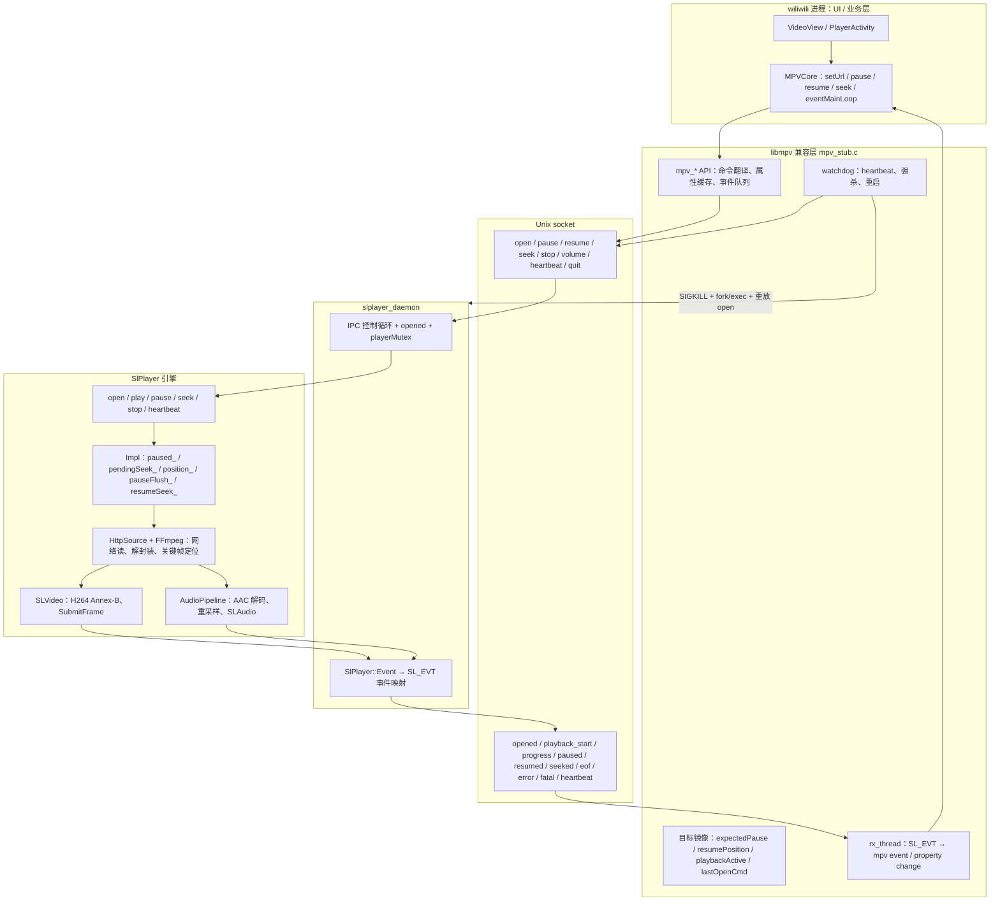

# 开发进度日志

> 每个阶段结束追加一条，带真机证据。更早的完整叙述见 [归档文档](archive/规划-完整历史-2026-11-16.md)。

## 阶段 0：环境与设备（2026-11-16）

- SDK 交叉编译环境（WSL2 Ubuntu 26.04 + `~/steamlink-sdk`，GCC 9.2.0）就绪
- 真机：root SSH、固件 build 930、263MB 可见内存
- Moonlight 官方 6.2.0 可用；V+ 全部跑不起来，已结案

## 阶段 1：SLVideo / GL / SLAudio

- 1.3 SLVideo 出画面：640x360 Annex-B，180 帧成功
- 1.4a GL 叠层：SDL2 + 原生 EGL（alpha=8），半透明层正常叠在视频上
- 1.4b SLAudio 出声：440Hz 正弦波，RSS 9.8MB / CPU 5.2%

## 阶段 2：播放管线

- 2.1 最小 FFmpeg 7.1.1 静态库（约 1.7MB），MP4/FLV 解封装通过
- 2.2 本地 MP4 → SLVideo/SLAudio：10 秒画面声音正常，RSS 7.9MB / CPU 1.5%
- 2.3a B 站 API：`playurl` 不需要 WBI/登录；设备下载约 950KB/s
- 2.3b libcurl 边下边播：真实 360p 30 秒正常；RSS 28MB / CPU 11.8%
- 2.3c 设备端 API：`popular → view → playurl` 全在设备完成；cid 必须 64 位
- 2.3d 缓冲窗口：8MB 分块（pinned moov + 反压），RSS 28.4 → 18.2MB；音频首帧后 3000ms 启动，`sync_long` 白屏/蜂鸣基本同时
- 2.3e 播放控制：手柄 A 暂停、左右 ±10s、B 退出；SLVideo overlay 进度条可见；seek 后 300ms 音频补偿

## 阶段 2.3f：线程化 + 自动音画同步

- 480p 诊断：`BeginFrame` 重试 0，不是解码背压；单线程主循环 30fps 预算不够
- 音频解码/重采样/SLAudio 移到独立线程；主线程只入有界包队列
- 固定延迟不可靠：视频上屏耗时每次 1.5～2.7s 浮动
- 自动同步：`GetQueuedVideoMS` 停止创新高 → 已呈现内容 `P` → 音频预缓冲跳过 `P` 后启动
- 480p 本地合流：904 帧完整播完，CPU 13.6%，RSS 10.1MB；用户确认基本同步
- 360p 网络流：742 帧，CPU 16.2%，RSS 19.4MB

## 阶段 2.4：480p DASH 双流

- `fnval=16`，视频取第一个 avc1，音频取最大 bandwidth；失败回退 MP4
- 两路独立 `MediaSource`，音频线程自解封装
- 修复预缓冲丢帧造成的内容缺口（改为等待）
- 真机 `--popular 30`：640x480@25 + AAC 48kHz，737 帧；A/V 偏差 ±223ms 无漂移；RSS 27.6MB / CPU 16.2%
- 用户确认同步正常

## 阶段 3.1：borealis + wiliwili API

- 新工程 `app/`：borealis + nanovg + yoga + fmt + cpr + pystring + wiliwili API 子集
- 自编静态 libcurl 7.79.1（cpr 要求 ≥7.68）
- 真机：热门列表 20 条正常渲染（截图 + 用户确认）
- 关键：WBI 取 key 是同步请求，API 必须在主循环后的独立线程调用

## 阶段 3.1c：热门列表 + 详情页

- 热门行可聚焦、A 进详情、B 返回；详情显示标题/UP/播放数/简介
- 修复：`pushActivity` 会用 `createContentView()` 覆盖内容（否则崩溃）；Label 默认可聚焦（需显式关闭）；B 键不自动返回
- 截图确认详情页正常；用户确认上下/A/B 正常
- 提交：`592d2bc`

## 阶段 3.2：整仓移植 wiliwili UI

- 方向纠正：停止手写样式，改为整仓编译 wiliwili（去掉 mpv 本体）
- 除 MemoryModule（仅 Windows DLL 用）外，子模块全部初始化
- MPV 头文件取自 mpv v0.37.0（`client.h` / `render.h` / `render_gl.h`），桩库在 `tools/mpv-stub/mpv_stub.c`
- 构建：`sh tools/build-wiliwili.sh` → `~/build-wiliwili/wiliwili`，22MB，strip 后 8.2MB
- 链接修复：SDK 的 libssl/libcrypto 无 SONAME，绝对路径会写进 DT_NEEDED；`tools/cmake/FindOpenSSL.cmake` 改为 `-lssl -lcrypto`
- 崩溃修复：桩库 `mpv_get_property_string` 返回 NULL，wiliwili 用 fmt 打印时抛 `string pointer is null` → 改为返回 `strdup("mpv-stub")`
- 真机：原生 HomeActivity 正常渲染（推荐/热门/追番/影视标签、侧栏、真实封面与 UP 主信息），截图确认
- 真机：视频播放页可进入（标题/UP 主/点赞投币/评论栏/底部控件正常，视频区域为黑屏+加载动画）
- 修复进播放页 SIGSEGV：borealis 的 glad 不加载 GLES2 的 FBO 函数；构建改 `MPV_NO_FB`，桩库用 `SDL_GL_GetProcAddress` 补 `glad_glBindFramebuffer`
- 现状：wiliwili RSS 约 34MB、CPU 约 64%（首页持续渲染）；PE_Single_CPU 仍在后台占约 21%
- 透明层 spike（2026-11-16）：borealis `SDL_GL_ALPHA_SIZE=8` + `SL_TRANSPARENT` 透明 clear；`slvideo_test` 播 450 帧彩条，采集卡截图确认视频从 UI 后面透出，卡片/文字/侧栏正常叠加
- 补充验证：60 秒测试图循环 + `SL_SPIKE_NO_IMAGES=1` 跳过卡片预览图，整个卡片区域透明、视频大面积透出；**用户真机确认通过**
- 视频层分辨率 1920x1080，UI 1280x720 由 EGL 自动缩放；SLVideo 进程 RSS 6.4MB / CPU 1.4%

## 阶段 3.4b：VPU 鲁棒性架构第 1 步（2026-11-17）

- 架构拍板：进程隔离 + Dirty Flag + mpv 层 watchdog，详见 [06-VPU鲁棒性架构.md](06-VPU鲁棒性架构.md)
- 第 1 步完成（VPU 生命周期干净化 + Dirty Flag），只改 `player/src/SlPlayer.cpp`：
  - Dirty Flag `/tmp/slplayer_vpu.lock`：起调前写、`shutdown()` 末尾（FreeContext 之后）删；残留则启动前先做 Context 建/释清洗
  - 起调失败复位重试：`CreateContext`/`CreateStream` 失败做有限次 FreeContext → 延时 → CreateContext（SDK 无全局 Deinit，这是最接近复位的动作）
  - 重建 stream 去脏：seek/pause 的 FreeStream → CreateStream 之间加 50ms 间隔，封装为 `rebuildStream()` 并带复位重试
  - 异常安全：`emit()` 回调 try/catch + `ShutdownGuard` RAII + 线程入口 try/catch 三重保护
- 真机验证（设备在线，本地 `dash_480p_30s.mp4`）：
  - 画面：采集卡截图 `.screenshots/vpu_step1_visual.png` 确认视频正常上屏（非黑屏）——曾因只凭日志下结论被用户纠正，已补截图证据
  - 基线：播放中标记存在、退出后清除（93 帧）
  - 异常自愈闭环：SIGKILL 后标记残留 → 重启触发"启动前清洗"→ 正常播放并清标记
  - pause/seek：暂停/恢复/seek 到关键帧 5.00s，117 帧 0 丢帧，退出清标记
  - 交叉编译通过，无新增 warning
- 复核发现 6 处"预想 vs 真实代码"差异（如 CreateContext 失败无 context 可 free、emit 回调抛异常可绕过 shutdown），已回填 06 文档第三节
- 真机观察：`MV_PE_Remove` 返回 `0x800001ab`（退出时），本次未造成卡死，留作 VPU 污染排查线索

## 阶段 3.4c：VPU 鲁棒性架构第 2 步（2026-11-17）

- 第 2 步完成（暴露检测能力），改 `SlPlayer.h/.cpp` + `test_main.cpp`：
  - 新增 `FatalType`（VpuInitFailed/VpuRebuildFailed/FrameSubmitStalled/UnsupportedStream）+ `FatalCallback` + `setFatalCallback()`，5 处 VPU 致命点主动上报，上层决策不 `_exit()`；普通错误仍走 `EventType::Error`
  - 新增无锁 `Heartbeat`（`lastFrameTimeMs` 单调时间戳 + stage/playing/inTransition/videoFrames），只读 atomic、不取锁、不碰 `stats()`；时间戳在 `SubmitFrame` 成功后更新
  - `slplayer_test` 加 `[hb]`（含 frameAge + watchdog 阈值提示）与 `[fatal]` 打印验证路径
- 真机验证：
  - `frameAge` 播放中 14～41ms；暂停期涨到 2046ms 但 `inTransition=1`（正确挂起）；恢复后回落 38～88ms
  - 采集卡截图 `.screenshots/vpu_step2_visual.png` 确认画面正常（非黑屏）
  - 交叉编译通过无 warning；强杀后 Dirty Flag 残留（预期）、正常退出清除
- 真机发现并修复：`inTransition` 原用 pauseFlush/pauseFlushed 组合，暂停静默期会失效（frameAge 涨但 transition=0）→ 把 `paused_` 纳入判定
- 真机发现：resume 后首帧到达前有 `frameAge=3060ms transition=0` 窗口 → watchdog 设计需"恢复后首帧宽限期"（建议 2s）
- 复核差异追加 06 第三节（2 条）

## 补充验证：强杀后最后一帧残留（2026-11-17）

- 用户发现并提问：强杀播放进程后画面卡在最后一帧（监控画面"1999-03-01 / 快加药"）。采集卡截图 `.screenshots/after_kill_check.png` 确认属实——SLVideo 无隐藏 stream 接口，进程退出后最后一帧留在视频层。
- 真机测试残帧覆盖：无脏标记状态下启动新播放，新画面（动画"23:59:37 / 琥珀"）立即完整覆盖残帧，无叠加无卡死（`.screenshots/residual_covered.png`）。
- 结论：残帧会被新 stream 首帧正常覆盖，不构成卡死；封面占位的必要性是"非播放页不透明 UI 挡住残帧、避免透出"（已更新 05 文档第五节）。
- 提交纪律写入 [07 开发纪律](07-开发纪律.md)（先回归测试后提交、按主题拆解、`.workbuddy/` 不入库）；当时的拆解范例见本文历史资料归档。

## 阶段 3.5a：进程隔离骨架 + libmpv 兼容层基础（2026-11-17）

### 方案调整（用户拍板）

纪律一复核真实代码后发现"直连轻量"前提不成立：wiliwili 链接库里根本没有 SLVideo/SLAudio/FFmpeg，桩库仅 4KB 纯 C 空函数；直连须把 FFmpeg 4 个静态库 + SLVideo + SLAudio 塞进 wiliwili，且单进程内 wiliwili GL 层与 SLVideo 硬件层共存**从未验证**。而阶段 3.3 的双进程透明叠层 spike 已真机通过。故**进程隔离从"最后做"提前到 3.5a**，兼容层从第一版就是 IPC 客户端，SlPlayer 跑独立子进程。

### 实现

- 新增 `player/include/IpcProtocol.h`：IPC 线上格式常量（Unix socket、4 字节长度 + TAB 分隔文本 payload、命令/事件集）
- 新增 `player/daemon/slplayer_daemon.cpp`：播放子进程，SlPlayer + IPC server；`open/pause/resume/seek/stop/quit/volume/heartbeat` 命令，事件回调转 IPC 上报；`SIGTERM` 置 quit 走干净 shutdown（PDEATHSIG 兜底）
- 重写 `tools/mpv-stub/mpv_stub.c`（164 行空桩 → 兼容层）：
  - `mpv_create/initialize/terminate_destroy`：fork/exec daemon（子进程设 `PR_SET_PDEATHSIG`）+ connect（50×100ms 重试）+ 回收
  - `mpv_command_async`：解析 `loadfile`（含 extra 串的 referrer/start/end/audio-file）、`set pause/volume`、`seek`、`stop/playlist-clear`、`quit`
  - `mpv_wait_event`：事件队列，严格模拟 mpv 时序（START_FILE → FILE_LOADED → PLAYBACK_RESTART）；事件在下次 wait_event 时失效（对齐 mpv 语义，避免 wiliwili 不释放导致泄漏）
  - 属性缓存 + `mpv_observe_property` 观察表：`PROPERTY_CHANGE` 带观察时注册的 reply_userdata（duration=INT64、playback-time/percent-pos=DOUBLE、pause/eof-reached/seeking=FLAG 等）
  - `mpv_render_context_*` 保持 no-op（视频走 SLVideo 硬件层）
- 新增调试/验证工具：`ipc_probe`（IPC 链路探针）、`compat_test`（链 libmpv.a 模拟 wiliwili 调用序列）
- 构建改动：`tools/build-wiliwili.sh` 编译兼容层（`-D_DEFAULT_SOURCE -pthread`）并复制协议头；`player/CMakeLists.txt` 新增 daemon 与两个测试 target

### 真机验证（2026-11-17）

- **IPC 控制面/事件面**（`ipc_probe`）：daemon 收到 open → SLVideo stream 就绪 → 事件 `opened(30.12s, 640x480)` / `playback_start` / 连续 `progress` 全部正常
- **兼容层全链路**（`compat_test`）：`forked daemon pid=...` → `connected to daemon` → `loadfile` → daemon 侧 open → `视频已上屏`；事件时序 `START_FILE → FILE_LOADED → PROPERTY_CHANGE(duration=30) → PLAYBACK_RESTART → PROPERTY_CHANGE(playback-time/percent-pos) → TICK`，与 mpv 语义一致；属性值正确
- **画面（采集卡截图确认）**：`.screenshots/3.5a_compat_visual.png` 显示视频画面（"琥珀"动画、时间戳 23:59:37、"异镜科技"字幕），**非黑屏**
- **seek/回收**：seek 到 5s 后 `playback-time=5.00`；`mpv_terminate_destroy` → daemon 优雅退出 → **Dirty Flag 正常清除**、进程全清
- wiliwili 整仓构建通过，链接无冲突（两套 curl 分属不同进程）

### 真机发现并修复的 bug

`daemon` 的 `recvPayload` 把 200ms `SO_RCVTIMEO` 超时误判为"连接断开"（只把 EINTR 当 continue，EAGAIN 直接 return false）→ daemon 在 open 后 200ms 无命令就退出。改成三态返回（1=完整帧 / 0=超时 / -1=真断开）后事件面全部正常。已回填 06 文档第三节复核表。

### 已知未完成

- **wiliwili UI 进播放页的实际验证**：`MPVCore::init()` 在构造函数里、`MPVCore::instance()` 只在播放页（VideoView）首次访问，故需人工操作 UI 进播放页才能触发完整链路。当前兼容层已用 `compat_test` 独立验证（模拟完全相同的调用序列），UI 侧待人工操作确认。

## 阶段 3.5a 补充：Steam Link 主菜单启动入口（2026-11-17）

用户要求"在主菜单加个启动入口，和 moonlight 一样"。

### 机制（从真实设备逆向确认，非猜测）

- `shell`（Qt/QML 主菜单）扫描 **`/home/apps/<dir>/toc.txt`**：shell 二进制里有 `/home/apps`、`/toc.txt` 和 `Missing name/icon/run entry in toc.txt` 字符串
- `toc.txt` 三行格式：`name=Moonlight` / `icon=moonlight.png` / `run=moonlight.sh`
- 点击流程：shell 写 `/tmp/launch_cmdline.txt` 并退出 → `/home/steam/shell.sh` 的 `while true` 循环 `eval` 执行该命令
- 主菜单进程链：`rc.local` 启动 `powermanager.sh` → `powermanager` → `shell.sh` → `shell`

### 实现

- 新增 `tools/steamlink-app/`：`install.sh`（一键安装/更新）、`bilibili.sh`（启动脚本）、`toc.txt`、`bilibili.png`（wiliwili 官方 256×256 图标）
- 安装到 **`/home/apps/bilibili/`**（机身 flash，`/` 分区可用 660MB，占用约 39MB）：`toc.txt` + `bilibili.png` + `bilibili.sh` + `bin/{wiliwili,slplayer_daemon}` + `resources/`
- **HOME 持久化**到 `/usr/local/bilibili`（默认 `/tmp` 重启清空会丢 B 站登录态）
- 启动脚本设 `SL_DAEMON_PATH`、`SL_TRANSPARENT=1`，照 moonlight 做法 `renice -10` 音视频服务与自身
- 纯增量安装：不改 `shell.sh` / `rc.local` / moonlight，卸载只需 `rm -rf /home/apps/bilibili /usr/local/bilibili`

### 真机验证（全闭环）

1. 主菜单截图：**Bilibili 图标（粉红 WiliWili logo）与 Moonlight 并排显示** ✓
2. 模拟点击（写 launch_cmdline + `killall shell`）→ wiliwili 启动，截图确认 **B 站首页完整渲染**（推荐 tab、视频卡片、封面缩略图、播放量、UP 主、底部按键提示）✓
3. 退出 wiliwili → **自动回到主菜单**，`launch_cmdline.txt` 被消费 ✓

### 真机踩坑（含一次判断纠正）

**① 透明层开关不能全局打开（用户发现并纠正）**

我在启动脚本里固定 `export SL_TRANSPARENT=1`，导致首页背景变纯黑——这是阶段 3.3 验证"透明层能否透出视频"时留下的 spike 开关（`borealis-steamlink-alpha.patch` 里 `if (getenv("SL_TRANSPARENT")) color.a = 0;`），设置后整个 UI 图层全透明，首页没有视频层可透就露出黑底。另有 `SL_SPIKE_NO_IMAGES`（跳过图片绘制）也是同期调试开关。

修复：启动脚本不设该变量，首页/详情页恢复不透明；透明只在播放页需要，按 [05 文档第五节](05-播放器替换设计.md) 由运行时切换实现（属 3.5d）。

**② `exec` 判断纠正（用户指出 moonlight 用 exec 也能回主菜单）**

我一度认为"启动脚本不能用 `exec`，否则会顶掉 `shell.sh` 的 while 循环、退出后回不到主菜单"，并据此改成普通调用。**这个判断是错的**：

- `eval $cmd` 执行的是 `shell.sh` fork 出的**子进程**，`exec` 替换的是该子进程，`shell.sh` 的 while 循环不受影响
- 真机确认：`exec` 启动后 `shell.sh`（PID 4063）与 `wiliwili`（PID 360）同时存在，wiliwili 退出后循环继续、主菜单自动回来
- moonlight 的 `exec` 是正确且省开销的做法（少一个常驻 sh 进程）

已改回 `exec`。补充发现：`shell.sh` 由 `powermanager` 在开机时拉起（powermanager 二进制内含 `/home/steam/shell.sh &`），但 powermanager **不在运行期**检测重启——手工 `kill -9` 掉 shell.sh 本身需手动恢复。

## 阶段 3.5a 真机联调：播放页跑通（2026-11-17 下午）

### 现象与根因

真机点进播放页后视频不开始播放、进度停在 0。日志里出现 `[mpv-compat] 透明关闭` 紧跟在 SPS 之后，说明兼容层在 loadfile 之后又被喂了一条"停播"命令。

加命令审计日志（`[mpv-compat] cmd: ...`）后抓到 wiliwili 的真实命令序列：

```
loadfile <主源> replace <extra>
loadfile <备用源1> append
loadfile <备用源2> append
→ FILE_LOADED 事件后：
playlist-clear
set pause no
```

两个语义错误：

1. **`playlist-clear` 被当成 `stop`**。mpv 的语义是"清空播放列表但保留当前播放项"（wiliwili 用它丢弃备用链接，`mpv_core.cpp:933`），我们却下发 `SL_CMD_STOP` → 视频刚加载完就被停掉，随后的 `resume` 发给一个已停的播放器。**这是"进播放页不播放"的直接原因**。
2. **`append` 被当成正常播放请求**。wiliwili 的 `setBackupUrl()`（`mpv_core.cpp:1184`）给每个视频追加 2 个备用 CDN；老实现每个 append 都触发一次完整 `open`，导致一个视频连出 3 次 open、进度反复打回 0。

### 修复

- `playlist-clear`：只清备用源队列，不下发 stop（日志 `playlist-clear：丢弃 N 个备用源，当前播放继续`）
- `append`：只入备用源队列（≤8 条），不触发播放；主源报错时依次切换，全失败才向 UI 报 `END_FILE(ERROR)`
- 兼容层加命令审计日志 `[mpv-compat] cmd: ...`（定位这类问题的关键手段）
- 发送串行化：新增 `txMutex`，命令（UI 线程）与备用源切换（接收线程）共享同一 socket 时不会帧交错

### 播放页透明改为运行时开关

`borealis-steamlink-alpha.patch` 在 `SDLVideoContext::clear()` 里**逐帧** `getenv("SL_TRANSPARENT")`，因此同进程内 `setenv/unsetenv` 立即生效，**不需要改 borealis 代码**：

- `loadfile`(主源) → `setenv("SL_TRANSPARENT","1",1)`：播放页 UI clear 全透明，透出 SLVideo 视频平面
- `stop` / `EOF` / 播放错误 / `terminate_destroy` → `unsetenv`：恢复不透明 UI
- 启动脚本不再设该变量（否则全程透明，首页露出空视频平面变黑底）

### 验收（用户真机确认"可以放了"）

- 日志证据：`播放页透明开启` → `loadfile` → `备用源入队(1)(2)` → `playlist-clear：丢弃 2 个备用源，当前播放继续` → `set pause no` → `音频就绪` → `进入播放循环` → `视频已上屏`
- 隔离回归（`compat_test` 复刻 wiliwili 的 FILE_LOADED 处理）：`playback-time` 连续推进 0.17 → 0.94 → 3.06 → 5.14 → 10.94 s，不再被重置
- 用户确认：视频出画面、**弹幕正常显示**

### 弹幕为什么能直接用

wiliwili 自带弹幕引擎（`wiliwili/source/view/danmaku_core.cpp`，37KB，`DanmakuItem::draw(NVGcontext*)` 走 nanovg 自绘 + `live_danmaku_item.cpp`），**完全不依赖 mpv**。整仓移植时只替换了 MPV 层，弹幕/UI/网络/API 全是原样代码，所以无需额外适配即可工作。

### 本轮暴露的新缺陷（已登记到 00 文档 D1～D4）

1. D1 暂停后音画不同步
2. D2 多次播放退出后某些视频音频变白噪音（疑与 D1 同源）
3. D3 播放页控制条与标题栏出现白色半透明渐变背景（透明 clear 下的 UI 叠加异常）
4. D4 播放中偶发崩溃退出：现场日志在 `VideoView set fullscreen state` 处截断、daemon 侧 `IPC 接收断开`、`dmesg` 连续 `memory_engine_lookup_shm_node Error alignaddr`

## D4/D5 定位：不是崩溃，是 OOM 杀了播放子进程（2026-11-17 15:39）

用户报告两个新现象：⑤ 点暂停后按钮状态不变、有时无法恢复播放；⑥ 详情页会自动播放（原生预期），小窗能透出视频但没缩放。

### ⑤ 的根因（已确证）

日志顺序非常干净：

```
[mpv-compat] cmd: set video-margin-ratio-* 0     ← 进全屏
[mpv-compat] cmd: set pause yes                  ← 用户点暂停
[mpv-compat] IPC 接收断开                        ← daemon 在同一时刻死掉
[mpv-compat] cmd: set pause no                   ← 之后所有命令都写进废 socket
```

内核证据：

```
dmesg: Killed process 2383 (slplayer_daemon) total-vm:365156kB, anon-rss:24004kB, file-rss:1968kB
ps:    2383 root  [slplayer_daemon]      ← 僵尸（父进程没 wait）
/tmp/slplayer_vpu.lock  33 字节          ← 非正常退出，Dirty Flag 机制正常生效
```

内存现状：总量 269MB / 已用 196MB / 空闲 73MB / 缓存 121MB；`wiliwili` RSS ≈ 50MB，daemon 被杀时 RSS ≈ 24MB。

**结论**：daemon 被 OOM killer 杀掉 → 没有 `SL_EVT_PAUSED` 上报 → `pause` 属性不发 `PROPERTY_CHANGE`（wiliwili 观察 id=12）→ 按钮状态不变；后续 `set pause no` 写入已关闭 socket → 无法恢复。**D5 是 D4 的下游表现**，不是暂停逻辑本身的问题（3.4b 阶段 `slplayer_test` 的 pause/seek 测试是 0 丢帧通过的）。

### ⑥ 的性质

- 自动播放：wiliwili 原生 `AUTO_PLAY`，移植前就有，预期行为
- 小窗不缩放：SLVideo 只能全屏输出；wiliwili 下发的 `set video-margin-ratio-*`（日志可见 0.367/0.359 等）我们目前忽略，小窗区域因 render no-op 而透明，露出的是全尺寸视频的局部
- 处理方案沿用 05 文档既定结论：强制 `PLAYER_AUTO_FULLSCREEN`，非全屏走封面占位 + 暂停（属 3.5d）

### 由此确认的优先级

`3.5c`（子进程死亡检测 + 重启）从"锦上添花"变成**必须做**：daemon 被 OOM 杀死是这台设备的常态风险，没有 watchdog 就只能整页退出。

## D7：弹幕只有固定类型，没有横向滚动（2026-11-17 用户报告）

### 弹幕位移机制（读 `danmaku_core.cpp` 确认）

```cpp
if (!MPVCore::instance().isPlaying()) {
    position    = i.speed * (playbackTime - i.time);          // 暂停分支：靠 playback_time
    i.startTime = currentTime - (playbackTime - i.time) / videoSpeed * 1e6;
} else {
    position    = i.speed * (currentTime - i.startTime) * videoSpeed / 1e6;  // 播放分支：靠墙钟
}
```

- `isPlaying()` 直接返回 `video_playing`，而 `video_playing` 的唯一来源是 **`core-idle` 属性**（`mpv_core.cpp:981-989`，`playing = (*data == 0)`）
- `playbackTime` 来自 `playback-time` 属性的 PROPERTY_CHANGE（userdata 4）
- 固定弹幕（type 4 顶 / 5 底）本来就是不动的，只看时间窗口 `i.time ~ i.time+4s`

### 嫌疑点（待真机确认）

1. **`core-idle` 只在 `PLAYBACK_START` 发一次 0**，之后再不更新。若这一条事件没在 UI 侧生效（或 UI 开始绘制弹幕的时间早于它），`video_playing` 会一直是初始值 `false` → 所有滚动弹幕都走"暂停分支"，位置只随 `playback_time` 的 250ms 台阶变化，视觉上接近停滞。
2. daemon 的 progress `position` 存在回退（真机日志 `0.320 → 0.080 → 0.020`）。在暂停分支里 `position` 直接由它算，回退会让弹幕忽前忽后。
3. `i.speed = (width + i.length) / SECOND`（`SECOND = 0.12 * DANMAKU_STYLE_SPEED`，默认 12s 穿过一屏），依赖绘制区宽度——如果 `video_aspect` 缺失导致 `maskWidth/maskHeight` 异常，速度也会异常（目前未验证）。

### 验证方案

- 真机播放中隔 3 秒截两张图：对比进度时间（确认 `playback_time` 在走）+ 弹幕 x 位置（确认是否真静止）
- 兼容层补发 `core-idle`：`PLAYBACK_START` → 0，暂停/EOF/错误 → 1；观察弹幕是否恢复滚动

## 真机性能采样 + 播完态截图（2026-11-17 15:45）

用户播放中要求采样性能与截图。设备：wiliwili(632) + slplayer_daemon(780)。

### CPU / 内存（`top -b -n 1` + `/proc/PID/status`）

| 项目 | 数值 |
|---|---|
| 整机 CPU | **86.6% usr + 13.3% sys，idle 0%**（单核已饱和） |
| Load average | 3.15 / 2.59 / 2.47 |
| `wiliwili` | **58.8% CPU**，RSS 43MB，VSZ 430MB，12 线程 |
| `PE_Single_CPU`（音视频服务） | 23.5% CPU |
| `slplayer_daemon` | 11.7% CPU，RSS 19MB，VSZ 346MB，8 线程 |
| 内存 | 用 202MB / 总 269MB，free 66MB，cached 109MB |

结论：瓶颈在 **UI 渲染**（58.8%），播放子进程只占 11.7%。这台机器 CPU 没有余量，弹幕/进度条更新滞后大概率是掉帧而不是逻辑错。

### 本轮日志要点

- `检测到 VPU 脏标记，先执行启动前清洗` → `启动前清洗完成`：**上次 OOM 杀掉 daemon 留下的标记被正确处理**，3.4b 的防御机制在真实故障上验证有效
- 该片源 `SPS: refs=7 reorder=4 buffering=7`（高参考帧，按设计不改写）
- `视频已上屏: 内容 2733 ms, 队列 2358 ms, 音频跳过 375 ms`
- 音频 48kHz，`预缓冲 8.81 s, 跳过 0.38 s`（预缓冲偏大，与 D1/D2 同区域）
- 全屏切换后出现 `透明关闭（UI 恢复不透明）`

### 截图三连（同一次播放）

| 文件 | 时刻 | 内容 |
|---|---|---|
| `perf_A.png` | 播放中（全屏） | 视频正常上屏（无限暖暖 3.0 预告），弹幕"急急急"在画面上方 |
| `perf_B.png` | 播完后 | 视频区变**纯灰 #EFEFEF**，UI 控件出现，进度 02:53/02:56，弹幕"我天那我21号过生日啊"仍在 |
| `perf_C.png` | 约 1 分钟后 | 与 B **完全一致**（进度不再变） |

用户确认："第二张图的时候，视频已经播放完了"。所以不是卡死，是 **EOF 后我们关掉了透明层** → UI 的 opaque clear 盖住视频层 → 灰底。mpv 的正常行为是保留最后一帧并显示结束态。已登记为 **D8**。

### D3 视觉确认

`perf_B.png` / `perf_C.png` 顶部标题栏和底部控制条都是**白色半透明渐变**（自上而下由白渐隐），与用户描述的"白色半透明渐进背景"一致。这个渐变在 wiliwili 里本应是深色遮罩，透明 clear 下叠出白色，属渲染层 alpha 处理问题。

## D4 真正根因：/tmp 是 tmpfs，88MB 测试残留把内存吃光（2026-11-17 15:49）

用户反馈"这个视频放了十几秒就崩了"。抓现场发现这次被杀的是 **wiliwili 自己**（上一轮是 daemon）：

```
wiliwili invoked oom-killer                 ← 由 wiliwili 自己触发
  __alloc_pages_nodemask → _DefaultAlloc [gal3d] → gckVIDMEM_ConstructVirtual
Killed process 632 (wiliwili) anon-rss:91796kB
free: used 266168 / total 269604 / free 3436
```

OOM 发生在 **GPU 驱动分配显存**的路径上，说明"申请一块纹理时已无空闲页"，内核反手杀了申请者。所以现象是"播到某一刻突然退出"，与播放到第几秒无关。

### 顺藤摸出的真凶

```
df -h /tmp        → tmpfs 131.6M  87.5M  66%
grep Shmem /proc  → Shmem: 89592 kB        （与 tmpfs 用量完全对应）
du -sk /tmp/*     → slplayer 43.7M / wiliwili 22.5M / resources 13.1M / res.tar.gz 9.9M
```

`/tmp` 是 **tmpfs（内存盘）**，里面全是我早期实验留下的产物：两个 17MB 的 mp4/抓包样本、一份 22.5MB 的旧 wiliwili 二进制副本、13MB 旧 resources、10MB 资源包。**应用真身在 `/home/apps/bilibili`（ext4，38MB），这些运行完全不需要**，却占掉设备总内存的三分之一。

这也解释了为什么"偶发"：可用内存本来就只剩几 MB，随便一次纹理分配就会踩线。

### 处置（已执行）

1. 清空 `/tmp` 残留：87.5MB → 272KB，**MemFree 3.4MB → 92.5MB**，`Shmem` 89588kB → 304KB
2. `bilibili.sh`：启动时把 `MemFree`/`Shmem`/`df /tmp` 记进日志第一行（`[boot]` 前缀），并把重定向改为 `>>`（否则基线被冲掉）
3. `install.sh`：新增第 6 步"检查设备内存与 /tmp 占用"，超 10MB 直接告警并给出清理命令
4. 新增 `tools/steamlink-app/memwatch.sh`：每 2s 采样 `MemFree/Cached/Shmem/Slab/wili RSS/daemon RSS` 到 `/tmp/memwatch.log`，用于区分"泄漏"与"一次性峰值"

### 复盘

- 前一轮把 D4 归因为"内存峰值被 OOM 挑中"，方向对但没找源头。**下次应先看 tmpfs 用量和 Shmem**，这两条一对照就能定位，不必等两次现场。
- 教训写进 03 文档第十节：测试产物不放 `/tmp`；看到 `IPC 接收断开` 先 `dmesg | grep Killed process`。

## 清理后真机复测：播放顺畅，弹幕仍不动（2026-11-17 15:54-15:58）

用户反馈"正在播放，现在顺畅多了，我就说虽然内存小也不至于这么吃内存"。

### 内存曲线（`tools/steamlink-app/memwatch.sh`，2s 采样）

启动基线（新 `bilibili.sh` 的 `[boot]` 行）：`MemFree=167220kB Shmem=292kB`、`/tmp 276KB`。

| 阶段 | wiliwili RSS | daemon RSS | MemFree |
|---|---|---|---|
| 启动瞬间 | 6.8MB | — | 149MB |
| UI 初始化 | 33.7 → 43.7MB | — | 104 → 85MB |
| 载入视频 | 59.3MB（峰值） | 2.8 → 28.2MB | **9.2MB（最低点）** |
| 稳定播放 | 48.3MB | 28.2MB | 73MB |

- **载入瞬间有一个约 66MB 的临时分配**（MemFree 65MB → 9.2MB，几秒后自动归还 73MB）。当时 `Cached` 有 109MB 可回收，所以没有触发 OOM；但如果同时再来一次峰值，仍是风险点（后续可用 memwatch 对比不同码率片源）
- 稳定后 `wili` 约 48MB、`daemon` 约 28MB、`MemFree` 约 71～73MB，播放流畅
- 观察项：`wili` RSS 在 15:55-15:58 从 48.3 → 49.8MB（约 0.3MB/min 缓增），量级不大，先记着

### D7 弹幕复现（内存充足条件下仍然不动）

连拍两帧间隔 0.7s（`.screenshots/dm_C1.png` / `dm_C2.png`）：

- "一分为二" 在两帧中横坐标完全一致；"啊，好痛。。"仅视觉测量误差级位移
- 按 `DANMAKU_STYLE_SPEED=100` 推算 `SECOND=12s` 穿屏 → 0.7s 应移动约 **58～66px**，实测为 0
- 同屏多条弹幕左缘集中在 x≈320～460（插入点附近堆叠），且存在某条弹幕在 0.7s 内整条消失的现象 —— 更像 **type 4/5 固定弹幕的 4s 窗口**（`CENTER_SECOND = 0.04*100 = 4s`）

**当时结论（已被 2026-11-18 后续追踪修正）**：D7 不是掉帧导致（内存已充足），是时间基准/状态问题。已核对：`push_prop_event` 会从 observe 表回填 userdata（core-idle=1、playback-time=4），wiliwili 的 `case 1/4` 分支按 userdata 分发，链路设计正确。当时计划加属性事件追踪；2026-11-18 实测确认 `core-idle` 正常，真正缺的是 `speed` 初值，最终根因与修复见本文末节“SPS 策略撤回与 D7 弹幕根因修复”。

## D9 登记：异常退出后重启会闪现上次的残帧（2026-11-17 16:01）

用户回忆：之前 OOM 不正常退出后，重开 wiliwili 会先看到上次卡住的那一帧，然后才刷到主页（现在测不出来了）。

分析结论：视频平面是硬件层状态、不随进程死亡复位。正常退出走 `FreeStream/FreeContext` 干净；SIGKILL 时 `shutdown()` 根本没执行，平面保持最后提交的一帧。平面位于 UI 图层之下，所以"新进程启动 → 首帧未画（约 1～2s）"这段时间露出来的就是残帧，主页画出后即被盖住。15:49 现场的 `/tmp/slplayer_vpu.lock` 残留（脏标记）正是同因旁证。

`SLVideo.h` 无"关闭平面/清屏"接口，设备上也无 `/dev/fb*`，没有干净解法；登记为 D9，待与 3.5c 一起权衡（黑帧覆盖 / 只靠不再异常退出）。详见 06 文档第十一节。

## 阶段 3.5c：watchdog + 断连恢复 + 孤儿清理（2026-11-17 17:10）

### 实现

- `tools/mpv-stub/mpv_stub.c`：
  - 新增独立 watchdog 线程，通过 IPC `heartbeat` 读 daemon 心跳；`frameAge > 1.5s && playing && !inTransition && !pause` 或超过无心跳阈值时 SIGKILL daemon。
  - 接收线程识别 IPC 断开：`waitpid` 打印退出码/信号 → 关闭旧 socket → 启动新一代 daemon → 把保存的 `open` 命令改为最后播放位置后重发 → 首帧后补发 pause。
  - 恢复期间把 `playbackActive` 置 0，等新 daemon 的 `PLAYBACK_START` 再重新武装 watchdog；避免脏 VPU 清洗/慢开流被误判为卡死。
  - 恢复时抑制 `START_FILE/FILE_LOADED`，避免 wiliwili 的 `AUTO_PLAY` 自动 resume 覆盖用户暂停态。
  - 新增 30s 内最多 3 次的重启限流；超过后停止自动重启并打印原因，防止 daemon 持续崩溃时 fork 风暴。
  - socket 写入改用 `send(..., MSG_NOSIGNAL)`，避免 daemon 已死后 watchdog 发心跳让 wiliwili 主进程收到 SIGPIPE。
- `player/daemon/slplayer_daemon.cpp`：SIGTERM handler 只置 `volatile sig_atomic_t`；启动时接收 `--expected-parent`，主循环复核 `getppid()`，避免把“创建 daemon 的父线程退出”误判成父进程死亡。accept 改 200ms 轮询 + 15s 总超时，父进程死亡后可快速走干净 shutdown。
- `tools/steamlink-app/test-3.5c.sh`：设备端故障注入脚本，覆盖 SIGKILL daemon、暂停中 SIGKILL daemon、SIGSTOP daemon、SIGKILL 父进程；日志/视频/二进制都放 `/home/apps/bilibili/3.5c-test`（flash），不写测试视频到 tmpfs。
- `player/daemon/compat_test.c`：新增由环境变量控制的“首帧后暂停”测试钩子，并把 stdout 改为无缓冲，便于脚本按日志推进。

### 验证

构建：`cmake --build ~/build-slplayer` 与 `sh tools/build-wiliwili.sh` 均成功；`mpv_stub.c` 用 `-Wall -Wextra` 单独编译无告警；测试脚本 `sh -n` 通过。

真机基线：设备 `reboot -f` 后 `/tmp` 约 12KB、无 Dirty Flag、无应用进程。完整 wiliwili + daemon 通过 `tools/steamlink-app/install.sh` 部署；`/tmp` 在部署后仍约 12KB。

`sh /home/apps/bilibili/3.5c-test/test-3.5c.sh all` 四类场景全部 PASS：

1. `kill-daemon`：播放中 `SIGKILL` daemon `885` → 打印 `daemon 退出(reason=IPC 断开): pid=885 signal=9(SIGKILL)` → 新 daemon `927` 接管 → `恢复播放: pos=0.117 pause=0`；`playback-time` 从 0.000 继续到 0.265。
2. `kill-daemon-paused`：首帧后暂停，再 `SIGKILL` daemon `1013` → 新 daemon `1067` → `恢复播放: pos=0.000 pause=1`，暂停态保留。
3. `freeze-daemon`：`SIGSTOP` daemon `1137` → watchdog 打印 `hbAge=1615ms frameAge=1633ms playing=1 transition=0 pause=0 action=无新帧` → 强杀并恢复为 daemon `1237`。本轮 1.5s 无新帧阈值先于 2s 无心跳阈值命中，是预期的双保险行为。
4. `kill-parent`：`SIGKILL` 兼容层父进程 → daemon 自行退出、Dirty Flag 删除，无孤儿残留。

测试使用加速参数 `poll=200ms nohb=2000ms stall=1500ms grace=1000ms`；代码默认值为 `500/3000/1500/2000ms`，可用环境变量覆盖。默认值仍需在真实长时间播放/OOM 场景中继续校准。

### 结论边界

进程级恢复链路已验证：daemon 死不再拖垮兼容层进程，能打印真实退出状态、自动重启、恢复位置与暂停态；父进程死后 daemon 能干净退出。真实 wiliwili UI 的暂停按钮视觉、异常退出后的残帧是否可见，仍需用户在完整播放场景中观察，不能仅凭本轮日志下结论。

## 真实 wiliwili 实例验收、D2 白噪音与 D1 对齐（2026-11-17 18:30）

### 真实实例链路

- 仓库新增 `tools/patches/wiliwili-open-bv-test.patch`，构建脚本自动应用；给 wiliwili 加 `--open-bv <BV号>` 测试入口，内部只调用 `Intent::openBV()`，视频详情、playurl、DASH 音视频、弹幕仍由 wiliwili 自己请求。
- 正式 `bilibili.sh` 透传启动参数；通过 `/tmp/launch_cmdline.txt` + 精确 shell PID 走正常主菜单 handoff，不绕过启动脚本。
- 真实播放 `BV1fYpn6SEk9`：日志确认 wiliwili 请求到独立视频源和 AAC 音轨，兼容层转交 daemon，播放器以 1920×1080 H.264 + 44.1kHz AAC 启动。

### D2：固定 48kHz

- 现象：真实实例中用户听到音频爆成噪音。日志：`[SlAudio] SLAudio_CreateStream 失败` 是使用独立 compat_test 时的环境差异；真实 UI 中是 `44100 Hz` 直接传给 SLAudio 后爆噪。
- 根因：`SLAudio.h` 明确 native frequency 为 48000Hz；Kodi `CAESinkSteamLink` 也固定 `SL_SAMPLE_RATE 48000`。原“按源透传”设计在本链路错误。
- 修复：`AudioPipeline` 固定 48000Hz sink，AAC 解码后由 swresample 转到 48kHz / stereo / S16；帧长 3840 字节/20ms。
- 验收：真实 wiliwili 播放同一 BV，用户确认声音正常。

### D1：暂停/恢复严格对齐

- 现象：用户手动暂停时画面还会多走一点，声音先停；恢复后声音超前。
- 修复过程：
  1. 暂停先由播放线程 flush SLVideo 队列，再停音频，避免音频先停、视频后停。
  2. 音频 seek 到“暂停请求时间点”，视频仍从关键帧解码，但用请求时间点而非关键帧 PTS 作为音频基准。
  3. 首帧提交后按实测上屏延迟和“关键帧→暂停点”的时间差安排音频启动时点；预缓冲在这段等待中填满，启动时 skip=0。
  4. 删除 seek 后 3 秒截断兜底，避免 large skip 导致再次失步。
- 真机日志：`SL_SYNC_DEBUG=1` 显示 `seek start: target=6503 first=5000 latency=2230 delay=3733`，与计算 `2230 + (6503-5000)` 一致；`SlAudio 启动: 预缓冲 10.91s, 跳过 0.00s`。
- 状态：日志和时序计算符合预期，**最终仍需用户在真实 UI 手动暂停/恢复确认听感**。

### 正常退出与 watchdog

- 正常退出日志已走完整 `audio_.stop → SLAudio_FreeContext → SLVideo_FreeStream → SLVideo_FreeContext → clear dirty flag → shutdown done`；`fuser` 无占用，主菜单恢复，Dirty Flag 为 NO。
- 真实 UI 播放中 `kill -9 slplayer_daemon`：wiliwili PID 保持存活，兼容层打印 `daemon 退出(reason=IPC 断开): signal=9(SIGKILL)`，新 daemon 启动并从 `pos=8.770` 恢复；恢复后音频仍走 48k 路径。

### D1 用户确认与新缺陷登记（2026-11-17 18:45）

- 用户真机手动暂停/恢复后确认：D1 暂停恢复音画同步，D1 关闭。
- 用户同时报告三个新问题，按独立缺陷登记到 00 任务板：
  1. D10：普通快进/快退后仍引入音画不同步；
  2. D11：播放多个视频后暂停按键失效；
  3. D12：暂停/播放操作延迟高，需拆分输入、UI、IPC、VPU flush 各段耗时。
- 这三项未在本次修复，保持待办；本次已提交的代码范围仍为 3.5c、D2、D1。

## 登录实测、D15 音轨 URL 修复与新缺陷 D13/D14（2026-11-17 19:20）

- 用户确认：原样移植的 wiliwili 自带登录、弹幕和播放记录同步，不需要另做登录模块。设备配置 `/usr/local/bilibili/.config/wiliwili/wiliwili_config.json` 已含 `cookie`，登录态持久化路径 `HOME=/usr/local/bilibili` 有效。
- 用户调整了设备默认值：`player_auto_fullscreen=true`、`player_hwdec=true`（兼容层桩层，无实际硬解开关作用）、`image_request_threads=2`；安装脚本不会覆盖这些设置。

### D15：音轨 URL 前导引号

- 用户报告某 720P 视频无声。日志证据：
  - `[SlPlayer] 打开音频源: "https://...`
  - `[SlPlayer] 音频地址失败: avformat_open_input: No such file or directory`
  - 三条备用音轨均失败，最终 `无可用音频，静音播放`。
- 根因：wiliwili 的 `genExtraUrlParam()` 生成 `audio-file="url"`；B 站音轨 URL 参数里含逗号，旧 `build_open_cmd()` 用 `strtok_r(..., ",")` 切分 extra，把引号内的 URL 也切开，导致音轨值残留前导 `"`。
- 修复：`tools/mpv-stub/mpv_stub.c` 改为只把引号外逗号当分隔符，去掉包裹引号但保留 URL 内容；extra/audio URL/恢复 open 命令缓冲扩大（64KB）；`rewrite_open_start()` 改为按输入长度分配临时缓冲。
- 验证：全量构建通过；部署后用户用正确视频确认声音正常。D15 关闭。

### D13：登录后动态页关注列表不刷新

- 用户报告登录后动态页关注 UP 列表不显示，关闭 wiliwili 重进仍不刷新；播放与播放记录同步正常。
- 归类：原生 wiliwili UI/API 数据刷新问题，与 SlPlayer、IPC、VPU 状态机无直接因果；需单独抓动态页 API 响应。

### D14：高清源切换与 OOM

- 用户设置 1080P60/1080P+ 后部分视频能放，但无法确认是否切到真实目标清晰度；容易 OOM。
- 内核日志证据：`shm_driver heap has not enough (19287808) bytes for (51840000) bytes`、`memory_engine_allocate failed`、`shm_lowmem_killer alert`；当时 `wiliwili` 占约 70MB SHM、`slplayer_daemon` 约 11MB、`PE_Single_CPU` 约 100MB。
- 归类：与 D4（`/tmp` tmpfs 吃内存）不同，D14 是图形/VPU 共享内存池容量问题；需先记录实际 qn/codec/refs 和 SHM 峰值，不能仅凭“设置了高清”判断源已切换。

## D11/D10 现场抓取与候选修复（2026-11-17 19:35）

### 现场证据

- 用户在真实播放中卡在“暂停后不能继续播放”。进程表：wiliwili `2169`、daemon `2192` 仍存活；daemon 只剩主 IPC、SDK RPC/ALSA 线程，播放/音频线程已退出，所以后续 `set pause yes/no` 能进入日志但无人执行。
- 日志顺序：`cmd: set pause yes` → `暂停: 清空视频队列 @ 519.58 s` → `cmd: set pause no` → `[SlHttp] 回跳超出窗口: target=76187722 base=76546048` → `partial file`；之后连续多轮 pause/resume 都没有新的 `暂停:` 日志。
- watchdog 没有杀 daemon：主 IPC 仍回复 heartbeat，且播放线程退出后 `playing=false`，“无新帧”判据不成立。这是 watchdog 状态判据的盲点，但本轮先修播放线程退出的根因。

### 候选修复

- D11：暂停恢复仍需要回退 seek，因为暂停时已 flush 掉 VPU 队列，单纯继续读会跳过未上屏内容；不能改成“原地续播”。
- D10/D11 共同根因：`HttpSource::Downloader::seek()` 原来只允许窗口内回跳，窗口外直接返回 -1，且 FFmpeg 的字节估算可能超出文件长度，导致 `av_seek_frame` 失败、`partial file` 和播放线程退出。
- 修复：
  - 窗口外回跳/大步快进时，停止旧下载线程，用 `Range: <offset>-` 重新请求，窗口基准重置到目标偏移；
  - curl 增加进度回调，让 `stop_` 能中断阻塞中的下载；
  - `Content-Range` 解析整片总长度，Range 响应的 `Content-Length` 不再被误当作总长；
  - CDN 未返回 206 时明确报错，避免按错误偏移解析；
  - FFmpeg 给出越界字节偏移时，SlPlayer 在 `av_seek_frame` 前提供媒体时间提示，AVIO 按 `实际文件长度 × 目标时间/总时长` 重新映射；
  - seek 目标钳制到实际文件长度内。
- 验证：`HEAD/Range` 对合法偏移返回 `206 Partial Content`，`Content-Range` 给出总长度；全量交叉编译通过；候选修复已通过 `install.sh` 部署。**D11/D10 行为仍需用户用刚才的视频真机复测，暂不标记完成。**

## 实施方向调整：播放器语义对齐（2026-11-17 19:45）

- 用户复测候选修复后反馈：快进快退仍不同步，暂停失效仍会出现，几分钟长视频 seek 还会跳到错误时间点；自动续播也没有完全适配。
- 结论：这些不是可以逐个调 skip/等待的独立问题。wiliwili 目标状态、mpv 兼容层缓存状态、daemon 实际播放状态各自计算时间，导致短片/单一动作看似正常，长视频、跨窗口 seek、连续播放后必然发散。
- 决策：停止局部修补，P0 改为“播放器语义对齐”。正式契约见 [05 播放器语义契约](05-播放器替换设计.md)：建立 wiliwili/mpv 标准行为序列、单一时间真相、目标状态与当前状态分离、续播优先级和 heartbeat 工作线程语义。
- 当前工作区中 Range/时间提示候选代码保持未提交、冻结为实验改动；不得按“已修复”提交。任务板和优先级已同步到 [00 文档](00-当前状态与任务.md)。

## PSV 低内存参考与 D13 上游修复复核（2026-11-17 19:55）

- 复核确认：当前 wiliwili 源码是上游主线 `origin/yoga` / `v1.6.0` / `88e5876`；上游没有独立 PSV Git 分支，PSV 通过同一源码的 `__PSV__`、`PLATFORM_PSV`、`scripts/psv/` 编译与依赖补丁支持。
- 上游 `dev` 比当前主线多 3 个提交；其中 `2f583df3edeca2c67d4e48da715cc473d75aa15a` 修复动态页关注 UP 列表：`mid` 字段从 `uint64_t` 改为 `std::string`，选择时 `std::stoull()`。这与 D13 日志 `type_error.302: type must be number, but is string` 完全一致，已登记为可单独回移修复；不整体切换 `dev`。
- PSV 默认 480P/720P 清晰度不照搬到 Steam Link：Steam Link 由 SLVideo 直接硬解，与 PSV 视频路径不同；D14 只观察到部分 1080P60/1080P+ 片源的 SHM 分配失败，应以实际 qn/codec/refs 与 SHM 峰值决定方案。
- 可借鉴并列入 D16 试验：更小图片 URL 尺寸、图片线程从 2 试到 1、播放器内存缓存试到 0MB；这些针对单核 CPU/内存压力，不等于照搬 PSV 平台参数。
- PSV 参考依据见本文“历史资料归档：SPS、PSV 与 D14 分析”；任务状态写入 [00 文档](00-当前状态与任务.md)。本轮只更新文档，不改播放器代码。

## P0 通讯架构与代码现状复核（2026-11-17 20:20）

- 按开发纪律先复核真实代码，再允许落地实现。核对范围覆盖 wiliwili `MPVCore`/`VideoView`/`PlayerActivity`、libmpv 兼容层 `mpv_stub.c`、IPC 协议与 daemon、SlPlayer/HttpSource/AudioPipeline。
- 当前链路确认：UI 操作经 `mpv_*` 进入兼容层，IPC 只传控制命令和状态事件；视频数据由 daemon 内的 SlPlayer 直接提交 SLVideo，GUI/弹幕在 wiliwili 进程用 GL 叠加。真正的时间与引擎状态由 `SlPlayer::Impl` 产生，兼容层另有属性缓存和目标镜像，daemon 没有统一播放状态机。
- 已确认 11 项实现差异：seek 模式丢失、续播等价 seek 重复重建、文件 generation 缺失、暂停目标/当前态混用、seek 请求无序号、heartbeat 线程存活语义缺口、EOF 事件顺序错误、恢复位置取自目标而非当前时间、core-idle/seeking 状态不完整、工作区实验改动污染基线，以及“23 个 mpv 调用点”的旧口径无法复现。
- 当时的通讯架构 Mermaid 图、分层职责表、播放器信息落点表、行为链路表、libmpv API 覆盖表和 R1～R11 差异表均归档在本文“历史资料归档：P0 实施前架构与代码复核”；当前设计只看 [05 播放器设计](05-播放器替换设计.md)。
- libmpv API 覆盖复核来源：wiliwili 原始源码 `88e5876` 的 `mpv_core.hpp`/`mpv_core.cpp`、`~/mpv-stub/lib/libmpv.a` 与 `~/build-wiliwili/wiliwili` 的符号表。三处一致为 22 个唯一 `mpv_*` API；属性观察编号 1～21，其中 8、9 注释，实际启用 19 个；wrapper 调用表达式约 108 处。旧文档“21 个空函数”和“23 个调用点”均已更正。
- 用户要求先核对架构再写代码，因此本轮未实现 P0 代码。
- 工作区整理：Range/时间提示实验改动已按明确路径保存到 `stash@{0}`（`冻结：D10/D11 候选改动（P0 前隔离）`）；本轮曾提前修改的 `IpcProtocol.h` 已撤回。当前只有文档改动，未提交。

## D14 的 GPU / SHM 内存讨论与 bitrate 可疑点（2026-11-17）

- 明确区分三类内存账：Linux 可回收 page cache、tmpfs/anonymous 内存、GPU/VPU shm 池。一次无播放进程快照中 `MemFree≈3MB` 但 `Cached≈154MB`、`Shmem≈1.4MB`，说明单看 `MemFree` 会误判；D14 的 51.84MB 请求属于 shm 池的大块连续分配问题，不是 D4 的 `/tmp` tmpfs 问题。
- 复核 UI 路径：wiliwili UI 与弹幕通过 borealis + NanoVG 走 GLES2，SLVideo 使用独立视频硬件层，GUI 以 alpha=8 透明层叠加；`mpv_render_context_render()` no-op 只表示视频不走 mpv 渲染。CPU 仍负责文本排版、路径生成和弹幕位置计算。
- 真机日志确认 EGL 创建 3 个 1280×720 framebuffer，stride 5120，约 10.5MiB。估算 1136×640 省约 2.1MiB，960×540 省约 4.6MiB；后者逻辑布局仍为 1280×720，但字体清晰度下降。该方向收益有限，不能根治 51.84MB 的 VPU 分配失败。
- 核对 Moonlight v6.2.0/master 上游源码：使用 `SLVideo_CreateStream(..., bLowLatency=1)`，只支持 I/P，设置帧率与 BT.709，不调用 `SetStreamTargetBitrate()`。Kodi Steam Link 解码器使用 `lowLatency=false`，同样只设置帧率。Moonlight 能播 1080P60 只能证明受控低延迟流可播，不能直接类比 B 站高 refs/B 帧点播流。
- 发现高优先级可疑点：`SlPlayer.cpp` 自阶段 3.4 起固定调用 `SLVideo_SetStreamTargetBitrate(videoStream, 1000)`，SDK 单位为 kbit/s，即 1Mbit/s；反汇编确认该 API 最终调用 `MV_PE_StreamSetVideoBitRate()`，不是 no-op。参考实现均不设置 bitrate。该调用位于 `CreateStream()` 后，是否导致 51.84MB 分配仍需时间线取证。
- 上述事实、假设和判别标准归档在本文“历史资料归档：SPS、PSV 与 D14 分析”；D14 任务条目同步到 [00 文档](00-当前状态与任务.md)。本轮没有修改实现代码。

## P0 播放器语义对齐实现与设备端回归（2026-11-18）

- 按 [05 文档第九节](05-播放器替换设计.md)的契约落地三层状态机，未修改 wiliwili 源码：兼容层负责 mpv 语义换算与事件时序，IPC/daemon 负责代次与请求号隔离，SlPlayer 负责目标态/当前态分离和完成事件。
- IPC 统一为 `<name>\t<gen>\t<req>\t<args...>` 帧信封；所有控制命令带文件代次和请求号，事件按同一代次回传。daemon 丢弃过期代次命令/事件；心跳扩展 `currentPaused`、`targetPaused`、`seeking`、`workerAlive`。
- 兼容层修正 R1/R2/R7/R8/R9：`seek relative` 与 `absolute-percent` 先换算为绝对秒数；`start=` 与 FILE_LOADED 后等价 seek 去重；`playback-time` 只来自 daemon；EOF 先发属性变化再发 `END_FILE`；seek 命令发出时置 `seeking=true`。
- SlPlayer 修正 R4/R5/R6：pause/resume/seek 只更新目标态，工作线程完成 flush、关键帧定位和首帧重建后再发当前状态；seek 请求带序号，旧完成不上报；恢复期间允许提交首帧，但 `Resumed` 延后到首帧完成后发出；工作线程退出后心跳反映 `workerAlive=false`。
- 过程中发现并修正两个实现问题：`build_open_cmd()` 已带 `open` 命令名，首次封装 IPC 时重复添加前缀，导致 daemon 把字面量 `open` 当作 URL；正常退出时 500ms 回收窗口会 SIGKILL 尚在清理 VPU 的 daemon，留下脏标记，已改为 5s 回收窗口。
- 提交前复核再修正一处边界：`loadfile append` 只是备用源入队，不能再递增当前文件代次，否则主源事件会被误过滤；现在只有 `replace`、备用源实际切换和 watchdog 回放递增代次。修正后重跑 P0 序列与 3.5c 四类故障注入，仍全部通过。
- 构建：`cmake --build ~/build-slplayer -j4` 与 `sh tools/build-wiliwili.sh` 均成功；交叉编译 libmpv 兼容层无新警告。通过 `tools/steamlink-app/install.sh` 部署正式二进制，测试二进制放在 `/home/apps/bilibili/3.5c-test/`（flash），未写 `/tmp`。
- 设备端 `SL_P0_TEST=1 compat_test ./test.mp4 24`：START_FILE → FILE_LOADED → PLAYBACK_RESTART 顺序正常；absolute=3s、relative=+3s、percent=25% 均换算并落到关键帧；pause/resume 的 `pause` 属性各变化一次（1 → 0）；第二个文件以 `start=2` 打开，新代次生效；正常退出后无 `/tmp/slplayer_vpu.lock`。
- 设备端 `test-3.5c.sh all`：kill-daemon、kill-daemon-paused、freeze-daemon、kill-parent 四类场景全部 PASS；恢复日志显示新代次和请求号，暂停态在用例 2 中保持为 1。
- 本轮未做真实 wiliwili UI 截图/听感验收。12 秒本地测试片段的 seek 落点为关键帧 PTS，与请求目标相差约 1.3～1.5 秒；这符合当前引擎设计，但 D10/D11/D12 是否最终消除仍需用户在真实 UI 上确认。

## P0 真机反馈后的定点修复（2026-11-18 11:00）

- 用户反馈：播放正常，但暂停一次后当前和后续视频都暂停失效；短快进正常，长快进先出声、画面停旧帧约半分钟；暂停按钮只在首次切换后失效。
- 日志判定不是 daemon 不稳定：无 OOM、无 IPC 断开、无 watchdog 误杀；关键证据是 `cmd=stop gen=2 current=1` 和连续的 `SlHttp 回跳超出窗口: target=502634 base=524288`。
- 修复 1：兼容层 `stop` 先按 daemon 当前代次发送，再递增本地代次并清旧事件，避免 stop 被代次过滤。
- 修复 2：新文件先清旧事件队列，再显式发布 `pause=false`、`eof-reached=false`、`core-idle=true`、`seeking=false`、`playback-time=0`、`percent-pos=0`，让 wiliwili 的 UI 状态镜像不会沿用上一文件。
- 修复 3：把冻结候选中的 Range 重定位并入 `HttpSource`（窗口外/大步快进重新发 Range、解析 Content-Range 总长、校验 206），并在 `SlPlayer::doSeek()` 为视频和独立音轨设置 seek 时间提示。音频不再在视频定位失败时先按目标时间启动。
- 交叉编译、`tools/steamlink-app/install.sh` 部署均成功；`compat_test` P0 序列和 3.5c 四类故障注入再次全部通过。日志确认新文件属性复位事件已送达，且没有 `丢弃过期代次命令: cmd=stop`。
- 用户下一轮真机复测确认暂停/恢复与快进快退已恢复；剩下问题转入下一节继续处理。原 Range stash 保留未删除。

## P0 第二轮真机反馈修复（2026-11-18 11:20）

- 用户复测：暂停/继续已恢复正常；前两个视频快进快退正常，第三个视频快进后音画不同步；暂停按钮图标不随状态切换。
- 按钮图标根因：wiliwili `VideoView::refreshToggleIcon()` 读 `mpvCore->isPlaying()`，即 `core-idle` 属性，不读 `pause` 属性。兼容层原先只在首帧/EOF 改 `core-idle`，暂停时一直是 0，所以永远显示暂停图标。现已在 `SL_EVT_PAUSED`/`SL_EVT_RESUMED` 时同步 `core-idle=1/0`，让 UI 的 `MPV_IDLE → refreshToggleIcon()` 真正刷新。
- 第三个视频不同步根因：该视频以 `start=11` 续播打开，`afterSeek=true` 时旧代码不会记录 `measuredVideoLatencyMs`，导致后续所有 seek 都走“视频已上屏”兜底分支而不是首帧对齐。`videoFrames > 1` 且队列稳定后改为无条件记录一次 `measuredVideoLatencyMs`，后续 seek 恢复走 `seek 对齐`。
- 保留“视频已上屏”分支：它是冷启动测延迟与首帧路径尚未拿到延迟时的兜底，删除会让首次播放退到 8 秒兜底才出声；现在角色降级为测量/冷启动/兜底。
- `compat_test` 增加“带 `start=2` 打开第二个文件后再 seek”的步骤；本地测试视频无音轨，无法验证音频对齐日志，只能验证命令/事件链。设备端 P0 序列与 3.5c 四类故障注入再次全部通过；日志确认 pause/resume 时 `core-idle` 在 1/0 间切换。

## P0 问题视频现场抓取与 VPU 重建次数修复（2026-11-18 11:50）

- 用户给出问题视频 `BV1Nvx16TEzY`。此前按 URL 中的 `43208345449` 反推 aid/BV 是错的，未能打开视频；已改为在测试入口直接接受正确 BV。
- 干净重启后，用 `--open-bv BV1Nvx16TEzY` 和固定自动序列（起播 → seek 115 → pause/resume → seek 300/450/250/150）复现。原始现场保存在设备 `/home/apps/bilibili/p0-repro-bv1Nvx16TEzY.log` 与 `p0-repro-dmesg.txt`。
- 复现结果：`refs=7 / reorder=4 / buffering=7` 码流在长 seek 后触发 `shm_driver` 为 VDEC 申请 1,605,632 字节失败，最大连续块仅 1,298,432～1,597,440 字节；watchdog 连续 5 次强杀 daemon，最终触发 30 秒 3 次限流，UI 永久 loading。不是 OOM killer，也不是 IPC 协议错误。
- 根因侧写：续播起播时 `CreateStream` 后立刻 `doSeek` 又 `Free/Create` 一次；暂停 flush 已 `Free/Create` 一次，恢复 seek 又重建一次。高 refs 片源每次重建都会消耗 VPU/SHM 连续块，短时间多次重建造成碎片化和 VDEC 分配失败。
- 修复：新增 `doSeek(..., rebuildVideo)`。新建流后尚未提交帧、以及暂停已 flush 后的恢复只重新定位 demuxer，不再重复 `FreeStream/CreateStream`；用户主动 seek 仍重建视频流。
- 修复后同 BV、同自动序列完整跑完（115/300/450/250/150），daemon 全程存活，无 watchdog 强杀，无 VDEC 1.6MB SHM 失败；日志保存为 `/home/apps/bilibili/p0-final-bv1Nvx16TEzY.log` 与 `p0-final-dmesg.txt`。内核仍有一次 wiliwili 申请 51.84MB SHM 失败，是独立 D14 现象，本次不混修。
- 标准回归：`compat_test` P0 序列与 3.5c 四类故障注入再次全部通过。

## D17 Steam Link 能力卡位（2026-11-18 14:55）

- 需求：视频选择最高只到 1080P60，禁止 4K/HDR/8K；音频只保留 AAC 高/中/低三档，不暴露 Dolby Atmos / Hi-Res。实现边界仍是构建补丁，不改 wiliwili 布局、样式或播放胶水。
- 真实代码复核：`config_helper.cpp` 的非 PSV 分支默认横/纵屏上限为 128，设置项默认值也是 128；`AUDIO_QUALITY` 有五个 raw value。`setting_activity.cpp` 音频选择器硬编码五个标签。`player_base_activity.cpp` 的 `QualityDataSource` 直接用 API 的 `accept_quality/accept_description` 建菜单，`getQualityIndex()` 还用于 OSD 文案，不能全局改索引语义。
- 现场差异：用户当前视频源设置为 FLV/MP4，日志中的 `qn=192` 实际是旧 MP4 支线的 720P 内部编号（现场流 `1280x720@30`），不是 4K。最终规则改为 `qn<=116 || qn==192` 可见；120/125/127 等高清档继续拦截。用户同时说明 1080P+ 在 1080P60 之下，两者通常不会出现于同一视频。
- 新增 `tools/patches/wiliwili-capability-caps.patch`，`tools/build-wiliwili.sh` 用 `WILI_VIDEO_QUALITY_LANDSCAPE_MAX 116` 作幂等哨兵并 `--recount` 应用。补丁覆盖配置默认值/旧配置运行时夹紧、设置页音频三标签、清晰度下拉过滤与选中索引映射、DASH 选流时对 192 的兼容。
- 验证进度：补丁通过干净 worktree 的 `git apply --check --recount`；构建日志确认 `apply wiliwili capability caps patch` 并编译成功；设备二进制不再包含 `Dolby Atmos` / `Hi-Res` 字符串。已通过 `install.sh` 部署。
- 设备插曲：第一次部署时运行中的 `wiliwili` 占用二进制导致 scp 失败，停止进程后重跑成功；用户随后看到的页面闪烁/退出与该强杀时间重合。重新拉起后进程稳定。因强杀留下 VPU 脏状态（日志 `MV_PE_StreamCreate() failed`），UI/播放复测前仍需 `reboot -f` 恢复干净基线；音频与视觉结论暂不据此下结论。
- 用户追加要求：编码选择只锁 H.264，隐藏 HEVC/AV1；播放设置里对 VPU 无效的图像调节也隐藏。真实代码复核：`setting_activity.cpp` 的 `selectorCodec` 由 `VIDEO_CODEC` 选项驱动，且在切换视频格式时会重新显示；`player_setting.cpp` 的均衡器区包含 5 个滑杆加 1 个重置项，对应 mpv 的 brightness/contrast/saturation/gamma/hue，兼容层这些属性均为 no-op。
- 补丁扩展：`VIDEO_CODEC` 选项收敛为 `{7}`，`BILI::VIDEO_CODEC` 固定 7，`selectorCodec` 在初始化及格式切换回调中始终保持 GONE；给播放器设置 XML 的均衡器标题和容器补 id，并在 `PlayerSetting` 构造中隐藏整段区域。仍不改 wiliwili 布局/样式或播放胶水。
- `tools/steamlink-app/install.sh` 改为先传 `wiliwili.new` / `slplayer_daemon.new` 再 `mv -f` 原子替换，部署时无需强杀正在运行的播放器，避免再次出现页面闪回主菜单和 VPU 脏状态。重新构建部署成功，设备二进制无 Dolby/Hi-Res/HEVC/AV1 选项字符串（仅保留 DASH 格式标签中的说明文字）。
- 用户重启后开始验收时又报告“退出播放退不出去、视频一直播到崩溃”。复核进程表发现我在 SSH 里直接 `nohup bilibili.sh`，而主菜单 `shell` 仍在运行，属于双 UI 抢焦点；不是 D17 补丁或播放器退出链路问题。改用 `/tmp/launch_cmdline.txt` + `killall shell` 的正规 handoff 后，退出日志出现完整 `cmd: stop` 与“透明关闭”，用户确认已能正常回到主页。该启动坑已写入 [03 踩坑](03-踩坑与经验.md)。

## D18 切换清晰度后退出崩溃：生命周期日志加固（2026-11-18 15:35）

- 用户找到稳定复现：播放 720P → 切到 480P → 退出播放，会卡住并闪回 Steam shell。干净 handoff 启动后仍能复现，因此不是双 UI 抢焦点。
- 跟随日志（`tail -F` 写到 `/home/apps/bilibili/`，避免 wiliwili 重启截断 `/tmp/wiliwili.log`）确认崩溃前序列：新 `loadfile gen=2` → 新片源上屏 → 三次 `set pause no` → 设置 video margin → wiliwili 无日志死亡 → daemon 仅打印“控制连接断开”。全过程中**没有 `cmd: stop`**，说明播放器 UI 在发出 stop 之前已经退出/崩溃；daemon 的清理不能作为根因证据。
- 已加三层单调时钟生命周期日志：`[mpv-compat][life]` 记录 `loadfile replace/stop/quit`，`[daemon][life]` 记录 `open enter/ok/failed`、`stop enter/done`、连接断开与 shutdown stop，`[SlPlayer][vpu]` 记录 `open/stop` 线程 join、`CreateStream/FreeStream` 和 `FreeContext` 边界。日志只在生命周期事件输出，不进逐帧路径。
- 编译与部署完成：播放器、mpv 兼容层、wiliwili 均构建成功；设备二进制字符串确认三类日志标签均存在。设备保持干净主菜单，尚未启动应用复现。
- 边界判断：`gdb` 只能看到用户态到 SDK/ioctl 的调用，无法证明 VPU 固件/驱动内部崩溃；下一步需用新日志对齐 UI、IPC、SlPlayer 的调用顺序，结合 `dmesg`/`DBG HEALTH` 判断是切清晰度时旧 VPU 流未干净销毁，还是 UI 在 stop 前的退出链路先崩溃。

### D18 结论与修复验证（2026-11-18 15:55）

- run1/run2 生命周期日志确认：切清晰度时 daemon 先 `player.stop()`，SlPlayer 完整走完 `FreeStream → FreeContext`，新 `CreateStream` 成功；退出崩溃时内核没有 OOM/SHM 失败，`memory_engine_lookup_shm_node` 出现在 daemon 后续清理阶段。因此不是切清晰度时 VPU 未销毁，而是 wiliwili UI 在发出 `stop` 前已死亡。
- run2 的 `-d` debug 日志抓到 `VideoView set fullscreen state: false` 紧跟 `VideoView already register MPV Event`，随后退出链路停在历史上报附近且没有 `del BasePlayerActivity` / `cmd: stop`。这与上游 [PR #692](https://github.com/xfangfang/wiliwili/pull/692)（issue #658）完全同类：`registerMpvEvent()` 重复订阅覆盖 `eventSubscribeID`，旧 lambda 在 VideoView 析构后成为悬空回调，导致 UAF。
- 没有自造半修复：按上游 commit `9e81d57` 回移完整两层修复——已注册时 `return`，并新增 `shared_ptr<bool> aliveToken` 在析构时置 false、回调开头检查。新增 `tools/patches/wiliwili-video-view-event-uaf.patch`，由 `tools/build-wiliwili.sh` 幂等应用。
- run3 真机验证：用户按“播放 → 切清晰度 → 退出”复测，仍按上游行为打印 `VideoView already register MPV Event`，但补丁拦截后退出流程继续完成：`VideoView` 析构、`cmd: stop`、`透明关闭`、daemon `stop done`、SlPlayer `FreeStream/FreeContext` 全部出现，wiliwili/daemon 进程存活。用户明确确认“可以正常退出了”；D18 关闭。
- 三层生命周期日志保留为诊断设施：`[mpv-compat][life]`、`[daemon][life]`、`[SlPlayer][vpu]` 只在边界事件输出，不进逐帧路径。设备现场日志保存在 `/home/apps/bilibili/d18-run1-*.log`、`d18-run2-*.saved.log`、`d18-run3-*.log`。

## D19 切换清晰度后音画不同步（2026-11-18 16:05）

- 用户真机发现：暂停/seek 已验证同步，但切换清晰度后音画不同步。run3 日志复核发现切清晰度是带 `start=13s` 的新 `loadfile`，`seek request=13.000 key=10.010 ok=1`，但音频启动只打印旧的 `视频已上屏: 内容 12412 ms, 队列 2069 ms, 音频跳过 0 ms`，没有 `seek 对齐` 行。
- 根因：`SlPlayer` 的兜底对齐用 `presentationMs - audioBaseMs` 计算音频跳过量，负值被 `max(0, ...)` 截成 0。画面还在关键帧附近（呈现时间落后目标）时，音频已经从目标时间开播，因此声音超前画面约 2～3 秒。
- 修复：兜底路径改为双向对齐。画面超前时仍用 `skipMs` 跳过音频；画面落后时计算 `delayMs`，调用 `audio_.scheduleStart(delayMs, skipMs)` 延迟音频启动。两个兜底分支都改，并把日志扩展为 `内容/呈现/目标/队列/音频延时/跳过`，便于后续判断对齐方向。
- 真机验证：新daemon部署后，用户切清晰度复测，日志出现 `内容 22589 ms, 呈现 20490 ms, 目标 22000 ms, 队列 2099 ms, 音频延时 1509 ms, 跳过 0 ms`；此前被截成 0 的负偏移已正确变成延迟。用户确认音画同步恢复；D19 关闭。现场日志保存在 `/home/apps/bilibili/d19-run1-live.log`。

### D17 最终 UI 验收与焦点修复（2026-11-18 16:45）

- 用户确认音频只剩 AAC 高/中/低、清晰度菜单无 4K/8K、编码选项隐藏、播放页图像调节隐藏。随后发现两个隐藏不彻底问题：
  1. 播放器设置里虽然看不到图像调节，但焦点仍能在底部之外多走 6 格，再回到顶部字幕项。根因是 borealis `Box::getDefaultFocus()` 递归子节点时不检查父容器 visibility；`SliderCell::getDefaultFocus()` 又直接返回内部私有 `pointer`。因此仅设外层 cell 或 slider 的 `setFocusable(false)` 无效。最终在 `wiliwili-capability-caps.patch` 中对五个 slider 的所有子控件（含 pointer）取消焦点，并对重置按钮取消焦点；用户确认六个隐藏焦点消失。
  2. 播放页倍速入口虽不生效但仍可见。新增 `tools/patches/wiliwili-hide-speed-button.patch`，调用上游 `hideVideoSpeedButton()` 隐藏 OSD 倍速按钮。第一版同时 `videoSpeed->setFocusable(false)`，导致 `setTvControlMode()` 调用 `setCustomNavigationRoute()` 时抛 `std::logic_error: Only focusable views can have a custom navigation route`，用户一播放即闪退。去掉该行后只靠 visibility 隐藏（普通 Label 的 `getDefaultFocus()` 会检查 visibility），重新构建部署，用户确认播放正常、倍速入口隐藏。
- 调试期间我在用户播放测试中强杀进程并部署，污染了 VPU 并出现残帧；已 `reboot -f` 恢复干净基线后再继续验证。该操作纪律问题已写入 [03 踩坑](03-踩坑与经验.md)。
- 最终真机确认：正常播放不闪退、倍速入口隐藏、播放器设置无残留焦点。D17 关闭。

## D13 动态页 mid 字符串回移（2026-11-18 16:55）

- 复核真实代码：当前 `DynamicUpResult::mid` 是 `uint64_t`，`DynamicUpListResult` 用 `NLOHMANN_DEFINE_TYPE_NON_INTRUSIVE` 解析；登录态下 B 站返回字符串 `mid`，日志为 `type_error.302: type must be number, but is string`，关注列表无法解析。上游 `2f583df` 正是把该字段改成 `std::string`，选择 UP 时再 `std::stoull()`。
- 新增 `tools/patches/wiliwili-dynamic-mid-string.patch`，仅回移这两个文件的两行改动，不整体切换 `dev` 分支。`tools/build-wiliwili.sh` 以 `std::string mid;` 作幂等哨兵。
- 补丁通过干净 worktree `git apply --check --recount`，wiliwili 构建成功，设备二进制已原子部署。因部署时设备仍有 daemon 运行，未主动强杀/重启；等待用户方便时从主菜单重新进入应用后验证动态页关注列表。
- 用户重启应用后真机确认：动态页左侧关注 UP 列表正常显示，选择具体 UP（截图中的“冬冰”）后右侧视频/综合列表正常刷新，进入其他 UP 也正常；截图已附在任务对话中。D13 关闭。

## D20 详情页加载期整页粉色（2026-11-18 18:05）

- 用户报告从第一版移植起，进入视频详情页、数据尚未返回时整页粉色，加载完成后恢复；关闭详情页自动播放仍然存在，说明与视频平面无关。截图取样为 `#FF759C`，与关注按钮的 `color/bilibili` 同色。
- 按调用顺序复核详情页 XML、`PlayerActivity`、`BasePlayerActivity::setCommonData()`、`UserInfoView` 和 `AutoTabFrame`。启动时透明度已关闭、环境无 `SL_TRANSPARENT`；临时日志显示关注按钮设置粉色时只有 100×34，代码里没有大尺寸 `setBackgroundColor()` 粉色赋值；`SL_SPIKE_NO_IMAGES=1` 也不消除粉色。
- 逐行复核 `VideoView::draw()` 后定位：`bottomBarColor` 取自 `color/bilibili`，用于底部 2px 播放进度条。加载期 `getRealDuration()` 返回 0，`mpvCore->playback_time / 0` 产生 NaN，NaN 宽度传给 `nvgRect()`；在 Vivante GLES2 上该非法路径被填充为整屏粉色。临时关掉这段绘制后用户确认粉色消失，验证根因。
- 正式修复不是删掉进度条，而是新增 `tools/patches/wiliwili-bottom-bar-nan.patch`：`duration<=0` 时 progress=0，`!std::isfinite(progress)` 再兜底为 0，最后钳制到 `[0,1]`。`tools/build-wiliwili.sh` 以 `SteamLinkBottomBarGuard` 幂等应用。
- 调试期间曾把 `export SL_SPIKE_NO_IMAGES=1` 写进 handoff 命令，因 `eval` 在 `shell.sh` 中执行，该变量残留到 shell.sh，导致用户重启后预览图仍隐藏；已通过 `reboot -f` 清除环境。正式版不带任何诊断开关。
- 用户重启后真机确认：详情页加载期不再粉色，预览图和其他图片正常显示，底部进度条正常。D20 关闭。

## 真机性能采样与切视频黑屏现场（2026-11-18 18:36～18:42）

- 用 `tools/steamlink-app/perf-sample.sh` 在设备端每约 2 秒采样一次，输出 `/home/apps/bilibili/perf-metrics.log`，不写 tmpfs。字段包括 `/proc/<pid>/stat` CPU ticks（按单核 100% 换算）、`/proc/<pid>/status` RSS、`/proc/meminfo` 和 SlPlayer 每文件元信息日志。采样帧率是片源声明值，不是实际上屏帧数；当前没有可直接读取的上屏帧计数器，不冒充实测 FPS。
- 1080P+ 稳定段（qn=30112，1920x1080@30，18:36:09～18:38:02）：`MemFree` 约 63MB；wiliwili RSS 稳定 40MB、CPU 23～33%；daemon RSS 31MB、CPU 11～28%；PE_Single_CPU RSS 19MB、CPU 28～65%。
- 720P 稳定段（qn=30064，1280x720@30，18:39:04～18:39:29）：`MemFree` 约 83MB；wiliwili RSS 40MB、CPU 16～40%；daemon RSS 22MB、CPU 0～39%；PE_Single_CPU RSS 19MB、CPU 7～18%。
- 片源声明帧率覆盖 720P 29.97/30fps、1080P 29.97/30fps、1080P60 59.94fps。
- 快速切换多个视频期间出现一次短暂黑屏。18:38:08～18:38:34，`MemFree` 从约 85MB 降到 20.7MB，`AnonPages` 升到 120MB，wiliwili RSS 从 40MB 冲到 91MB；之后回落并恢复播放。日志未见 OOM kill、VPU 致命错误或 SHM 分配失败；`K_RESTART` 出现在更早的 18:31 附近，不能作为这次黑屏的直接证据。该现场更倾向快速切视频/快照纹理导致的 UI 内存瞬时峰值，与 D14 图形内存压力相关，仍需专门取证，不在此处下结论。
- 采样脚本保留在仓库，现场日志保留在设备 `/home/apps/bilibili/perf-metrics.log` 与 `/tmp/wiliwili.log`。

## Steam Link 默认设置固化（2026-11-18 19:20）

- 审查设备当前 `wiliwili_config.json` 的 33 项 `setting` 与上游 `config_helper.cpp` 默认值。结论：不把测试期个人偏好写死，只固化与单核/低内存/SLVideo 全屏输出直接相关的默认值。
- 新增 `tools/patches/wiliwili-steamlink-defaults.patch`，由 `tools/build-wiliwili.sh` 幂等应用：
  - `player_auto_fullscreen=true`：SLVideo 是独立硬件视频层，播放页必须全屏。
  - `player_hwdec=true`：实际播放链路始终走 SLVideo 硬解，UI 默认值与事实一致。
  - `tls_verify=false`：设备重启后系统时间可能短暂回到 1970，避免 CDN 证书校验失败。
  - `player_inmemory_cache=0`：减少播放侧内存占用。
  - `texture_cache_num=100`：配合降低后的图片请求尺寸，控制纹理缓存上界。
  - `image_request_threads=1`：单核设备避免图片解码抢占播放线程。
  - `danmaku_smart_mask=false`：降低弹幕遮罩带来的 UI 负担。
  - `player_default_speed=1.0x`，并在 `ProgramConfig::init()` 运行时把 `MPVCore::VIDEO_SPEED` 固定为 100；倍速入口已隐藏，避免旧配置中的 1.5x 继续放大弹幕滚动速度。
- 没固化 `app_theme`、`player_volume`、`home_window_state`、`app_ui_scale` 等个人/窗口状态，避免把测试机偏好变成所有用户的默认行为。
- 补丁在干净 worktree 中通过 `git apply --check --recount`，wiliwili 构建成功，日志确认 `apply wiliwili Steam Link defaults patch`。本次只构建，未在用户播放测试期间部署。

## 历史资料归档：P0 实施前架构与代码复核（原 05 文档）

> 以下内容从 [05 播放器设计](05-播放器替换设计.md) 迁入，保留实施前快照与复核证据，不代表当前实现。当前契约只看 05 的设计章节，任务状态只看 00。

### 实施前总链路（P0 未实施）



数据面不走 IPC：视频由 daemon 内 SlPlayer 直接提交 SLVideo，wiliwili 的 GUI/弹幕在自身进程画 GL 叠加层；IPC 只承载控制命令、状态事件和 watchdog 心跳。

### 实施前分层职责

| 层 | 运行位置 | 当时持有 | 现状边界 |
|---|---|---|---|
| wiliwili UI / 业务 | wiliwili 进程 | `lastPlayedPosition`、UI 操作意图、MPVEvent 消费 | 认为自己在驱动标准 mpv |
| libmpv 兼容层 | wiliwili 进程 | mpv 属性缓存、事件队列、观察表、备用源、watchdog 状态、重放快照 | 目标镜像与真实状态未区分；`daemonGeneration` 只表示进程代次 |
| IPC | Unix socket `/tmp/slplayer-ipc.sock` | 4 字节小端长度 + TAB 文本帧 | open/命令/事件均无文件 generation、无 request id |
| slplayer_daemon | 独立进程 | 一个 Player 实例、`opened`、`playerMutex` | `playerMutex` 只覆盖 open/stop；pause/seek/heartbeat 从控制线程直接进入 |
| SlPlayer | daemon 进程内 | 真正的时间、暂停、seek 标志，HttpSource、AudioPipeline、SLVideo | `paused_` 同时表示目标与当前，`pendingSeek_` 无序号 |
| 硬件/系统 | daemon 与 wiliwili 共享显示设备 | SLVideo 视频平面、SLAudio 流、GL GUI 叠加层 | 视频硬件由 daemon 独占；GUI 透明度由 `SL_TRANSPARENT` 控制 |

### 实施前播放器信息落点

| 信息 | 当时事实源 | 传播链路 | 当时偏差 |
|---|---|---|---|
| 视频 URL/referrer/start/end/audio-file | `VideoView::genExtraUrlParam()` | `setUrl` → `loadfile` → `build_open_cmd()` → IPC `open` → `SourceSpec` | `network-timeout`、代理被忽略 |
| 备用源 URL | `setBackupUrl()` | `loadfile append` → compat `backup[]` → 主源失败时重新 open | append 不进 IPC，切源不递增 generation |
| 目标暂停态 | `pause()/resume()` | `set pause` → `expectedPause` → IPC → `paused_.exchange()` | 与当前暂停态共用 `paused_` |
| 当前暂停态 | SlPlayer `setPaused()` | 立即 `Paused/Resumed` → pause 属性 | 事件在 VPU flush 前发出 |
| 目标播放位置 | seek/seekRelative/seekPercent | mpv seek → compat `resumePosition = target` → IPC `seek seconds` → `pendingSeek_` | 三种模式都当绝对秒 |
| seek 结果 | `doSeek()` 后 `Seeked` | `PLAYBACK_RESTART`、`seeking=false` | 事件不带 playback-time；resumePosition 被目标覆盖 |
| 当前呈现时间 | SlPlayer `position_` | `maxSubmittedMs - GetQueuedVideoMS` → `Progress` 每 250ms | 单一时间源，但恢复位置被目标镜像污染 |
| 总时长 | SlPlayer `duration_` | `Opened`/`Progress` → duration 属性 | format/stream 优先，缺省用 endSeconds |
| seeking/core-idle | compat 缓存 | `SEEKED`/`PLAYBACK_START` | 用户 seek 未置 true；pause/EOF/stop 未置 core-idle |
| EOF | `EndFile` | 先 `END_FILE` 后 `eof-reached` | `END_OF_FILE` 被 `video_stopped` 条件拦截 |
| 心跳 | SlPlayer heartbeat | watchdog IPC → daemon 主循环读 atomic | 主循环活着但播放线程可能已停 |
| error/fatal | SlPlayer Error/Fatal | IPC → 备用源切换 → `END_FILE(ERROR)` | 无 generation，旧文件 error 可切新文件备用源 |
| 音量/倍速 | UI 属性 | set volume 下发；speed 只缓存 | speed 不参与真实变速 |

### 实施前行为链路

| 行为 | 当时通信链 | 当时问题 |
|---|---|---|
| 冷启动 | loadfile → open → Opened → 合成 START_FILE/FILE_LOADED → pause/resume | 无文件 generation |
| 续播打开 | start= 做一次 doSeek；FILE_LOADED 后再 seek(lastPlayedPosition) | 等价 seek 二次重建 VPU |
| 暂停 | set pause yes → paused_=true 并立即 Paused → 后续清队列停音频 | 目标/当前态混用，图标早于真实状态 |
| 恢复 | set pause no → resumeSeek → doSeek → 音频按首帧延时启动 | 快速连续 pause/resume 可能被旧完成路径覆盖 |
| 绝对 seek | `seek n absolute` → IPC `seek n` → doSeek | 模式丢弃、无序号 |
| 相对 seek | `seek n relative` → 仍发绝对 n | 跳到错误时间点 |
| 百分比 seek | `seek p absolute-percent` → 仍发绝对 p | 长视频跳到远超结尾 |
| EOF | EndFile → eof → 先 END_FILE 后 eof-reached | 自动续播链不完整 |
| 连续打开 | loadfile replace → open() 前 stop() | 无 generation，旧事件污染新文件 |
| watchdog 恢复 | SIGKILL daemon → 重放 lastOpenCmd（改写 start） | 恢复位置取目标而非当前位置 |

### mpv API 覆盖复核（基线 `88e5876`）

当时结论：22 个唯一 `mpv_*` API；属性观察编号 1～21，其中 8、9 注释，实际启用 19 个。早期记忆的“23 个调用点”无法复现。

| 类别 | API | 当时实现状态 |
|---|---|---|
| 生命周期 | `mpv_create` / `mpv_initialize` / `mpv_terminate_destroy` | 真实实现；initialize 启动 daemon、rx、watchdog |
| 版本/诊断 | `mpv_client_api_version` / `mpv_error_string` | 固定值/字符串映射 |
| 命令 | `mpv_command_async` / `mpv_command_string` | 命令翻译入口；当时 seek mode 丢失 |
| 选项 | `mpv_set_option` / `mpv_set_option_string` | no-op |
| 属性 | `mpv_observe_property` / `mpv_get_property` / `mpv_get_property_string` | 观察表 + 属性缓存；部分属性降级 |
| 事件 | `mpv_set_wakeup_callback` / `mpv_wait_event` | 线程安全队列 + 唤醒回调 |
| 内存 | `mpv_free` / `mpv_free_node_contents` | free / 空实现 |
| 渲染 | `mpv_render_context_*` 六个 API | dummy context；create 补装 GLES2 缺失 FBO 函数指针，其余 no-op |

复核命令：

```sh
cd ~/refs/wiliwili
git rev-parse --short HEAD
rg -o '^typedef .*\(\*(mpv[A-Za-z0-9]+Func)\)' \
    wiliwili/include/view/mpv_core.hpp | wc -l
rg -o '"mpv_[a-z_0-9]+"' wiliwili/source/view/mpv_core.cpp | sort -u

nm -g --defined-only ~/mpv-stub/lib/libmpv.a \
    | awk '$2 == "T" && $3 ~ /^mpv_/ {print $3}' | sort -u | wc -l
nm -C ~/build-wiliwili/wiliwili \
    | awk '($2 == "T" || $2 == "U") {print $3}' \
    | grep -E '^mpv_' | sort -u | wc -l
```

### P0 落地前 R1～R11 差异表

| 编号 | 当时预想 | 真实源码 | 对 P0 的影响 |
|---|---|---|---|
| R1 | seek 只送秒数 | wiliwili 发 absolute/relative/absolute-percent，compat 原样发 | 必须换算绝对秒 |
| R2 | start= 与 FILE_LOADED 后 seek 自然重合 | FILE_LOADED 后 VideoView 再 seek(lastPlayedPosition) | 等价 seek 去重 |
| R3 | 旧文件事件不污染新文件 | 无 generation；daemonGeneration 只是进程代次 | 命令/事件加 generation，清旧队列 |
| R4 | paused 属性变化发生在完成后 | setPaused 立即 emit；paused_ 同时目标/当前 | 拆分状态，事件由播放线程发 |
| R5 | 一次 seek 只有一个结果 | pendingSeek_ 无序号，旧完成无条件上报 | seek 请求号 |
| R6 | 主循环心跳足够 | heartbeat 由 IPC 主循环响应；running_ 未统一清零 | 快照暴露工作线程存活 |
| R7 | EOF 只发一次即可 | END_FILE 先于 eof-reached，END_OF_FILE 被拦截 | 先发 eof-reached 再 END_FILE |
| R8 | resumePosition 是实际时间 | seek 命令时立即写目标 | 目标/当前时间分离 |
| R9 | 停止后属性自然空闲 | EOF/error/stop 未置 core-idle；seek 未置 seeking | 完整状态事件 |
| R10 | 工作区可作 P0 基线 | Range/时间提示实验未提交 | 明确路径 stash 隔离 |
| R11 | wiliwili 有 23 个 mpv 调用点 | 实际 22 个唯一 API | 按 22 个 API 建覆盖表 |

## 历史资料归档：SPS、PSV 与 D14 分析（原 05 文档）

> 以下内容从 [05 播放器设计](05-播放器替换设计.md) 迁入。设计结论只保留在 05；这里是当时的真机现象、假设和判别标准。

### SPS 诊断与改写历史

- 早期曾把“播放约 50 帧后 `SLVideo_GetQueuedVideoMS` 卡死”归因于 B 站 360p/480p 的 `refs=7 / buffering=7`，并在运行时把 SPS 改写为 `4 / 3 / 4`。
- 干净重启后，同一个 `BV11fWo6aEFf`（`refs=7 / reorder=4 / buffering=7`）未改写时，本地播放 204 帧、网络 DASH 播放 317 帧均正常；30 秒带音频播放到 26.6s 无卡死。说明 `refs=7` 本身不是卡死根因，之前的规律是 VPU 被上一次异常播放污染造成的假相关。
- 把 `buffering` 从 7 压到 4 会截断 15 连 B 所需的重排缓冲，当时实测出现花屏和帧抽动，因此始终不降 buffering。
- 2026-11-18 用户多轮真机视觉复测确认：`refs 7→4` 会让很多视频花屏。虽然其中一张横向条纹截图后来确认是视频转场特效，但最终以多视频视觉复测为准，SPS 改写恢复默认关闭，`SL_SPS_REWRITE=1` 仅供对照实验。
- `fnval=1` 回退无效：失败时段拉到的 360p 仍是同一套 `refs=7` 模板，不能作为兼容性兜底。
- 登录后 1080p 的 SPS（H.264 Level 4.1 DPB 约束）仍待实测，见 00 的 3.6。

### VPU 污染历史

- 一旦某次播放把 MV_PE 锁死，后续即使播放已知正常的 `dash_480p_30s.mp4` 也会在 40 帧左右卡住，所有对比结论失真。
- 当时纪律：卡死后先 `reboot -f`，再放已知正常流确认基线；基线正常前不改代码、不对比码流参数、不下结论。Steam Link 普通 `reboot` 不生效，必须 `reboot -f`；重启会清空 `/tmp`。
- 首次污染的真实触发源当时未定位，候选包括异常退出、音频流创建/销毁、暂停/seek 重建、网络读停顿；后来收敛为“减少重建 + 重建间隔 + Dirty Flag + watchdog”，并把 51.84MB UI SHM 归为 D14。

### PSV 低内存参考（复核记录）

- 本地 wiliwili 源码为 `origin/yoga` 主分支 `v1.6.0` commit `88e5876`；上游没有独立 PSV Git 分支，PSV 是主线源码中的 `__PSV__`、`PLATFORM_PSV`、`BOREALIS_USE_GXM` 编译分支及 `scripts/psv/` 补丁。
- 上游 `dev` 比当前主线多 3 个提交：`2f583df`（动态页关注 UP 列表修复）、`5dccf14`（D3D11 渲染迁移）、`031ddf9`（剩余改动）。项目不整体切换 `dev`，只按需回移修复。
- PSV 主线默认：GXM 默认 720P、横屏最高 720P、竖屏最高 480P；OpenGL 默认 480P、横/竖屏最高 480P。该限制来自 PSV 自身渲染/运行时，不等于 Steam Link 的 SLVideo 直接硬解约束，不能照搬为统一清晰度上限。
- 可参考项：
  - 图片资源尺寸：横图约 256×144、头像 64×64，减少 PNG/JPEG 解码和纹理缓存占用，需对比画质与首页加载速度。
  - `image_request_threads=1`：单核上可能降低首页卡顿，需确认滚动加载不明显变慢。
  - `player_inmemory_cache=0MB`：桌面默认 10MB；需确认兼容层是否消费该配置，再判断实际收益。
- 不参考 PSV 的 220MB heap、GXM、VitaShark/定制 FFmpeg 解码器，均与 Steam Link SDK/SLVideo 不兼容。
- D13 上游修复：`DynamicTab::onError` 报 `json.exception.type_error.302, type must be number, but is string`，原因是 B 站 API 的 `mid` 返回字符串而 `v1.6.0` 的 `DynamicUpResult::mid` 是 `uint64_t`。上游 `2f583df3edeca2c67d4e48da715cc473d75aa15a` 把 `mid` 改为 `std::string`，选择 UP 时 `std::stoull()`；只回移该修复，不整体切 `dev`。

### D14 GPU/SHM 内存分析

- 设备 512MB DDR3，历史实测约 256MB 系统内存 + 256MB GPU/VPU 分摊，Linux 只看到约 263MB。普通进程 RSS、页缓存、tmpfs 在 Linux 侧记账；EGL framebuffer、纹理、SLVideo 硬件表面进入 GPU/VPU shm 池。两者不能只看 `free` 横向比较。
- 一次无播放现场：`MemFree≈3MB`、`Cached≈154MB`、`Shmem≈1.4MB`，说明低 `MemFree` 往往是文件缓存；真正危险的是 tmpfs、AnonPages/Unevictable、GPU/VPU shm 连续大块、驱动私有占用。
- D14 内核证据：`shm_driver heap has not enough (19287808) bytes for (51840000) bytes`、`memory_engine_allocate failed`、`shm_lowmem_killer alert`；请求约 49.4MiB，最大连续块约 18.4MiB，与 D4 的 tmpfs 耗尽不同。
- 渲染路径：wiliwili 用 borealis + NanoVG，GLES2 + SDL2 + EGL；弹幕 `DanmakuItem::draw()` 调 `nvgText`/`nvgFill`，画在 GUI GL 层；SLVideo 独立视频硬件层，GUI 通过 alpha=8 + 透明 clear 叠加；不使用 SLVideo ARGB overlay 画 UI/弹幕。
- UI 分辨率估算：日志确认 `mvInitDisplay` 输出 1920×1080，UI 1280×720 自动缩放；EGL 创建 3 个 1280×720 framebuffer，stride 5120，总量约 10.5MiB。

| UI framebuffer | 3 个 framebuffer 估算 | 相对 720P | 像素填充量 |
|---|---:|---:|---:|
| 1280×720 | 约 10.5MiB | 基线 | 基线 |
| 1136×640 | 约 8.3～8.4MiB | 省约 2.1MiB | 少约 21% |
| 960×540 | 约 5.9MiB | 省约 4.6MiB | 少约 44% |
| 854×480 | 约 4.7MiB | 省约 5.8MiB | 少约 56% |

- borealis `ORIGINAL_WINDOW_WIDTH=1280`，`setWindowSize(width,height)` 按 `width/1280` 算 `windowScale` 并保持逻辑 `contentWidth=1280`；960×540 逻辑高度仍是 720，布局理论上不变；1280×640 会减少垂直逻辑空间，不推荐。
- 低分辨率 UI 收益有限，不能解释或根治 51.84MB VPU/SHM 大块分配失败；优先级低于片源侧参数取证和纹理/图片缓存策略。
- Moonlight 6.2.0/master 的 `slvid.cpp` 使用 `SLVideo_CreateStream(..., bLowLatency=1)`，只支持 I/P，设置帧率和 BT.709，不调用 `SetStreamTargetBitrate()`。Kodi Steam Link 解码器用 `lowLatency=false`，只设置帧率，同样不设置 bitrate。Moonlight 能播 1080P60 只证明受控低延迟流可播，不能类比 B 站 high profile、B 帧、高 refs 点播流。
- 固定 `SLVideo_SetStreamTargetBitrate(videoStream, 1000)` 的 SDK 单位是 kbit/s，即 1Mbit/s；反汇编确认它最终调用 `MV_PE_StreamSetVideoBitRate()`，不是 no-op。但调用在 `CreateStream()` 后，是否导致 51.84MB 分配仍需时间线取证。最低成本实验是同一片源、同一清晰度、同一干净基线下移除该调用，比较 SHM 峰值与 51.84MB 申请是否消失。
- D14 实验需记录：真实 qn/codec/profile/level/分辨率/fps/码率/refs/reorder/buffering；`SLVideo_GetStreamResolution()`；`CreateStream()` 前/后、设置 bitrate 前/后、首个 `SubmitFrame()` 前/后的时间戳；`dmesg -T` 中 shm 失败时间；`/proc/meminfo` 的 MemFree/Cached/Shmem/AnonPages/Unevictable；进程 PSS/SHM 与 EGL framebuffer 日志；是否真实切换到请求清晰度。

## 历史资料归档：VPU 鲁棒性复核与实现记录（原 06 文档）

> 以下内容从 [06 VPU 鲁棒性架构](06-VPU鲁棒性架构.md) 迁入。06 只保留当前架构与机制契约；这里是当时的复核过程、真机数据和开发记录。

### 早期 SDK / 参考实现复核

| 议题 | 当时预想 | 真实 SDK / 代码 | 结论 |
|---|---|---|---|
| 全局复位接口 | 官方示例有 `AMP_Deinit()/AMP_Initialize()`、`MV_OSAL_Exit()/Init()` | `SLVideo.h` 只暴露 Create/Free Context/Stream、BeginFrame/WriteFrameData/SubmitFrame、GetQueuedVideoMS；`rootfs/usr/include` 搜不到 AMP/MV_OSAL | 全局 Deinit→Reinit 不成立；最接近复位的是 `FreeContext → 延时 → CreateContext` |
| Kodi 防御 | 可能有全局 Deinit / 探针 / lockfile | `SteamLinkVideo*.cpp` 只用全局/stream 锁、`Flush()=Close()+Open()`、每步检查返回值；Pause 只是 SetSpeed(0)，flush 在 `FlushBuffers()` 同时处理 audio/video | 借鉴串行化、Flush 语义、失败上报和 audio/video 同步 flush，不照搬完整播放器 |
| Moonlight 防御 | 也许有 VPU 防御源码 | 本机只有 6.2.0 App，无源码；SDK 不暴露 AMP | 不作为依据 |
| watchdog 位置 | 主循环喂狗可省线程 | `SlPlayer::run()` 若卡在 SLVideo ioctl，主循环自身停摆 | watchdog 必须独立线程且在上层 |
| 卡死线程终止 | 置 `stop_` + `interrupt()` 可退出 | C++ std::thread 无 kill；卡死时 join 永久阻塞，旧 stream 仍占 VPU | 单进程逻辑重启不可行，引出进程隔离 |

### 第 1 步（VPU 生命周期干净化）复核

| 复核项 | 当时预想 | 真实 `SlPlayer.cpp` | 处理 |
|---|---|---|---|
| 关键行号 | CreateStream≈454、seek≈544、pause≈582 | 一致 | 无需修正文档口径 |
| shutdown 顺序 | 停音频 → FreeStream → FreeContext | 真实顺序：audio.stop → SLAudio_FreeContext → SLVideo_FreeStream → 释放 bsf/AVPacket → close source → SLVideo_FreeContext | 文档补真实顺序 |
| CreateContext 失败 | 用 FreeContext → 延时 → CreateContext | 失败时没有旧 context 可 Free | 区分“无旧 context 只延时重试”和“有 context 才 Free 后重建” |
| 异常路径 | run() 无异常保护 | emit() 调用户回调，异常会绕过 shutdown 导致 terminate | 加 RAII ShutdownGuard + 外层 try/catch |
| doSeek 失败 | 未讨论 | 只置 stop_=true，主循环 break 后统一 shutdown | 保持行为，代码加注释 |
| shutdown 幂等 | 未讨论 | fail() 已调 shutdown，再加 guard 会重复释放 | 加 shutdownDone 标记 |

### 第 2 步（无锁检测接口）复核

| 复核项 | 当时预想 | 真实代码 | 处理 |
|---|---|---|---|
| stats() 给 watchdog 用 | 禁止 | stats() 里 audio/source 查询带锁或非 atomic | heartbeat 独立实现，只读 atomic，不调 stats() |
| 最后提交帧时间 | heartbeat 需要暴露 | 原代码只有 videoFrames_，无单调时间戳 | 新增 lastFrameTimeMs_，SubmitFrame 成功后更新 |
| BeginFrame 失败上报 fatal | 文档列为 fatal | 原代码重试 100 次后静默丢帧 | 新增 FrameSubmitStalled，非 stop_ 时上报 |
| fatal 与 error 事件 | 未讨论 | fail() 把 VPU 错误与普通错误混在 Error | 新增 FatalType，只覆盖 VPU 相关 |
| fatal 回调线程安全 | 未讨论 | 回调在播放线程，与控制线程并发 | mutex 保护注册，try/catch 防上层异常穿透 |
| inTransition 判定 | pauseFlush_/pauseFlushed_/resumeSeek_/pendingSeek_ 组合即可 | 真机暂停静默期 frameAge 从 19ms 涨到 2040ms 但 transition=0，watchdog 会误判 | 把 paused_ 纳入 inTransition；seek/resume 标志作为补充 |

### 3.5a 链接架构复核

| 复核项 | 当时预想 | 真实代码/构建链 | 处理 |
|---|---|---|---|
| compat 直连 SlPlayer | 填实桩函数即可 | wiliwili 未链 SLVideo/SLAudio/FFmpeg；桩库仅 4KB 纯 C；直连要链 FFmpeg 四个静态库 + 硬件库，桩库 C→C++ | 放弃“先直连后换 IPC”，进程隔离提前到 3.5a |
| curl 依赖 | 未讨论 | wiliwili 链静态 7.79.1，SlPlayer 链 SDK 动态 -lcurl | 进程隔离后天然隔离 |
| 单进程 SLVideo + wiliwili GL 共存 | 隐含可行 | 从未验证；阶段 3.3 只证明双进程透明叠层可行 | 复用已验证的双进程架构 |
| 子进程启动归属 | 未讨论 | compat 内 fork/exec daemon，对 wiliwili 仍呈 mpv_* | wiliwili 源码零改动目标不变 |

### 3.5a 真机联调暴露的语义差异

| 复核项 | 当时预想 | 真机/代码事实 | 处理 |
|---|---|---|---|
| loadfile append | 备用源先忽略 | setBackupUrl() 每个视频追加 2 条 CDN；老实现每个 append 都触发 open，一个视频连出 3 次、进度打回 0 | append 只入队列，主源失败才切换 |
| playlist-clear | 与 stop 合并 | mpv 语义是“清空列表但保留当前播放项”；wiliwili 在 FILE_LOADED 后立刻发它。按 stop 处理导致视频刚加载就被停 | 只清备用队列，不下发 stop |
| 播放页透明开关 | 要改 borealis 并重编 UI | borealis 补丁逐帧 getenv("SL_TRANSPARENT")，compat setenv/unsetenv 当帧生效 | 首页不透明、播放页透明，不改 UI 代码 |
| 命令审计 | 未讨论 | 出问题只能看 daemon 日志，无法知道 wiliwili 下发了什么 | compat 对非噪声命令打印 `[mpv-compat] cmd: ...` |
| 子进程消失归因 | 先怀疑 VPU 卡死 | 真机是 OOM killer SIGKILL；dmesg 有 Killed process，Dirty Flag 残留 | IPC 断开时 waitpid 打印退出状态 |
| daemon recv 超时 | 把 read 超时当断开 | g_clientFd 设 200ms SO_RCVTIMEO，原 recvPayload 把 EAGAIN 当断开 | 改三态：1 完整帧 / 0 超时 / -1 真断开 |
| daemon 消失信息量 | “IPC 接收断开”足够 | 看不到退出状态，无法区分 OOM/watchdog/正常退出 | waitpid 打印 WIFEXITED/WIFSIGNALED，精确到 signal=9(SIGKILL) |
| watchdog 读 heartbeat | 主进程直接读 SlPlayer::heartbeat() | 两进程，C compat 无法调 C++ 对象 | watchdog 经 IPC heartbeat 请求/事件读快照 |
| 恢复期间继续判定 | 首帧宽限 2s 够 | 新 daemon 要先清洗脏 VPU + 重新开流，可能超过 2s | 恢复时先 playbackActive=0，首帧后再武装 |
| 恢复只重发 open | wiliwili 会处理好 | FILE_LOADED 触发 playlist-clear+resume，把暂停态覆盖成播放 | suppressFileLoadedOnce，首帧后再补 pause |
| 父进程死亡检测 | getppid()==1 即可 | PDEATHSIG 是父线程语义且 handler 中不能调 VPU/锁 | fork 前记录父 PID，--expected-parent，SIGTERM 只置标志，getppid 复核 + IPC EOF 双保险 |

### VPU 机制落地记录

- **Dirty Flag 起调前清洗与自愈闭环**：`/tmp/slplayer_vpu.lock` 在起调前写、FreeContext 后删；SIGKILL 后残留，新进程启动先 `CreateContext → FreeContext → 延时` 清洗。真机画面截图 `.screenshots/vpu_step1_visual.png` 正常；基线播放 93 帧，退出后标记清除；SIGKILL 后标记残留并触发清洗；pause/seek 到关键帧 5.00s、117 帧 0 丢帧。
- **避免误判黑屏**：`slplayer_test --seconds N` 到时退出后 SLVideo 释放视频层，屏幕变黑是正常的；先查进程是否存活。曾只凭日志下结论被用户纠正，因此补截图证据。
- **DBG HEALTH 线索**：基线退出时日志出现 `DBG HEALTH {line: 1072 (MV_PE_Remove)} 0x800001ab`，当时未造成卡死，留作污染线索。
- **无锁检测接口真机记录**：frameAge 播放中 14～41ms；暂停期涨到 2046ms 但 inTransition=1；恢复后 38～88ms；fatal 回调编译通过、正常播放不误触发；截图 `.screenshots/vpu_step2_visual.png` 正常。
- **恢复首帧窗口**：曾观察到 `frameAge=3060ms playing=1 transition=0`（resume 完成但新帧未提交），因此 watchdog 需要恢复后首帧宽限期。
- **孤儿清理真机记录**：`kill -9 <compat_test_pid>` 后 daemon 自行退出，Dirty Flag 删除，无孤儿残留；结果见 3.5c 故障注入。
- **watchdog 真机记录**：poll=500ms、stall=1500ms、nohb=3000ms、grace=2000ms 为当时默认值，可用 `SL_WATCHDOG_*` 覆盖。四类故障注入（SIGKILL daemon、暂停中 SIGKILL、SIGSTOP daemon、SIGKILL 父进程）全部 PASS。

### VPU 回归矩阵（历史方法）

- 基线：每轮测试前 `reboot -f`，再放已知正常流 `dash_480p_30s.mp4` 确认基线；基线不干净则结论无效。
- 操作矩阵：起调（CreateContext/CreateStream、Dirty Flag）、播放（本地 MP4/B 站 m4s/DASH）、暂停、seek（±10s/跨关键帧/边界）、换源（清晰度/分 P/备份 URL）、EOF、正常 stop、异常 SIGKILL、父进程死亡。
- 循环方式：单操作循环每项 N≥20 并回测基线；完整生命周期循环；异常恢复循环；父进程死亡循环；长时间浸泡 ≥30 分钟。
- 判定：任一循环后基线流卡死/花屏即失败，记录 stage、readPos、队列、刚做过的操作并回到复核；视觉/音画必须采集卡截图或用户确认。

### VPU 提交拆解范例

2026-11-17 落地 VPU 第 1、2 步后拆成 3 个提交：

| 提交 | 主题 | 文件 |
|---|---|---|
| `8bd9f4d` | docs: 新增 VPU 鲁棒性架构设计与拍板决策 | 06、01、04、README |
| `973e1ca` | feat(slplayer): VPU 生命周期防御与检测接口（阶段 3.4b/3.4c） | SlPlayer.h、SlPlayer.cpp、test_main.cpp |
| `9d742ef` | docs: 同步第 1、2 步落地进度与真机证据 | 00、02 |

第 1、2 步代码因 heartbeat 字段与更新点交织在同批文件而合为一个 feat 提交；文档按“设计 / 进度”拆开。

### VPU 当时未确认的技术点

- 重建 stream 清理延时：当时 50ms，pause/seek 无回归；200ms 未对照。后续已因连续重建碎片化加 400ms 最小间隔。
- 起调复位重试参数：`kVpuInitRetryCount=2`、`kVpuInitRetryDelayMs=200`、`kVpuCleanupDelayMs=200`，真机清洗正常但未做失败注入压测。
- watchdog 周期/阈值：当时 500ms～1s 轮询、1.5s 无帧判定，未经长时间校准。
- IPC 载体当时未定，后来选择 Unix socket。
- SLAudio 音量接口、登录态 1080p SPS、D 状态进程 SIGKILL 延迟生效均为当时开放问题。

### 异常退出残帧（D9 历史记录）

- 用户报告：OOM/强杀后重启应用，先看到上次卡住的最后一帧视频画面，约 1～2s 后才刷成 wiliwili 主页；内存修好后无法复现。
- 机制：正常退出走 `SLVideo_FreeStream → SLVideo_FreeContext`，平面停止；SIGKILL 时 shutdown 不执行，硬件平面保持最后提交的一帧。视频平面在 UI 图层之下，新进程加载资源期间 UI 尚未画不透明首帧，于是残帧透出。
- 旁证：15:49 wiliwili 被 OOM 杀后 `/tmp/slplayer_vpu.lock` 残留，说明没走正常 shutdown。
- Dirty Flag 清洗只做 `CreateContext → FreeContext`，不碰显示平面；`SLVideo.h` 也没有关闭平面/清屏接口，设备上没有 `/dev/fb*`，无法直接写帧缓冲。
- 当时三条路线：① 不处理，依赖“不再异常退出”；② 脏标记命中时喂一帧纯黑 IDR 覆盖平面，但违背“清洗不喂帧、避免新污染源”原则，需实测；③ 3.5c watchdog 让 daemon 死而 UI 不死，从根上减少 UI 重启路径。
- 复现方法：播放中 `kill -9 <wiliwili pid>` 后重新进应用；会打断当前播放。

## SPS 策略撤回与 D7 弹幕根因修复（2026-11-18 13:30）

- 用户多轮真机测试后确认：`refs 7→4` 会让很多视频出现花屏。虽然此前一张疑似花屏截图后来确认是视频转场特效，但视觉结论以用户后续多视频复测为准。**SPS 改写恢复为默认关闭**，仅保留 `SL_SPS_REWRITE=1` 实验开关；400ms 重建间隔与减少重复 stream 重建继续保留。
- D7 现场属性追踪：播放时 `core-idle=0`、暂停时 `core-idle=1`，按钮与 MPV_IDLE 链路正确。根因是 wiliwili `MPVCore::video_speed` 默认值 0，只有 property id=10 事件才会更新；兼容层原先从不推送 `speed`。`danmaku_core.cpp` 播放分支的位置计算乘 `videoSpeed`，所以滚动位移恒为 0；暂停分支不乘倍速，因此出现“暂停能见滚动弹幕、播放只剩固定弹幕”。
- 修复：`mpv_observe_property("speed")` 注册后立即回放当前值 1.0，`set speed` 命令也发送属性事件；新增仅在 `SL_DANMAKU_DEBUG=1` 时启用的属性日志，不改变默认行为。`compat_test` 增加 speed 初值断言，实测输出 `[test] speed 初值断言通过: 1.000`。
- 用户指定 `BV1pix16iECa` 复测：日志出现 `speed=1.000`、`SPS rewrite=off`，采集卡截图确认播放中有多行滚动弹幕且两帧内容不同；`core-idle` 随暂停/恢复 1/0 切换。最终标准回归：`compat_test` P0 序列与 3.5c 四类故障注入全部通过。

## 未完成任务分诊（2026-11-18）

- 用户提出：除 OOM、VDEC/SHM 池分配失败和动态页这类显式问题外，很多旧报告可能已被架构变化覆盖，不应继续按旧编号主动修。
- 当前主动任务收敛为 **D14**（仍有 wiliwili 申请 51.84MB SHM 失败的内核现场）和 **D13**（动态页关注列表明确不刷新，上游已有 `2f583df`）。
- D3（白色渐变）和 D8（EOF 灰底）只有早期截图；透明层、事件顺序、播放器架构已多次变动，改为待复现。D8 特别说明：当前 compat 的 EOF 分支仍调用 `transparency_disable()`，事件顺序修复不等于视觉自愈，没有新截图不改。
- D9（异常退出残帧）依赖 OOM/UI 被杀；OOM 已缓解，3.5c 让 daemon 死而 UI 不死，历史现场无法复现，改为只在再次出现时处理。
- D12（暂停/播放延迟）缺少当前证据；目标/当前态分离、seek 对齐、减少重复 stream 重建和 400ms 间隔已改变时间线。只有用户仍明显感到延迟才做分段测量。
- D6 是 wiliwili 原生自动播放 + SLVideo 全屏能力边界，不是当前缺陷；D16 当前配置已接近目标；3.5b/3.5d/3.6 作为设计储备，没有明确症状不启动。
- 本轮只更新 [00 任务看板](00-当前状态与任务.md) 与本文记录，不改代码。

## 取消详情页封面占位 / D16 图片尺寸补丁（2026-11-18）

- 用户决定取消“详情页播放窗口用预览图替代”的设计，避免改 wiliwili 布局/Activity 行为；已从 [05 播放器设计](05-播放器替换设计.md) 与 [00 任务看板](00-当前状态与任务.md) 删除该方案。D6 保留为 SLVideo 全屏能力边界，不主动修。
- D16 改为确定收益的轻量优化：用构建补丁只改 `ImageHelper` 的桌面图片 URL 后缀，不改布局/控件/样式。当前 `672x378` 横图、`312x420` 竖图、`96/160` 头像、`540` 评论图收敛为 `320x180`、`208x280`、`64/96`、`180`。
- 内存估算：RGBA 纹理按 4 字节/像素。`672x378` 为 1,016,064 B（0.97MiB），`320x180` 为 230,400 B（0.22MiB），每张省约 0.75MiB；`texture_cache_num=100` 满缓存上界约从 96.9MiB 降到 22MiB，省约 75MiB。竖图每张约省 0.28MiB；头像和评论图收益较小。JPEG 解码瞬时缓冲从约 1MiB/张降到约 0.22MiB/张，图片线程为 1，瞬时收益有限。
- 新增 `tools/patches/wiliwili-image-size.patch`，`tools/build-wiliwili.sh` 幂等应用；构建日志确认 `apply wiliwili image size patch`，源码与设备二进制均确认 `@320w_180h_1c`，旧 `@672w_378h_1c` 不再存在。已部署到设备。用户用采集卡截图确认缩略图清晰度可接受，并指出采集卡画质本身偏低、实际电视输出会更清晰；D16 关闭。

## 元信息日志与重建间隔（2026-11-18 12:35；SPS 部分为中间过程，已由下一节撤回）

- 当时用户指出一张截图里的横向条纹是视频转场特效，不是解码花屏；这是**中间判断**，后续多视频复测又确认 refs 改写确实会花屏，最终结论见下一节。
- 新增每文件一次的轻量元信息日志：`[SlPlayer][media] oid=<id> qn=<码> audio=<数> duration=<秒> <宽>x<高> fps=<帧率>`，并在 SPS 行记录 target/need/rewrite。`--open-bv` 测试入口设置 `SL_MEDIA_TAG`，compat 的 loadfile 行带 `tag=<BV>`；普通主菜单没有 BV/title，但可用 oid/qn 检索。
- 当时的临时策略是 `refs>4 → 4`，保留 reorder/buffering；**该 SPS 默认值已在下一节撤回为关闭**。连续 SLVideo stream 重建增加 400ms 最小间隔，避免高 refs 片源在快速连续 seek 时耗尽 VDEC SHM 连续块，这项保留。
- 真机复现序列改为首次 seek 60s，再 220/300/120/240s，避开片尾 auto-next 和视频转场内容。`BV1KrsC6hEsK` 在该中间版本（SPS 改写开启）完整跑完，无 watchdog 强杀、无 VDEC 1.9MB SHM 失败；内核只有独立的 51.84MB UI SHM 失败（D14）。日志保存为 `/home/apps/bilibili/p0-seq60-refson-bv1KrsC6hEsK.log` 与 `p0-seq60-refson-dmesg.txt`。用户后续视觉复测否决了该 SPS 默认值，最终以默认关闭版本为准。
- 标准回归：`compat_test` P0 序列与 3.5c 四类故障注入再次全部通过。
